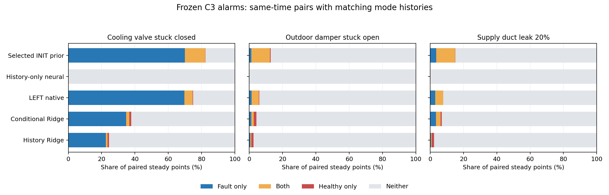

# G36同天气、同时刻健康—故障配对诊断

## 结论与技术取舍

**当前方法研发应优先解决异常判据的故障特异性：正常运行状态变化也会造成高分，真正由故障新增的持续报警很少。** 对新学习方法，正常跨日泛化仍是必要前提；本次step0候选没有满足此前提，不能从其成绩推断条件学习能力。没有证据支持把主要长漏检统一归因于任务在现有变量上完全不可观测。

这不证明只修改评分公式就能成功，不证明新网络必然能把所有弱差异分开。本轮没有训练、推理、重新校准或构造新检测器；没有把健康副本分数相减后当作可部署异常分数。不启动任何新候选。

## 配对范围与定义

- 原始四CSV、保存的全部五方法QUERY分数、原阈值逐字节保持。外部干湿球温度逐点相同，原索引及300秒采样轴相同，没有平移或补齐。
- QUERY每run7954点；注入区间7921点，原稳态内段从注入一小时后开始、7909点。全部区间结果保留。
- 当前模式不一致位置每个故障12点，逐点另表。过去至当前52点输入窗口存在模式差异的注入点，分别573/573/624点；这些不能因当前模式已经相同就称完整上下文一致。
- 主诊断表使用稳态且52点模式历史一致的7348/7348/7297点；原全部区间及不一致子组都保留，**不是重定义测试集或删除不利事件**。模式一致也不代表故障影响后的温度、流量等内生历史一致。
- 原始strict报警及第三点起生效的C3各自分为：仅故障报警、健康与故障同时报警、仅健康报警、均不报警。分组前先在完整连续轴计算C3，不拼接分组点。
- “仅故障报警”是同一时刻配对特异性诊断，不是新增部署规则。“同时报警”说明健康副本也有报警代价，**不能据此证明两次报警完全由同一原因产生**。

## 持续报警中有多少是故障特异的

下表每格为“仅故障C3报警覆盖 / 健康与故障共同C3报警覆盖”，分母为各自模式历史一致的稳态配对点。

| 方法 | 冷却阀卡闭 | 外气风阀卡全开 | 供风管泄漏20% |
|---|---:|---:|---:|
| 条件候选实际初始化先验 | 70.060% / 12.194% | 1.211% / 11.159% | 3.563% / 11.306% |
| 去条件神经对照 | 0.027% / 0% | 0% / 0% | 0% / 0% |
| 原生LEFT | 69.761% / 4.899% | 1.361% / 4.450% | 3.001% / 4.879% |
| 条件Ridge | 34.676% / 1.946% | 1.225% / 1.443% | 3.495% / 2.768% |
| 历史Ridge | 22.578% / 0.925% | 0.640% / 0.626% | 0.384% / 0.425% |

明确的正项是冷却阀故障：LEFT有69.76%的故障独有持续报警，条件Ridge也超过历史Ridge，不能称所有故障均无有效证据。

另外两个故障不同。LEFT的风阀/风管C3报警中，**76.58%/61.91%同时发生在健康副本上**；初始化先验对应90.21%/76.04%。因此此前部分“覆盖增加”伴随共同正常背景报警，不能全部归因故障识别。条件Ridge虽有新增特异报警，但仍只有1.22%/3.49%的长段特异覆盖。

问题不局限于开关边界。排除既定±30分钟正常切换邻域后，LEFT风阀/风管仅故障C3覆盖仍只有1.14%/2.97%，共同覆盖为4.71%/5.15%。在同模式占用期，LEFT两者特异覆盖3.19%/8.06%，共同覆盖12.31%/13.37%。不能只修三连规则或只把切换瞬间剔除来宣称解决。

完整四象限、strict/C3、所有区间、占用/非占用、模式不一致及最长无特异报警区间均在`paired_alarms.csv`。这些分组互有重叠，不当作独立样本相加或做显著性宣称。

## 持续不可观测：严格结论与不能越过的边界

没有发现任何一个故障存在**完整52点、全部9个实际输入通道逐值相同**的评分窗口，计数均为0。在整个注入期间，四个响应当前值完全相同的点仅5/2/1点，最长样本暴露分别25/5/5分钟，没有小时级持续区间。用故障注入前实际健康—故障复制差异的逐通道上界 `[0 K,0 K,0 kg/s,0.06 Pa]` 作数值参照，仍没有完整52点响应及模式都落在该上界内的区间。

这一参照只是模拟求解/归档差异，**不是传感器噪声、物理容差或新报警阈值**。没有重复健康模拟或仪器噪声依据，不能把任何小于任意百分比的差异自动标成“不可观测”。输入不完全相同也不等于存在实际可靠分类器。

可确认的是部分通道在非占用期很弱，而不是整个任务没有观测差异：

| 场景与同模式阶段 | 供风温度平均绝对差(K) | 混风温度差(K) | 流量差(kg/s) | 静压差(Pa) |
|---|---:|---:|---:|---:|
| 风阀故障，占用 | 0.544 | 1.237 | 0.1384 | 26.758 |
| 风阀故障，非占用 | 0.460 | 0.134 | 0.000061 | 0.030 |
| 风管故障，占用 | 0.793 | 0.858 | 0.7462 | 42.152 |
| 风管故障，非占用 | 0.966 | 0.237 | 0.000620 | 0.0077 |

所以非占用期的流量/静压弱可观测性应作为任务边界；温度仍有配对偏移。不能把这些温差自动解释为可与全部正常波动分开的故障信号。以上健康副本只用于事后观测诊断，从未进入模型训练或故障评分。

## 正常泛化、预测吸收与异常判据的区别

本轮所有权重冻结。保存的Ridge预测允许直接分解 `Δ残差 = Δ观测 − Δ预测`，无需重新推理。

- 冷却阀的条件/历史Ridge残差配对RMS，分别为观测配对RMS的0.329/0.231，说明冻结预测随故障后历史一起变化，削弱了一部分响应差异。这不是在线重新学习异常。
- 但风阀的对应比例1.079/1.001，风管为0.937/0.683。因此**“预测把所有故障都吸收掉”不成立**，不能据此自动复活旧关系路由或另造通用根因。
- 已训练history-only神经模型在冷却阀97.55%的配对点上，故障分数高于健康分数，但特异C3覆盖仅0.027%。有相对排序信息不等于在原合法CAL工作点有可用持续证据；没有据此重新拟合阈值。
- 本轮full仍是step0先验，不能借其正项讨论“学会了条件关系”。已确认的正常SELECT泛化失败保持原结论。

**优先级决定：异常判据的故障特异性为当前方法问题，正常泛化是新学习机制必须先具备的能力，局部弱可观测性限定可声称的检测范围。** 不能将三者合并成“阈值不好”或“数据完全无效”。下一项方法决策若继续，必须针对已观察到的正常背景与故障新增偏离混在同一分数中的问题；本轮不选择结构、不拟合新分数、不启动模型。

## 复现与交付

源码`src/hybrid_tsad/g36_paired_diagnostic.py`；4项时间窗口/四象限/C3测试通过。CPU配对计算约1.06秒，GPU0、训练0、前向0、阈值重拟合0。原30组逐故障strict/C3覆盖与旧评价一致，330组分层四象限计数守恒；这是主Agent交叉检查，不冒称新的独立审稿。全部输入SHA在运行前后相同。

原始派生结果：`research_workspace/analysis/g36_paired_response_20261115_v1/`，包括`RULES.json`、`RECEIPT.json`、`paired_alarms.csv`、`paired_observations.csv`、`mode_mismatch_points.csv`、`continuous_intervals.csv`、`ridge_prediction_response_decomposition.csv`和三个逐点配对NPZ。

这是同模拟器、同天气的三个相关仿真情景；不冒充真实独立故障确认，也不将后验配对诊断当作Hybrid新增方法贡献。
