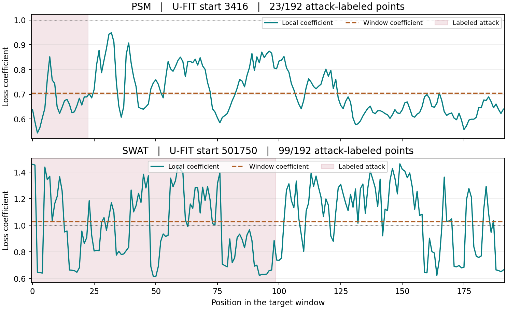

# Local versus window-level reliability in multisource LEFT replay

## Matched mixed-target detection

One development seed, 2,000 Adam steps, fixed endpoint and unchanged native full-window scores. PSM uses [22656,87744) and SWaT [608535,944856). Baseline banks and the [public detection table](../left_multisource_20261126/RESULTS.md) are reused. U-FIT weights use 6,144,000 time-position presentations in each condition, including repeated windows; the estimator receives no target annotations, CAL or QUERY scores.

| method | condition | PSM AP | PSM ROC-AUC | PSM VUS-PR | PSM VUS-ROC | SWAT AP | SWAT ROC-AUC | SWAT VUS-PR | SWAT VUS-ROC |
| --- | --- | --- | --- | --- | --- | --- | --- | --- | --- |
| Frozen multisource LEFT | ref | 0.5043 | 0.7200 | 0.5159 | 0.7313 | 0.7914 | 0.8423 | 0.6307 | 0.7341 |
| Random-init target U | ref | 0.5809 | 0.7392 | 0.5743 | 0.7502 | 0.7882 | 0.8422 | 0.6338 | 0.7414 |
| Source continuation | ref | 0.5241 | 0.7299 | 0.5346 | 0.7431 | 0.7897 | 0.8429 | 0.6291 | 0.7368 |
| Target U | A | 0.5770 | 0.7579 | 0.5850 | 0.7715 | 0.7800 | 0.8417 | 0.6332 | 0.7447 |
| Source replay | A | 0.5919 | 0.7556 | 0.5920 | 0.7717 | 0.7861 | 0.8420 | 0.6338 | 0.7403 |
| Window-weighted replay | A | 0.5949 | 0.7625 | 0.5940 | 0.7770 | 0.7872 | 0.8420 | 0.6318 | 0.7384 |
| Local-weighted replay | A | 0.5977 | 0.7629 | 0.5971 | 0.7782 | 0.7872 | 0.8421 | 0.6319 | 0.7384 |
| Target U | B | 0.5265 | 0.7402 | 0.5474 | 0.7551 | 0.7784 | 0.8387 | 0.6349 | 0.7490 |
| Source replay | B | 0.5754 | 0.7328 | 0.5766 | 0.7498 | 0.7806 | 0.8418 | 0.6327 | 0.7444 |
| Window-weighted replay | B | 0.5957 | 0.7573 | 0.5946 | 0.7728 | 0.7845 | 0.8426 | 0.6338 | 0.7432 |
| Local-weighted replay | B | 0.5943 | 0.7588 | 0.5941 | 0.7741 | 0.7847 | 0.8426 | 0.6331 | 0.7428 |
| Target U | C | 0.5775 | 0.7638 | 0.5862 | 0.7763 | 0.7800 | 0.8418 | 0.6336 | 0.7449 |
| Source replay | C | 0.5960 | 0.7570 | 0.5958 | 0.7730 | 0.7861 | 0.8418 | 0.6326 | 0.7394 |
| Window-weighted replay | C | 0.6002 | 0.7653 | 0.5988 | 0.7797 | 0.7872 | 0.8421 | 0.6319 | 0.7378 |
| Local-weighted replay | C | 0.6027 | 0.7651 | 0.6009 | 0.7798 | 0.7873 | 0.8422 | 0.6319 | 0.7378 |

At fixed target mass, local weighting improved all four ranking measures over window weighting on naturally mixed PSM. At the abnormal-replacement endpoint it gave back PR performance relative to window weighting, while improving ROC-AUC and VUS-ROC. SWaT's natural AP difference was 0.000005, and neither weighted arm recovered frozen-source AP. Both domains assigned more weight to the nominal part of mixed windows. The detection comparisons support retaining the allocation observation and the PSM result, without promoting the local scheme as a demonstrated improvement over window weighting across conditions.

## Exposure responses

B and C replace the same 3,200 shared target slots with fully anomalous or fully nominal donor windows from U-FIT. This is 5% of all training-window presentations. The interaction subtracts the comparator's B−C response from the named method's response. Positive ranking differences favor the first method. [All A/B/C and frozen-source contrasts](contrasts.csv).

| domain | comparison | AP | ROC_AUC | VUS_PR | VUS_ROC |
| --- | --- | --- | --- | --- | --- |
| PSM | ordinary B-C | -0.051026 | -0.023616 | -0.038787 | -0.021156 |
| PSM | replay B-C | -0.020624 | -0.024195 | -0.019292 | -0.023250 |
| PSM | window B-C | -0.004491 | -0.007971 | -0.004199 | -0.006899 |
| PSM | local A - Z | 0.093445 | 0.042930 | 0.081247 | 0.046905 |
| PSM | local B-C | -0.008482 | -0.006277 | -0.006858 | -0.005623 |
| PSM | window-replay A | 0.002909 | 0.006894 | 0.001995 | 0.005360 |
| PSM | window-replay B | 0.020367 | 0.024533 | 0.018039 | 0.022999 |
| PSM | window-replay interaction | 0.016132 | 0.016224 | 0.015093 | 0.016351 |
| PSM | local-replay A | 0.005795 | 0.007383 | 0.005088 | 0.006545 |
| PSM | local-replay B | 0.018885 | 0.026019 | 0.017536 | 0.024360 |
| PSM | local-replay interaction | 0.012142 | 0.017918 | 0.012434 | 0.017627 |
| PSM | local-window A | 0.002886 | 0.000489 | 0.003093 | 0.001185 |
| PSM | local-window B | -0.001481 | 0.001487 | -0.000503 | 0.001361 |
| PSM | local-window interaction | -0.003991 | 0.001694 | -0.002659 | 0.001276 |
| SWAT | ordinary B-C | -0.001546 | -0.003057 | 0.001281 | 0.004134 |
| SWAT | replay B-C | -0.005484 | -0.000004 | 0.000133 | 0.005041 |
| SWAT | window B-C | -0.002732 | 0.000555 | 0.001952 | 0.005398 |
| SWAT | local A - Z | -0.004141 | -0.000235 | 0.001222 | 0.004335 |
| SWAT | local B-C | -0.002574 | 0.000457 | 0.001160 | 0.004973 |
| SWAT | window-replay A | 0.001063 | 0.000070 | -0.001994 | -0.001896 |
| SWAT | window-replay B | 0.003856 | 0.000770 | 0.001063 | -0.001231 |
| SWAT | window-replay interaction | 0.002752 | 0.000558 | 0.001819 | 0.000357 |
| SWAT | local-replay A | 0.001068 | 0.000119 | -0.001928 | -0.001851 |
| SWAT | local-replay B | 0.004079 | 0.000768 | 0.000343 | -0.001584 |
| SWAT | local-replay interaction | 0.002910 | 0.000461 | 0.001028 | -0.000068 |
| SWAT | local-window A | 0.000005 | 0.000048 | 0.000066 | 0.000045 |
| SWAT | local-window B | 0.000223 | -0.000002 | -0.000720 | -0.000353 |
| SWAT | local-window interaction | 0.000159 | -0.000097 | -0.000791 | -0.000425 |

## Allocation of the target weight budget

The two allocations have the same mean coefficient in each window. The local arm varies coefficients only on the original 192-point grid. Coarse scales and the spectral cycle receive the window mean in both arms. Coefficients are not probabilities of health or measurements of gradient contribution.

Average target coefficients by window class (shared by both arms). A coefficient of one is the target minibatch average.

| domain | condition | fully_abnormal | fully_normal | partial |
| --- | --- | --- | --- | --- |
| PSM | A | 0.6930 | 1.0451 | 0.9038 |
| PSM | B | 0.7264 | 1.0747 | 0.9358 |
| PSM | C | 0.6891 | 1.0402 | 0.9002 |
| SWAT | A | 0.7939 | 1.0173 | 0.7965 |
| SWAT | B | 0.8098 | 1.0385 | 0.8199 |
| SWAT | C | 0.7931 | 1.0154 | 0.7963 |

Position-level coefficients pooled over all target exposures, grouped by the public point label.

| domain | condition | position | window_exposures | positions | window_weight | local_weight | local_minus_window |
| --- | --- | --- | --- | --- | --- | --- | --- |
| PSM | A | normal | 32000 | 5500741 | 1.0290 | 1.0343 | 0.0052 |
| PSM | A | abnormal | 32000 | 643259 | 0.7517 | 0.7069 | -0.0448 |
| PSM | B | normal | 32000 | 4952210 | 1.0591 | 1.0645 | 0.0053 |
| PSM | B | abnormal | 32000 | 1191790 | 0.7542 | 0.7320 | -0.0222 |
| PSM | C | normal | 32000 | 5566610 | 1.0261 | 1.0308 | 0.0047 |
| PSM | C | abnormal | 32000 | 577390 | 0.7482 | 0.7032 | -0.0451 |
| SWAT | A | normal | 32000 | 5781091 | 1.0133 | 1.0138 | 0.0005 |
| SWAT | A | abnormal | 32000 | 362909 | 0.7881 | 0.7801 | -0.0080 |
| SWAT | B | normal | 32000 | 5202421 | 1.0346 | 1.0352 | 0.0005 |
| SWAT | B | abnormal | 32000 | 941579 | 0.8086 | 0.8057 | -0.0029 |
| SWAT | C | normal | 32000 | 5816821 | 1.0120 | 1.0124 | 0.0005 |
| SWAT | C | abnormal | 32000 | 327179 | 0.7872 | 0.7791 | -0.0081 |

Within partially anomalous target windows:

| domain | condition | position | window_exposures | positions | window_weight | local_weight | local_minus_window | window_fraction_local_above_uniform |
| --- | --- | --- | --- | --- | --- | --- | --- | --- |
| PSM | A | normal | 7181 | 969349 | 0.9539 | 0.9836 | 0.0298 | 0.7258 |
| PSM | A | abnormal | 7181 | 409403 | 0.7853 | 0.7148 | -0.0705 | 0.2742 |
| PSM | B | normal | 6463 | 872018 | 0.9864 | 1.0168 | 0.0304 | 0.7294 |
| PSM | B | abnormal | 6463 | 368878 | 0.8163 | 0.7445 | -0.0718 | 0.2706 |
| PSM | C | normal | 6463 | 872018 | 0.9504 | 0.9802 | 0.0298 | 0.7286 |
| PSM | C | abnormal | 6463 | 368878 | 0.7816 | 0.7111 | -0.0705 | 0.2714 |
| SWAT | A | normal | 1221 | 114979 | 0.8175 | 0.8428 | 0.0253 | 0.7158 |
| SWAT | A | abnormal | 1221 | 119453 | 0.7763 | 0.7519 | -0.0244 | 0.2842 |
| SWAT | B | normal | 1097 | 102517 | 0.8421 | 0.8684 | 0.0264 | 0.7156 |
| SWAT | B | abnormal | 1097 | 108107 | 0.7990 | 0.7740 | -0.0250 | 0.2844 |
| SWAT | C | normal | 1097 | 102517 | 0.8185 | 0.8442 | 0.0257 | 0.7147 |
| SWAT | C | abnormal | 1097 | 108107 | 0.7752 | 0.7508 | -0.0244 | 0.2853 |

The last column is the fraction of partially anomalous window presentations whose positions of that label have a higher mean local coefficient than the uniform window coefficient (numerical tolerance 1e-7). Repeated windows count. [Full-window classes and pooled normal/abnormal positions](weights_by_label.csv).

Each panel uses natural A and the first presented partial window closest to its domain's median number of anomalous positions among partial exposures. Public labels enter this illustration and the allocation analysis after sealing all detection banks.

## Operating costs at historical mixed CAL

| domain | method | condition | normal_FPR | Recall | normal_alarm_fragments | M | Ntrue | auxiliary_any_hit_events | one_to_one_eventF1 | long_steady_macro_coverage | long_steady_point_coverage | max_event_miss_points |
| --- | --- | --- | --- | --- | --- | --- | --- | --- | --- | --- | --- | --- |
| PSM | replay | A | 0.1289 | 0.4586 | 295 | 21 | 48 | 22 | 0.0977 | 0.6709 | 0.8424 | 397 |
| SWAT | replay | A | 0.6291 | 0.9175 | 270 | 10 | 22 | 19 | 0.0712 | 0.5783 | 0.9654 | 1000 |
| PSM | replay | B | 0.1525 | 0.4932 | 337 | 24 | 48 | 24 | 0.1026 | 0.7207 | 0.8670 | 399 |
| PSM | replay | C | 0.1256 | 0.4578 | 283 | 21 | 48 | 22 | 0.0998 | 0.6628 | 0.8405 | 397 |
| SWAT | replay | B | 0.5387 | 0.7987 | 659 | 14 | 22 | 19 | 0.0377 | 0.2854 | 0.8598 | 2018 |
| SWAT | replay | C | 0.6554 | 0.9175 | 504 | 10 | 22 | 19 | 0.0388 | 0.5798 | 0.9655 | 1000 |
| PSM | window | A | 0.1238 | 0.4459 | 263 | 20 | 48 | 21 | 0.0998 | 0.6628 | 0.8374 | 397 |
| PSM | window | B | 0.1341 | 0.4694 | 313 | 21 | 48 | 22 | 0.0935 | 0.6833 | 0.8475 | 397 |
| PSM | window | C | 0.1243 | 0.4526 | 278 | 20 | 48 | 21 | 0.0950 | 0.6679 | 0.8402 | 397 |
| PSM | local | A | 0.1167 | 0.4360 | 264 | 20 | 48 | 21 | 0.1015 | 0.6487 | 0.8312 | 409 |
| PSM | local | B | 0.1319 | 0.4652 | 319 | 21 | 48 | 22 | 0.0927 | 0.6767 | 0.8462 | 397 |
| PSM | local | C | 0.1151 | 0.4428 | 286 | 20 | 48 | 21 | 0.0959 | 0.6566 | 0.8351 | 409 |
| SWAT | window | A | 0.6699 | 0.9178 | 160 | 9 | 22 | 20 | 0.1040 | 0.5843 | 0.9658 | 999 |
| SWAT | window | B | 0.6060 | 0.8384 | 257 | 12 | 22 | 19 | 0.0879 | 0.5677 | 0.8811 | 1441 |
| SWAT | window | C | 0.6750 | 0.9178 | 341 | 8 | 22 | 20 | 0.0452 | 0.5849 | 0.9659 | 999 |
| SWAT | local | A | 0.6705 | 0.9178 | 182 | 8 | 22 | 20 | 0.0821 | 0.5849 | 0.9659 | 999 |
| SWAT | local | B | 0.6064 | 0.8384 | 263 | 12 | 22 | 19 | 0.0860 | 0.5677 | 0.8812 | 1440 |
| SWAT | local | C | 0.6789 | 0.9178 | 280 | 8 | 22 | 20 | 0.0546 | 0.5860 | 0.9659 | 999 |

Each method uses its own strict-exceedance threshold from the same 512 CAL points (higher q99). All 512 PSM CAL labels and 38 SWaT CAL labels are attacks. These retrospective operating points do not certify a normal false-positive budget. [All strict and confirmed results](operations.csv), [operating contrasts](operating_contrasts.csv), [event details](events.csv).

## Verification and compute

Checks cover native all-one loss and parameter gradients, nonuniform local versus window gradients, per-window and batch budgets, tied score ranks checked by independent strict/inclusive counts, checkpoint identities, AP/ROC and CAL confusion counts. VUS and event matching use the established implementations. Per-stage elapsed seconds and model fingerprints are archived. [Costs](costs.csv), [training and score receipts](receipts.json), [CPU readback](review.json).
