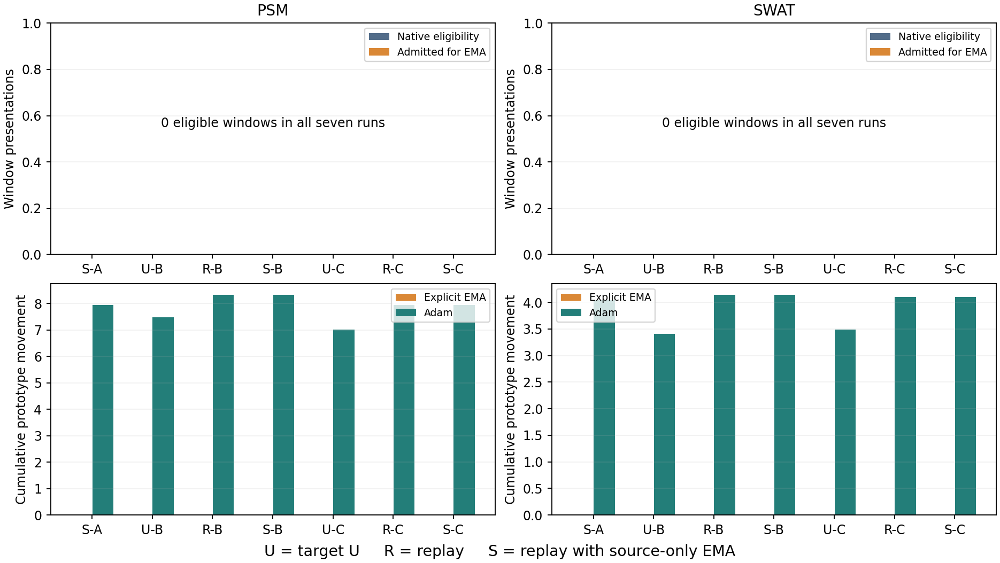

# Does restricting explicit prototype writes protect mixed-target adaptation?

## Absolute detection on the fixed target suffix

All rows use native LEFT retrospective W192 scores and the same points within each task. PSM covers [22656,87744), SWaT [608535,944856). The official target normal prefix supplies the scaler. Fourteen new seed-2025 fits start from the archived width-specific source models. Target U and ordinary replay under A, and the three reference rows, reuse earlier banks. [Complete public benchmark](../left_multisource_20261126/RESULTS.md).

| method | condition | PSM AP | PSM ROC-AUC | PSM VUS-PR | PSM VUS-ROC | SWAT AP | SWAT ROC-AUC | SWAT VUS-PR | SWAT VUS-ROC |
| --- | --- | --- | --- | --- | --- | --- | --- | --- | --- |
| Frozen source LEFT | ref | 0.5043 | 0.7200 | 0.5159 | 0.7313 | 0.7914 | 0.8423 | 0.6307 | 0.7341 |
| Random-init target U | ref | 0.5809 | 0.7392 | 0.5743 | 0.7502 | 0.7882 | 0.8422 | 0.6338 | 0.7414 |
| Source continuation | ref | 0.5241 | 0.7299 | 0.5346 | 0.7431 | 0.7897 | 0.8429 | 0.6291 | 0.7368 |
| Target U | A | 0.5770 | 0.7579 | 0.5850 | 0.7715 | 0.7800 | 0.8417 | 0.6332 | 0.7447 |
| Source replay | A | 0.5919 | 0.7556 | 0.5920 | 0.7717 | 0.7861 | 0.8420 | 0.6338 | 0.7403 |
| Replay with source-only EMA | A | 0.5919 | 0.7556 | 0.5920 | 0.7717 | 0.7862 | 0.8420 | 0.6338 | 0.7403 |
| Target U | B | 0.5265 | 0.7402 | 0.5474 | 0.7551 | 0.7784 | 0.8387 | 0.6349 | 0.7490 |
| Source replay | B | 0.5754 | 0.7328 | 0.5766 | 0.7498 | 0.7806 | 0.8418 | 0.6327 | 0.7444 |
| Replay with source-only EMA | B | 0.5753 | 0.7328 | 0.5766 | 0.7498 | 0.7806 | 0.8418 | 0.6327 | 0.7444 |
| Target U | C | 0.5775 | 0.7638 | 0.5862 | 0.7763 | 0.7800 | 0.8418 | 0.6336 | 0.7449 |
| Source replay | C | 0.5960 | 0.7570 | 0.5958 | 0.7730 | 0.7861 | 0.8418 | 0.6326 | 0.7394 |
| Replay with source-only EMA | C | 0.5960 | 0.7570 | 0.5958 | 0.7730 | 0.7861 | 0.8418 | 0.6326 | 0.7394 |

## Controlled exposure

A uses natural U-FIT. B and C replace the same 3,200 of 32,000 shared target slots, respectively with wholly attack-labeled or wholly normal-labeled W192 windows from U-FIT. This replaces 5% of all 64,000 window presentations. Source and second target streams are untouched. Data construction used public labels; learners consumed numeric starts and values. Eligibility does not match operating conditions between donors.

| domain | comparison | AP | ROC_AUC | VUS_PR | VUS_ROC |
| --- | --- | --- | --- | --- | --- |
| PSM | ordinary B-C | -0.051026 | -0.023616 | -0.038787 | -0.021156 |
| PSM | replay B-C | -0.020624 | -0.024195 | -0.019292 | -0.023250 |
| PSM | restricted B-C | -0.020692 | -0.024226 | -0.019228 | -0.023205 |
| PSM | restricted-replay A | 0.000004 | -0.000001 | 0.000013 | 0.000001 |
| PSM | restricted-replay B | -0.000073 | -0.000031 | 0.000040 | 0.000041 |
| PSM | restricted-replay interaction | -0.000068 | -0.000031 | 0.000064 | 0.000045 |
| PSM | replay-ordinary B | 0.048907 | -0.007421 | 0.029139 | -0.005365 |
| PSM | replay-ordinary interaction | 0.030403 | -0.000579 | 0.019495 | -0.002094 |
| SWAT | ordinary B-C | -0.001546 | -0.003057 | 0.001281 | 0.004134 |
| SWAT | replay B-C | -0.005484 | -0.000004 | 0.000133 | 0.005041 |
| SWAT | restricted B-C | -0.005506 | -0.000011 | 0.000089 | 0.005032 |
| SWAT | restricted-replay A | 0.000006 | -0.000000 | 0.000001 | -0.000001 |
| SWAT | restricted-replay B | -0.000025 | -0.000009 | -0.000059 | -0.000011 |
| SWAT | restricted-replay interaction | -0.000022 | -0.000008 | -0.000043 | -0.000009 |
| SWAT | replay-ordinary B | 0.002191 | 0.003113 | -0.002150 | -0.004626 |
| SWAT | replay-ordinary interaction | -0.003939 | 0.003053 | -0.001149 | 0.000907 |

On PSM, ordinary replay reduced the AP loss under B versus C from 0.05103 to 0.02062. Its B AP also exceeded target-only U by 0.04891, although both ROC measures fell under B and showed no analogous protection. On SWaT the absolute B AP difference still favored replay by 0.00219, but replay suffered a larger B−C AP decline than target-only U. Restricting EMA writes added no demonstrable protection in either domain.

PSM has 649 eligible abnormal starts across five events; 3,200 draws used 645 distinct starts. SWaT has 3,468 eligible starts across nine events; the same number of draws used 2,094 distinct starts. The C draws used 2,826 and 3,126 distinct nominal starts, respectively. A repeated slot or donor is a presentation, not another event. The point fractions below use all 64,000 windows, counting source slots under their normal training role.

| domain | arm | presentations | fully_anomalous | partially_anomalous | overlapping_U_events | attack_point_fraction_all_slots |
| --- | --- | --- | --- | --- | --- | --- |
| PSM | restricted_A | 32000 | 1218 | 7181 | 22 | 0.0523 |
| PSM | ordinary_B | 64000 | 5517 | 13700 | 22 | 0.1494 |
| PSM | replay_B | 32000 | 4286 | 6463 | 22 | 0.0970 |
| PSM | restricted_B | 32000 | 4286 | 6463 | 22 | 0.0970 |
| PSM | ordinary_C | 64000 | 2317 | 13700 | 22 | 0.0994 |
| PSM | replay_C | 32000 | 1086 | 6463 | 22 | 0.0470 |
| PSM | restricted_C | 32000 | 1086 | 6463 | 22 | 0.0470 |
| PSM | ordinary_A | 64000 | 2449 | 14418 | 22 | 0.1047 |
| PSM | replay_A | 32000 | 1218 | 7181 | 22 | 0.0523 |
| SWAT | restricted_A | 32000 | 1268 | 1221 | 9 | 0.0295 |
| SWAT | ordinary_B | 64000 | 5569 | 2292 | 9 | 0.1051 |
| SWAT | replay_B | 32000 | 4341 | 1097 | 9 | 0.0766 |
| SWAT | restricted_B | 32000 | 4341 | 1097 | 9 | 0.0766 |
| SWAT | ordinary_C | 64000 | 2369 | 2292 | 9 | 0.0551 |
| SWAT | replay_C | 32000 | 1141 | 1097 | 9 | 0.0266 |
| SWAT | restricted_C | 32000 | 1141 | 1097 | 9 | 0.0266 |
| SWAT | ordinary_A | 64000 | 2496 | 2416 | 9 | 0.0580 |
| SWAT | replay_A | 32000 | 1268 | 1221 | 9 | 0.0295 |

Interaction is the difference between the two B−C responses in the order shown. A positive interaction can coexist with a lower absolute B score. [All direct contrasts, B−A and C−A](contamination.csv).

## Source and target windows admitted for explicit writes

Across the 28,000 newly observed updates, neither the ordinary full-batch filter nor the restricted write rule admitted a window. The explicit EMA displacement was zero in both prototype banks. The banks moved through Adam in every run. Thus the B/C comparison varies the data reaching the gradient update, but supplies no instance of a harmful native write that the restriction prevented. Small numerical ranking differences between the two replay implementations cannot establish a benefit of changing write permissions.

The native filter requires low reconstruction error and low time/frequency assignment JS divergence (within the native 0.30 quantiles) and both native confidence tests (at least 0.85). Restricted replay computes the two effective cutoffs on slots 16–31 and admits only qualified source slots. Native-filter columns describe the full-batch rule on the same forward, including its shadow value for restricted replay. Adam still sees all samples. EMA momentum is 0.99. Each active step calls one hard update per bank. Archived ordinary A and replay A have no per-window selection traces; their counts are unavailable.

| domain | arm | native_target | native_source | written_target | written_source | ema_write_steps | no_write_steps | t_ema_total | f_ema_total | t_adam_total | f_adam_total |
| --- | --- | --- | --- | --- | --- | --- | --- | --- | --- | --- | --- |
| PSM | restricted_A | 0 | 0 | 0 | 0 | 0 | 2000 | 0.0000 | 0.0000 | 4.1007 | 3.8413 |
| PSM | ordinary_B | 0 | 0 | 0 | 0 | 0 | 2000 | 0.0000 | 0.0000 | 3.8855 | 3.5904 |
| PSM | replay_B | 0 | 0 | 0 | 0 | 0 | 2000 | 0.0000 | 0.0000 | 4.3008 | 4.0303 |
| PSM | restricted_B | 0 | 0 | 0 | 0 | 0 | 2000 | 0.0000 | 0.0000 | 4.3001 | 4.0301 |
| PSM | ordinary_C | 0 | 0 | 0 | 0 | 0 | 2000 | 0.0000 | 0.0000 | 3.6710 | 3.3416 |
| PSM | replay_C | 0 | 0 | 0 | 0 | 0 | 2000 | 0.0000 | 0.0000 | 4.1058 | 3.8447 |
| PSM | restricted_C | 0 | 0 | 0 | 0 | 0 | 2000 | 0.0000 | 0.0000 | 4.1059 | 3.8449 |
| SWAT | restricted_A | 0 | 0 | 0 | 0 | 0 | 2000 | 0.0000 | 0.0000 | 2.0407 | 2.0050 |
| SWAT | ordinary_B | 0 | 0 | 0 | 0 | 0 | 2000 | 0.0000 | 0.0000 | 1.7492 | 1.6612 |
| SWAT | replay_B | 0 | 0 | 0 | 0 | 0 | 2000 | 0.0000 | 0.0000 | 2.0901 | 2.0548 |
| SWAT | restricted_B | 0 | 0 | 0 | 0 | 0 | 2000 | 0.0000 | 0.0000 | 2.0900 | 2.0547 |
| SWAT | ordinary_C | 0 | 0 | 0 | 0 | 0 | 2000 | 0.0000 | 0.0000 | 1.7794 | 1.7100 |
| SWAT | replay_C | 0 | 0 | 0 | 0 | 0 | 2000 | 0.0000 | 0.0000 | 2.0666 | 2.0319 |
| SWAT | restricted_C | 0 | 0 | 0 | 0 | 0 | 2000 | 0.0000 | 0.0000 | 2.0665 | 2.0317 |

Movement sums the Frobenius norm of consecutive substep displacements, separately for each bank. The [full table](mechanism.csv) also gives start-to-end drift and actual labeled point exposure. [Window and event composition](selection_composition.csv) distinguishes full, partial and zero overlap, distinct starts and distinct observed event intervals. Summaries were joined only after sealing all 28 CAL/QUERY banks.

## Three-consecutive-point operating results

| domain | arm | normal_FPR | Recall | normal_alarm_fragments | M | Ntrue | auxiliary_any_hit_events | one_to_one_eventF1 | long_steady_macro_coverage | long_steady_point_coverage | max_event_miss_points |
| --- | --- | --- | --- | --- | --- | --- | --- | --- | --- | --- | --- |
| PSM | source | 0.1627 | 0.4715 | 267 | 23 | 48 | 27 | 0.1237 | 0.7427 | 0.8659 | 399 |
| PSM | ordinary | 0.1339 | 0.4707 | 311 | 21 | 48 | 23 | 0.0938 | 0.6742 | 0.8595 | 397 |
| PSM | replay | 0.1289 | 0.4586 | 295 | 21 | 48 | 22 | 0.0977 | 0.6709 | 0.8424 | 397 |
| PSM | random_u | 0.1924 | 0.5626 | 384 | 26 | 48 | 27 | 0.1032 | 0.8888 | 0.9387 | 397 |
| PSM | source_only | 0.1365 | 0.4473 | 267 | 25 | 48 | 27 | 0.1351 | 0.6978 | 0.8475 | 399 |
| SWAT | source | 0.7230 | 0.9200 | 111 | 9 | 22 | 21 | 0.1385 | 0.6052 | 0.9684 | 721 |
| SWAT | ordinary | 0.5327 | 0.7948 | 541 | 13 | 22 | 18 | 0.0434 | 0.2727 | 0.8585 | 2018 |
| SWAT | replay | 0.6291 | 0.9175 | 270 | 10 | 22 | 19 | 0.0712 | 0.5783 | 0.9654 | 1000 |
| SWAT | random_u | 0.6709 | 0.9177 | 193 | 10 | 22 | 20 | 0.0976 | 0.5885 | 0.9660 | 999 |
| SWAT | source_only | 0.6953 | 0.9177 | 227 | 8 | 22 | 20 | 0.0669 | 0.5889 | 0.9661 | 996 |
| PSM | restricted_A | 0.1289 | 0.4586 | 295 | 21 | 48 | 22 | 0.0974 | 0.6709 | 0.8424 | 397 |
| PSM | ordinary_B | 0.1644 | 0.5096 | 346 | 24 | 48 | 25 | 0.0962 | 0.7245 | 0.8846 | 399 |
| PSM | replay_B | 0.1525 | 0.4932 | 337 | 24 | 48 | 24 | 0.1026 | 0.7207 | 0.8670 | 399 |
| PSM | restricted_B | 0.1525 | 0.4932 | 335 | 24 | 48 | 24 | 0.1030 | 0.7207 | 0.8670 | 399 |
| PSM | ordinary_C | 0.1345 | 0.4699 | 310 | 22 | 48 | 23 | 0.0989 | 0.6660 | 0.8551 | 397 |
| PSM | replay_C | 0.1256 | 0.4578 | 283 | 21 | 48 | 22 | 0.0998 | 0.6628 | 0.8405 | 397 |
| PSM | restricted_C | 0.1256 | 0.4578 | 283 | 21 | 48 | 22 | 0.0998 | 0.6628 | 0.8405 | 397 |
| SWAT | restricted_A | 0.6291 | 0.9175 | 270 | 10 | 22 | 19 | 0.0712 | 0.5783 | 0.9654 | 1000 |
| SWAT | ordinary_B | 0.3159 | 0.7632 | 7259 | 14 | 22 | 18 | 0.0038 | 0.2265 | 0.8572 | 2018 |
| SWAT | replay_B | 0.5387 | 0.7987 | 659 | 14 | 22 | 19 | 0.0377 | 0.2854 | 0.8598 | 2018 |
| SWAT | restricted_B | 0.5390 | 0.7989 | 680 | 14 | 22 | 19 | 0.0365 | 0.2854 | 0.8598 | 2018 |
| SWAT | ordinary_C | 0.5462 | 0.8090 | 1387 | 14 | 22 | 19 | 0.0169 | 0.3254 | 0.8657 | 2018 |
| SWAT | replay_C | 0.6554 | 0.9175 | 504 | 10 | 22 | 19 | 0.0388 | 0.5798 | 0.9655 | 1000 |
| SWAT | restricted_C | 0.6560 | 0.9175 | 468 | 10 | 22 | 19 | 0.0418 | 0.5798 | 0.9655 | 1000 |

The model-specific thresholds use the same 512 CAL points, higher q99 and strict exceedance. PSM CAL contains 512 labeled attack points and SWaT CAL 38. These historical calibration sets do not certify a normal false-alarm budget. [Strict and confirmed results](operations.csv), [operating interactions](operating_contrasts.csv), [all events](events.csv).

## Cost and replication

| domain | arm | train_s | bank_s | peak_MiB |
| --- | --- | --- | --- | --- |
| PSM | restricted_A | 76.1429 | 1.7911 | 442.4971 |
| PSM | ordinary_B | 69.5582 | 0.6568 | 442.4971 |
| PSM | replay_B | 66.3626 | 0.6538 | 442.4971 |
| PSM | restricted_B | 77.7590 | 0.6530 | 442.4971 |
| PSM | ordinary_C | 68.9618 | 0.6625 | 442.4971 |
| PSM | replay_C | 71.6333 | 0.6602 | 442.4971 |
| PSM | restricted_C | 67.7934 | 0.6578 | 442.4971 |
| SWAT | restricted_A | 80.4178 | 4.4728 | 433.0889 |
| SWAT | ordinary_B | 74.9620 | 3.3556 | 433.0889 |
| SWAT | replay_B | 80.0444 | 3.3559 | 433.0889 |
| SWAT | restricted_B | 79.4852 | 3.3531 | 433.0889 |
| SWAT | ordinary_C | 74.4916 | 3.3551 | 433.0889 |
| SWAT | replay_C | 79.0750 | 3.3607 | 433.0889 |
| SWAT | restricted_C | 79.3212 | 3.3483 | 433.0889 |

Post-seal CPU readback checked slot counts, the untouched target stream, all donor footprints, checkpoint and trace identities, raw-bank AP/ROC, fixed CAL thresholds and strict/three-confirmed confusion counts. VUS and event matching use the previously fixed implementations. [Readback values](review.json).

Train and bank seconds are elapsed on one A40 per job. The two-domain run uses one development seed. Archive paths under `results/left_memory_exposure_20261126_v1` contain the numeric plans, 14 endpoints and all score banks. [Full-bank identities and donor qualification](receipts.json), [per-step eligibility and prototype displacement](traces/).
