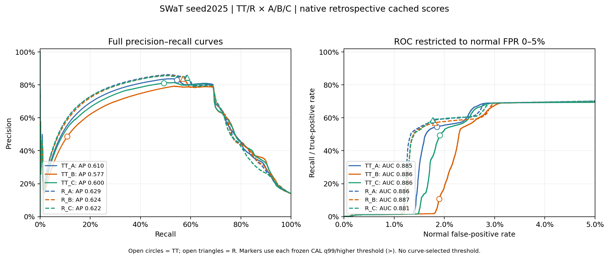
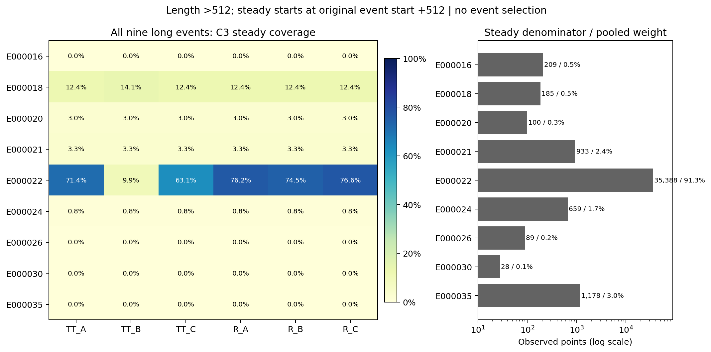

# Two-task, three-seed fixed additional-exposure replication

This task completes the fixed LEFT+source-replay R exposure comparison, without changing model, native loss,1:1 source/target composition, batch256, freshAdam1e-4,2000 updates, endpoint selection, inference or calibration. It adds exactly16 jobs: SWaT/PSM x seed2026/2027 x TT/R x B/C. Seed2025 B/C and all prior A/noU/SS assets are reused. No original model is retrained. P/V and older stopped branches remain stopped.

Each seed reuses its original accepted A sampling plan. Interventions use SeedSequence([seed,20261118,10]).spawn(3) for slots,B donors,C donors. Every arm replaces25,600 of256,000 common-T window exposure slots,5% of512,000 total exposure; B/C share slots and TT/R share corresponding donor windows. T-prime and S do not change. Current U-FIT donor pools and192-point eligibility are unchanged. Labels assist stress-condition construction only; learners see numeric normalized windows and fixed slot maps, not labels or donor/event identities.

The replication varies training and intervention sampling jointly, at fixed tasks and native initial states. Repeated/overlapping donor windows are not new independent events. Per-seed results are followed by means and sample standard deviations(ddof1,n3) of paired effects. NoU is one frozen reference with no fabricated SD. No test points, events or best seeds are pooled across domains.

Mandatory comparisons are direct RB-TTB, each arm's B-C/B-A/C-A, and I=(RB-RC)-(TTB-TTC). Positive false-positive interactions indicate increased response cost, not an absolute RB-vs-TTB comparison. Ranking, actual false alarms, strict recall, any-hit, one-to-one matching, complete-event coverage, long steady macro and pooled coverage remain separate. SWaT and PSM use their original full-window axes and512 CAL points; each model has its own q99/higher/strict-greater threshold. PSM's all-attack CAL remains unchanged and is not normal-FPR certification. All results are offline retrospective.

## Concurrent seed2025 cache explanation

The [fixed curves and event analysis](curves/CURVE_FINDINGS.md) use only accepted caches. Full PR and low-FPR ROC retain the original CAL operating points. No curves change training, deployment thresholds or CAL roles.



TT-B/C full ROC-AUC is0.885519/0.885894, while original CAL strict recall is10.829%/49.358% at observed FPR1.895%/1.906%. Similar global area hides different low-FPR rises and operating points; AP also falls for TT-B. This does not uniquely identify a training or calibration cause.



All nine predefined events are included. The [all-seed long-event table](all_seed_nine_long_events.csv) retains324 records across TT/R x A/B/C x three seeds x strict/C3 x nine events; no event or seed is selected. E000022 accounts for35,388/38,769=91.28% of steady points. Four events have zero steady coverage under every shown arm. Seed2025 pooled retention therefore cannot establish broad sustained coverage across events. [Full108 event/stream/model rows](curves/long_events_all_streams.csv), [macro/pooled values](curves/macro_pooled_summary.csv) and [original CAL operating points](curves/operating_points.csv) are retained. The full-resolution curve arrays/CSVs are retained in the external result archive; no threshold is selected from them.

## Execution identity

Default seed2025 draw logic exactly reconstructs both domains' original slot-map and B/C donor-start arrays, without repeating training. See [the reconstruction receipt](legacy_2025_rebuild_check.json). Implementation was published ateed201ebedae6451eb0bfe4c204ad3175c5d27cb before new training results. Only seed injection, fixed-plan lookup and aggregation/orchestration are extended.

## Complete three-seed results

All16 new jobs and32 score banks completed. The accepted seed2025 B/C and all three seeds of A/SS were reused; noU is one frozen initialization per task. Values below are arithmetic means +/- sample standard deviations(ddof1,n3), with noU shown once and no fabricated SD. These are adaptation plus intervention-sampling repetitions under fixed initial models and exposed tasks, not independent datasets/events or source-pretraining repetitions. Complete [per-seed tables](PER_SEED_TABLE.md) and [all88 strict/C3 rows](comparison.csv) retain every fixed model.

### Main table A: ranking and strict point operation

| Domain | Model | n | AP | ROC-AUC | VUS-PR | VUS-ROC | Strict FP points | Strict recall, % |
|---|---|---:|---:|---:|---:|---:|---:|---:|
| SWAT | noU | 1 | 0.607560 | 0.842267 | 0.606345 | 0.829634 | 5073.0 | 60.960 |
| SWAT | SS | 3 | 0.608429 +/- 0.013990 | 0.850662 +/- 0.024725 | 0.608127 +/- 0.018868 | 0.836893 +/- 0.031179 | 5253.0 +/- 102.3 | 60.409 +/- 1.162 |
| SWAT | TT-A | 3 | 0.602121 +/- 0.007345 | 0.883489 +/- 0.001959 | 0.608004 +/- 0.008918 | 0.879869 +/- 0.001540 | 5401.7 +/- 114.9 | 48.599 +/- 7.705 |
| SWAT | TT-B | 3 | 0.579275 +/- 0.001956 | 0.884994 +/- 0.000895 | 0.583105 +/- 0.001207 | 0.879829 +/- 0.001882 | 5531.3 +/- 61.3 | 15.422 +/- 5.102 |
| SWAT | TT-C | 3 | 0.591413 +/- 0.007259 | 0.883241 +/- 0.002352 | 0.595666 +/- 0.007262 | 0.878702 +/- 0.002850 | 5519.7 +/- 97.7 | 35.666 +/- 15.102 |
| SWAT | R-A | 3 | 0.628215 +/- 0.009976 | 0.889039 +/- 0.004136 | 0.633021 +/- 0.012471 | 0.884876 +/- 0.003477 | 5247.7 +/- 102.1 | 57.673 +/- 2.021 |
| SWAT | R-B | 3 | 0.626291 +/- 0.004468 | 0.890994 +/- 0.003508 | 0.630613 +/- 0.005161 | 0.886296 +/- 0.002017 | 5339.3 +/- 115.6 | 56.806 +/- 0.487 |
| SWAT | R-C | 3 | 0.626448 +/- 0.007292 | 0.888027 +/- 0.006709 | 0.631134 +/- 0.007250 | 0.883798 +/- 0.004768 | 5244.0 +/- 138.2 | 57.834 +/- 1.650 |
| PSM | noU | 1 | 0.583688 | 0.771345 | 0.575447 | 0.775647 | 7381.0 | 43.613 |
| PSM | SS | 3 | 0.575601 +/- 0.000341 | 0.763598 +/- 0.000964 | 0.571421 +/- 0.000497 | 0.771357 +/- 0.001001 | 7057.0 +/- 145.5 | 43.645 +/- 0.479 |
| PSM | TT-A | 3 | 0.571614 +/- 0.001049 | 0.732122 +/- 0.001037 | 0.561903 +/- 0.000672 | 0.739760 +/- 0.000617 | 11965.3 +/- 142.4 | 63.532 +/- 0.654 |
| PSM | TT-B | 3 | 0.579377 +/- 0.001396 | 0.740176 +/- 0.000340 | 0.568437 +/- 0.001014 | 0.746670 +/- 0.000130 | 10995.0 +/- 207.0 | 60.405 +/- 1.064 |
| PSM | TT-C | 3 | 0.571496 +/- 0.000716 | 0.731608 +/- 0.000425 | 0.562131 +/- 0.000492 | 0.739545 +/- 0.000360 | 12041.0 +/- 168.9 | 63.924 +/- 0.683 |
| PSM | R-A | 3 | 0.587530 +/- 0.000572 | 0.747381 +/- 0.000755 | 0.585520 +/- 0.000580 | 0.761011 +/- 0.000603 | 5111.7 +/- 177.7 | 41.579 +/- 0.789 |
| PSM | R-B | 3 | 0.593355 +/- 0.000286 | 0.756274 +/- 0.000082 | 0.588360 +/- 0.000261 | 0.767339 +/- 0.000093 | 5319.0 +/- 348.7 | 41.888 +/- 1.109 |
| PSM | R-C | 3 | 0.587934 +/- 0.000728 | 0.747427 +/- 0.000537 | 0.585985 +/- 0.000964 | 0.761126 +/- 0.000510 | 5126.7 +/- 230.4 | 41.716 +/- 1.029 |

### Main table B: confirmed-three-point events and persistence

One-to-one matching count M, any-hit and matching F1 are separately named. Coverage uses complete eligible events; PSM's boundary-truncated events remain only in observed point measures. Long steady state begins at original start+512 for all predefined events longer than512 points. Offsets and false-alarm fragment rates remain in the full CSV; full-window availability means they are retrospective, not causal alarm delays.

| Domain | Model | C3 FP | C3 matched M | C3 any-hit | C3 matching F1 | Complete-event coverage,% | Long macro,% | Long pooled,% | Longest missed span,points |
|---|---|---:|---:|---:|---:|---:|---:|---:|---:|
| SWAT | noU | 4324.0 | 15.00 | 15.00 | 0.0826 | 60.789 | 10.949 | 73.203 | 3074.0 |
| SWAT | SS | 4440.0 +/- 89.4 | 15.00 +/- 0.00 | 15.00 +/- 0.00 | 0.0767 +/- 0.0010 | 60.210 +/- 1.179 | 10.978 +/- 0.176 | 72.534 +/- 1.449 | 3394.0 +/- 293.3 |
| SWAT | TT-A | 4588.0 +/- 110.1 | 15.00 +/- 0.00 | 15.00 +/- 0.00 | 0.0606 +/- 0.0155 | 47.821 +/- 8.404 | 9.120 +/- 1.260 | 57.269 +/- 10.354 | 6551.0 +/- 577.0 |
| SWAT | TT-B | 4705.7 +/- 56.4 | 15.00 +/- 0.00 | 15.00 +/- 0.00 | 0.0477 +/- 0.0025 | 13.710 +/- 5.179 | 4.061 +/- 0.695 | 15.222 +/- 6.378 | 12275.0 +/- 3486.0 |
| SWAT | TT-C | 4703.3 +/- 79.4 | 15.00 +/- 0.00 | 15.00 +/- 0.00 | 0.0495 +/- 0.0008 | 34.300 +/- 15.282 | 7.151 +/- 2.197 | 40.600 +/- 18.834 | 7832.3 +/- 1751.3 |
| SWAT | R-A | 4456.0 +/- 90.3 | 15.00 +/- 0.00 | 15.00 +/- 0.00 | 0.0761 +/- 0.0028 | 57.434 +/- 2.022 | 10.561 +/- 0.302 | 69.111 +/- 2.485 | 4754.7 +/- 726.2 |
| SWAT | R-B | 4535.7 +/- 100.9 | 15.00 +/- 0.00 | 15.00 +/- 0.00 | 0.0763 +/- 0.0007 | 56.602 +/- 0.466 | 10.474 +/- 0.131 | 68.063 +/- 0.583 | 5235.3 +/- 303.7 |
| SWAT | R-C | 4458.0 +/- 126.4 | 15.00 +/- 0.00 | 15.00 +/- 0.00 | 0.0769 +/- 0.0032 | 57.581 +/- 1.642 | 10.583 +/- 0.247 | 69.292 +/- 2.031 | 4747.7 +/- 559.8 |
| PSM | noU | 6721.0 | 18.00 | 21.00 | 0.1040 | 65.710 | 65.355 | 83.902 | 399.0 |
| PSM | SS | 6351.7 +/- 152.4 | 17.00 +/- 0.00 | 20.00 +/- 0.00 | 0.0917 +/- 0.0010 | 65.381 +/- 0.527 | 65.432 +/- 1.378 | 83.897 +/- 0.497 | 399.0 +/- 0.0 |
| PSM | TT-A | 11340.0 +/- 141.3 | 20.67 +/- 0.58 | 26.33 +/- 0.58 | 0.1396 +/- 0.0019 | 80.863 +/- 0.281 | 95.242 +/- 0.507 | 97.230 +/- 0.295 | 399.0 +/- 0.0 |
| PSM | TT-B | 10346.7 +/- 235.2 | 21.00 +/- 0.00 | 22.67 +/- 1.15 | 0.1355 +/- 0.0050 | 78.593 +/- 0.535 | 91.455 +/- 1.201 | 95.084 +/- 0.659 | 399.0 +/- 0.0 |
| PSM | TT-C | 11418.3 +/- 174.6 | 21.00 +/- 1.00 | 27.00 +/- 1.00 | 0.1412 +/- 0.0041 | 81.141 +/- 0.295 | 95.791 +/- 0.479 | 97.550 +/- 0.279 | 399.0 +/- 0.0 |
| PSM | R-A | 4396.0 +/- 172.1 | 17.00 +/- 0.00 | 17.00 +/- 0.00 | 0.0902 +/- 0.0021 | 61.083 +/- 0.797 | 58.208 +/- 1.725 | 81.209 +/- 0.657 | 399.0 +/- 0.0 |
| PSM | R-B | 4606.7 +/- 328.3 | 18.00 +/- 0.00 | 18.00 +/- 0.00 | 0.0953 +/- 0.0022 | 61.193 +/- 1.008 | 59.814 +/- 1.533 | 81.480 +/- 0.615 | 399.0 +/- 0.0 |
| PSM | R-C | 4416.3 +/- 216.9 | 17.00 +/- 0.00 | 17.00 +/- 0.00 | 0.0911 +/- 0.0001 | 61.149 +/- 0.971 | 58.256 +/- 2.275 | 81.263 +/- 0.846 | 399.0 +/- 0.0 |

Strict false-positive rates/precision/F1, C3 point recall, event precision/recall, normal alarm fragments, censoring and observed/available hit offsets are retained in [comparison.csv](comparison.csv) and [all metric summaries](method_summary.csv). A mean count need not be an integer; per-seed raw counts are not pooled. NoU has n1/SD NA and SS remains source-only continuation, not a target zero-contamination counterfactual.

## Paired contamination-response table

Each difference is formed within its own seed first; its three-seed mean and sample SD are then reported. A positive FP difference is higher cost. Direct RB-TTB compares actual model operations; a positive FP interaction does not mean RB has more absolute false positives than TTB. All within-method B-C/B-A/C-A and I are retained.

### Ranking and strict operation effects

| Domain | Comparison | AP,pp | ROC,pp | Strict FP,points | Strict recall,pp |
|---|---|---:|---:|---:|---:|
| SWAT | RB-TTB | 4.7017 +/- 0.4782 | 0.6000 +/- 0.3989 | -192.0 +/- 57.7 | 41.385 +/- 5.484 |
| SWAT | TT B-C | -1.2138 +/- 0.9034 | 0.1753 +/- 0.2241 | 11.7 +/- 80.0 | -20.245 +/- 16.989 |
| SWAT | TT B-A | -2.2847 +/- 0.8995 | 0.1506 +/- 0.2534 | 129.7 +/- 78.2 | -33.177 +/- 9.498 |
| SWAT | TT C-A | -1.0709 +/- 0.1084 | -0.0247 +/- 0.1812 | 118.0 +/- 32.9 | -12.932 +/- 7.607 |
| SWAT | R B-C | -0.0156 +/- 0.2856 | 0.2967 +/- 0.3313 | 95.3 +/- 43.5 | -1.028 +/- 1.180 |
| SWAT | R B-A | -0.1924 +/- 0.6550 | 0.1955 +/- 0.2580 | 91.7 +/- 24.0 | -0.867 +/- 1.537 |
| SWAT | R C-A | -0.1767 +/- 0.5794 | -0.1012 +/- 0.3639 | -3.7 +/- 38.5 | 0.161 +/- 0.449 |
| SWAT | I | 1.1982 +/- 1.0959 | 0.1214 +/- 0.5534 | 83.7 +/- 119.1 | 19.217 +/- 16.860 |
| PSM | RB-TTB | 1.3978 +/- 0.1155 | 1.6099 +/- 0.0345 | -5676.0 +/- 201.2 | -18.516 +/- 0.840 |
| PSM | TT B-C | 0.7881 +/- 0.0725 | 0.8567 +/- 0.0173 | -1046.0 +/- 38.2 | -3.519 +/- 0.383 |
| PSM | TT B-A | 0.7763 +/- 0.1268 | 0.8054 +/- 0.0916 | -970.3 +/- 69.5 | -3.127 +/- 0.452 |
| PSM | TT C-A | -0.0118 +/- 0.0756 | -0.0514 +/- 0.1071 | 75.7 +/- 34.9 | 0.392 +/- 0.126 |
| PSM | R B-C | 0.5421 +/- 0.0991 | 0.8848 +/- 0.0618 | 192.3 +/- 145.2 | 0.172 +/- 0.233 |
| PSM | R B-A | 0.5825 +/- 0.0855 | 0.8893 +/- 0.0836 | 207.3 +/- 204.7 | 0.309 +/- 0.369 |
| PSM | R C-A | 0.0404 +/- 0.0248 | 0.0045 +/- 0.0218 | 15.0 +/- 61.6 | 0.137 +/- 0.240 |
| PSM | I | -0.2460 +/- 0.0572 | 0.0280 +/- 0.0790 | 1238.3 +/- 107.2 | 3.692 +/- 0.167 |

### Event and sustained-coverage effects

| Domain | Comparison | C3 FP,points | Matched M | Any-hit | Matching F1 | Complete-event coverage,pp | Long macro,pp | Long pooled,pp | Longest miss,points |
|---|---|---:|---:|---:|---:|---:|---:|---:|---:|
| SWAT | RB-TTB | -170.0 +/- 49.4 | 0.00 +/- 0.00 | 0.00 +/- 0.00 | 0.0286 +/- 0.0019 | 42.892 +/- 5.521 | 6.412 +/- 0.770 | 52.841 +/- 6.806 | -7039.7 +/- 3786.0 |
| SWAT | TT B-C | 2.3 +/- 66.5 | 0.00 +/- 0.00 | 0.00 +/- 0.00 | -0.0018 +/- 0.0033 | -20.590 +/- 17.474 | -3.089 +/- 2.444 | -25.379 +/- 21.536 | 4442.7 +/- 3589.5 |
| SWAT | TT B-A | 117.7 +/- 75.5 | 0.00 +/- 0.00 | 0.00 +/- 0.00 | -0.0128 +/- 0.0180 | -34.111 +/- 10.399 | -5.059 +/- 1.461 | -42.047 +/- 12.809 | 5724.0 +/- 3632.9 |
| SWAT | TT C-A | 115.3 +/- 40.5 | 0.00 +/- 0.00 | 0.00 +/- 0.00 | -0.0110 +/- 0.0147 | -13.520 +/- 7.128 | -1.969 +/- 0.985 | -16.669 +/- 8.789 | 1281.3 +/- 1231.2 |
| SWAT | R B-C | 77.7 +/- 44.2 | 0.00 +/- 0.00 | 0.00 +/- 0.00 | -0.0006 +/- 0.0028 | -0.980 +/- 1.186 | -0.110 +/- 0.147 | -1.229 +/- 1.460 | 487.7 +/- 256.2 |
| SWAT | R B-A | 79.7 +/- 25.8 | 0.00 +/- 0.00 | 0.00 +/- 0.00 | 0.0003 +/- 0.0022 | -0.832 +/- 1.557 | -0.088 +/- 0.187 | -1.048 +/- 1.902 | 480.7 +/- 427.2 |
| SWAT | R C-A | 2.0 +/- 37.0 | 0.00 +/- 0.00 | 0.00 +/- 0.00 | 0.0009 +/- 0.0017 | 0.147 +/- 0.442 | 0.022 +/- 0.065 | 0.181 +/- 0.534 | -7.0 +/- 183.0 |
| SWAT | I | 75.3 +/- 106.6 | 0.00 +/- 0.00 | 0.00 +/- 0.00 | 0.0012 +/- 0.0057 | 19.611 +/- 17.473 | 2.980 +/- 2.387 | 24.150 +/- 21.536 | -3955.0 +/- 3396.7 |
| PSM | RB-TTB | -5740.0 +/- 180.0 | -3.00 +/- 0.00 | -4.67 +/- 1.15 | -0.0402 +/- 0.0056 | -17.399 +/- 0.824 | -31.641 +/- 1.231 | -13.604 +/- 0.458 | 0.0 +/- 0.0 |
| PSM | TT B-C | -1071.7 +/- 67.1 | 0.00 +/- 1.00 | -4.33 +/- 0.58 | -0.0057 +/- 0.0013 | -2.549 +/- 0.243 | -4.337 +/- 0.740 | -2.466 +/- 0.387 | 0.0 +/- 0.0 |
| PSM | TT B-A | -993.3 +/- 102.3 | 0.33 +/- 0.58 | -3.67 +/- 0.58 | -0.0042 +/- 0.0032 | -2.271 +/- 0.276 | -3.787 +/- 0.773 | -2.146 +/- 0.403 | 0.0 +/- 0.0 |
| PSM | TT C-A | 78.3 +/- 35.7 | 0.33 +/- 0.58 | 0.67 +/- 0.58 | 0.0016 +/- 0.0022 | 0.278 +/- 0.057 | 0.549 +/- 0.113 | 0.320 +/- 0.066 | 0.0 +/- 0.0 |
| PSM | R B-C | 190.3 +/- 134.0 | 1.00 +/- 0.00 | 1.00 +/- 0.00 | 0.0042 +/- 0.0022 | 0.044 +/- 0.106 | 1.558 +/- 0.751 | 0.217 +/- 0.277 | 0.0 +/- 0.0 |
| PSM | R B-A | 210.7 +/- 198.6 | 1.00 +/- 0.00 | 1.00 +/- 0.00 | 0.0051 +/- 0.0028 | 0.111 +/- 0.243 | 1.606 +/- 0.210 | 0.271 +/- 0.099 | 0.0 +/- 0.0 |
| PSM | R C-A | 20.3 +/- 64.6 | 0.00 +/- 0.00 | 0.00 +/- 0.00 | 0.0009 +/- 0.0023 | 0.066 +/- 0.177 | 0.048 +/- 0.551 | 0.054 +/- 0.196 | 0.0 +/- 0.0 |
| PSM | I | 1262.0 +/- 80.6 | 1.00 +/- 1.00 | 5.33 +/- 0.58 | 0.0099 +/- 0.0019 | 2.593 +/- 0.137 | 5.894 +/- 1.217 | 2.683 +/- 0.480 | 0.0 +/- 0.0 |

All three individual interaction rows per domain/stream are in [interaction.csv](interaction.csv), and all84 direct/within-arm differences in [contrasts.csv](contrasts.csv). The [paired summary](paired_summary.csv) includes every preserved numeric metric, with n/n_valid and NA rather than silently dropping a missing seed.

### Per-seed interaction signs

| Domain | Seed | I_AP,pp | I_strict FP | I_C3 coverage,pp | I_C3 matched M | I_C3 any-hit | I_C3 FP |
|---|---:|---:|---:|---:|---:|---:|---:|
| SWAT | 2025 | +2.4355 | +171 | +37.8236 | +0 | +0 | +164 |
| SWAT | 2026 | +0.3495 | -52 | +2.9868 | +0 | +0 | -43 |
| SWAT | 2027 | +0.8095 | +132 | +18.0212 | +0 | +0 | +105 |
| PSM | 2025 | -0.3120 | +1260 | +2.5962 | +1 | +6 | +1312 |
| PSM | 2026 | -0.2121 | +1122 | +2.7288 | +0 | +5 | +1169 |
| PSM | 2027 | -0.2140 | +1333 | +2.4540 | +2 | +5 | +1305 |

## Scientific conclusion and locked scope

SWaT's fixed-condition protection repeats in direction across all three adaptation/intervention seeds. I_AP is positive in all three, mean+1.1982 +/-1.0959pp, and I_C3 complete-event coverage is+19.6106 +/-17.4727pp. Effect magnitudes vary substantially: coverage interaction ranges from+2.9868 to+37.8236pp. Direct RB-TTB AP improves+4.7017 +/-0.4782pp, strict false-positive points decrease192 +/-57.7, strict recall improves41.3846 +/-5.4837pp and C3 coverage improves42.8916 +/-5.5212pp. These direct false-alarm comparisons remain favorable even though mean I_strictFP=+83.7 points and mean I_C3FP=+75.3 points are adverse interactions. Both comparisons are required; neither replaces the other.

This is protection relative to TT under fixed additional exposure, not complete persistence or operational dominance. SWaT R-B/C difference in AP averages-0.0156pp, C3 coverage-0.9795pp and C3 FP+77.7 points; R is not perfectly invariant to the intervention. Every SWaT model/seed still discovers15/22 events. R-B long macro coverage is only10.4736 +/-0.1315%, compared with pooled68.0630 +/-0.5829%. Seed2025's nine-event distribution shows the dominant long event and four zero-coverage steady events. R-B also remains below noU/SS sustained coverage. No added-event or broad long-event competence claim is made.

PSM retains a different response. B-C AP is positive in both arms for every seed, so no corresponding AP-specific contamination harm is established. I_AP is negative in all three, mean-0.2460 +/-0.0572pp. Direct R-B AP is higher than TT-B by1.3978 +/-0.1155pp and strict FP lower by5676 +/-201.2, but strict recall is lower by18.5162 +/-0.8401pp and C3 complete-event coverage lower by17.3994 +/-0.8244pp. R-B has18 matched/any-hit events in every seed, versus TT-B21 matches and22/22/24 any-hit events. Its positive C3 coverage interaction(+2.5930pp) and any-hit interaction(+5.333 on average) coexist with lower absolute detection and an adverse C3FP interaction(+1262 +/-80.6 points). Matching-count interaction is only+1.0 +/-1.0, distinct from any-hit. The all-attack CAL limitation stays explicit; ranking and calibrated operation are not equivalent.

Natural mixed adaptation gains(R-A versus TT-A), protection under label-assisted extra replacements, and general cross-domain/field robustness are separate claims. The accepted natural-A R-TT AP effects were+2.609 +/-1.324pp on SWaT and+1.592 +/-0.111pp on PSM. The entire direct RB-TTB gap is not a newly identified contamination benefit; it includes an existing replay advantage. The B-C interaction supplements that direct comparison rather than relabeling the baseline gain. These runs use domain-specific normally trained initial states and exposed public tasks, not SWaT-to-PSM zero-shot transfer, new multi-source pretraining or independent field confirmation. Donor windows repeat the same9/5 event intervals. The two methods retain different natural second-half backgrounds; interaction alone does not isolate source-memory preservation from dilution/content effects. Old A repetitions do not add B/C independent events. Native LEFT and mature source replay retain their attribution; no new Hybrid-original mechanism is established by renaming them.

This fixed contamination experiment is now locked after the requested repetitions. No additional rate, seed, data domain, loss, network, checkpoint, threshold or successor variant is launched. P/V remains stopped. Positive SWaT evidence and all PSM/coverage/false-alarm limits are retained in the existing paper.

## Resources, recovery and incremental checks

Exactly16 new models and32 banks completed at2000 updates. Fourteen jobs completed under the original queue; two PSM TT-B jobs had never started because GPU0's prelaunch idle guard rejected immediately after the preceding job. The original FAILED and OS_WAIT are preserved. Recovery required no STARTED record and no model output directory, resumed only those two cases on two idle cards, and did not rerun any successful training. The frozen scientific worker was unchanged.

Successful job-wall GPU accounting totals1.1906157064 A40 hours. The prelaunch guard consumed0.193526 seconds wall and no CUDA process; including it conservatively gives1.1906694636 ledger hours. Old seed2025/A/noU/SS costs are not charged again. Peak allocated training memory is2.908GiB. [Per-job records](new_job_costs.csv) retain ordinal devices, UTC times, exits and checkpoint identities; [resource summary](resource_summary.json) distinguishes the unused guard attempt. Main CPU evaluation took126.313 seconds. Seed2025 cache-curve generation took25.324 seconds, with no GPU inference.

Five data-path tests and three pure-statistics tests passed separately, including legacy2025 exact draws, new-seed distinction, untouched second halves/RNG, ddof1 pairing, n1 reference SD-NA and missing-value handling. An attempted combined test import encountered local Windows c10.dll initialization failure, retained as CPU_COMBINED_TEST_IMPORT_FAILURE.json in external preparation records. It was not hidden or claimed as a full-suite pass. Actual GPU jobs, the separate tests and the main CPU evaluation succeeded. No unrelated environment or full-project audit was added.

Reproduction entry points use the pinned external assets and fresh output directories:

```text
python -m hybrid_tsad.left_exposure_run prepare --workspace WORKSPACE --output NEW_RAW --configs hybrid_ad/configs --seeds 2026 2027
python -m hybrid_tsad.left_exposure_run queue --workspace WORKSPACE --output NEW_RAW --seeds 2026 2027 --gpus 0 1 2 3
python -m hybrid_tsad.left_exposure_repeats_evaluation --workspace WORKSPACE --root NEW_RAW --out NEW_METRICS --workers 4
```

The special --recover-unstarted path only accepts missing cases without STARTED/output artifacts and preserves original lifecycles. These commands describe completed computation, not authorization to duplicate it. Frozen original task snapshots, raw weights/optimizers/traces/scores and complete large curve arrays remain external; public files contain code, figures and derived result summaries.

## Independent acceptance

One same-family role-separated reviewer independently reconstructed all1,101,004,800 new donor-bank scalars exactly from authorized U-FIT/scaler data, checked source/init/RNG/plan/endpoint/lifecycle identities, and recomputed new ranking, CAL, strict/C3, one-to-one matching, any-hit, long coverage and offline offsets. Old2025 and A/noU/SS rankings were identity-bound and reused. Per-seed paired effects and their n3 sample statistics were recomputed separately.8,192 original/statistical values agree within2.84e-14 floating-summary precision;16,248 CSV values agree exactly. Review CPU wall time was359.172 seconds. Full role-independent records remain in the raw audit directory; this is bounded same-model-family review, not external/blind peer review. [Public verification summary](verification_summary.json).
