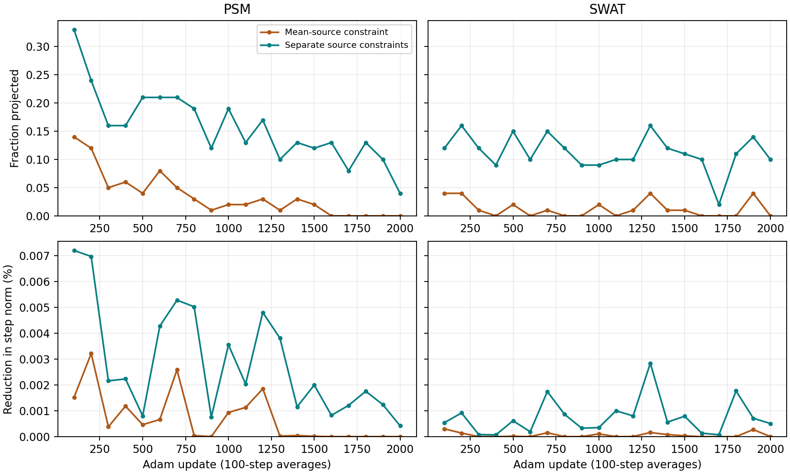

# Source-constrained mixed adaptation of LEFT

## Mixed-target ranking

One development seed (2025), native retrospective full-window scoring. PSM uses 65,088 points [22656,87744), SWaT 336,321 points [608535,944856). The four previously scored arms on each target are reused. Source checkpoints, scaler, score reduction, window grid and target/CAL roles follow the [base experiment](../left_multisource_20261126/RESULTS.md).

| Method | PSM AP | PSM ROC-AUC | PSM VUS-PR | PSM VUS-ROC | SWAT AP | SWAT ROC-AUC | SWAT VUS-PR | SWAT VUS-ROC |
| --- | --- | --- | --- | --- | --- | --- | --- | --- |
| Frozen source LEFT | 0.5043 | 0.7200 | 0.5159 | 0.7313 | 0.7914 | 0.8423 | 0.6307 | 0.7341 |
| Random-init target U | 0.5809 | 0.7392 | 0.5743 | 0.7502 | 0.7882 | 0.8422 | 0.6338 | 0.7414 |
| Pretrained target U | 0.5770 | 0.7579 | 0.5850 | 0.7715 | 0.7800 | 0.8417 | 0.6332 | 0.7447 |
| Ordinary replay | 0.5919 | 0.7556 | 0.5920 | 0.7717 | 0.7861 | 0.8420 | 0.6338 | 0.7403 |
| Source continuation | 0.5241 | 0.7299 | 0.5346 | 0.7431 | 0.7897 | 0.8429 | 0.6291 | 0.7368 |
| Mean-source constraint | 0.5918 | 0.7555 | 0.5919 | 0.7716 | 0.7860 | 0.8420 | 0.6338 | 0.7405 |
| Separate source constraints | 0.5923 | 0.7556 | 0.5923 | 0.7718 | 0.7859 | 0.8419 | 0.6342 | 0.7403 |

## Matched and source-only contrasts

| domain | comparison | AP | ROC_AUC | VUS_PR | VUS_ROC |
| --- | --- | --- | --- | --- | --- |
| PSM | Separate source constraints − Frozen source LEFT | 0.087969 | 0.035609 | 0.076474 | 0.040475 |
| PSM | Separate source constraints − Ordinary replay | 0.000319 | 0.000061 | 0.000314 | 0.000114 |
| PSM | Separate source constraints − Mean-source constraint | 0.000491 | 0.000132 | 0.000469 | 0.000135 |
| PSM | Separate source constraints − Source continuation | 0.068132 | 0.025705 | 0.057752 | 0.028691 |
| PSM | Mean-source constraint − Ordinary replay | -0.000172 | -0.000071 | -0.000154 | -0.000021 |
| PSM | Source continuation − Frozen source LEFT | 0.019837 | 0.009904 | 0.018721 | 0.011784 |
| SWAT | Separate source constraints − Frozen source LEFT | -0.005430 | -0.000407 | 0.003549 | 0.006250 |
| SWAT | Separate source constraints − Ordinary replay | -0.000221 | -0.000053 | 0.000399 | 0.000064 |
| SWAT | Separate source constraints − Mean-source constraint | -0.000091 | -0.000088 | 0.000410 | -0.000177 |
| SWAT | Separate source constraints − Source continuation | -0.003790 | -0.000975 | 0.005148 | 0.003497 |
| SWAT | Mean-source constraint − Ordinary replay | -0.000130 | 0.000035 | -0.000011 | 0.000241 |
| SWAT | Source continuation − Frozen source LEFT | -0.001640 | 0.000568 | -0.001599 | 0.002753 |

PSM showed a net AP gain over frozen transfer and over source continuation. Ordinary replay captured nearly all of that gain. Separate constraints added 0.000319 AP over replay on PSM and changed AP by −0.000221 on SWaT. On SWaT the small VUS-PR gain came with more normal alarm fragments. The two separate source inequalities removed first-order conflicts that the average allowed, with no material or consistent advantage over average-constrained or ordinary replay. The single seed and lack of a separate length-matched arm limit attribution of the small differences.

## What the optimizer changed

| domain | arm | trigger | ratio_mean | ratio_min | near_zero | tep_actual_positive | smd_actual_positive | tep_finite_rise | smd_finite_rise |
| --- | --- | --- | --- | --- | --- | --- | --- | --- | --- |
| PSM | mean | 0.0355 | 1.0000 | 0.9982 | 0 | 0.1145 | 0.0425 | 0.2425 | 0.0795 |
| PSM | separate | 0.1575 | 1.0000 | 0.9976 | 0 | 0.0000 | 0.0000 | 0.2520 | 0.0790 |
| SWAT | mean | 0.0125 | 1.0000 | 0.9997 | 0 | 0.0905 | 0.0115 | 0.2430 | 0.0575 |
| SWAT | separate | 0.1125 | 1.0000 | 0.9992 | 0 | 0.0000 | 0.0000 | 0.2680 | 0.0575 |

Fractions are over 2,000 endpoint updates per arm. Near-zero counts use an applied/proposed norm ratio at most 0.01. Positive dot products use the applied float32 parameter displacement; finite rises count strictly positive changes in the same source batch loss at fixed post-EMA state. See [all step summaries](mechanism.csv).

## CAL and event costs

Thresholds use each model’s own 512 mixed-CAL scores (q99, higher, strict exceedance). PSM has 512 annotated attack points in CAL, SWaT has 38. The empirical quantile gives no certified normal false-alarm budget. Confirmed alarms start on the third consecutive exceedance. M is the number of one-to-one matched events. Any-hit counts a different event statistic. Long-event columns give equal-event and pooled-point steady coverage. All times reflect retrospective localization. [Per-event results](events.csv).

| domain | arm | stream | normal_FPR | Recall | normal_alarm_fragments | M | Ntrue | auxiliary_any_hit_events | one_to_one_eventF1 | event_point_coverage | long_steady_macro_coverage | long_steady_point_coverage | max_event_miss_points |
| --- | --- | --- | --- | --- | --- | --- | --- | --- | --- | --- | --- | --- | --- |
| PSM | Frozen source LEFT | strict | 0.1820 | 0.5030 | 566 | 32 | 48 | 36 | 0.0882 | 0.7199 | 0.7643 | 0.8759 | 399 |
| PSM | Frozen source LEFT | confirmed3 | 0.1627 | 0.4715 | 267 | 23 | 48 | 27 | 0.1237 | 0.6988 | 0.7427 | 0.8659 | 399 |
| PSM | Pretrained target U | strict | 0.1539 | 0.5124 | 569 | 36 | 48 | 37 | 0.0923 | 0.7193 | 0.7215 | 0.8797 | 397 |
| PSM | Pretrained target U | confirmed3 | 0.1339 | 0.4707 | 311 | 21 | 48 | 23 | 0.0938 | 0.6906 | 0.6742 | 0.8595 | 397 |
| PSM | Ordinary replay | strict | 0.1486 | 0.4981 | 566 | 37 | 48 | 38 | 0.0966 | 0.6896 | 0.7022 | 0.8564 | 397 |
| PSM | Ordinary replay | confirmed3 | 0.1289 | 0.4586 | 295 | 21 | 48 | 22 | 0.0977 | 0.6621 | 0.6709 | 0.8424 | 397 |
| PSM | Random-init target U | strict | 0.2174 | 0.6035 | 702 | 38 | 48 | 39 | 0.0875 | 0.8044 | 0.9172 | 0.9535 | 397 |
| PSM | Random-init target U | confirmed3 | 0.1924 | 0.5626 | 384 | 26 | 48 | 27 | 0.1032 | 0.7807 | 0.8888 | 0.9387 | 397 |
| PSM | Source continuation | strict | 0.1543 | 0.4798 | 514 | 35 | 48 | 37 | 0.1034 | 0.6903 | 0.7242 | 0.8587 | 399 |
| PSM | Source continuation | confirmed3 | 0.1365 | 0.4473 | 267 | 25 | 48 | 27 | 0.1351 | 0.6686 | 0.6978 | 0.8475 | 399 |
| PSM | Mean-source constraint | strict | 0.1488 | 0.4978 | 568 | 37 | 48 | 38 | 0.0961 | 0.6890 | 0.7008 | 0.8558 | 397 |
| PSM | Mean-source constraint | confirmed3 | 0.1290 | 0.4582 | 296 | 21 | 48 | 22 | 0.0974 | 0.6616 | 0.6691 | 0.8416 | 397 |
| PSM | Separate source constraints | strict | 0.1480 | 0.4972 | 566 | 37 | 48 | 38 | 0.0966 | 0.6881 | 0.6991 | 0.8551 | 397 |
| PSM | Separate source constraints | confirmed3 | 0.1283 | 0.4577 | 295 | 21 | 48 | 22 | 0.0974 | 0.6607 | 0.6674 | 0.8410 | 397 |
| SWAT | Frozen source LEFT | strict | 0.7242 | 0.9212 | 216 | 9 | 22 | 21 | 0.0706 | 0.9212 | 0.6140 | 0.9695 | 721 |
| SWAT | Frozen source LEFT | confirmed3 | 0.7230 | 0.9200 | 111 | 9 | 22 | 21 | 0.1385 | 0.9200 | 0.6052 | 0.9684 | 721 |
| SWAT | Pretrained target U | strict | 0.5407 | 0.8023 | 1755 | 14 | 22 | 19 | 0.0135 | 0.8023 | 0.3067 | 0.8624 | 2016 |
| SWAT | Pretrained target U | confirmed3 | 0.5327 | 0.7948 | 541 | 13 | 22 | 18 | 0.0434 | 0.7948 | 0.2727 | 0.8585 | 2018 |
| SWAT | Ordinary replay | strict | 0.6332 | 0.9178 | 912 | 10 | 22 | 19 | 0.0216 | 0.9178 | 0.5813 | 0.9656 | 998 |
| SWAT | Ordinary replay | confirmed3 | 0.6291 | 0.9175 | 270 | 10 | 22 | 19 | 0.0712 | 0.9175 | 0.5783 | 0.9654 | 1000 |
| SWAT | Random-init target U | strict | 0.6759 | 0.9181 | 1007 | 10 | 22 | 20 | 0.0196 | 0.9181 | 0.5939 | 0.9663 | 994 |
| SWAT | Random-init target U | confirmed3 | 0.6709 | 0.9177 | 193 | 10 | 22 | 20 | 0.0976 | 0.9177 | 0.5885 | 0.9660 | 999 |
| SWAT | Source continuation | strict | 0.7001 | 0.9181 | 887 | 8 | 22 | 20 | 0.0177 | 0.9181 | 0.5953 | 0.9664 | 991 |
| SWAT | Source continuation | confirmed3 | 0.6953 | 0.9177 | 227 | 8 | 22 | 20 | 0.0669 | 0.9177 | 0.5889 | 0.9661 | 996 |
| SWAT | Mean-source constraint | strict | 0.6297 | 0.9173 | 475 | 11 | 22 | 19 | 0.0435 | 0.9173 | 0.5811 | 0.9656 | 999 |
| SWAT | Mean-source constraint | confirmed3 | 0.6270 | 0.9162 | 279 | 11 | 22 | 19 | 0.0712 | 0.9162 | 0.5782 | 0.9654 | 1001 |
| SWAT | Separate source constraints | strict | 0.6299 | 0.9175 | 462 | 10 | 22 | 19 | 0.0413 | 0.9175 | 0.5811 | 0.9656 | 999 |
| SWAT | Separate source constraints | confirmed3 | 0.6272 | 0.9168 | 289 | 10 | 22 | 19 | 0.0645 | 0.9168 | 0.5782 | 0.9654 | 1001 |

## Incremental cost

| domain | arm | train_s | bank_s | peak_MiB | windows_target | windows_each_source |
| --- | --- | --- | --- | --- | --- | --- |
| PSM | source_only | 77.3779 | 1.7243 | 442.3701 | 0 | 32000 |
| PSM | mean | 228.2983 | 0.6812 | 460.1411 | 32000 | 16000 |
| PSM | separate | 228.3804 | 0.6622 | 494.6260 | 32000 | 16000 |
| SWAT | source_only | 79.5853 | 4.4230 | 432.2979 | 0 | 32000 |
| SWAT | mean | 230.5447 | 3.3642 | 431.2954 | 32000 | 16000 |
| SWAT | separate | 226.8464 | 3.3671 | 431.2954 | 32000 | 16000 |

Independent CPU readback verified the six checkpoint identities, both legal axes, retrospective availability, AP with grouped ties, rank-sum ROC-AUC, CAL quantiles and strict/three-confirmed confusion counts. It checked displacement norms against 12 archived vector pairs and zero correction on every non-triggered step. VUS and event matching use the original metric implementations; they were not independently reimplemented. [Readback record](review.json).

Train seconds are elapsed times on one A40 per job and include periodic vector snapshots. Bank seconds include checkpoint and scaler loading plus CAL/QUERY scoring and serialization. Full parameter displacement vectors were archived at steps 1, 1000 and 2000; the CSV trace records both norms, the repair, both signed source dot products and both finite loss changes at every constrained step. [Asset identities](receipts.json).

Run the training and evaluation shell entry points in sequence on the existing LEFT workspace. Both use the same original source checkpoint and FIT assets as commit `c69955a3cbeb575455fc0279c8c2838ae4a46134`. The six compressed traces are in [traces](traces/). The complete checkpoints, CAL/QUERY banks, step traces and vector samples are in the experiment workspace under `results/left_source_constraints_20261126_v1`.
