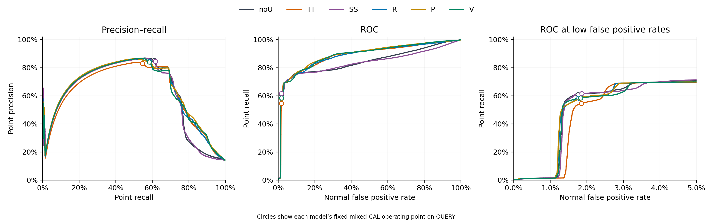
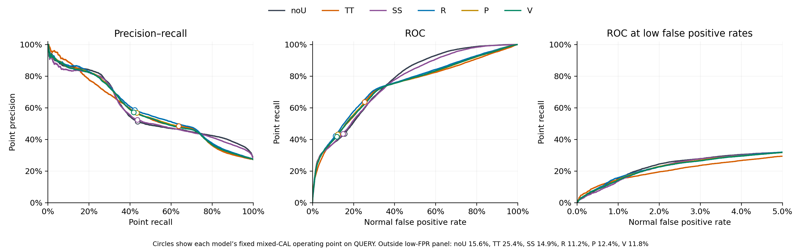

# 源多输出重构响应保持

固定 SWaT、PSM 各自原生 LEFT 初态、scaler、原型和运行步，复用 seed2025 的 R `[T,S]` 计划，每域新增 P、V 两臂。各臂批量 256、Adam 1e-4、2000 次更新并取终点；完整原生目标和原生推理评分沿用既有实现。

教师是本域原生初态的冻结副本，仅读取当前 R 批次的源 FIT 半批 S，使用 eval/no_grad。学生附加源前向使用 eval 行为并保留梯度，读取 `_forward` 的 `X_hat`、`X_hat_from_S`、`X_hat_ms`。三者均为同一 S 的 B×192×C 重构，单位为同一标准化输入坐标；它们共享和融合信息。设三路师生输出差为 Δ，P 是三路差先均值后的元素均方，V 是三路元素均方的平均。总目标为原生 R 损失加 P 或 V，λ=1。

V−P 等于三路 Δ 相对其平均 Δ 的元素方差，始终非负。因此本轮同时包含约束方式与约束强度差异。辅助前向恢复子模块模式、运行步、buffer、缓存及全部 RNG，参数保持可导。临时克隆 buffer 并在退出时恢复原引用，以保护原生图和附加图。原生训练前向仍按原规则更新状态，附加前向不额外更新原型或 EMA。保持项在推理时不参与评分。

两域分别使用原 CAL 点与共同 QUERY 轴，q99/higher/严格大于，全部为离线回顾。PSM 的 CAL 角色及其512个固定取点均带攻击标签，阈值只定义该固定经验操作点。SWaT 与 PSM 的旧 noU、TT、SS、R 的兼容分数和指标均复用。

本轮借鉴重放和功能保持/知识蒸馏，成熟机制和 LEFT 原生输出按来源归属。方法定义和相关工作的关系见[现有论文正文](../../../manuscript/next_generation_20261115/draft.md)及[方法公式](../../../manuscript/next_generation_20261115/method_definition.md)。

## 数值与状态检查

真实两域 B256 检查均通过同权接近零、扰动后保持项可导、原生训练前向后附加源前向再反向的梯度与状态检查。SWaT 同权 P 为 `8.32e-13`，V 为 `2.50e-12`；逐路最大相对均方差 `1.08e-11`。初次自定绝对阈值 `1e-12` 过严导致检查退出，记录已保留。量化后采用 float32 逐路相对均方差不超过 `1e-9` 的近零判据，两域通过。检查未改变学习公式、模型实现、λ 或推理评分。关闭 MHA 快速路径未改变观察到的误差，未据此断定该路径为原因。

关闭保持项时原生损失一致，梯度最大差约 `1e-9`，完整参数/buffer 状态、缓存、异质模式及随机状态一致。附加调用后教师始终冻结，学生保持路径仍可反向传播。此检查只验证实现有效性。

## Completed detection results

All four new P/V jobs completed with OS exit 0. Old noU/TT/SS/R scores and accepted metrics are reused. All new arms use seed2025, endpoint2000, their domain-specific native initialization and the original R sample plan. This is one seed per new arm on two exposed development tasks, not a new independent confirmation.

SWaT has 336321 scored QUERY points, 22 complete events and nine long events. PSM has 65088 scored QUERY points, 48 complete events and five long events. Boundary-truncated PSM events contribute observed points to point metrics but are excluded from complete-event metrics. Consequently strict recall and complete-event point coverage have different denominators in PSM. Long steady state begins at original event start+512 for events longer than512 points.

Strict and C3 rows are separate. C3 confirmation does not backfill the first two points. Any-hit and chronological one-to-one event matching are distinct; one-to-one precision/recall/F1 and observed/available first-hit offsets are retained in [comparison.csv](comparison.csv), together with false-alarm fragments, thresholds, coverage and censoring. Scores use full192-point windows and become available at window end. These are offline retrospective metrics, not causal alarm delays. VUS uses the fixed author metricor RangeAUC_volume_opt implementation, windowSize100 and thre250. AP and trapezoidal PR area remain separately named in the CSV.

## SWAT: fixed seed2025

| Method | AP | ROC-AUC | VUS-PR | VUS-ROC | Strict FP | Strict recall |
|---|---:|---:|---:|---:|---:|---:|
| noU | 0.607560 | 0.842267 | 0.606345 | 0.829634 | 5073 | 60.960% |
| TT | 0.610342 | 0.884582 | 0.618301 | 0.881642 | 5344 | 54.587% |
| SS | 0.601081 | 0.833884 | 0.595455 | 0.813485 | 5371 | 61.605% |
| R | 0.629347 | 0.885512 | 0.639265 | 0.884546 | 5143 | 58.327% |
| P | 0.635728 | 0.892502 | 0.642965 | 0.890241 | 5258 | 58.363% |
| V | 0.625967 | 0.888787 | 0.627882 | 0.882386 | 5290 | 58.407% |

| Method | C3 FP | C3 any-hit | C3 one-to-one F1 | Complete-event point coverage | Long steady pooled | Long steady macro | Longest miss, points |
|---|---:|---:|---:|---:|---:|---:|---:|
| noU | 4324 | 15/22 | 0.082645 | 60.789% | 73.203% | 10.949% | 3074 |
| TT | 4530 | 15/22 | 0.074257 | 54.369% | 65.333% | 10.102% | 5970 |
| SS | 4543 | 15/22 | 0.076336 | 61.419% | 74.028% | 11.160% | 3074 |
| R | 4362 | 15/22 | 0.073710 | 57.948% | 69.731% | 10.637% | 4434 |
| P | 4476 | 15/22 | 0.073892 | 58.038% | 69.829% | 10.649% | 4226 |
| V | 4519 | 15/22 | 0.080214 | 58.231% | 70.079% | 10.568% | 4226 |

[Vector curves](SWAT_curves.pdf). Full PR, full ROC and FPR <=5% ROC are shown. Out-of-panel operating points are explicitly listed, not moved. Curves do not select thresholds.

## PSM: fixed seed2025

| Method | AP | ROC-AUC | VUS-PR | VUS-ROC | Strict FP | Strict recall |
|---|---:|---:|---:|---:|---:|---:|
| noU | 0.583688 | 0.771345 | 0.575447 | 0.775647 | 7381 | 43.613% |
| TT | 0.572727 | 0.733239 | 0.562617 | 0.740466 | 12006 | 63.665% |
| SS | 0.575764 | 0.762970 | 0.571271 | 0.770729 | 7033 | 43.495% |
| R | 0.587891 | 0.748194 | 0.586017 | 0.761687 | 5294 | 42.314% |
| P | 0.578313 | 0.738939 | 0.577226 | 0.753827 | 5851 | 43.276% |
| V | 0.576862 | 0.738653 | 0.575583 | 0.753346 | 5566 | 41.791% |

| Method | C3 FP | C3 any-hit | C3 one-to-one F1 | Complete-event point coverage | Long steady pooled | Long steady macro | Longest miss, points |
|---|---:|---:|---:|---:|---:|---:|---:|
| noU | 6721 | 21/48 | 0.104046 | 65.710% | 83.902% | 65.355% | 399 |
| TT | 11388 | 26/48 | 0.140468 | 80.955% | 97.350% | 95.447% | 399 |
| SS | 6324 | 20/48 | 0.091398 | 65.293% | 83.789% | 65.152% | 399 |
| R | 4578 | 17/48 | 0.089474 | 61.901% | 81.772% | 59.734% | 399 |
| P | 5142 | 19/48 | 0.101064 | 63.038% | 83.285% | 63.420% | 399 |
| V | 4837 | 17/48 | 0.088542 | 61.834% | 82.228% | 59.598% | 399 |

[Vector curves](PSM_curves.pdf). Full PR, full ROC and FPR <=5% ROC are shown. Out-of-panel operating points are explicitly listed, not moved. Curves do not select thresholds.

## Paired learning contrasts

| Domain | Contrast | AP difference, pp | ROC difference, pp | Strict FP difference | C3 complete-event coverage difference, pp | C3 any-hit difference |
|---|---|---:|---:|---:|---:|---:|
| SWAT | V-R | -0.3380 | +0.3275 | +147 | +0.2826 | +0 |
| SWAT | V-P | -0.9761 | -0.3715 | +32 | +0.1926 | +0 |
| SWAT | P-R | +0.6381 | +0.6990 | +115 | +0.0900 | +0 |
| SWAT | P-noU | +2.8168 | +5.0235 | +185 | -2.7503 | +0 |
| SWAT | V-noU | +1.8407 | +4.6520 | +217 | -2.5577 | +0 |
| PSM | V-R | -1.1029 | -0.9541 | +272 | -0.0663 | +0 |
| PSM | V-P | -0.1451 | -0.0287 | -285 | -1.2033 | -2 |
| PSM | P-R | -0.9579 | -0.9255 | +557 | +1.1370 | +2 |
| PSM | P-noU | -0.5375 | -3.2405 | -1530 | -2.6720 | -2 |
| PSM | V-noU | -0.6826 | -3.2692 | -1815 | -3.8753 | -4 |

All fields for both streams, including VUS, long steady pooled/macro effects and longest misses, are retained in [contrasts.csv](contrasts.csv). Values compare the same domain/axis and are not pooled across domains.

## Scientific decision

The tested V constraint does not establish a useful independent gain over R or P. SWaT V loses AP and VUS relative to R while increasing false positives, with a small C3 point-coverage gain and no new discovered events. PSM V loses ranking and complete-event coverage relative to R and adds false positives. This conclusion concerns the fixed constraint, not replay as a whole or all mixed-unlabeled learning.

P retains a bounded SWaT positive: AP improves by0.6381 percentage points over R, and all four ranking metrics improve. Strict false positives increase by115, C3 false positives by114, with no new events (15/22). Its PSM AP decreases by0.9579 percentage points. PSM C3 any-hit improves from17 to19/48 and complete-event coverage by1.1370 percentage points, accompanied by564 additional C3 false-positive points. This is a detection trade-off, not a reproducible cross-task ranking gain or evidence for V. Both P and V remain below noU's complete-event C3 coverage on each task.

All thresholds are the pre-fixed q99/higher/strict-greater rule in each model's own score units. SWaT CAL includes38/512 attack-labeled points; PSM CAL includes512/512. These labels were checked after scores froze. Neither operating point certifies a normal1% false-positive budget; PSM's original task and thresholds are retained unchanged. No QUERY-driven reconfiguration occurred.

Replay and functional response preservation are mature mechanisms. The experiment does not establish a new Hybrid contribution, contamination identification, pure time/frequency-view independence or contamination robustness. V is pointwise stronger than P at lambda1, so equal coefficients do not make equal-strength controls. No automatic new variant, coefficient search, extra seed or successor training is launched.

## Training participation, review and cost

[training_response_trace.csv](training_response_trace.csv) records native loss, preservation loss and separate gradient norms at steps1/500/1000/1500/2000. The first matching initialization gives near-zero preservation gradients; later prescribed observations have nonzero gradients. This establishes participation, not detection benefit. Checkpoints, original score banks, failed gate and configuration identities remain in the local immutable run artifacts.

A role-separated reviewer independently recomputed raw ranking, calibration, point and coverage quantities and checked source/sample/state identities. Main JSON648 numeric cells and CSV640 numeric cells agree exactly (max absolute difference0). The one-to-one F1 and separate delay quantities were retained from the main shared evaluator but not independently recomputed; this is disclosed rather than a claim of fully independent event-matching verification. Review uses the same model family and is not external blind peer review. An audit metadata serialization failure is retained; recovery used already computed saved rows without repeating VUS or inference.

Measured formal jobs and gate occupancy total0.4734554293 A40 GPU hours. An additional diagnostic invocation has3.8469933 seconds total-wall upper bound; combined conservative accounting is at most0.4745240385 GPU hours. Initial failed-gate4.7345 GPU seconds are included, not discarded. The diagnostic value is an upper bound rather than precise GPU instrumentation. Main CPU evaluation took59.079 seconds; extra auxiliary forward/backward cost is included in measured P/V training. Four formal trainings and eight CAL/QUERY banks were completed, with no repeated successful training.

Implementation was first published at2fb6d959723ce4606d6184b182e341e16fad4d54. Raw identities and review summary are in [verification_summary.json](verification_summary.json). Training uses no new parameters and inference is unchanged. No raw data, weights, credentials or private records are published with this report.
