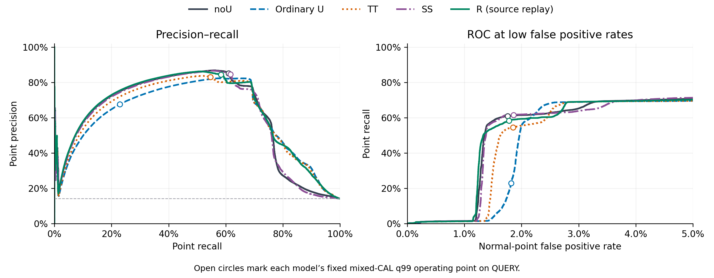

# SWaT LEFT＋源重放适配的匹配比较

实验共享 [原生 LEFT 初态和自然混合普通 U](../left_swat_natural_u_20261118/RESULTS.md) 的检查点、原型、scaler 及初始运行步 `52581`。TT、SS、R 各运行 seed2025、批量 256、Adam `1e-4`、2,000 次全参数更新，固定终点 `54581`。每步一次原生完整 forward 和 optimizer step，保留原型状态更新及损失规则。noU 与普通 U 的训练、读出、排序指标和 CAL 阈值复用原档，事件指标从冻结分数补算。

- TT `[T, T′]` 的两半来自自然混合目标 `[495000,585000)`，每步前 128 个窗口 T 逐值复用原普通 U 计划。
- SS `[S′, S]` 的两半来自原生正常训练 FIT `[0,396000)`，后 128 个窗口 S 与 R 同位相同。
- R `[T, S]` 保留 T 并加入历史正常窗口 S。`SeedSequence(2025).spawn(3)` 按顺序独立预采样 S、T′、S′，各域均从完整 192 点窗的合法起点均匀有放回抽样。三臂各有 512,000 次窗口曝光。

SS 的运行原件 `INITIAL_IDENTITY` 有沿用模板的 `U_FIT` 和背景条件说明。它的训练入口只加载源 FIT，实际读取以训练角色回执及抽样计划为准。训练全程使用观测和抽样索引，标签仅用于评分封存后的评价。

全窗由原生 LEFT `infer` 计算，锚点 495000、窗长和步长 192。共同 QUERY `[608535,944856)` 有 336,321 点，包含 22 个完整事件、9 个长事件。各模型使用同一组旧自然混合任务的 512 个 CAL 点，在各自分数上取 `q99 / higher`，报警使用严格大于。确认三连从连续第三个超阈点计入。长稳态覆盖沿用事件长度大于 512、稳态从事件起点加 512 的规则。所有评价为离线回顾，分数最早在窗口末点可用。VUS 固定官方 `RangeAUC_volume_opt`、`windowSize=100`、`thre=250`。

## 共同轴主表

| 方法 | AP | ROC-AUC | VUS-PR | VUS-ROC | CAL 阈值 | 严格点误报数（率） | 严格点召回 | 三连事件命中 | 三连一对一事件 F1 |
|---|---:|---:|---:|---:|---:|---:|---:|---:|---:|
| noU | 0.607560 | 0.842267 | 0.606345 | 0.829634 | 0.184673 | 5,073（1.758%） | 60.960% | 15/22 | 0.082645 |
| 普通 U | 0.595365 | 0.885345 | 0.601940 | 0.882681 | 0.178054 | 5,249（1.819%） | 22.948% | 15/22 | 0.034130 |
| TT | 0.610342 | 0.884582 | 0.618301 | 0.881642 | 0.177880 | 5,344（1.852%） | 54.587% | 15/22 | 0.074257 |
| SS | 0.601081 | 0.833884 | 0.595455 | 0.813485 | 0.176608 | 5,371（1.861%） | 61.605% | 15/22 | 0.076336 |
| R | 0.629347 | 0.885512 | 0.639265 | 0.884546 | 0.177679 | 5,143（1.782%） | 58.327% | 15/22 | 0.073710 |

三连事件命中列为 any-hit，逐事件核对显示五组命中的是同一组 15/22 事件。一对一匹配的计数也全部为 15/22，事件 F1 随报警片段数量变化。严格点误报率以 288,544 个正常点为分母，点召回以 47,777 个异常点为分母。混合 CAL 分位只定义经验操作点。

| 方法 | 三连正常误报点 | 三连异常点覆盖 | 三连事件宏覆盖 | 三连长稳态合并覆盖 | 三连长稳态宏覆盖 | 最长三连漏段（点） |
|---|---:|---:|---:|---:|---:|---:|
| noU | 4,324 | 60.789% | 11.826% | 73.203% | 10.949% | 3,074 |
| 普通 U | 4,442 | 18.260% | 9.128% | 20.831% | 4.684% | 5,702 |
| TT | 4,530 | 54.369% | 11.299% | 65.333% | 10.102% | 5,970 |
| SS | 4,543 | 61.419% | 11.585% | 74.028% | 11.160% | 3,074 |
| R | 4,362 | 57.948% | 11.567% | 69.731% | 10.637% | 4,434 |

[PDF 矢量图](pr_low_fpr_roc.pdf)。普通 U 的 ROC-AUC 接近 R，但在各自固定 CAL 操作点附近，普通 U 的点召回为 22.95%，R 为 58.33%。图中的曲线和标记均取自这次封存分数。

## 配对判断

| 对比 | AP 差（百分点） | 严格点召回差（百分点） | 严格点误报数差 | 三连异常点覆盖差（百分点） | 三连长稳态合并覆盖差（百分点） | 最长三连漏段差（点） |
|---|---:|---:|---:|---:|---:|---:|
| R−普通 U | +3.40 | +35.38 | −106 | +39.69 | +48.90 | −1,268 |
| R−TT | +1.90 | +3.74 | −201 | +3.58 | +4.40 | −1,536 |
| R−SS | +2.83 | −3.28 | −228 | −3.47 | −4.30 | +1,360 |
| R−noU | +2.18 | −2.63 | +70 | −2.84 | −3.47 | +1,360 |

R−TT 是相同批量、步数和共享 T 下的主要重放对照。R 的 AP、低误报操作点和三连覆盖优于 TT，三连事件 F1 略低。TT 自身已恢复了普通 U 的大部分覆盖差距，因此 R−普通 U 含批量和窗口曝光变化。R−SS 显示在共享 S 下加入目标窗口可提高排序，却降低固定操作点的召回和长稳态覆盖。R−noU 显示实际更新后的排序提高、持续覆盖回落。五组命中数量均为 15/22。结论限于单种子下 LEFT＋源重放相对等量目标训练的收益。SS 与自然混合 U 的训练数据角色不同，无法用来分离异常污染的因果效应。

## 消耗和复算

GPU0 R 274.168 秒、GPU1 TT 274.472 秒、GPU2 SS 274.082 秒，均正常退出，合计 822.723 A40 秒（0.228534 GPU 小时）。主 CPU 评价及制图用时 62.48 秒。一次同模型家族、职责分离的独立复算与主表对照 160 项完全一致。原件位于工作区 `results/left_author_swat_source_replay_20261118_v1`，其中 `audit` 保存独审。全量指标和逐事件结果位于 `results/left_author_swat_source_replay_metrics_20261118_v1`。固定计划 SHA-256 `82cc66790b6aa90c09e31f53895c65bf88583310ecafcd95578188abc39fceec`，六份分数封存 SHA-256 `228e761a3eba0c74ffc1208e3727cadffbe38d4dc0145d09e1db2ea7ad31034a`。本轮结束后三臂不继续扩展。
