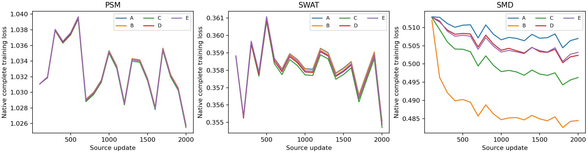
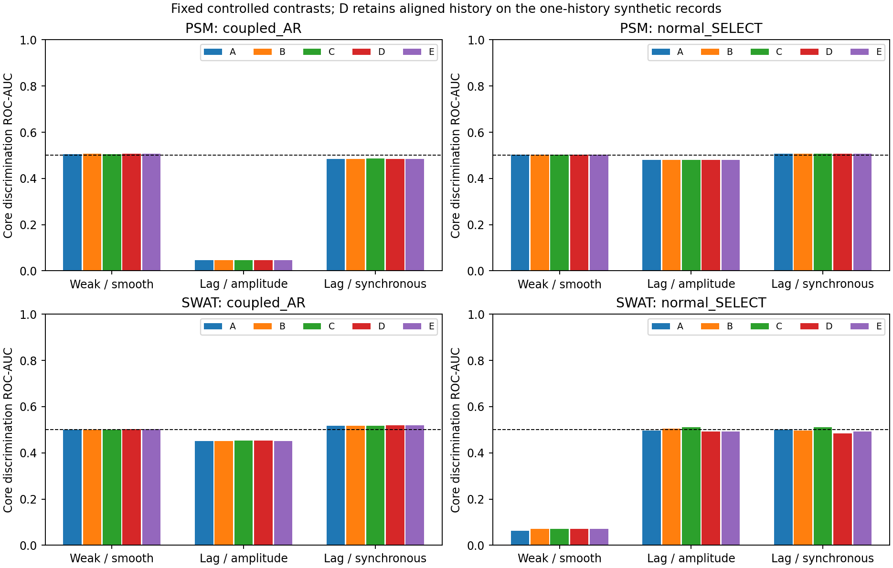
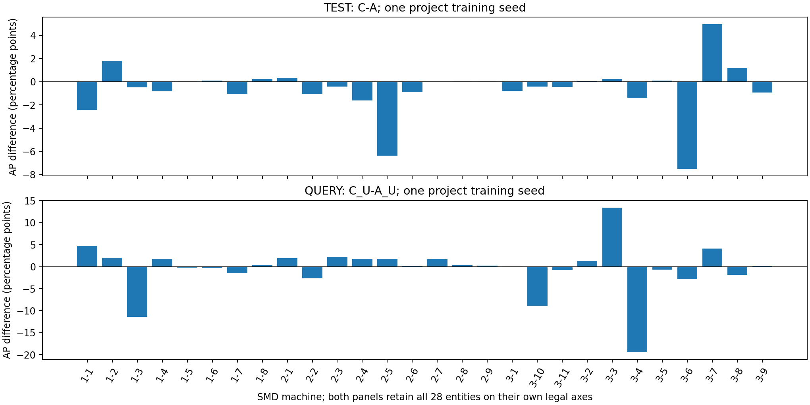

# Frozen official TimesFM history conditioning of LEFT

This experiment uses public normal source records and previously exposed public target tasks. It evaluates one fixed representation-level architecture, not a forecast-residual ensemble. Native LEFT supplies the complete training objective, prototype mechanism and deployment score. Official TimesFM 3.0 supplies frozen, variable-specific historical hidden patches. No laboratory observations, first-paper labels or enterprise records enter any stage.

## Method and fixed comparison

For a current 192-point window beginning at `s`, the historical input ends at `s-1`. TEP has 256 valid observations from the same 500-point run, left-padded to 512 slots; the other source records and public target evaluations have 512 valid observations. Every window and its history stay within one record and permitted role. The complete official forward returns `__call__:transformer_output` with shape `[B,C,16,1280]`. Its original temporal and variate attention remain active. Each variable retains its own historical tokens.

The added module projects historical tokens to 128 dimensions and applies four-head cross-attention to the corresponding variable's native LEFT encoder tokens. A zero-initialized scalar gate gives `Q + tanh(g) * Attention(Q,H,H)`. LEFT and the conditioner are learned; TimesFM is frozen. The older optional multi-scale decoder context interface remains unused. All arms share the existing pre-EMA differentiable-snapshot compatibility wrapper. The new module adds an encoder-output hook; this is a project adaptation of LEFT, not an untouched author numerical reproduction.

| Arm | Historical input | Additional trainable parameters | Deployment score |
|---|---|---:|---|
| A: matched LEFT continuation | None | 0 | Native LEFT |
| B: simple historical statistics | Per-variable mean and variance | 66,945 | Native LEFT |
| C: official pretrained history | Full frozen TimesFM hidden patches | 230,529 | Native LEFT |
| D: earlier reassigned history | Earlier legal history from the same record | 230,529 | Native LEFT |
| E: random encoder history | Full randomly initialized, frozen TimesFM architecture | 230,529 | Native LEFT |

B is a simpler, lower-capacity control. C/D/E share the condition-layer initialization and architecture. D uses an isolated random stream and preserves the ordered variable mapping, but is a causal reassignment rather than a multiset-preserving permutation. Its short TEP donors can overlap strongly with the intended history. The earliest legal history cannot be reassigned. These limitations weaken the interpretation of an indistinguishable C/D result; they do not change the observed C/A detection comparison.

The frozen historical encoder contains 330,710,976 parameters. Native LEFT has 4,519,985, 3,742,202 and 10,162,030 registered parameters at the PSM, SWaT and SMD widths. The historical encoder's full output head is executed by the official forward, although forecast outputs never enter the detector.

## Identities and source learning

- TimesFM code: `918df02c9d366b2145bc5876135fa2131d3ed2a6`.
- Hugging Face revision: `43046b85ec22d584a13f8098c2ed39c889e129c2`.
- Official weight file SHA-256: `a7592b0a8432baee54483254e5647856911ce69e09d09a9bb65904b2d98f17da`.
- Loaded full-model state SHA-256: `b20ef55e020503c3fd059d624e06eb0bb0cf38108124eae4ad7f7f233fb7bf67`.
- Fixed random-encoder state SHA-256: `c9ca6c52b87bb5187298a876db5c6048de32df8e9de24f297b94d801bbe61680`.
- LEFT upstream: `3fadb4811797075e233076b9faceb0d8ec59b697`, through the already matched native compatibility implementation.

The code is Apache-2.0; the downloaded TimesFM 3.0 weights have their separate non-commercial, non-production terms. The upstream pretraining membership of the public target datasets is unknown. Project source exclusion does not establish their absence from Google's training corpus. [Official code](https://github.com/google-research/timesfm/tree/918df02c9d366b2145bc5876135fa2131d3ed2a6) · [Fixed model revision](https://huggingface.co/google/timesfm-3.0-pytorch/tree/43046b85ec22d584a13f8098c2ed39c889e129c2)

PSM25 and SWaT31 use TEP FaultFree Training plus all SMD normal FIT records. SMD38 uses TEP plus HAI 21.03, excluding SMD from project source learning and selection. Existing source scalers and FIT/SELECT roles remain fixed. Source windows draw an ordered set of distinct channels, with the same map throughout history and current input. TEP FIT runs 1–20 and SELECT runs 61–65 remain separate. A 500-point TEP run supplies 53 legal current-window starts under the 256+192 footprint; runs are never concatenated.

All five arms in each fold start from the same existing LEFT source checkpoint. Each receives 2,000 additional Adam updates, batch 32, learning rate 0.0001 and 64,000 current-window presentations. Current windows and the native random stream are matched. The 1,024 normal SOURCE SELECT windows are diagnostic; the source endpoint is fixed, not selected using a target metric or the SELECT trajectory. This produces fifteen source models. The mean/variance and hidden conditions introduce no extra supervised objective.

Normal source SELECT complete loss was respectively 1.159807/1.159507 for A/C at PSM width, 0.412356/0.411871 at SWaT width and 0.504809/0.493099 at SMD width. Lower normal-source loss is not used as evidence of improved target anomaly discrimination. Exact losses, states and exposure plans remain in the source receipts.

## Public Z detection

[PUBLIC_Z.md](PUBLIC_Z.md) contains the four complete external-method panels, the separate complete-axis learning contrasts, training/statistical/context permissions and all retained negative results. Native full-window scores are available only at the end of the current window. Equal scoring timestamps do not make causal endpoint, full-window and long-context detectors equivalent in information access.

The complete history-valid axes are PSM `[576,87744)` and SWaT `[495576,944856)`. SMD uses all 28 entity-specific legal axes, totaling 689,856 points. External intersections can additionally trim SMD tails. Differences below use the complete internal axis, not a mixture of these two panels.

| Fold | C−A AP | C−A ROC-AUC | C−A VUS-PR | C−A VUS-ROC |
|---|---:|---:|---:|---:|
| PSM | +0.000377 | +0.000218 | +0.000367 | +0.000230 |
| SWaT | −0.000093 | +0.000181 | −0.000313 | +0.000765 |
| SMD28 macro | −0.006313 | −0.006952 | −0.008137 | −0.003678 |

PSM's small gain is almost reproduced by the earlier-history control. SWaT shows mixed signs with very small changes. On SMD, C loses all four macro metrics to A, and its macro AP is below B, D and E. C−A AP has 12 wins and 16 losses, with median −0.004177 across the 28 machines. Entity counts are not independent training repetitions. All new models use the one fixed project seed2025.

## Independent mixed-unlabeled U

All thirty targets completed both replay trajectories: PSM, SWaT and every SMD machine. Each trajectory starts independently from its corresponding A or C source endpoint, uses fresh Adam, 2,000 fixed updates, sixteen target windows and eight windows from each normal source per step. This gives sixty U models. The two arms share current windows, source/target plans and the native random stream. No target annotation enters training or endpoint selection.

The following four panels use QUERY only: PSM `[23040,87744)` (64,704 points), SWaT `[608664,944856)` (336,192 points), and 437,952 points across all SMD machines. SMD first computes each machine's metric and then takes the equal-weight mean. All 28 have valid positive and negative QUERY support. Z references below are rescored on these same QUERY axes and their statistics permissions; they are not the complete-test Z numbers above.

### AP

| Complete method | PSM | SWaT | SMD28 macro |
|---|---:|---:|---:|
| Matched source-continuation LEFT, frozen Z | 0.547434 | 0.789938 | 0.561068 |
| Pretrained-history LEFT, frozen Z | 0.547884 | 0.789851 | 0.552371 |
| Matched LEFT + ordinary replay U | 0.581121 | 0.785986 | 0.572650 |
| Pretrained-history LEFT + ordinary replay U | 0.579317 | 0.785674 | 0.568230 |

### ROC-AUC

| Complete method | PSM | SWaT | SMD28 macro |
|---|---:|---:|---:|
| Matched source-continuation LEFT, frozen Z | 0.735898 | 0.843021 | 0.882945 |
| Pretrained-history LEFT, frozen Z | 0.736094 | 0.843377 | 0.870633 |
| Matched LEFT + ordinary replay U | 0.751238 | 0.842110 | 0.893220 |
| Pretrained-history LEFT + ordinary replay U | 0.749907 | 0.842347 | 0.886882 |

### VUS-PR

| Complete method | PSM | SWaT | SMD28 macro |
|---|---:|---:|---:|
| Matched source-continuation LEFT, frozen Z | 0.550867 | 0.629790 | 0.600836 |
| Pretrained-history LEFT, frozen Z | 0.551252 | 0.629088 | 0.588657 |
| Matched LEFT + ordinary replay U | 0.577741 | 0.634617 | 0.614971 |
| Pretrained-history LEFT + ordinary replay U | 0.575707 | 0.634598 | 0.608311 |

### VUS-ROC

| Complete method | PSM | SWaT | SMD28 macro |
|---|---:|---:|---:|
| Matched source-continuation LEFT, frozen Z | 0.748275 | 0.737104 | 0.918942 |
| Pretrained-history LEFT, frozen Z | 0.748423 | 0.736855 | 0.912694 |
| Matched LEFT + ordinary replay U | 0.764475 | 0.741355 | 0.925004 |
| Pretrained-history LEFT + ordinary replay U | 0.763008 | 0.742051 | 0.917787 |

### Matched differences

All entries below are differences in metric units, not percentages. The complete entity-level data retain all signs and magnitudes.

| Fold | Contrast | Δ AP | Δ ROC-AUC | Δ VUS-PR | Δ VUS-ROC |
|---|---|---:|---:|---:|---:|
| PSM | C_U−A_U | −0.001803 | −0.001331 | −0.002034 | −0.001467 |
| SWaT | C_U−A_U | −0.000312 | +0.000237 | −0.000019 | +0.000696 |
| SMD28 | C_U−A_U | −0.004420 | −0.006338 | −0.006660 | −0.007217 |
| PSM | C_U−C_Z | +0.031434 | +0.013812 | +0.024455 | +0.014585 |
| SWaT | C_U−C_Z | −0.004178 | −0.001030 | +0.005509 | +0.005196 |
| SMD28 | C_U−C_Z | +0.015859 | +0.016249 | +0.019654 | +0.005093 |
| PSM | A_U−A_Z | +0.033687 | +0.015340 | +0.026874 | +0.016200 |
| SWaT | A_U−A_Z | −0.003952 | −0.000910 | +0.004827 | +0.004251 |
| SMD28 | A_U−A_Z | +0.011582 | +0.010276 | +0.014135 | +0.006062 |

Replay improves both models on PSM and SMD, whereas SWaT trades lower AP/ROC for higher VUS. C_U remains below matched native replay in AP on all three targets. On SMD, its larger improvement from its own weaker Z state partly closes the initial gap but does not reverse it. The C_U−A_U AP difference has 17 wins, no ties and 11 losses, with median +0.002142 and mean −0.004420. ROC-AUC and VUS-PR also have 17 wins/11 losses; VUS-ROC has 14 wins/14 losses. Thus the negative macro result does not imply that every machine worsens, while the majority of small wins does not erase larger losses. No seed-level significance is claimed.

**Operating-point eligibility.** The original 512 CAL locations remain unchanged. Only 458 PSM, 498 SWaT and 438–453 per SMD machine can be scored with the full legal historical footprint. Because the fixed complete CAL panel is unavailable, all new threshold, false-alarm, event and coverage operating metrics are NA. We do not replace the missing locations, reduce the calibration panel or reuse an old score threshold. The historical PSM all-attack CAL and SMD nominal-normal CAL results remain under their original protocols and are not normal false-alarm guarantees.

## Controlled responses

The fixed controlled bank contains 64 independently simulated coupled autoregressive records and 16 disjoint normal public SELECT blocks per width; the PSM background remains nominally normal. It reuses the [previously frozen inputs and intervention definitions](../left_history_relation_20261126/controlled_results.md): weak-change, relative-delay, energy-matched smooth/amplitude and synchronous controls. These inputs have 256 valid historical observations padded to 512; they are not a 256-versus-512 history-length ablation. Current windows have 192 observations, with core positions `[96,160)` and separately retained boundary/full-window summaries. No control parameter was selected from these model responses.

The table gives core discrimination ROC-AUC for matched native continuation and the pretrained-history candidate. The reference is the named control, not an unrelated normal record. All five arms, all eight paired contrasts and all three regions remain in the detailed tables.

| Width / background | Contrast | Native A | Pretrained-history C |
|---|---|---:|---:|
| PSM / coupled AR | Weak change vs smooth control | 0.505737 | 0.505615 |
| PSM / normal SELECT | Weak change vs smooth control | 0.503906 | 0.503906 |
| SWaT / coupled AR | Weak change vs smooth control | 0.500977 | 0.500488 |
| SWaT / normal SELECT | Weak change vs smooth control | 0.062500 | 0.070312 |
| PSM / coupled AR | Relative delay vs amplitude control | 0.045654 | 0.045410 |
| PSM / normal SELECT | Relative delay vs amplitude control | 0.480469 | 0.480469 |
| SWaT / coupled AR | Relative delay vs amplitude control | 0.451416 | 0.454102 |
| SWaT / normal SELECT | Relative delay vs amplitude control | 0.496094 | 0.511719 |
| PSM / coupled AR | Relative delay vs synchronous control | 0.485352 | 0.485596 |
| PSM / normal SELECT | Relative delay vs synchronous control | 0.507812 | 0.507812 |
| SWaT / coupled AR | Relative delay vs synchronous control | 0.517334 | 0.518066 |
| SWaT / normal SELECT | Relative delay vs synchronous control | 0.500000 | 0.511719 |

These results do not show a clear additional weak-change or delay-specific response. Low values, including values below 0.5, are retained without score reversal. Public normal blocks are not independent devices, and simulated receiver variables do not identify physical fault channels in public records. The independent synthetic records offer only one legal history, so D retains identity there and cannot serve as a shuffle ablation in that group.

## Engineering scope

The source-only checks establish full official weight identity, frozen states, hidden axes, valid gradient paths through the conditioner, zero-gate equivalence to native LEFT, and one native EMA/step update per training forward. Changing padding values leaves valid hidden states unchanged. Changing a later historical patch leaves earlier temporal hidden states unchanged, while changing one variable affects other variables through the official variable attention. These are input-path checks, not evidence for anomaly-specific or causal mechanisms.

An unpadded 256-point call is not numerically identical to the corresponding padded 512-slot call (maximum observed difference about 0.329); the internal cause was not isolated. The experiment keeps the same padded representation everywhere it is required. The archived `max_variates=32` field is not used by this fixed PyTorch attention path: the actual SMD call retains 38×38 variable attention. This does not establish upstream pretraining support for all 38-variable distributions.

## Cost, reproducibility and independent recomputation

The sealed matrix contains fifteen source models (five per fold), sixty replay models (two per target), 270 TEST/QUERY score banks and 120 CAL banks. Source learning records 30,000 optimizer steps and 960,000 current-window presentations; replay records 120,000 steps and 3,840,000 presentations. These totals describe the sealed trajectories, not independent records or a claim that discarded preparation attempts had zero unlogged work. Frozen official and random TimesFM encoders are reused across the matched source models. No successful endpoint was trained again to improve its target result.

| Measured stage | Summed stage-wall seconds | Hours | Timing boundary |
|---|---:|---:|---|
| Source learning, five arms jointly per fold | 18,682.823 | 5.190 | Three joint receipts; includes streaming historical feature computation |
| Replay learning, A/C jointly per target | 37,468.538 | 10.408 | Thirty paired receipts; not a separate native-only benchmark |
| Shared U source feature extraction | 1,680.205 | 0.467 | One shared source cache |
| Other frozen feature extraction | 607.347 | 0.169 | 120 timed extraction stages |
| LEFT score computation | 142.100 | 0.039 | 390 banks; excludes separate feature extraction, loading and hashing |
| Controlled features and scores | 39.569 | 0.011 | 28 stages |
| **Successful GPU-work stages** | **58,620.584** | **16.283** | Sum of the above stage timers |
| Failed/replaced cache preparation and pauses | 1,442.971 | 0.401 | Recorded estimates/bounds, including suspended intervals |
| CPU score-to-metric evaluation | 3,480.608 | 0.967 | 330 metric files; includes the fixed VUS implementation |

These are sums of measured wall intervals, not GPU kernel time, utilization-adjusted GPU-hours or billing. Parallel workers reduce elapsed completion time. Source A–E and replay A/C are timed jointly and counted once; they do not support an exact per-arm inference-cost ratio. Some setup, model loading, identity hashing and engineering checks have no complete stage timer. The recorded preparation overhead is therefore not an exhaustive metered total. The largest recorded allocator peak is 27.834 GiB on an A40. Final CPU table/plot generation took 27.47 seconds; independent CPU recomputation took 46.35 seconds. The [row-level ledger](evidence/summary/actual_costs.csv) retains each timer and its scope.

During execution, full-FP32 cache placement was moved from host memory to GPU memory, and a nested native initializer's allocator cap was corrected. Sample/gather parity and unchanged training-code semantics were checked; the frozen numerical objective, batch plans and endpoint rule were retained. Failed preparation logs, earlier code snapshots and the limitation on reconstructing unsealed discarded work remain in the [resource records](evidence/CACHE_RELOCATION_SCOPE.json). These repairs are engineering provenance, not extra scientific variants.

The single [final independent review](review.json) independently integrated AP and ROC-AUC for 420 result rows from 270 score banks. Maximum absolute discrepancies were 3.33e−16 and 1.92e−14. It also checked all 75 checkpoint identities, 330 metric-file hashes, 517 archived external rows and axes, 120 CAL bank identities, 96 macro rows, 168 paired-summary rows and 420 entity-pair rows. Macro and paired values agreed exactly. Controlled recomputation covered 20 banks and 480 region/contrast rows, with maximum discrepancy 2.22e−16. **VUS was checked at aggregation and difference level only; its integration was not independently rerun.** High-dimensional historical feature tensors were not all regenerated or rehashed by this reviewer; recorded input bindings, source-feature hashes, normal-source engineering results and complete official weight identities were checked. The review used no model forward or GPU. Earlier partial checks and failed audit-parser logs are preserved; the final parsing fixes did not change production metrics.

The [evidence manifest](evidence/evidence_manifest.json) identifies 1,161 small artifacts by exact path, byte length and SHA-256. Every packaged file was checked after transfer. The transferred archive SHA-256 is `7b13a270e7ae01b88041eea37b7de84a938e959fb5e02764eb3a6d3d01fcf0e7`; final review SHA-256 is `331c2cbfccfbe8a7d9520c36cadde6341ce15fb71a77634b9a9c22bad3381bdf`. Original checkpoints, scores, CAL arrays and feature assets remain under `/home/a312/tsad_research/results/left_timesfm_hidden_20261126_v1`; the repository contains their identities and receipts, not a redistribution of Google weights or large intermediate tensors. The official model must be obtained under its own license.

The numerical deliverables are the [complete public panels](PUBLIC_Z.md), [all entity metrics](evidence/summary/entity_metrics.csv), [macro metrics](evidence/summary/macro_metrics.csv), [paired summaries](evidence/summary/paired_summary.csv), [entity differences](evidence/summary/paired_entities.csv), [CAL eligibility](evidence/summary/cal_eligibility.csv) and [controlled per-record differences](evidence/controlled/per_record_differences.csv). Model receipts and source/U plans are retained alongside the evidence; their source and input hashes bind results to the executed program.

Lower source loss does not establish better target anomaly detection. These are training curves, not a checkpoint-selection rule.

All values, including below-chance separation, are retained. D has no effective history reassignment on the one-history synthetic records.

The two panels have different legal axes. Differences are calculated within each panel; no TEST-to-QUERY subtraction is made.

## Scientific decision

The fixed architecture is not advanced to more seeds, pollution experiments or F. It does not establish a useful detection increment over matched LEFT continuation and replay across the public tasks, and the controlled inputs do not establish weak-change or lag-specific sensitivity beyond their fixed controls. Small PSM Z gains, SWaT ROC-related gains, SMD per-machine U wins and improvements relative to each model's own Z state are retained. They do not jointly support a pretrained-history mechanism claim.

This decision applies to this gated insertion, frozen encoder, source objective and update budget. The experiment does not isolate an intrinsic failure of all TimesFM representations, all long-history architectures or all time–frequency coordination. In particular, the causal reassignment is limited, the statistics control has lower capacity, the TEP and controlled histories are shorter than the public target histories, and all target datasets have prior development exposure. The broader public TSAD method objective and the complete multi-source LEFT assets remain intact. No new architecture or loss is queued.
