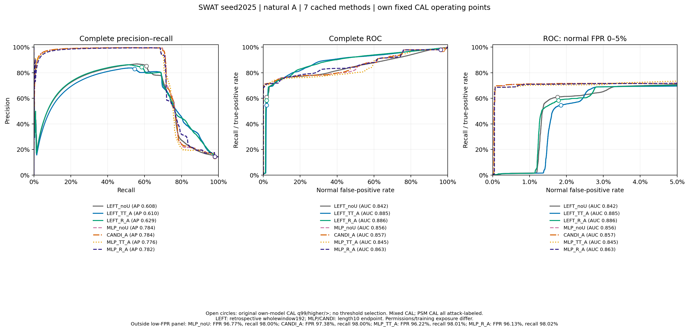
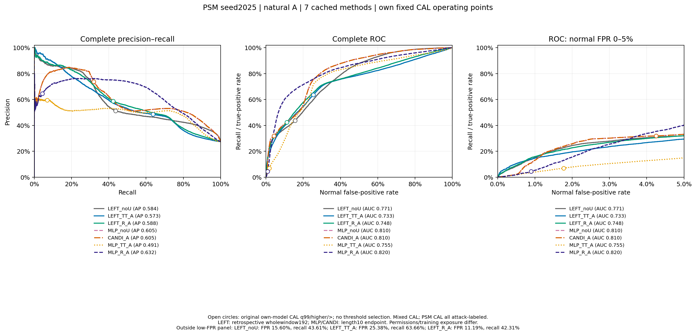

# 固定跨骨干普通TT／源重放R比较

**完成并有界独审通过。** 本轮只新增SWaT/PSM各seed2025的plain MLP TT、R四次适配。原MLP源训练、noU、完整CANDI及LEFT noU/TT-A/R-A的20行评价全部复用，没有重训或重新选择初态。当前完整CANDI和已锁定LEFT+R三种子自然混合／受控污染结果保持不变。

## 完整方法主表

同一QUERY轴：SWaT336321点、22完整事件、九长事件；PSM65088点、48完整事件、五长事件。AP不是梯形PR-AUC。VUS采用固定LEFT发布实现，windowSize=100、thre=250。全28行严格／三连结果、所有事件P/R/F1及点召回见[comparison.csv](comparison.csv)，40组同轴差值见[contrasts.csv](contrasts.csv)。

| 数据 | 方法 | AP | ROC-AUC | VUS-PR | VUS-ROC | 严格误报点／率 | 严格点召回 | 三连一对一／any-hit | 三连事件F1 | 三连完整事件点覆盖 |
|:--|:--|--:|--:|--:|--:|--:|--:|:--|--:|--:|
| SWAT | LEFT_noU | 0.607560 | 0.842267 | 0.606345 | 0.829634 | 5073 / 1.758% | 60.960% | 15/22 / 15/22 | 0.082645 | 60.789% |
| SWAT | LEFT_TT_A | 0.610342 | 0.884582 | 0.618301 | 0.881642 | 5344 / 1.852% | 54.587% | 15/22 / 15/22 | 0.074257 | 54.369% |
| SWAT | LEFT_R_A | 0.629347 | 0.885512 | 0.639265 | 0.884546 | 5143 / 1.782% | 58.327% | 15/22 / 15/22 | 0.073710 | 57.948% |
| SWAT | MLP_noU | 0.783949 | 0.856207 | 0.543552 | 0.696882 | 279225 / 96.770% | 97.997% | 5/22 / 21/22 | 0.175439 | 97.980% |
| SWAT | MLP_TT_A | 0.776102 | 0.845163 | 0.514483 | 0.665694 | 277636 / 96.220% | 98.014% | 5/22 / 21/22 | 0.185185 | 97.997% |
| SWAT | MLP_R_A | 0.782007 | 0.863262 | 0.541789 | 0.702566 | 277384 / 96.132% | 98.018% | 5/22 / 21/22 | 0.119048 | 98.001% |
| SWAT | CANDI_A | 0.783885 | 0.856961 | 0.541710 | 0.695700 | 280994 / 97.383% | 98.003% | 4/22 / 21/22 | 0.125000 | 97.984% |
| PSM | LEFT_noU | 0.583688 | 0.771345 | 0.575447 | 0.775647 | 7381 / 15.602% | 43.613% | 18/48 / 21/48 | 0.104046 | 65.710% |
| PSM | LEFT_TT_A | 0.572727 | 0.733239 | 0.562617 | 0.740466 | 12006 / 25.378% | 63.665% | 21/48 / 26/48 | 0.140468 | 80.955% |
| PSM | LEFT_R_A | 0.587891 | 0.748194 | 0.586017 | 0.761687 | 5294 / 11.190% | 42.314% | 17/48 / 17/48 | 0.089474 | 61.901% |
| PSM | MLP_noU | 0.604606 | 0.810453 | 0.625606 | 0.819068 | 2011 / 4.251% | 31.869% | 20/48 / 21/48 | 0.235294 | 49.062% |
| PSM | MLP_TT_A | 0.491079 | 0.755309 | 0.537025 | 0.776429 | 839 / 1.773% | 6.924% | 20/48 / 21/48 | 0.204082 | 6.462% |
| PSM | MLP_R_A | 0.631848 | 0.819876 | 0.681092 | 0.844464 | 425 / 0.898% | 4.348% | 18/48 / 19/48 | 0.302521 | 3.146% |
| PSM | CANDI_A | 0.604606 | 0.810451 | 0.625607 | 0.819065 | 2012 / 4.253% | 31.869% | 20/48 / 21/48 | 0.235294 | 49.062% |

完整CANDI独立列为外部方法，并非新增MLP训练臂。原CANDI backbone noU在本表规范命名MLP_noU，保留旧method名称、原METRICS SHA和原始资产，不改历史。PSM有边界截断事件：全轴点召回和完整事件覆盖的分母不同，不能混用。

| 数据 | 方法 | 三连误报点／率 | 正常误报片段 | 三连完整事件宏覆盖 | 长稳态宏／合并覆盖 | 最长漏段 | 首次命中／实际可用偏移中位数 |
|:--|:--|--:|--:|--:|--:|--:|:--|
| SWAT | LEFT_noU | 4324 / 1.499% | 310 | 11.826% | 10.949% / 73.203% | 3074 | 40.0 / 188.0 |
| SWAT | LEFT_TT_A | 4530 / 1.570% | 338 | 11.299% | 10.102% / 65.333% | 5970 | 40.0 / 188.0 |
| SWAT | LEFT_R_A | 4362 / 1.512% | 323 | 11.567% | 10.637% / 69.731% | 4434 | 40.0 / 188.0 |
| SWAT | MLP_noU | 279160 / 96.748% | 50 | 91.257% | 88.889% / 99.461% | 721 | 0.0 / 0.0 |
| SWAT | MLP_TT_A | 277568 / 96.196% | 47 | 91.397% | 88.889% / 99.461% | 721 | 0.0 / 0.0 |
| SWAT | MLP_R_A | 277263 / 96.090% | 77 | 91.432% | 88.889% / 99.461% | 721 | 0.0 / 0.0 |
| SWAT | CANDI_A | 280916 / 97.356% | 57 | 91.292% | 88.889% / 99.461% | 721 | 0.0 / 0.0 |
| PSM | LEFT_noU | 6721 / 14.207% | 218 | 26.823% | 65.355% / 83.902% | 399 | 2.0 / 82.0 |
| PSM | LEFT_TT_A | 11388 / 24.072% | 205 | 32.064% | 95.447% / 97.350% | 399 | 2.0 / 86.0 |
| PSM | LEFT_R_A | 4578 / 9.677% | 224 | 17.730% | 59.734% / 81.772% | 399 | 3.0 / 78.0 |
| PSM | MLP_noU | 1812 / 3.830% | 91 | 22.786% | 23.761% / 72.358% | 1000 | 4.0 / 4.0 |
| PSM | MLP_TT_A | 659 / 1.393% | 87 | 18.463% | 5.008% / 4.585% | 1618 | 7.0 / 7.0 |
| PSM | MLP_R_A | 359 / 0.759% | 48 | 17.855% | 1.380% / 1.577% | 2025 | 7.0 / 7.0 |
| PSM | CANDI_A | 1812 / 3.830% | 91 | 22.786% | 23.761% / 72.358% | 1000 | 4.0 / 4.0 |

长事件仍为duration>512，steady从原事件start+512开始；宏平均与合并覆盖分开。三连在第三点确认，不回填前两点。一对一沿固定时间贪心首次未匹配重叠规则，不是最大匹配；any-hit不代替一对一。延迟为hit-only回顾定位／availability偏移，未命中保留删失，不作不同上下文下的严格在线优劣结论。

## 骨干内部学习增量

| 数据 | 配对 | AP差／百分点 | ROC差／百分点 | VUS-PR差／百分点 | 严格FP差 | 严格召回差／百分点 | 三连FP差 | 三连覆盖差／百分点 | 三连匹配变化 |
|:--|:--|--:|--:|--:|--:|--:|--:|--:|:--|
| SWAT | LEFT R−TT_A | 1.900460 | 0.092961 | 2.096347 | -201 | 3.740293 | -168 | 3.579128 | 15 → 15 |
| SWAT | LEFT R−noU | 2.178684 | 4.324477 | 3.291987 | 70 | -2.633066 | 38 | -2.840279 | 15 → 15 |
| SWAT | MLP R−TT_A | 0.590511 | 1.809835 | 2.730644 | -252 | 0.004186 | -305 | 0.004186 | 5 → 5 |
| SWAT | MLP R−noU | -0.194179 | 0.705524 | -0.176265 | -1841 | 0.020931 | -1897 | 0.020931 | 5 → 5 |
| PSM | LEFT R−TT_A | 1.516445 | 1.495465 | 2.340006 | -6712 | -21.351032 | -6810 | -19.054387 | 21 → 17 |
| PSM | LEFT R−noU | 0.420339 | -2.315072 | 1.057022 | -2087 | -1.299286 | -2143 | -3.808982 | 18 → 17 |
| PSM | MLP R−TT_A | 14.076916 | 6.456663 | 14.406679 | -414 | -2.576073 | -300 | -3.316278 | 20 → 18 |
| PSM | MLP R−noU | 2.724260 | 0.942245 | 5.548638 | -1586 | -27.521233 | -1453 | -45.916240 | 20 → 18 |

## 技术取舍

1. **MLP＋相同重放未整体达到或超过LEFT＋R。** SWaT MLP R的AP高于LEFT R，但三连正常误报仍96.090%，一对一仅5/22；LEFT R为1.512%误报、15/22匹配和57.948%覆盖。MLP的98.001%高覆盖伴近全时报警，不是可用持续检测。PSM MLP R在排序、低报警成本、事件F1和计算成本上更强，但三连完整事件覆盖仅3.146%，最长漏段2025；LEFT R覆盖61.901%、最长漏段399，同时付出9.677%而非0.759%的三连正常误报。不能凭最高AP或最低报警量确定唯一胜者。

2. **LEFT额外复杂度有具体操作价值，也有明显代价。** 当前固定操作点下，SWaT的正常误报与独立事件匹配更可用，PSM保留更多持续异常点和长稳态覆盖；但其参数、训练成本更高，PSM排序及误报又不及MLP R。这些是完整配置的实测取舍，不是严格隔离时频表示的消融。窗口192对10、scaler权限和原生目标差异仍存在，尤其PSM全攻击CAL不能认证正常误报预算，也不能把覆盖差直接归因为表示能力。

3. **R−TT排序正项首先属于通用源历史重放策略。** 两骨干在两域都出现AP正差，当前没有证据把这一正项独占归给LEFT时频机制或Hybrid原创。MLP PSM相对TT的AP增量14.077个百分点，但匹配20→18、覆盖6.462%→3.146%；其事件F1上涨伴报警片段大幅减少，不等于发现更多事件。相对noU，MLP R持续覆盖49.062%→3.146%，也不支持适配全面改善。没有在MLP上开展B/C，不能外推污染保护或鲁棒因果结论。

**固定取舍：** LEFT＋R保留为当前持续覆盖取向的工作基座，MLP noU／TT／R固定为不可省略的低成本强对照；当前证据既不支持以MLP最高AP替代整套方案，也不足以把LEFT＋成熟重放直接定型为已成立的Hybrid原创方法。完成本轮后锁定基础骨干／普通重放比较，不追加MLP种子、污染比例、阈值、损失或新候选。两域已曝光、MLP仅seed2025，LEFT既有三种子正负项原样保留。

## 固定学习、时间权限与复用

- 从已选plain MLP SOURCE_SELECTED原PT/原scaler/原配置恢复，全部参数更新；不加载SANA，不用FPM或保持项，不重跑正常源训练。fresh Adam lr1e-4，betas(.9,.999)、eps1e-8、weight_decay0，批量256、2000有效更新终点，无新选权或调度。
- 精确复用原LEFT seed2025 A计划字节，每个192点相对起点u保留末点t=role_lo+u+191，MLP实际输入为u+182至u+191的10点。TT=[T10,Tprime10]，R=[T10,S10]，共享目标半批；不重新抽样、不跨角色／记录拼接，标准化仅原MLP scaler一次变换。源FIT/正常SELECT/目标UFIT及CAL/QUERY均未移动。
- 源MLP使用FIT-only StandardScaler，LEFT沿原生完整正常前缀统计（含源SELECT）；源初始化训练预算和目标也不同。MLP10点整窗MSE在真实末点可用；LEFT192点非重叠原生全窗分数在所属窗末点可用。统一点轴不等于同上下文或纯时频效应。
- CAL仍同512点，每模型自身q99/higher/严格大于，未按QUERY改选或反转分数。PSM512点全攻击、SWaT38点攻击，均仅为经验混合CAL操作点。训练不读取标签；标签只在四模型／八银行封存后评价。
- [两域完整PR／完整ROC／0—5%正常误报ROC](curves/)使用固定缓存和原CAL工作点，出界点在完整ROC与图注保留，未按曲线选阈值。曲线只解释排序与工作点差异，不把图上可选阈值当新部署结果。

## 参数与实际成本

| 数据 | MLP参数 | LEFT参数 | MLP R训练／读出秒 | MLP R整作业秒 | 旧LEFT R整作业秒 |
|:--|--:|--:|--:|--:|--:|
| SWAT | 140584 | 3742202 | 9.863 / 3.559 | 21.240 | 274.168 |
| PSM | 94624 | 4519985 | 9.193 / 0.648 | 15.120 | 247.965 |

四新增作业均OS0、无失败／恢复／重复训练，实际共0.0204699198 A40 GPU小时（73.691711秒），主CPU指标26.953秒。MLP训练峰值最大allocated为21.197MiB；阶段setup/train/readout及退出峰值均记录。旧LEFT成本是包含startup/训练/读出的历史作业壁钟，不是严格微基准；上下文及原生目标不同。既有源训练、noU和完整CANDI成本沿[原报告](../candi_native_a_20261118/RESULTS.md)及[历史LEFT成本](../candi_native_a_20261118/reused_left_costs.json)引用，本轮未重复支出。

参数来源为实际MLP模型及旧LEFT具名R训练receipt，非checkpoint张量总数猜测。[完整资源记录](resource_summary.json)包含原LEFT计数身份。原始分数、权重、优化器、计划、数据和运行日志留在受控工作区，不上传公开仓库。

## 必要检查与独立复核

三项增量CPU测试通过；实际worker原生整窗MSE与直接MSE逐窗bitexact，TT/R初态／RNG／共享T一致，所有12参数张量真实改变、梯度有限，所有Adam状态step2000；CAL/QUERY权重、CPU/CUDA RNG和完整optimizer状态只读。

一次同模型家族职责独立复核通过：2664项原分数／旧身份／配对比较最大差2.22e-16，CSV2840项完全一致；完整512000槽/臂的192末点→10后缀映射及角色边界、相同初态、八银行、CAL规则、事件匹配和覆盖均核验。VUS共享固定官方实现，旧VUS未重算；非外部盲审，未独立重训或补模型推理。[独审限定](audit_summary.json)。

Raw GLOBAL SHA `5d806cec1c4171f8527aee75a2720ddfb84b09bcc925aa40a9a58634b0f482fe`；主METRICS SHA `b1bc2557bc6625e4b376c47ecfbafd6c6b8201b1a922eddbf27a149e9b1610f0`。代码基于b3d613c，初版实现0fb80ce；最终提交以Git记录为准。

曲线CPU含prep5 8.06秒、首次final7 7.324秒、只复用原数组的布局重导出 3.98秒，共 19.365秒。所有数值文件SHA在布局调整前后不变；图例移至面板外以保留PSM低FPR原工作点。精确NPZ保留外部，PNG/PDF/SVG、14行工作点和[曲线回执](curves/curve_receipt.json)公开。图上工作点标的是严格点级，不能误作三连工作点。
