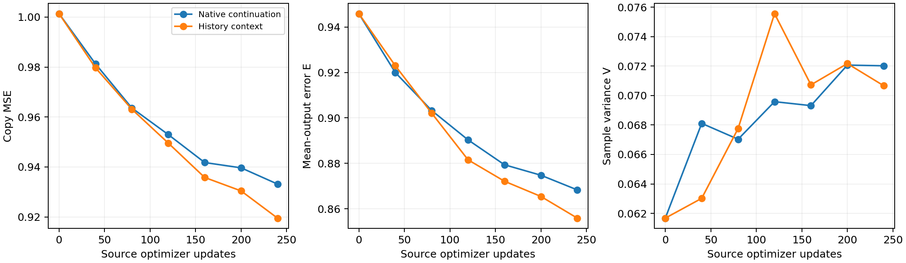
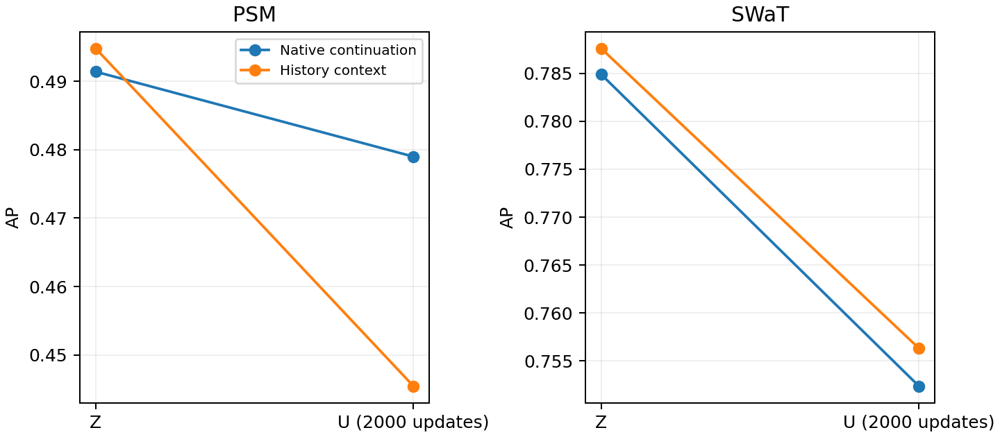

# Paired source and full-U development results

Single project training seed 2025. Values below retain separate public and QUERY panels. All ranking differences are computed on identical ticks within a panel. LEFT retains its offline context permission. No calibration threshold is introduced.

## Z: public

| Method | PSM AP | PSM ROC-AUC | PSM VUS-PR | PSM VUS-ROC | SWaT AP | SWaT ROC-AUC | SWaT VUS-PR | SWaT VUS-ROC |
| --- | ---: | ---: | ---: | ---: | ---: | ---: | ---: | ---: |
| TimeRadar + trainable history context | 0.495524 | 0.719034 | 0.468786 | 0.658618 | 0.728971 | 0.838661 | 0.469702 | 0.672024 |
| Matched native decoder continuation | 0.492870 | 0.717044 | 0.469319 | 0.661607 | 0.722847 | 0.834580 | 0.461426 | 0.664574 |
| Official TimeRadar, matched project readout | 0.494071 | 0.714661 | 0.462378 | 0.654056 | 0.734178 | 0.839639 | 0.475467 | 0.671378 |
| Frozen multi-source LEFT (offline W192) | 0.497257 | 0.700362 | 0.502917 | 0.706403 | 0.723928 | 0.811287 | 0.497585 | 0.660756 |
| Native LEFT, target-normal training (offline W192) | 0.577412 | 0.775419 | 0.574606 | 0.784912 | 0.543882 | 0.820670 | 0.534722 | 0.809097 |

Axes: PSM [611,87744); SWaT [495611,944856).
The target-normal LEFT row is an N background reference, not source-frozen Z. Both LEFT rows are offline W192; TimeRadar rows are causal endpoints. Target normal-prefix statistics include normal SELECT for every row.

## Z: QUERY

| Method | PSM AP | PSM ROC-AUC | PSM VUS-PR | PSM VUS-ROC | SWaT AP | SWaT ROC-AUC | SWaT VUS-PR | SWaT VUS-ROC |
| --- | ---: | ---: | ---: | ---: | ---: | ---: | ---: | ---: |
| TimeRadar + trainable history context | 0.494804 | 0.711088 | 0.456147 | 0.633278 | 0.787593 | 0.855493 | 0.563266 | 0.702569 |
| Matched native decoder continuation | 0.491406 | 0.709107 | 0.457245 | 0.635653 | 0.784892 | 0.851313 | 0.555679 | 0.696760 |
| Official TimeRadar, matched project readout | 0.494384 | 0.709309 | 0.449681 | 0.628119 | 0.792434 | 0.857547 | 0.575100 | 0.707909 |
| Frozen multi-source LEFT (offline W192) | 0.504839 | 0.724752 | 0.516162 | 0.735922 | 0.791359 | 0.842269 | 0.630793 | 0.734052 |
| Native LEFT, target-normal training (offline W192) | 0.587050 | 0.778099 | 0.577899 | 0.781838 | 0.608253 | 0.841497 | 0.607626 | 0.829731 |

Axes: PSM [23115,87744); SWaT [608634,944856).
The target-normal LEFT row is an N background reference, not source-frozen Z. Both LEFT rows are offline W192; TimeRadar rows are causal endpoints. Target normal-prefix statistics include normal SELECT for every row.

## U: QUERY

| Method | PSM AP | PSM ROC-AUC | PSM VUS-PR | PSM VUS-ROC | SWaT AP | SWaT ROC-AUC | SWaT VUS-PR | SWaT VUS-ROC |
| --- | ---: | ---: | ---: | ---: | ---: | ---: | ---: | ---: |
| TimeRadar + trainable history context | 0.445443 | 0.693170 | 0.450203 | 0.671977 | 0.756319 | 0.849155 | 0.627997 | 0.794651 |
| Matched native decoder continuation | 0.478992 | 0.704771 | 0.470963 | 0.661983 | 0.752374 | 0.846517 | 0.621046 | 0.797047 |

Axes: PSM [23115,87744); SWaT [608634,944856).

## Paired differences

| Comparison | Dataset | Stage/panel | AP | ROC-AUC | VUS-PR | VUS-ROC |
| --- | --- | --- | ---: | ---: | ---: | ---: |
| history_minus_native | PSM | Z/public | +0.002653 | +0.001990 | -0.000533 | -0.002989 |
| history_minus_native | PSM | Z/QUERY | +0.003399 | +0.001981 | -0.001099 | -0.002375 |
| history_minus_native | PSM | U/QUERY | -0.033549 | -0.011602 | -0.020760 | +0.009994 |
| native_U_minus_Z | PSM | U-Z/QUERY | -0.012414 | -0.004336 | +0.013718 | +0.026330 |
| history_U_minus_Z | PSM | U-Z/QUERY | -0.049361 | -0.017918 | -0.005944 | +0.038700 |
| history_minus_native | SWaT | Z/public | +0.006124 | +0.004081 | +0.008276 | +0.007449 |
| history_minus_native | SWaT | Z/QUERY | +0.002701 | +0.004180 | +0.007586 | +0.005809 |
| history_minus_native | SWaT | U/QUERY | +0.003945 | +0.002639 | +0.006951 | -0.002396 |
| native_U_minus_Z | SWaT | U-Z/QUERY | -0.032517 | -0.004796 | +0.065367 | +0.100287 |
| history_U_minus_Z | SWaT | U-Z/QUERY | -0.031273 | -0.006338 | +0.064731 | +0.092082 |

## Comparator information permissions

| Row | Training permission | Target parameters | Readout |
| --- | --- | --- | --- |
| Official TimeRadar | Fixed official pretraining, no project source fitting | None | Project B1/W100/ten-copy endpoint V, not a numerical reproduction of the paper leaderboard |
| Matched native continuation | Official parent + same normal TEP/SMD source240 | None at Z; native decoder updated in U | Causal endpoint V |
| History model | Same official parent, normal sources and source240, plus trained history/interaction | None at Z; history and decoder updated in U | Same causal endpoint V |
| Multi-source LEFT | Archived full normal-source training (4000 steps), width-specific models | None in the displayed Z row | W192 offline full-window native score |
| Native target-normal LEFT | Archived native normal target FIT/SELECT training | Target-normal training; N background | W192 offline full-window native score |

Every target scaler uses the same bound normal-prefix statistics, including normal SELECT. Equal score ticks do not equalize context, training budgets or upstream data permissions. Differences are calculated from full-precision values before rounding.

## Interpretation of this first development round

The complete model, matched training and frozen scoring are operational. The project remains method research. This first round establishes small, task-dependent Z changes and an active learned history path; it does **not** establish net mixed-U AP improvement or a finished method contribution.

- On the public Z axis, candidate minus matched native AP is +0.002653 on PSM and +0.006124 on SWaT. PSM loses both VUS measures against the native continuation. SWaT improves all four measures against that continuation, but its AP remains below the official reference: 0.728971 versus 0.734178. The SWaT result therefore partly reduces continuation damage, rather than surpassing the initial official V detector.
- On the isolated QUERY axis, candidate U minus native U is −0.033549 AP, −0.011602 ROC-AUC, −0.020760 VUS-PR and +0.009994 VUS-ROC on PSM. On SWaT the differences are +0.003945, +0.002639, +0.006951 and −0.002396. All signs are retained.
- Candidate U minus its own Z is −0.049361 AP on PSM and −0.031273 on SWaT. The corresponding VUS-ROC changes are positive (+0.038700 and +0.092082), and SWaT also gains VUS-PR. These are ranking trade-offs, not a blanket failure on every measure. Net AP adaptation benefit is absent in both domains.
- Complete external competitiveness is not established. Target-normal LEFT is stronger across all four PSM measures. On SWaT the candidate's AP exceeds that particular target-normal LEFT endpoint, while both VUS measures are substantially lower. Frozen source LEFT also remains an important comparator. These rows have different training and offline-context permissions, so gaps are not attributed solely to architecture.

No architecture closure or empirical-paper repositioning follows from this single development round. The **one priority for a second bounded revision** is the U update scope: retain the source-learned historical path as a fixed reference during U, while continuing the same decoder replay objective. This is a diagnostic/control hypothesis within the same architecture, not an established improvement or a new contribution. Current results cannot prove that history-parameter updates caused the PSM loss. No such extra U fits are queued in this delivery; the requested two source and four U fits are the complete executed matrix. Source budget limitations remain disclosed, without adding a second simultaneous revision or changing score/normalization.

## Source learning and history participation

Both arms selected step240 from the same seven normal SELECT times. Copy MSE falls from 1.0013698074 to 0.9331550044 (native) and 0.9195197355 (history). Candidate final E_full/V_full are 0.8559245733/0.0706613292; native values are 0.8683406464/0.0720159198. V_full increases relative to step0 for both arms. These are full-position normal modeling statistics, distinct from the terminal deployment V. Selection at the budget edge does not establish convergence.

Under the fixed norm0, signed-standardized-input protocol, the preserved official abs reconstruction is nonnegative. The common SELECT panel has mean negative-input fraction 0.5094040992 and irreducible nonnegative-reconstruction MSE lower bound 0.5943360273. This shared constraint explains why zero reconstruction risk is not an appropriate convergence requirement. It neither explains the between-arm detection difference by itself nor permits changing preprocessing after target evaluation. [CPU plan/decomposition check](plan_audit.json)

The diagnostic panel is the unchanged 32-window normal SOURCE SELECT set. Only 14 SMD windows across 12 source records permit an earlier, nonoverlapping512-point history in the same role; TEP and two short-history SMD draws are NA, not replaced by overlapping donors. The donor/current ordering and actual input differences are preserved in [raw diagnostics](history_diagnostics.json).

| Sealed candidate | Legal mismatch windows | Mean mismatch minus correct copy MSE | Mismatch worse / tie / better | Median absolute terminal-V change | Mean bypass minus correct copy MSE, all 32 |
| --- | ---: | ---: | --- | ---: | ---: |
| Source Z | 14 | +0.026617 | 11 / 0 / 3 | 0.002928 | +0.047117 |
| PSM U | 14 | +0.024889 | 12 / 0 / 2 | 0.001110 | +0.105381 |
| SWaT U | 14 | +0.034074 | 13 / 0 / 1 | 0.000983 | +0.080529 |

The median relative input RMS change is 1.335842. Native control scores and reconstructions are exactly invariant to these history interventions. The candidate therefore uses history and benefits from correspondence on this **normal source panel**. Negative individual windows are retained. These facts do not establish anomaly specificity, physical lag/causality or a contribution to target AP. A bypassed trained decoder is not the independently trained native method. Parameters and RNG remain unchanged in these diagnostics. [Full-precision summary](history_diagnostic_summary.csv)

The two source models are evaluated again on the exact QUERY ticks; this figure does not subtract a full-TEST Z result from a suffix U result. There is one project seed, not a confidence interval or independent-pretraining repeat.

## Execution, verification and cost

- Completed 2 source fits and 4 fixed 2000-update U fits. Both source models selected240. Total formal updates 8,480; current-window presentations 271,360. The normal-source plan includes 2,146 distinct TEP and 3,831 distinct SMD current windows. Repeated/overlapping windows are not independent events or statistical repeats.
- Frozen readout produced 1,874,458 learned-model endpoint scores across eight banks, plus 536,378 official-reference scalar scores from the identical frozen encoder and separate official decoder. Every bank retains endpoint, availability and complete input footprint; all chunk SHA256s and expected consecutive indices were checked.
- Source process times: native 165.69s and history 319.34s. U times: PSM native 1667.65s/history 3316.79s; SWaT native 1710.50s/history 3332.82s. Peak allocated tensor memory is 300.51–370.71MiB across fits. These are actual B1 TimeRadar measurements.
- Main GPU phase wall span is 1.9235h. Reserving all four devices across that entire span gives a conservative envelope of 7.6941 A40·h, including early idle and scheduling. This is not kernel time. Sum of overlapping training/score worker times is not exclusive GPU hours. The subsequent numerical review takes 5.82s inside the review function (7.91s including startup); diagnostics take 12.36s and CPU metrics 458.92s. Adding the two whole read-only GPU0 process spans to the main four-device envelope gives an upper bound of 7.6997 A40·h. CPU metrics use no GPU. Incomplete scoring chunks at rescheduling and some launch/import/CPU preparation costs lack complete timers and are disclosed rather than treated as zero. Three shell-launch issues were corrected before the intended workers ran; no scientific setting changed.
- Source weights are shared across PSM/SWaT because source arrays, full variable mappings, scalers and plans are identical and the model's parameters do not depend on C. Source TEP retains 52 variables, SMD 38; target input is 25/31. No variable-weight truncation or padding is used.
- Readout reuses the frozen native encoder only after full-tensor bitwise equivalence checks. Each model retains its own trained decoder and history. Joint chunk timings are labeled as shared allocation, not separate method latency. Completed independent chunks were retained when scheduling changed. Model training was not interrupted by the readout rescheduling.
- The separate [numerical review](independent_review.json) rechecks both source selections, all saved native nondecoder tensors against official state, the four actual U update scopes, 12 new-model AP/ROC rows and 24 raw-score samples (three fixed endpoints per bank), with exact forward readback. The main evaluator independently checks all 24 ranking rows. VUS uses the pinned implementation; no independent VUS algorithm reimplementation is claimed. This is a separate numerical executable, not a claim of independent human/agent peer review.
- U is real: candidate historical parameters move by L2 norms 3.43945/3.59500 and decoders by 13.26597/12.46965 on PSM/SWaT. Both native U decoders also move. Frozen original nondecoder states remain exactly unchanged.
- A clean-directory rebuild reproduces the table set, paired differences, two figures in SVG/PNG and diagnostic summary byte-for-byte (seven files). The six saved model/Adam resume states also pass a CPU-only restore roundtrip, including final optimizer counters. [Restore receipt](restore_check.json) This is table/figure reproducibility, distinct from training replication. All six trained weights and eight score banks are backed up in both the persistent server results directory and the author-local run directory; weights/raw arrays are not uploaded to Git. [Artifact access/locations](artifact_locations.json) [Training costs](training_costs.csv) · [Scoring costs](scoring_costs.csv) · [Cost scope](cost_summary.json) · [Wall-clock envelope](wall_clock_cost.json)

## Permissions, axes and F readiness

The first 611 TEST points are excluded for the complete612-point footprint. To match the established external grid, the right tails of 97 PSM and 63 SWaT points also remain excluded. Compared with the actual archived mixed grids, QUERY starts 459 points later on PSM and 99 later on SWaT. Public positive warmup exclusions are 3 and 0 points, respectively. No missing score is filled with zero. [Axis identity and exclusions](axis_manifest.json)

Target normalization uses the existing normal FIT+normal SELECT prefix, excluding TEST. Project source data exclude PSM/SWaT, while the upstream official pretraining retains its own permissions. Historical project exposure means these are development targets. Native LEFT uses W192 offline windows and its score availability differs from the causal TimeRadar endpoint; target-normal LEFT is a distinct training permission. No new CAL is selected. New operating results remain NA, and old all-attack/mixed-CAL operating points are not recertified.

F is ready at the entry-point/support level, **not completed**. It starts from the full source checkpoint, never a U endpoint. The first eligible support events are PSM[3248,3439) and SWaT[496754,497694), with 191/940 anomaly-label points and 512 normal-label points. Each earliest legal normal block yields only 1 normal endpoint; the events yield 92/841 positive endpoints. Each task additionally reads 612 unlabeled historical points beyond its annotation budget; exact numeric unions are recorded. This narrow normal support is a substantive limitation, not silently enlarged. Four disposable one-update checks pass, but formal F fits/score banks remain 0. The scorer supports a separate F QUERY bank and the no-project-source initialization resets **both** official native and initial history state. [F support](PSM/F_support/support.json) · [SWaT support](SWAT/F_support/support.json) · [Entry check](F_entry_check.json) · [Commands](REPRODUCE.md)

## Artifact identities

[Sealed model hashes](sealed_models.json), [score-bank numeric/chunk identities](score_manifest.csv), [source/target plan and tensor identities](contract.json), [actual first-update terminal score footprints](first_update_footprints.json), and [early runtime/version provenance](runtime_provenance.json) plus [final evaluator provenance](runtime_provenance_final.json) bind this result. The preserved executed-training script differs from the current checked entry only by parent-hash assertions and a receipt field; the [exact diff](executed_training_to_current.patch) adds no model, objective, data or optimizer change. The normal-source/checkpoint results and the old empirical draft retain their original snapshots. No SMD/NASA/F expansion, extra seed, loss or score variant was launched.
