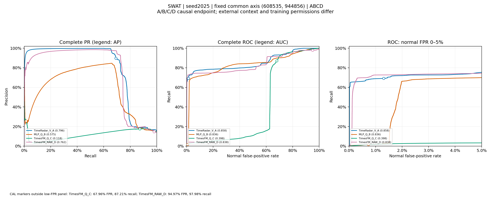
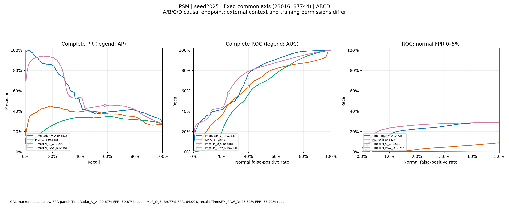

# 原生V × 严格历史条件动态：固定正常源验证

**限定NO-GO：本轮B/C条件化没有建立超出原生V的检测增量；C不进入自动R适配。** 该结论针对本次固定数据、结构、pinball与上尾评分，不否定TimeRadar或TimesFM全部机制，也不是污染鲁棒性结论。保留D在PSM的小幅排序正项和A在SWaT的具体检测能力，不另开后继候选。

完全按`1be5e00`协议执行：公开SWaT31/PSM25、seed2025，六次正常源训练，全部20epochs完成；A冻结官方TimeRadar权重，B简单MLP，C官方TimesFM3轻量代码模块/无官方权重，D同实际编码器初态的原值MSE预测参照。B/C预测V的三个分位数；D用原值MSE，二者不是纯读出或等参数消融。SOURCE_FIT/正常SELECT，无目标更新，未读取任何私有或第一篇数据。所有六选权与16银行先封存，再开放公开标签评价。

## 完整共同轴排序比较

SWaT `[608535,944856)`，336321点；PSM测试轴 `[23016,87744)`，64728点。未拼接数据域或裁去不利点。AP与固定实现VUS-PR不是同一指标；VUS沿LEFT发布`RangeAUC_volume_opt(windowSize=100,thre=250)`，保持原数值，未按结果改实现或参数。外部方法的已验收同轴指标/旧VUS直接复用。

| 域 | 方法 | AP | ROC-AUC | VUS-PR | VUS-ROC |
| --- | --- | --- | --- | --- | --- |
| SWAT | TimeRadar_V_A | 0.7957 | 0.8579 | 0.5766 | 0.7090 |
| SWAT | MLP_Q_B | 0.5749 | 0.8365 | 0.4884 | 0.7445 |
| SWAT | TimesFM_Q_C | 0.1177 | 0.3983 | 0.1268 | 0.3813 |
| SWAT | TimesFM_RAW_D | 0.7623 | 0.8385 | 0.5467 | 0.6960 |
| SWAT | LEFT_noU | 0.6076 | 0.8423 | 0.6063 | 0.8296 |
| SWAT | LEFT_TT | 0.6103 | 0.8846 | 0.6183 | 0.8816 |
| SWAT | LEFT_R | 0.6293 | 0.8855 | 0.6393 | 0.8845 |
| SWAT | MLP_noU | 0.7839 | 0.8562 | 0.5436 | 0.6969 |
| SWAT | MLP_TT | 0.7761 | 0.8452 | 0.5145 | 0.6657 |
| SWAT | MLP_R | 0.7820 | 0.8633 | 0.5418 | 0.7026 |
| SWAT | CANDI_A | 0.7839 | 0.8570 | 0.5417 | 0.6957 |
| SWAT | HistoryMean512 | 0.0877 | 0.2278 | 0.0909 | 0.2327 |
| PSM | TimeRadar_V_A | 0.5510 | 0.7350 | 0.4846 | 0.6482 |
| PSM | MLP_Q_B | 0.3684 | 0.6422 | 0.3843 | 0.5857 |
| PSM | TimesFM_Q_C | 0.2898 | 0.5875 | 0.3220 | 0.6076 |
| PSM | TimesFM_RAW_D | 0.5679 | 0.7438 | 0.5755 | 0.7649 |
| PSM | LEFT_noU | 0.5866 | 0.7770 | 0.5777 | 0.7808 |
| PSM | LEFT_TT | 0.5778 | 0.7444 | 0.5670 | 0.7506 |
| PSM | LEFT_R | 0.5932 | 0.7595 | 0.5907 | 0.7719 |
| PSM | MLP_noU | 0.6065 | 0.8151 | 0.6278 | 0.8233 |
| PSM | MLP_TT | 0.4924 | 0.7630 | 0.5389 | 0.7836 |
| PSM | MLP_R | 0.6358 | 0.8281 | 0.6855 | 0.8522 |
| PSM | CANDI_A | 0.6065 | 0.8151 | 0.6278 | 0.8233 |
| PSM | HistoryMean512 | 0.3037 | 0.5256 | 0.3324 | 0.5679 |
| PSM | TimeRadar_native | 0.4305 | 0.6884 | 0.4377 | 0.6775 |

权限分列：A/B/C/D为因果输入末点协议，分数信息在t可用，不含真实运算等待。A保持原生V公式，但B1、固定mask和FIT-only scaler不同于历史批次/整窗原生基准。LEFT为192点非重叠整窗回顾读出、正常前缀scaler含SELECT，TT/R有目标更新；MLP/CANDI为10点末时刻整窗MSE、其原正常初始化及不同适配，非同骨干/预算消融。HistoryMean保留旧残差尺度。PSM历史TimeRadar_native是离线原批次分数且只有排序，无合法新CAL；SWaT历史TimeRadar无兼容银行，不补跑。SWaT HistoryMean也只有排序，无当前混合CAL。外部成熟方法的成绩不归为Hybrid贡献。

## 固定CAL操作指标与持续检测

每模型自身同512点的q99/higher/严格大于；无QUERY调阈值。SWaT混合CAL含38个标注异常点，PSM512点全标注异常。它们不认证正常1%误报率。严格点与C3均为逐点因果三连确认，不回填前两点；整个实验仍是历史公开数据回顾评价。标%列为百分比，事件P/R/F1为0–1比例；事件命中为一对一M/N，any-hit另列。

| 域 | 方法 | 严格正常FPR% | 严格召回% | C3正常FPR% | C3全点召回% | C3匹配事件 | C3 any-hit | C3事件P | C3事件R | C3事件F1 | C3完整事件点覆盖% | C3长稳态宏% | C3长稳态合并% | 最长整事件漏检点 | 命中事件延迟中位点 |
| --- | --- | --- | --- | --- | --- | --- | --- | --- | --- | --- | --- | --- | --- | --- | --- |
| SWAT | TimeRadar_V_A | 1.303 | 69.169 | 1.223 | 69.123 | 10/22 | 10/22 | 0.0806 | 0.4545 | 0.1370 | 69.123 | 11.460 | 82.566 | 3941 | 137.0 |
| SWAT | MLP_Q_B | 0.728 | 1.528 | 0.617 | 1.488 | 8/22 | 8/22 | 0.0567 | 0.3636 | 0.0982 | 1.488 | 0.056 | 0.077 | 31928 | 62.5 |
| SWAT | TimesFM_Q_C | 67.960 | 87.211 | 67.432 | 87.008 | 19/22 | 20/22 | 0.0425 | 0.8636 | 0.0810 | 87.008 | 63.921 | 91.558 | 1218 | 0.0 |
| SWAT | TimesFM_RAW_D | 94.966 | 97.982 | 94.910 | 97.959 | 5/22 | 21/22 | 0.1613 | 0.2273 | 0.1887 | 97.959 | 88.889 | 99.461 | 721 | 0.0 |
| SWAT | LEFT_noU | 0.988 | 1.513 | 0.842 | 1.432 | 12/22 | 12/22 | 0.0569 | 0.5455 | 0.1030 | 1.432 | 0.855 | 0.291 | 31840 | NA |
| SWAT | LEFT_TT | 0.940 | 1.268 | 0.796 | 1.193 | 12/22 | 12/22 | 0.0588 | 0.5455 | 0.1062 | 1.193 | 0.837 | 0.147 | 31861 | NA |
| SWAT | LEFT_R | 0.937 | 1.321 | 0.789 | 1.243 | 12/22 | 12/22 | 0.0566 | 0.5455 | 0.1026 | 1.243 | 0.837 | 0.142 | 31862 | NA |
| SWAT | MLP_noU | 97.186 | 98.024 | 97.156 | 98.003 | 4/22 | 21/22 | 0.0870 | 0.1818 | 0.1176 | 98.003 | 88.889 | 99.461 | 721 | 0.0 |
| SWAT | MLP_TT | 97.057 | 98.053 | 97.027 | 98.037 | 5/22 | 21/22 | 0.1136 | 0.2273 | 0.1515 | 98.037 | 88.889 | 99.461 | 721 | 0.0 |
| SWAT | MLP_R | 96.612 | 98.026 | 96.570 | 98.010 | 5/22 | 21/22 | 0.0893 | 0.2273 | 0.1282 | 98.010 | 88.889 | 99.461 | 721 | 0.0 |
| SWAT | CANDI_A | 97.502 | 98.014 | 97.474 | 97.993 | 4/22 | 21/22 | 0.1026 | 0.1818 | 0.1311 | 97.993 | 88.889 | 99.461 | 721 | 0.0 |
| PSM | TimeRadar_V_A | 29.669 | 50.870 | 29.096 | 48.878 | 6/48 | 17/48 | 0.0706 | 0.1250 | 0.0902 | 73.195 | 86.453 | 92.114 | 694 | 0.0 |
| PSM | MLP_Q_B | 39.775 | 63.999 | 38.933 | 62.122 | 8/48 | 18/48 | 0.0667 | 0.1667 | 0.0952 | 84.271 | 99.832 | 99.902 | 399 | 0.0 |
| PSM | TimesFM_Q_C | 0.321 | 0.155 | 0.008 | 0.000 | 0/48 | 0/48 | 0.0000 | 0.0000 | 0.0000 | 0.000 | 0.000 | 0.000 | 4852 | NA |
| PSM | TimesFM_RAW_D | 25.507 | 58.207 | 22.008 | 48.803 | 22/48 | 30/48 | 0.1325 | 0.4583 | 0.2056 | 76.511 | 85.168 | 91.366 | 399 | 3.5 |
| PSM | LEFT_noU | 18.692 | 49.595 | 17.026 | 45.468 | 20/48 | 24/48 | 0.0602 | 0.4167 | 0.1053 | 70.893 | 76.407 | 88.130 | 399 | NA |
| PSM | LEFT_TT | 26.874 | 67.237 | 25.634 | 64.711 | 22/48 | 28/48 | 0.0921 | 0.4583 | 0.1533 | 82.443 | 97.374 | 98.472 | 399 | NA |
| PSM | LEFT_R | 17.047 | 53.970 | 15.151 | 50.014 | 21/48 | 22/48 | 0.0544 | 0.4375 | 0.0968 | 72.304 | 79.975 | 89.967 | 399 | NA |
| PSM | MLP_noU | 4.327 | 32.568 | 3.883 | 31.357 | 20/48 | 21/48 | 0.1550 | 0.4167 | 0.2260 | 49.166 | 23.817 | 72.390 | 1000 | 4.0 |
| PSM | MLP_TT | 3.494 | 11.688 | 2.811 | 9.082 | 20/48 | 21/48 | 0.0784 | 0.4167 | 0.1320 | 12.128 | 11.796 | 11.398 | 1019 | 6.0 |
| PSM | MLP_R | 0.996 | 5.282 | 0.822 | 4.105 | 20/48 | 21/48 | 0.2381 | 0.4167 | 0.3030 | 3.847 | 2.697 | 2.439 | 1621 | 7.0 |
| PSM | CANDI_A | 4.327 | 32.568 | 3.883 | 31.357 | 20/48 | 21/48 | 0.1550 | 0.4167 | 0.2260 | 49.166 | 23.817 | 72.390 | 1000 | 4.0 |
| PSM | HistoryMean512 | 3.018 | 5.368 | 1.114 | 2.463 | 20/48 | 20/48 | 0.0943 | 0.4167 | 0.1538 | 3.449 | 1.935 | 2.374 | 1324 | 13.0 |

全部严格点/C3的TP/FP/FN/TN、Precision/Recall/F1、正常误报片段及每千正常点片段、事件P/R/F1、事件宏/合并覆盖及延迟保留于[methods.csv](methods.csv)。外部LEFT延迟列NA是离线可用偏移，不能直接称实时检测延迟；其原偏移字段仍在CSV中。

全QUERY异常点召回与“完整合格事件”点覆盖分母不同，PSM尤需区分；不完整/未观测事件不算实际漏检，详细原件保留UNKNOWN/NA。非命中事件延迟为NA，并非零。长事件定义为原持续长度>512、稳态从原起点+512开始；SWaT22完整事件中9长，PSM48中5长。

## 固定配对差

主表下列使用C3操作差；AP/ROC不受确认规则影响。数值为百分点，事件和漏检为计数差，n=1、不报告虚假标准差。严格点的对应差也完整列于[paired.csv](paired.csv)。

| 域 | 对比 | ΔAP pp | ΔROC pp | Δ正常FPR pp | Δ全点召回 pp | Δ匹配数 | Δany-hit | Δ长宏 pp | Δ长合并 pp | Δ最长漏检点 |
| --- | --- | --- | --- | --- | --- | --- | --- | --- | --- | --- |
| SWAT | C−A | -67.804 | -45.951 | 66.209 | 17.885 | +9 | +10 | 52.461 | 8.992 | -2723 |
| SWAT | C−B | -45.727 | -43.814 | 66.815 | 85.520 | +11 | +12 | 63.865 | 91.480 | -30710 |
| SWAT | C−D | -64.466 | -44.011 | -27.479 | -10.951 | +14 | -1 | -24.968 | -7.903 | +497 |
| SWAT | B−A | -22.078 | -2.137 | -0.606 | -67.635 | -2 | -2 | -11.405 | -82.489 | +27987 |
| SWAT | D−A | -3.339 | -1.940 | 93.687 | 28.836 | -5 | +11 | 77.428 | 16.895 | -3220 |
| PSM | C−A | -26.113 | -14.753 | -29.087 | -48.878 | -6 | -17 | -86.453 | -92.114 | +4158 |
| PSM | C−B | -7.856 | -5.463 | -38.925 | -62.122 | -8 | -18 | -99.832 | -99.902 | +4453 |
| PSM | C−D | -27.808 | -15.632 | -22.000 | -48.803 | -22 | -30 | -85.168 | -91.366 | +4453 |
| PSM | B−A | -18.257 | -9.289 | 9.837 | 13.244 | +2 | +1 | 13.380 | 7.789 | -295 |
| PSM | D−A | 1.695 | 0.880 | -7.087 | -0.075 | +16 | +13 | -1.285 | -0.748 | -295 |

## 逐事件证据与裁决

SWaT：A的C3正常误报1.223%、全点召回69.123%，发现10/22一对一事件。其长稳态宏覆盖11.460%而合并82.566%，说明高合并覆盖主要来自少数长事件，不能宣称九长事件普遍检出。B减少误报至.617%，却使C3召回跌至1.488%、长宏.0558%。C的事件命中19/22、长宏63.921%有数值增加，但正常误报67.432%、AP仅.117681，不构成误报可控的增量。D也以94.910%正常误报换高覆盖；不能把其any-hit21/22写成匹配21/22，实际匹配5/22。

PSM：C3条件下C无异常命中，最长完整事件漏检4852点；低正常误报.00846%不能解释为鲁棒。A/B/D的长合并覆盖虽高，正常误报分别29.096%/38.933%/22.008%，仍有代价。D相对A的AP+.016950、ROC+.008797、C3匹配6→22事件是本轮真实有限正项；D没有V输入，不能把它归为时频V协同或据此自动扩展。它也没有超过同轴MLP noU/MLP R的排序，跨模型上下文/训练权限不同，不作单因素归因。

[EVENT_PAIRS.csv](EVENT_PAIRS.csv)完整列出全部70个合格事件的strict/C3两种流，共140行，A/B/C/D覆盖、长稳态、最长漏段及命中延迟并排；未选有利案例。独审发现导出器原先请求不存在的end字段，仅重导为正确end_exclusive，旧CSV另存；训练、分数、METRICS和原EVENTS未变，[修复记录](BOUNDARY_EXPORT_FIX.json)。

C在两域的阈值无关排序均下降，因此不能将全部负项归因于CAL迁移。正常pinball更低不等于异常判据更好；本轮不够分离正常支持域外外推、异常历史被解释及条件宽度失配等机制，均不能冒称已证根因。D保留部分原值预测信息，却不支持条件V提供独立额外证据。此次源正常验证不支持将C推进混合适配；方法与源尺度冻结，不改分数/阈值/权重，不自动新增R、种子、域或损失。两阶段和混合无标签研究目标保留，下一阶段由主研究决策决定。

## 工程等价、成本与资产

两域step0全QUERY均为0逆序、0新压缩、0拆tie、0严格报警差；AP/ROC与A完全一致。实际梯度、C/D同编码器初态、原生参数/缓冲与CPU/CUDA RNG不变、源角色隔离和全16bank公式通过检查。13项受影响单元测试通过；不冒称全仓测试通过。

| 域 | 模型 | 可训练参数 | 实际更新 | SELECT epoch | SELECT损失 | 训练含进退占卡秒 | 训练峰分配GiB | QUERY预测读出主体秒 |
| --- | --- | --- | --- | --- | --- | --- | --- | --- |
| SWAT | B | 509091 | 3880 | 14 | 0.00862716265 | 31.519 | 0.040 | 16.012 |
| SWAT | C | 587011 | 3880 | 20 | 0.00342821065 | 811.713 | 5.788 | 172.372 |
| SWAT | D | 698143 | 3880 | 20 | 0.00313528778 | 810.494 | 5.790 | 180.863 |
| PSM | B | 410787 | 1040 | 16 | 0.202475255 | 12.917 | 0.039 | 3.667 |
| PSM | C | 584707 | 1040 | 7 | 0.325661832 | 185.365 | 4.684 | 28.459 |
| PSM | D | 655129 | 1040 | 19 | 0.231621271 | 187.908 | 4.685 | 30.048 |

A另有1,636,043冻结参数；B/C在部署还需该教师，D只需自己的原值预测器。教师V只生成一次共享缓存，不给每方法重复计费。34个实际GPU作业全部OS0、清理无存活组成员，无失败/重跑；累计**2.290003054 A40GPU小时**，包括本轮正常缓存、两域真实B128门检、六训练、目标缓存及读出启动/清理。预协议六窗工程检查4.990秒属于此前已归档工作，不在本轮再次计费。主CPU指标墙钟78.233秒；曲线和独审成本另在最终VERIFICATION列明。

[MODEL_COSTS.csv](MODEL_COSTS.csv)、[TRAINING_COSTS.csv](TRAINING_COSTS.csv)区分主体耗时与含进退占卡时间、训练/推理峰值；[ARTIFACT_MANIFEST.json](ARTIFACT_MANIFEST.json)绑定34作业、6选权、8共享缓存、16评分银行、实际原字节runtime及环境。完整原始观测/缓存、OPT、TRACE、maskbits、十副本末点、阶次、V、三分位数/宽度/floor、D预测与残差留在研究工作区。

六份新项目模型以原字节公开于[models](models/MODEL_CARD.md)，无上游预训练张量/原始数据/凭据；官方TimeRadar权重只保留SHA，不重新分发。缓存只公开SHA与结构说明。所有旧权重、分数、阈值和结论不覆盖。

## 固定曲线

圆圈为原CAL操作点；超过0–5%图区间者逐项标出，未重选阈值。rank-only方法无虚构CAL点。全PR/ROC数组保存在原曲线目录，PNG/PDF/SVG与[操作点表](curves/OPERATING_POINTS.csv)公开。可比较的时间/统计/训练权限见上文。

[SWaT外部完整曲线](curves/SWAT_EXTERNAL.png)；[PSM外部完整曲线](curves/PSM_EXTERNAL.png)。
