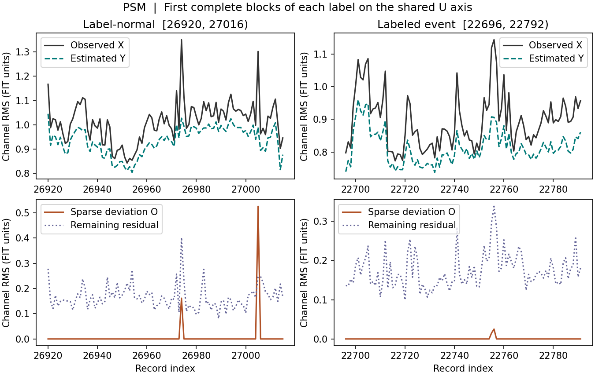
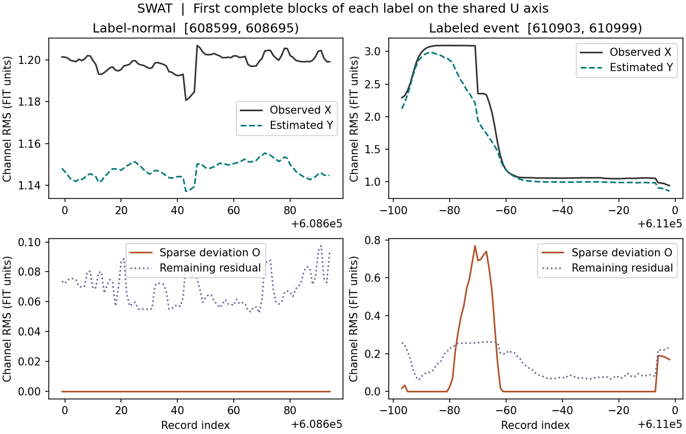

# Fixed trajectory subspaces on public multivariate records

The frozen source model was the best of the three subspace methods on both complete public tasks. SWaT retained a source-initialization benefit over the target-only normal control (+0.01319 AP), alongside a larger loss against leaving the source model frozen (−0.08892 AP). The target-only control was marginally ahead on PSM AP. All three were below the simple level-deviation baseline on each task. Values reflect one deterministic procedure per arm.

## Complete public comparison

| Method | PSM AP | PSM ROC-AUC | PSM VUS-PR | PSM VUS-ROC | SWaT AP | SWaT ROC-AUC | SWaT VUS-PR | SWaT VUS-ROC |
| --- | ---: | ---: | ---: | ---: | ---: | ---: | ---: | ---: |
| Frozen multi-source subspaces | 0.3294 | 0.5347 | 0.3624 | 0.5812 | 0.2002 | 0.5534 | 0.2108 | 0.5665 |
| Source planes → normal target fit | 0.3278 | 0.5325 | 0.3607 | 0.5790 | 0.1113 | 0.4264 | 0.1163 | 0.4419 |
| Normal target covariance → normal target fit | 0.3278 | 0.5326 | 0.3607 | 0.5790 | 0.0981 | 0.3983 | 0.1019 | 0.4139 |
| LEFT (2 seeds) | 0.5734 ± 0.0046 | 0.7739 ± 0.0030 | 0.5674 ± 0.0073 | 0.7817 ± 0.0047 | 0.5650 ± 0.0299 | 0.8177 ± 0.0045 | 0.5286 ± 0.0084 | 0.7799 ± 0.0415 |
| CATCH (3 seeds) | 0.4364 ± 0.0084 | 0.6474 ± 0.0060 | 0.5275 ± 0.0087 | 0.6977 ± 0.0065 | NA | NA | NA | NA |
| TimeRadar block0 (released weights) | 0.4333 | 0.6707 | 0.4413 | 0.6784 | 0.6393 | 0.8220 | 0.5141 | 0.7668 |
| TimeRadar, FIT-only scaler (released weights) | 0.4554 | 0.6838 | 0.4581 | 0.6892 | NA | NA | NA | NA |
| PCA residual | 0.5344 | 0.7933 | 0.5290 | 0.7667 | NA | NA | NA | NA |
| Normal level deviation | 0.4383 | 0.6542 | 0.4460 | 0.6543 | 0.7448 | 0.8318 | 0.4645 | 0.6443 |

Complete W96 test windows begin at 0 (PSM test-relative) or 495000 (SWaT absolute); all positions become available at window end. The new full banks retain 87,840 and 449,856 positions and drop 1 and 63 tail points respectively. Intersect with the archived external valid intervals before comparing: [0,87744) on PSM and [495000,944856) on SWaT. The additional 96 PSM positions are retained in the W96 rows of [ranking.csv](ranking.csv). Native data have 25 and 31 channels. Archived methods were read from their sealed [panel](../left_decoder_context_20261124/public_extension/methods.csv). Each LEFT/CATCH entry is mean ± sample SD of the archived metrics. LEFT trains on normal FIT with normal SELECT and a scaler including SELECT, CATCH trains with FIT-only scaling, both use W192 offline. TimeRadar uses its full-normal-prefix scaler, W100, L=1 and batched order. PCA fits target FIT; level deviation uses the LEFT prefix scaler and the current observation. These permissions differ from the new methods' FIT-only scaler. The separate published CrossAD and ModernTCN panel is in the [main manuscript](../../../manuscript/next_generation_20261115/draft.md#published-reference-panel).

## Independent natural mixed adaptation

| Method | PSM AP | PSM ROC-AUC | PSM VUS-PR | PSM VUS-ROC | SWaT AP | SWaT ROC-AUC | SWaT VUS-PR | SWaT VUS-ROC |
| --- | ---: | ---: | ---: | ---: | ---: | ---: | ---: | ---: |
| Frozen multi-source subspaces | 0.3292 | 0.5442 | 0.3608 | 0.5875 | 0.2348 | 0.5675 | 0.2447 | 0.5770 |
| Source planes → quadratic U | 0.3273 | 0.5415 | 0.3589 | 0.5850 | 0.1394 | 0.4571 | 0.1460 | 0.4688 |
| Mixed target covariance → robust U | 0.3275 | 0.5417 | 0.3591 | 0.5852 | 0.1207 | 0.4415 | 0.1251 | 0.4535 |
| Source planes → robust U | 0.3273 | 0.5415 | 0.3589 | 0.5850 | 0.1374 | 0.4550 | 0.1438 | 0.4668 |

On PSM, robust versus quadratic source-initialized U changes AP by −0.0000011 and VUS-PR by +0.0000022. Both remain below frozen Z. On SWaT, the difference is negative on all four metrics; robust U retains an advantage over the target-only mixed control (+0.01671 AP), while losing 0.09738 AP against Z. Source initialization and the source reference projector change together in the target-only comparison. The direct test of local deviation separation is the robust–quadratic contrast. Neither dataset supplies a material ranking benefit in that contrast. See [full precision paired effects](paired.csv).

U-FIT is [0,17568) on PSM and [495000,585000) on SWaT. Every role anchors its own W96 grid. Score the whole legal QUERY [22504,87784) and [608023,944887) respectively, then intersect with the natural mixed protocol's prior shared axes [22656,87744) and [608535,944856) for the table and operating evaluation. All four arms use the same target FIT scaler, grids and final robust solve. U uses no target labels. Target-only builds its reference and anchor from a full extra mixed covariance pass. Both source arms use the same target blocks and source anchor in all five sweeps.

## Operating costs

| Domain | Method | Stream | FPR | Recall | Event F1 | Matches | Any-hit | FP fragments | Long macro | Long pooled | Max miss |
| --- | ---: | ---: | ---: | ---: | ---: | ---: | ---: | ---: | ---: | ---: | ---: |
| PSM | Frozen multi-source subspaces | strict | 0.0096 | 0.0327 | 0.1323 | 41/48 | 41 | 379 | 0.0138 | 0.0163 | 480 |
| PSM | Frozen multi-source subspaces | confirmed3 | 0.0005 | 0.0047 | 0.2025 | 8/48 | 8 | 18 | 0.0012 | 0.0029 | 3788 |
| PSM | Source planes → quadratic U | strict | 0.0097 | 0.0326 | 0.1325 | 41/48 | 41 | 380 | 0.0135 | 0.0154 | 480 |
| PSM | Source planes → quadratic U | confirmed3 | 0.0005 | 0.0047 | 0.2250 | 9/48 | 9 | 18 | 0.0011 | 0.0026 | 3788 |
| PSM | Mixed target covariance → robust U | strict | 0.0097 | 0.0330 | 0.1310 | 41/48 | 41 | 380 | 0.0139 | 0.0161 | 561 |
| PSM | Mixed target covariance → robust U | confirmed3 | 0.0005 | 0.0044 | 0.2439 | 10/48 | 10 | 19 | 0.0010 | 0.0023 | 3787 |
| PSM | Source planes → robust U | strict | 0.0097 | 0.0326 | 0.1325 | 41/48 | 41 | 380 | 0.0135 | 0.0154 | 480 |
| PSM | Source planes → robust U | confirmed3 | 0.0005 | 0.0047 | 0.2250 | 9/48 | 9 | 18 | 0.0011 | 0.0026 | 3788 |
| SWAT | Frozen multi-source subspaces | strict | 0.0163 | 0.0917 | 0.0260 | 17/22 | 17 | 584 | 0.0509 | 0.1065 | 2032 |
| SWAT | Frozen multi-source subspaces | confirmed3 | 0.0125 | 0.0624 | 0.0295 | 17/22 | 17 | 433 | 0.0406 | 0.0717 | 2034 |
| SWAT | Source planes → quadratic U | strict | 0.0162 | 0.0083 | 0.0537 | 17/22 | 17 | 575 | 0.0382 | 0.0042 | 31858 |
| SWAT | Source planes → quadratic U | confirmed3 | 0.0125 | 0.0068 | 0.0716 | 17/22 | 17 | 421 | 0.0321 | 0.0036 | 31858 |
| SWAT | Mixed target covariance → robust U | strict | 0.0162 | 0.0084 | 0.0538 | 17/22 | 17 | 574 | 0.0383 | 0.0042 | 31858 |
| SWAT | Mixed target covariance → robust U | confirmed3 | 0.0125 | 0.0069 | 0.0730 | 17/22 | 17 | 411 | 0.0322 | 0.0036 | 31858 |
| SWAT | Source planes → robust U | strict | 0.0162 | 0.0083 | 0.0538 | 17/22 | 17 | 574 | 0.0382 | 0.0042 | 31858 |
| SWAT | Source planes → robust U | confirmed3 | 0.0125 | 0.0068 | 0.0716 | 17/22 | 17 | 421 | 0.0321 | 0.0036 | 31858 |

Thresholds come from each arm's own W96 scores on the original 512 CAL timestamps, q99/higher and strict exceedance. All 512 PSM CAL points and 38 of 512 SWaT points on this natural-U protocol carry event labels. Labels were joined after score sealing. These quantiles have no certified nominal FPR. Three consecutive exceedances confirm alarms without backfill. Matching and any-hit count complete events; the two columns happened to agree here. On SWaT, confirmed recall fell from 6.24% (Z) to 0.68% (robust U), and longest missed span rose from 2,034 to 31,858 points despite 17/22 matched events in both cases. Detection of some portion of an event conceals a substantial loss of sustained coverage. Offset statistics are retrospective and include actual block availability. [Operating details](operating.csv) · [Per-event results](events.csv)

## Fitting, convergence and cost

Stage 1 uses 20 TEP FaultFree Training runs (100 disjoint FIT blocks) and all 28 normal SMD records (5,892 FIT blocks); it weights domains, records within a domain and blocks within a record equally. The held-out nominal panels have 25 TEP blocks from five other runs and 1,462 SMD blocks. The same four rank-two projectors went to both target domains. Source trajectory risk was 0.26669/0.26336 on TEP FIT/SELECT and 0.12178/4.69428 on SMD FIT/SELECT. That SMD gap describes the fixed source statistic; SELECT did not replace the FIT projector. Target scalers use the first 105,984 PSM training rows and first 396,000 SWaT normal rows. Nominal SELECT risk and distances between learned planes are in [fit checks](fit_check.json). No synthetic or real event labels entered training.

| Domain | Fit | Blocks/sweep | Initial planes, sweep 1 risk | After sweep 5 | Total fit s | Of which extra covariance s |
| --- | ---: | ---: | ---: | ---: | ---: | ---: |
| PSM | Source planes → normal target fit | 1104 | 0.0748 | 0.0741 | 5.01 | 0.000 |
| PSM | Normal target covariance → normal target fit | 1104 | 0.0738 | 0.0738 | 5.05 | 0.241 |
| PSM | Source planes → quadratic U | 183 | 0.0823 | 0.0809 | 0.84 | 0.000 |
| PSM | Mixed target covariance → robust U | 183 | 0.0780 | 0.0780 | 0.90 | 0.040 |
| PSM | Source planes → robust U | 183 | 0.0796 | 0.0783 | 0.98 | 0.000 |
| SWAT | Source planes → normal target fit | 4125 | 0.0462 | 0.0452 | 13.97 | 0.000 |
| SWAT | Normal target covariance → normal target fit | 4125 | 0.0450 | 0.0450 | 14.26 | 1.086 |
| SWAT | Source planes → quadratic U | 937 | 0.0512 | 0.0504 | 3.78 | 0.000 |
| SWAT | Mixed target covariance → robust U | 937 | 0.0494 | 0.0494 | 4.45 | 0.251 |
| SWAT | Source planes → robust U | 937 | 0.0504 | 0.0496 | 4.31 | 0.000 |

Costs are measured wall seconds per job on an Intel Xeon Silver 4310 CPU, with one BLAS thread per worker (PSM 8 workers, SWaT 23). The following times sum jobs that can overlap. The source fit and held-out source-risk calculation took 4.81 s. Target fit receipts total 53.99 s inclusive of scaler handling and the target-only covariance passes. Bank generation on TEST/CAL/QUERY totaled 21.88 s. Ranking evaluation and its arithmetic check totaled 613.99 worker-wall seconds, mostly the pinned VUS calculation. GPU use was zero. Mean iterations and per-bank tails and wall times are recorded in [diagnostics.csv](diagnostics.csv).

All 69,090 adaptation solves and 34,631 readout solves reached relative proximal-gradient fixed-point residual below 1e-5. The maximum recorded was 0.00000999999732. The 500-iteration cap retained the final iterate by rule; no block reached the failure threshold. The relative mapping is measured on the objective multiplied by WC, normalized by max(1, ||Y||_F). The [preflight](checks.json) checks the lag adjoint, orthonormal DCT, Huber equivalence, lag quadratic, gradient, singular-value shrinkage, anchored eigen optimum and objective descent on actual nominal inputs. The [fit check](fit_check.json) recalculates the objective of the first actual mixed block in both domains with explicit lag/band loops. AP and ROC were recomputed for every full/common curve using tied score groups and rank sums respectively; agreement was within 1e-11. VUS was evaluated with the pinned author implementation (windowSize=100, thre=250), without an independent second implementation. [Bindings](models.csv) · [Metric receipt](numeric_check.json) · [Source receipts](source_fit.json).

## Window examples

The examples are the first complete, wholly label-normal and wholly event-labeled blocks on the common QUERY axis for each domain. The figures show RMS over all sensors; the deployed score is the channel mean absolute residual. Neither examples nor labels influence fitting, calibration or scoring. SWaT's event example had nonzero O in 1.34% of entries versus zero in the normal example. The PSM normal example had more nonzero entries than the event example (0.167% versus 0.083%). The plotted components identify statistical deviations. The labels describe system-level intervals. [Example indices](examples.csv)

## Execution

On the compute host, set PYTHONPATH=src, OPENBLAS_NUM_THREADS=1 and OMP_NUM_THREADS=1. Supply the public workspace path W. Run python scripts/run_trajectory_public.py W prepare. For each domain run python scripts/run_trajectory_public.py W train --domain DOMAIN --workers N (8 PSM, 23 SWAT). After both domains seal, replace train with score. Finish with python -m hybrid_tsad.trajectory_evaluation W PINNED_METRIC_FILE and python scripts/check_trajectory_fit.py W. The independent per-arm train and score commands are also available in hybrid_tsad.trajectory_experiment. Immutable full banks, per-block diagnostics, projectors, scalers and model seals are under results/trajectory_subspace_20261126_v1 in the compute workspace. Only publishable summaries and aggregate illustrations are checked in.
