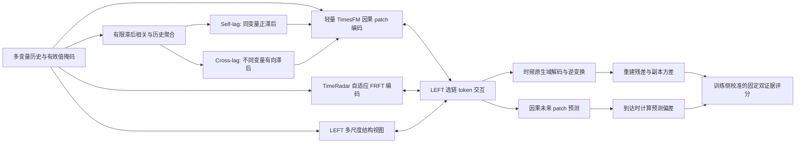

# Hybrid V1：时频—长程时序—滞后协同异常检测

版本：2026-11-02 / DESIGN-v1-r1。设计在代码整合前完成审定；目前完整模型已实现，CPU/A40 L0 已验收，三个源训练种子各完成 8000 次更新，正在做终态及源校准验收。检测收益尚待验证。最高依据为用户本次正式路线纠偏；过去四模式预测候选是开发资产，不是最终架构或研究方向否决器。

## 1. 统一目标与贡献边界

建立一个可训练、可关闭组件、可复现的完整模型，同时覆盖：自适应 FRFT、长历史因果表示、明确的 Self-lag/Cross-lag、LEFT 式多视图交互、重建与预测异常证据、多源预训练及目标域 Z/U/F、混合无标签污染实验。

这是完整候选，不预先声称六项都是创新。拟验证的核心机制是：**保留原生时频表示的多视图交互，结合有向有限滞后关系，是否能提供单视图和同步关系之外的异常证据；这种证据在异构、含污染的无标签训练下能否保留。** 已完成的复现、失败实验和 200 步开发结果全部保留。

## 2. 总体结构

不是叠放完整 TimesFM 与完整 LEFT。复用 TimesFM 的小型因果块、TimeRadar 的 FRFT 编解码组件、LEFT 的多尺度及交互组件；共享通道无关参数，Cross-lag 单独完成跨变量耦合。

## 3. 数据和时间合同

默认工程配置：长历史 H=512，时频局部窗口 W=100、patch=5，时序 patch=16、D=128、4 层、4 heads，预测 P=32；lag 窗口 100、最大滞后 32 个原采样点、top-k=4；多尺度下采样因子 4、2；互补副本 K=2。均为开发默认，正式数值由 source-only 验证与成本测试冻结，不按 query 选取。参数目标不超过 8M，需实际统计，不能将估计当实测。

输入 `[B,H,C]`，随数据集变化的 C 不对应固定变量编号嵌入。附 observed mask、原始绝对索引、实体/run、采样间隔元数据。不同实体不能因拼接而产生跨边界窗口；非等间隔序列不将样本 lag 冒称分钟。

每个待评价点 t 明确区分两个计算图：

|分支|可读观测|输出及可用时间|
|---|---|---|
|预测 pass|X[t-H:t]，只到 t−1|预测 t..t+P−1；误差在对应真实观测到达后可用|
|重建 pass|X[t-H+1:t+1]，允许看到已到达的 x(t)|仅将窗口末点重建证据记到 t；不回填较早位置|

二者共享参数，不共享会把当前观测送入预测图的隐藏张量、归一化统计或缓存。重建属于当前状态评分，不冒称提前预测。训练时随机选择截断点，未来预测 target 单独存放；不将真实 future 填入 TimesFM 预处理后才遮蔽。

## 4. 模块设计与张量接口

### 4.1 FRFT 编解码与重建

外置固定 TimeRadar Model 的 order 网络、复数 patch embedding、FractionalEncoder、MLP_Decoder 和 FRFT/iFRFT。每个原窗口独立计算 order，保留同窗变量共享，不再跨原 batch 共享统计。原文件及原发布权重不修改。

局部窗口 W100 得到原生复数 token `[B,K,C,20,256]`，实虚映射到公共 D 后作为 F 流。FRFT patch 是变换域索引，不贴上原时间标签；T→F/F→T 是跨域注意力，不将两轴逐点相加或插值假对齐。F 流保留 copy 和原生 patch 轴，融合后投影回复数维，复用 decoder 与对应 order 的 iFRFT 完成原时间域重建。

适配器明确返回 order、输入 mask、局部窗口坐标和归一化记录，不通过全局 hook 偷存状态。编码/解码组合从真实作者类复用；必要的分拆 forward 属于项目适配，以原 forward 无融合输出做数值对照。

**符号及数值约定**：V1 支持有符号信号，逆变换重建默认取实部；作者原 Model 最后取 abs 的行为保留为独立 `author_abs` 控制，不悄悄声称二者一致。保留作者依赖的 `torch_frft.frft/ifrft` 快速连续近似算子，不将其误称为任意有限向量上的精确酉 DFRFT。order=0/1 做严格的正负输入回环测试；非整数 order 的验收是与固定官方源逐项一致，并完整报告回环误差及 `exact_inverse=false`，不能要求源算子本身不满足的普适恒等。首次测试及全部线性、随机、局部平滑案例保留于 `preparations/hybrid_v1_i1_core_20261102_v1/`。该澄清修正测试假设，不替换模型算子、不挑选有利信号、不将近似误差隐藏为实现成功。

### 4.2 长程因果时序编码

实际复用 TimesFM 3.0 `ResidualBlock`、`MixingTransformer/StackedMixingTransformer` 的小配置，关闭完整推理 wrapper、KV 解码缓存和大权重下载。默认 `use_variate_attention=False`，跨变量交互交给明确的 Cross-lag；同步变量注意力可作后续控制。

每变量连续 16 点 patch，经共享 residual embedding，变为 `[B,C,32,D]`。只允许 patch k 读取不晚于 k 的 patch；训练下一 patch 目标必须右移。缺失/遮蔽 mask 同步进入 attention。这里是对公共因果模型代码的轻量配置与训练适配，不称 TimesFM 3.0 官方预训练小模型，也不把因果 mask 当因果发现。

T采用因果attention骨干，但首版归一化使用整个合法输入prefix的visible-only统计，较早patch可通过统计依赖prefix内较晚点，因此不宣称旧patch在其当时在线因果。整个prefix→prefix外future仍严格满足时间可用性。后续融合也可以使用截至截断点的全部历史，只用末端状态预测截断点之外的target，不用全历史F流训练历史内部的逐点提前预测。若以后要逐patch历史预测，必须连同归一化改为累计prefix统计，另列实现与控制。

### 4.3 Self-lag 与 Cross-lag

以 Autoformer 完整方法中的延迟相关及聚合为成熟基础，保留旧官方循环算子作为控制。V1 的**非循环、有限滞后、有向变量对**是明确项目适配，不冒称作者已有该跨变量异常模块。

设原采样轴短历史 z_i(s)，共享投影得到 Q_i(s), K_j(s), V_j(s)。相关候选为：

`a(i,j,l) = sum_{s=l}^{W−1} <Q_i(s),K_j(s−l)> / ((W−l)*sqrt(d_lag))`。

- Self-lag：j=i，l∈{1..32}；不把恒等零滞后当独立滞后证据。
- Cross-lag：j≠i，l∈{0..32}；必须保存 target i/source j/lag l 三个轴，不能用单变量自相关改名。
- 源值聚合使用 V_j(W−1−l)，绝不循环回绕。可直接计算，或零填充 FFT 后按有效重叠归一化；两实现需数值等价。top-k/softmax 在每个窗口、目标变量的合法候选中计算，不能跨 batch 共享选择。
- Self 与 Cross 各产出 `[B,C,D]`，经残差投影更新 T 的末端 token，两个开关独立。C=1 时 Cross 明确零增量、不生成假变量对。
- Cross 同步控制仅允许 l=0；有向候选扰乱控制只用于机制检验，不用测试 AP 选择合法 lag。

关闭Cross-lag只删除显式有向滞后通路，不宣称全模型从此完全变量独立：保留的官方FRFT order仍可能在同窗变量之间共享。该共同背景在开/关比较中保持不变；若要声称完全切断跨变量信息，需要另行约束共享order等路径，不能偷换消融含义。

原数据缺失的相关项按有效重叠计数，支持数不足的候选被屏蔽；所有候选无效时返回有记录的零增量，而不是 softmax 全负无穷产生 NaN。学到的 lag 是预测关联，不声称物理因果或已知故障真值。

### 4.4 多尺度与 LEFT 交互

保留真正的 M 多尺度流，不把 lag 输出冒称多尺度。复用 LEFT `MS_Utils` 的 Nyquist 约束滤波与下采样思想/可复用算子；变量数相关的投影改为逐变量共享投影。M 为多尺度 patch token 的拼接，并带尺度身份和有效 mask。

MS读出复用作者 `MsDecoder` 的逐token投影；每个尺度的融合token按其真实粗分辨率上采样到原H的patch网格，再共享解码器重建原时间目标，保留by-scale预测。各尺度对原observed且被遮蔽目标都有GT损失，主r_ms按各尺度误差等权，不能只监督最后一个尺度而让其他M流失去任务。此处全率多尺度读出是项目适配，不冒称LEFT原训练目标逐式移植；一致性在聚合预测与TF的重叠原时间区间计算。

按 LEFT 真实 selected links 运行 1 层起步：T←F、F←更新后的 T、M←更新后的 T；跨变量滞后先在 T 端注入。融合按每变量组织，避免固定 C 参数。K 个 TF copy 保持独立分支：将T/M广播到每个copy，分别交互与解码，预测头在解码后平均copies；不先平均掉F及重建方差证据。原生 F 轴和多尺度 M 轴仅由注意力连接，不强行坐标同一化。

原 `MultiViewFusion.forward` 没有 mask 参数，因此新adapter必须调用其真实 `t_from_f/f_from_t/m_from_t` 子块并显式传入已有的attention/key-padding mask，保持原更新顺序。无padding/dropout关闭时与原类同权重输出对照；TimesFM的make_attn_mask返回True=可见，但其patch_mask输入与PyTorch key_padding_mask均为True=屏蔽，须按字段转换，不能一律取反。补零query在残差FFN后清零；全无有效key的分支显式跳过，不能NaN。

选链图没有M→T/F边。为防止M成为无效装饰，M+必须有直接真实目标监督和进入主重建证据的解码路径，不能只存一个未使用的辅助表示。

保留相同公共维的 `none / feature_mean / concat_linear / left_interaction` 四种开关。实际首版 `late_score_equal` 与 `none` 是同一无特征交互路径，不重复作为两个模型；主评分固定为重建家族与预测家族各 1/2，即 TF/MS/pred=(.25,.25,.5)，不是三个分项各 1/3。它与特征等权不同，也不等于三个单独训练模型的集成。多层融合、原型 memory 和额外 gate 不是 V1 必需组件。

简单融合的异长轴处理固定为：每流按有效token做域内pool到一个D向量，feature_mean取三向量均值、concat_linear将3D投影到D，再以同一上下文残差广播回各自流。不是把T32/F20/M多尺度的第n项硬相加。none不进行特征交互；其训练仍使用共同 SSL 配方，含 0.1 跨视图一致性，不能称独立训练专家。普通feature池化与LEFT保留token的差异是真实模型差异，容量/成本另报。精确评分及后续对照合同见 `notes/hybrid_v1_20261102/PSM_Z_AND_ABLATION_PROTOCOL_DRAFT.md`。

### 4.5 解码、训练目标和异常分数

F 原生 token 产生时频逆变换重建；M/T 融合状态产生轻量原时间辅助重建；T 末端产生未来 32 点。首版监督目标：

`L_ssl = L_tf_masked_reconstruction + L_ms_masked_reconstruction + L_future_prediction + 0.1 * L_masked_cross_view_consistency`。

前三个目标固定等权；一致性项是明确项目适配且可关闭，不是把LEFT的STFT cycle公式不加修改搬到FRFT。MS重建对真实masked历史目标回归；一致性仅比较TF局部W100与MS原时间重建的重叠被遮位置，不能只做两个头相互拟合却没有GT。先不加原型库或新对比网络。TimeRadar原CDL的历史实现及弱/注入标签条件保留，不直接将依赖标签的CDL冒充混合无标签目标。

预测pass使用可见历史，重建pass使用共同原始遮蔽历史。主末点重建采用两个互补的通道组：每组遮住当前t的一部分通道，所有分支入口前施加同一mask；每个通道的t点只从其真值被遮蔽的组评分，其他通道当前观测在t已到达时允许使用。每组保留K=2个FRFT副本，因此完整重建成本为最多2组×2副本，不能用旧K2单pass成本冒称新成本。C1只执行有目标的组，空组跳过；两个组的目标集合必须完整、不重叠。

训练强制相同末点遮蔽规则，并增加事前固定的历史随机patch遮蔽；真实target留在loss侧，visible-only mean/scale不读取隐藏真值。所有视图包括MS和lag均只读student填补后的数值与mask。FRFT互补mask是额外变换域遮蔽，不替代原值遮蔽。预测pass完全不包含x(t)，不能复用重建pass的当前其他通道或统计。

自然缺失、人工遮蔽、补齐三种mask分开。只有原始observed的真实目标进入loss/score，插补值不是GT。某通道可见数不足2时其归一化标无效；无有效监督的窗口跳过且记录，不虚报optimizer更新。分组及所有copy mask作为输入记录随通道置换一起变化，才能检验条件置换等变；不声称固定列号分半后换列仍逐位等变。推理分组与副本RNG只依预登记seed/原窗口身份，不能依label或分数；构建optimizer前完成ResidualBlock输入维度初始化。

当前点至少保存：`r_tf`、`r_ms`、副本 `r_var`、`r_pred`、每通道值、预测签发点及目标点、各分量可用mask。完整主分数固定 `S=0.25*cal(r_tf)+0.25*cal(r_ms)+0.5*cal(r_pred)`，即重建/预测各一半、重建内部两路等权。M有直接评分路径，去M的控制必须真改变图和loss。预登记去掉某重建路时，剩余重建路占总分0.5；不是在query逐点挑选可用路。若运行时任一必要分量不可评分，则主分数为缺失并保留覆盖，不偷偷填0/自适应重权重。

副本方差保留为辅助及TimeRadar原评分控制，不先添加测试驱动权重。cal固定为 `log1p(error / max(source_CAL_median,1e-6))`，只用被允许校准池，正尺度常数规则写入配方；不能用query的分位数或真实正常标签。源/目标统计不混用。

主预测误差先使用 horizon=1；预先登记的 {1,8,32} 多 horizon 汇总仅使用真实签发过的旧预测，作为固定控制，不能在看到某时刻真值后重新签发该时刻预测。各控制在共同有效索引上比较，并单列不可评分事件覆盖。

## 5. 两阶段与混合无标签

### Stage 1：异构公开源预训练

按数据集/实体均衡抽样完整多变量窗口，不恢复旧 C=1 抽样器来冒充跨变量预训练。共享输入/解码参数，H、C 有 mask；归一化只依赖对应输入允许的观测。源 FIT / SELECT / CAL 隔离，最长 H+P 足迹不跨 run/切分边界。选模只看源验证自监督目标及固定诊断，不用目标 query 标签。

污染研究是核心实验轴。V1同时实现无鲁棒基线half-MSE（0.5*error²）与Huber(delta=1)的逐元素重建/预测损失，使小残差处曲率相同，而非把全局梯度缩放差异当鲁棒收益。实际报告的MSE/RMSE仍用标准定义。Huber为成熟稳健基线而非预先宣称的创新。两者训练曝光、数据池、权重、初始化和评分策略一致。先不增加根据模型自身错误筛正常的复杂可靠性网络，避免把难正常误删。

污染比例预登记 {0,1,5,10,20}%：独立源支持事件池的真实公共异常片段，以及另列的受控注入；连续片段按原事件组织，不把点打散。原标签只供构造和评价账本，学习代码只见数值与自然有效 mask。不从 query 截片补训练。多源混合不等于已证明污染鲁棒；该主张需鲁棒开/关和多污染水平实证。

### Stage 2：Z / U / F

|路径|参数更新|数据与校准|
|---|---|---|
|Z|无目标更新|仅源训练和源 CAL；不先 fit 目标 scaler 或目标阈值|
|U|目标适配区间无标签 SSL 更新，可冻结/更新融合与 heads|混合正常/异常；独立目标无标签 CAL 与 query；真实污染标签不得参与过滤、早停或阈值选择|
|F|少量事件监督更新融合末层/已有 heads及简单异常头，主编码器默认冻结|K=0/1/3/5/10 个独立异常事件＋匹配正常支持；支持/验证/query及时间隔离固定，完整事件不能跨集合|

F目标必须真实实现：support上的逐点 `BCEWithLogits(event_head(features),label)`＋正常support上的SSL保持项（默认0.1），异常support不强迫作正常重建。特征由已到达时刻的分项残差及融合端点构成，头保持线性；融合末层/heads的更新与冻结表示线性探针另作区分。K按全部异常标注预算计，不额外隐藏有标签异常验证事件；首版选步数规则从源验证固定，目标仅用独立正常支持验证，不用query。K0明确无异常监督：以Z和正常SSL适配对照分别列出，不能伪称已有少样本异常学习。

校准权限固定：Z用源CAL；U用独立的无标签混合CAL，阈值不能称真实正常1%误报预算；F用匹配但与训练/query隔离的正常支持CAL，正常支持量与异常K分别记账。源/目标校准作为不同条件分列，不能把换CAL池的收益全归模型更新。

U 的 CAL 池本身可能污染，需比较相同合法池和阈值规则并报告校准偏差；不能偷用 query 的真实正常点设误报率。F 同时保留仅阈值校准控制，旧线性探针失败不自动否定新表示或新 F 路径。

首版更新名单固定：U只更新fusion、tf_fusion_delta、ms_decoder、forecast_head，TF/temporal/lag/MS-filter基础编码器冻结；F再加event_head，余同。U按固定预算和无标签SELECT自监督损失选步，不能用真实污染身份。更广泛更新是另一个消融，不让执行者各自默认。

F的event_head为线性(2D+3)→1：输入通道池化的融合T端点D、F原生域池化D，以及log1p(r_tf/r_ms/r_pred)三个实际到达后的残差。K>0最终连续分数为原logit，阈值用独立正常支持CAL的q99；仅阈值校准对照仍用原SSL双证据分数。CE按独立事件/匹配正常片段均衡，不能让长事件点数冒充更多shot。K=0不启用event_head/CE、不更新，精确退化为Z；另报正常SSL适配U控制。标签到原target索引的映射和正常支持量必须入manifest。

源CAL按domain等权：每个domain内有效窗口总权重1/域数，分项尺度取该加权分布中位数，主阈值取同一冻结CAL分布q99上分位、strict>。U/F目标合法CAL为本实体池的非加权规则，逐条件分列。零中位数用1e-6，零误差得零；全无有效CAL拒绝拟合，不返回虚构阈值。不同分量缺失不能伪装为正常。

## 6. 系统消融与模型验收

先使完整 V1 跑通，再在同配置上关闭 TF、long temporal、Self-lag、Cross-lag、全部 lag、M 多尺度、LEFT interaction；比较固定 FRFT order、原 Autoformer 循环控制、Cross 同步控制、feature mean/concat、late-score equal 与完整模型。先做主要控制，按波次扩展，不同时启动全笛卡尔积。

模块验收包含：每条路径实际梯度/参数变化、开关确实改变路径、padding/缺失/变 C、通道置换、batch 独立、未来/遮蔽 target 置换不影响编码、FRFT 有符号逆变换、有限 lag 无回绕及 i/j/lag 索引、重建/预测双 pass 隔离、Z 零更新、U 不见标签、F 实际使用异常事件。测试通过是工程验收，不是模型收益或创新认证。

## 7. 风险与不变边界

TimesFM 3.0 当前核得官方技术发布和代码，未核得 3.0 的正式顶会论文；正式基础单列 ICML2024。TimeRadar/LEFT 的软件许可未认证，保持外置，不把其代码再许可发布到 Git。长历史与短 TF 窗口不同：full vs no-TF 保持 long history 相同；单支之间的比较明确感受野差异，另做同历史控制，不能据单支比较声称纯频域增量。

微弱异常须有预登记的幅值/边际证据分层或受控扰动；滞后关联异常须有独立生成/记录或谨慎的关联分析，普通 benchmark 标签只能证明通用检测。没有机制真值不阻断模型研发，但限制机制主张。预算内技术调整由 root 负责；不因单 seed/局部损失变化改变六项路线。

作者数值对照绕过新D256→128→256投影及融合，复用相同order/mask/decoder复数输出，先比较author_abs；再在同一逆变换上分别测试real/abs。无融合的公共D投影本来不是恒等，不要求它逐位等于原作者全部输出。FRFT按上述整数回环、非整数源一致性及误差披露分别验收，不要求随机decoder恒等，也不把可精确回环的独立DFRFT诊断悄悄换进主模型。
