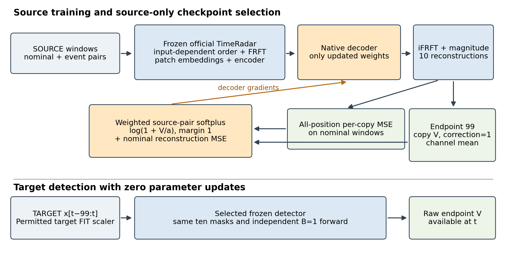

# Abstract

A pretrained reconstruction detector may deploy disagreement among masked reconstructions even when subsequent learning primarily rewards reconstruction accuracy. We investigate direct supervision of that deployed statistic. Starting from official TimeRadar weights, we freeze the fractional representation and encoder and update only the native decoder. Nominal source windows retain the per-copy reconstruction objective. Publicly labeled abnormal and normal windows supply a point-count-weighted pairwise loss on log-scaled endpoint variance. Detection uses the same native variance with no additional head or target parameter update. Three project-training seeds yield mean average-precision gains over matched reconstruction continuation of 0.03433 on PSM, 0.01128 on MSL and 0.01665 on SMAP, while SMD decreases by 0.00946. These seeds share one official initialization. Same-label reconstruction-error and supervised-head comparisons support task-dependent value for direct variance learning, with stronger reconstruction-error performance on NASA and substantial gaps to complete target-trained LEFT. Source-support expansion and full updates fail to broaden competitiveness under the tested protocols. Operational results expose false-alarm, event-discovery and coverage tradeoffs. The evidence supports a narrowly defined source-supervised learning procedure and identifies limits to its transfer.

# 1 Introduction

Pretrained time-series anomaly detectors must convert internal outputs into a scalar that ranks observations by abnormality. Reconstruction error is one possible statistic. Disagreement across masked reconstructions is another. Learning to reconstruct a nominal input and learning to order abnormal observations by disagreement are related objectives, but they need not favor the same parameters.

TimeRadar offers a concrete setting in which to examine this distinction. Its official model learns an input-dependent fractional representation and produces multiple masked reconstructions. The released variance configuration measures disagreement among those copies [@timeradar2026]. A decoder can reduce reconstruction loss while producing disagreement that transfers poorly as an anomaly score. Deliberately increasing source-event disagreement could also separate source examples yet damage target performance. Both possibilities require detection evaluation.

We study a restricted intervention. We retain the official pretrained representation, native decoder structure and endpoint variance. We update the decoder with nominal reconstruction and a pairwise objective applied directly to that variance on publicly labeled source events. The endpoint supervised during fitting is also scored at deployment. The method adds no scoring network. Five public SWaT fitting events and four separate source-validation events supply anomaly knowledge. Nominal reconstruction windows come from SWaT and SMD. Target parameters remain frozen during the principal benchmark.

The technical question concerns the object being supervised. Pairwise ranking, source anomaly labels, fractional transforms and reconstruction variance have precedents. We examine one learning procedure in which real source-event supervision changes the native deployment statistic through the original decoder. This gives a precise implementation and comparison. It also restricts the claim. The representation and pretraining come from TimeRadar, and the experiments do not establish a separate time–frequency representation contribution.

Three questions organize the study. Does direct endpoint-variance supervision improve on frozen detection and source reconstruction continuation under the same readout? How does the complete procedure compare with reconstruction-error supervision, a standard supervised head and mature external detectors? How stable are its gains across source-training seeds, tasks and operating criteria?

The proposed contribution is the specification and implementation of source-event supervision on native deployed endpoint disagreement, with source-only checkpoint selection. The experimental contribution is a matched three-seed evaluation and a set of same-label and complete-method comparisons that locate the benefit and its boundaries. These contributions concern a concrete learning procedure and its observed transfer. Their significance is limited by inherited components and by the evidence's scope.

The positive evidence consists of repeated average ranking gains on PSM and two NASA tasks relative to the original reconstruction controls. Important limitations remain. PSM informed development, SMD contributed nominal source data, and NASA uses one sensor per entity. SMAP precision–recall gains coexist with ROC costs. Complete LEFT is stronger across most external comparisons. Completed mixed-update and single-event-support experiments do not establish reliable additional benefit.

# 2 Related Work

## 2.1 Pretrained detection and native disagreement

TimeRadar learns fractional reconstruction and contextual deviation in hidden patches. Its published detection rule includes reconstruction error and variability among masked outputs [@timeradar2026]. We distinguish that combined rule from the fixed released-code variance configuration used here. Our intervention supervises the native endpoint variance after official pretraining.

DADA combines an adaptive bottleneck with dual adversarial decoders and also uses reconstruction variability for detection [@shentu2025dada]. Variance-based anomaly evidence is therefore established prior work. TimeRCD learns a contextual anomaly discriminator using synthetic context-dependent labels [@lan2026timercd]. Our procedure applies real public source labels to the original TimeRadar decoder and keeps its variance readout. Complete comparisons assess competitive scope. Matched TimeRadar controls provide the closer evidence for the training intervention.

## 2.2 Source supervision and pairwise learning

Neural pairwise ranking is a mature tool [@burges2005ranknet]. Learning anomaly scores from limited labels also precedes this work. PReNet learns relations between labeled and unlabeled instances to obtain anomaly scores [@prenet2019preprint]. We use a softplus margin on two native scalar scores. The object differentiated through is an existing reconstruction-disagreement statistic, alongside nominal reconstruction.

Source labels identify full abnormal or normal windows. They do not identify individual faulty sensors. Three chronological endpoint strata support sampling within each event, with weights proportional to their legal positive endpoint counts. These strata provide no physical stage interpretation. Source and target datasets also have different anomaly semantics.

## 2.3 Multiview detectors and information permissions

LEFT coordinates temporal, spectral and multiscale views through reconstruction and consistency objectives [@left2026]. CATCH models channel relationships using frequency patching [@catch2025]. We retain their complete local implementations as external references where compatible caches exist.

A common timestamp axis aligns evaluated observations but leaves information differences intact. Interior scores from a full window become available after the scored observation. A terminal score uses the current observation and preceding window. Our causal ranking and external common-axis panels therefore retain their respective availability times and standardization permissions. Global ranking, empirical false alarms and event discovery are reported as distinct outcomes.

# 3 Problem Formulation

Let a public record contain \(x_0,\ldots,x_{N-1}\), with \(x_t\in\mathbb R^C\). An archived scaler fitted on permitted nominal FIT data gives \(z_t\). An eligible timestamp has input
\[
X_t=[z_{t-99},\ldots,z_t]\in\mathbb R^{100\times C}.
\]
Each native forward contains one window. The current observation participates in reconstruction. The endpoint score is available at \(t\).

Sources supply nominal windows \(\mathcal N\), labeled fitting events \(\mathcal E_{\rm fit}\), and separate labeled selection events \(\mathcal E_{\rm select}\). A positive window lies entirely inside an abnormal source interval. Its paired negative lies entirely inside a labeled-normal interval of the same authorized role. Source labels enter fitting and checkpoint selection.

Each target has a fixed scoring axis \(\mathcal I_d\). Target labels enter evaluation after source selection. Target parameters receive zero updates. Archived target FIT values may supply scaler statistics. CAL values determine empirical thresholds for the separate operating analysis. The official checkpoint's upstream pretraining permissions are inherited, and exclusion of every target dataset from all upstream pretraining is not independently certified.

AP is the principal outcome. ROC-AUC, VUS-PR and VUS-ROC complement it. For multi-entity tasks we compute metrics per entity, then take equal-weight means. Three seeds vary project source sampling and fitting from one official initialization. They are not independent datasets or independent pretrained models.

# 4 Proposed Method

## 4.1 Frozen representation and native decoder

Write the official forward as
\[
H^{(m)}(X;\theta_0,\mathcal M_C),\qquad
\widehat X_\psi^{(m)}
=\left|\operatorname{iFRFT}_{\alpha_{\theta_0}(X)}
\!\left(D_\psi(H^{(m)})\right)\right|,
\quad m=1,\ldots,10.
\]
The fixed parameters \(\theta_0\) include the order network, real/imaginary input mappings and encoder. \(D_\psi\) is the original complex decoder. The order is computed independently for each B=1 window using its variables according to the native rule. Official fractional transforms and variable ordering are retained.

The mask bank \(\mathcal M_C\) contains five fixed random patch masks and their complements. RNG state is isolated and restored around each forward. Masks depend on channel count and are fixed across fitting and scoring. Eval mode disables dropout while decoder gradients remain enabled. All non-decoder parameters and buffers are frozen.

{width=100%}

## 4.2 Deployment statistic and nominal objective

Define the copy mean
\[
\overline x_{\psi,j,c}=\frac1{10}\sum_{m=1}^{10}\widehat X_{\psi,j,c}^{(m)}.
\]
The deployment statistic is
\[
V_\psi(X)=\frac1C\sum_{c=1}^{C}\frac1{9}
\sum_{m=1}^{10}
\left(\widehat X_{\psi,99,c}^{(m)}
-\overline x_{\psi,99,c}\right)^2.
\tag{1}
\]
This uses correction1 and the channel mean. Ten copies and position99 are identical in the training pairs and deployment.

Nominal windows retain the complete per-copy objective
\[
\mathcal L_{\rm copy}=
\frac1{|\mathcal B_N|}\sum_{X\in\mathcal B_N}
\frac1{10\cdot100\cdot C_X}
\sum_{m,j,c}
\left(\widehat X_{\psi,j,c}^{(m)}-X_{j,c}\right)^2.
\tag{2}
\]
Each window is reduced before averaging, so sources with different channel counts receive equal weight per window.

This loss decomposes exactly into
\[
\mathcal L_{\rm copy}(X)=E_{\rm full}(X)+0.9V_{\rm full}(X),
\]
where both terms average all positions and channels, and the variance uses correction1. Nominal reconstruction therefore already penalizes disagreement on nominal windows. It supplies no direct ordering constraint between labeled abnormal and normal endpoints. That distinction motivates supervision, without identifying a unique cause of historical failures.

## 4.3 Weighted endpoint pair learning

Partition each fitting event's legal endpoints into three chronological, nearly equal-size strata \(\mathcal P_{e,k}\). Let \(n_{e,k}=|\mathcal P_{e,k}|\). Each update samples one positive window \(P_{e,k}\) per stratum and one negative \(N_{e,k}\) from the legal labeled-normal pool. Set
\[
w_{e,k}=\frac{n_{e,k}}{\sum_{e',k'}n_{e',k'}},
\qquad
g_\psi(X)=\log\!\left(1+\frac{V_\psi(X)}a\right).
\]
The fixed \(a\) is the official-initialization median V over all4,632 legal normal source-FIT endpoints, protected below by \(10^{-8}\). Its archived value is \(0.02649214304983616\).

The supervised and total losses are
\[
\mathcal L_{\rm pair}
=\sum_{e,k}w_{e,k}\operatorname{softplus}
\!\left(1-g_\psi(P_{e,k})+g_\psi(N_{e,k})\right),
\tag{3}
\]
\[
\mathcal L=\mathcal L_{\rm copy}+\mathcal L_{\rm pair}.
\tag{4}
\]
Margin and pair coefficient are both1. The weights describe window-sampling strata. Overlapping windows do not become independent events or uniformly supervised original timepoints.

For \(u=1-g(P)+g(N)\),
\[
\frac{\partial\ell}{\partial V(P)}
=-\frac{\sigma(u)}{a+V(P)},\qquad
\frac{\partial\ell}{\partial V(N)}
=\frac{\sigma(u)}{a+V(N)}.
\tag{5}
\]
The objective encourages positive source disagreement relative to its paired negative through the decoder. Nominal reconstruction provides the accompanying constraint. These derivative directions describe the learning request. They imply no transfer guarantee for new events or domains.

Updating only \(\psi\) preserves upstream parameters while permitting the decoder to alter the relation between features and reconstructed copies. Variance can change independently of whether an input is accurately reconstructed. We therefore evaluate direct E supervision and a supervised head as separate complete procedures.

## 4.4 Source selection and implementation

The five fitting events yield15 strata. Each update uses32 nominal windows,16 SWaT and16 SMD, plus15 positive and15 paired-normal windows. SMD first samples a machine uniformly, then a legal endpoint. Independent native B=1 forwards accumulate decoder gradients before one optimizer step.

Fresh AdamW uses learning rate \(10^{-4}\), betas \((0.9,0.95)\), epsilon \(10^{-8}\), weight decay0.1 excluding bias and LayerNorm parameters, and24-step linear warmup. The cap is240 updates. At updates \(0,40,\ldots,240\), source selection evaluates16 fixed pairs per validation event/stratum. Risk averages pairs within each stratum, then equally over four events and three strata. The earliest minimum wins. Training is point-count weighted and selection is event/stratum balanced. The reconstruction control uses this same label-assisted selection. Selected steps and exposures differ across methods.

**Algorithm1. Direct source supervision of native endpoint V**

~~~text
Inputs: official parameters (theta0, psi0), fixed source roles,
        seed-specific window plan, mask bank M_C, source scale a
Freeze theta <- theta0; set trainable psi <- psi0
Keep the complete model in eval mode; create fresh decoder AdamW
best_risk <- infinity
For q = 0,...,240
    If q > 0
        Clear decoder gradients
        For each of the 32 nominal windows X in plan[q]
            Native B=1 forward with isolated fixed masks
            Backpropagate copy_MSE(X)/32
        Draw one positive and one normal window for each FIT stratum
        Native B=1 forward for each paired window
        Compute V at endpoint99 and weighted pair loss (Equation3)
        Backpropagate pair loss
        Apply scheduled learning rate and one AdamW step
    If q in {0,40,80,120,160,200,240}
        Compute the fixed SOURCE SELECT event/stratum risk
        If risk < best_risk, save decoder and update best_risk
Freeze the selected decoder
For each legal target timestamp t
    Apply the permitted archived target scaler
    Form X_t = z[t-99:t+1]; native B=1 forward with fixed masks
    Output raw V(X_t); available_index <- t
~~~

The implementation is in native_event_rank.py, native_event_rank_training.py and the archived domain readouts. Native score computation retains decoder gradients through the inverse transform. The training score uses cal_anomaly_score with L=1. Source selection precedes target scoring.

# 5 Experiments

## 5.1 Public data and axes

PSM uses25 channels and SMD all28 machines with38 channels. NASA uses sensor column0 for27 MSL and53 admitted SMAP entities. The archived admission rule excludes SMAP P-2 because of a pre-existing label/record conflict. The rule predates these comparisons. Complete causal axes are \([99,N)\) within records, totaling87,742 PSM,705,648 SMD,71,056 MSL and422,370 SMAP points. Entities are never concatenated into a continuous record.

Nominal SWaT FIT is \([0,396000)\). The authorized labeled slice \([495000,585000)\) splits at502578, in a normal inter-event gap. Five fitting events provide1,857 legal positive endpoints and4,632 legal normal endpoints. Four selection events provide2,439 positive and79,092 normal endpoints. SWaT is excluded as a target for this fold. SMD nominal training-side FIT supplies reconstruction windows.

PSM is exposed development data. SMD evaluates held-out tests of nominal-source-visible devices. NASA supplies different public tasks with single-sensor inputs. These permissions differ from fully unseen-domain testing. Target FIT scalers are retained from the archived protocol.

The external common axis starts at99 and ends at each entity's last point jointly scored by LEFT and DADA. Totals are87,645 PSM,702,996 SMD,69,495 MSL and417,265 SMAP points. Our causal values are restricted to those indices without changing their scores. LEFT uses W96 on MSL and W192 elsewhere, DADA W100, and TimeRCD blocks up to5000 points. Their interior scores retain later availability. A separate history-baseline panel appears in the supplement.

## 5.2 Metrics and comparisons

AP is non-interpolated average precision, distinct from trapezoidal PR area. ROC-AUC and both VUS metrics accompany it. VUS uses the pinned LEFT implementation with windowSize100 and250 thresholds. It incorporates tolerance around ranges and is interpreted alongside strict point ranking.

Frozen official V, E and V+E are local project endpoint results. Here
\[
E_\psi(X)=\frac1C\sum_c
(\overline x_{\psi,99,c}-X_{99,c})^2.
\]
The fixed sum is the existing paper-formula comparison under the project endpoint protocol. It is separate from released-code L=1 V and from exact reproduction of the author's complete original evaluation track.

Source reconstruction uses the original nominal draws and labeled SELECT. Direct E shares the labeled pair schedule and loss form but uses its own official-normal FIT scale0.30042700469493866 and E-specific selection risk. The MLP uses frozen official features with a supervised nonlinear readout. It changes trainable components, objective and score, so it is a complete supervised control.

LEFT trains on target nominal arrays with normal validation. SMD has per-machine models and NASA domain-shared models. Its scaler includes the complete normal prefix. DADA uses official weights and normal target arrays for scaling. TimeRCD uses official logit differences with archived FIT-only statistics once. NASA uses its official univariate checkpoint. Whole-QUERY statistics remain in their separate archived track. CATCH and PCA retain their existing target-training permissions.

Seeds2025–2027 vary source sampling from one pretrained initial state. We report sample SD with ddof1. Paired differences are computed at each seed before averaging. Entity count and overlapping point count do not enlarge the number of training repetitions. No significance claim is made from three seeds.

## 5.3 Complete detectors

Table1 uses the external common axis. Cells contain two metrics each. Trained native controls show three-seed mean and sample SD. Single official/external results retain their fixed identity. Every value is a local computation, including project protocol adaptations.

**Table1A. Complete methods, AP / ROC-AUC.**

{{MAIN_AP}}

**Table1B. Identical methods and axes, VUS-PR / VUS-ROC.**

{{MAIN_VUS}}

The candidate's strongest competitive scope is PSM. Its mean AP0.5731 is close to LEFT0.5769 and above DADA0.3957 and FIT-only TimeRCD0.3019. LEFT has higher ROC and both VUS measures. SMD candidate AP0.4402 is below LEFT and TimeRCD and above DADA. Its mean margin over DADA includes negative entity medians and only12–13 winning machines across seeds.

NASA exposes larger gaps. Candidate mean AP is0.3659 on MSL and0.3826 on SMAP, compared with LEFT0.5083 and0.4932. DADA and TimeRCD also have higher AP. Frozen E and V+E remain strong NASA references. These limits coexist with gains over matched native controls.

## 5.4 Repeated learning effects

Table2 reports method means and seed SDs on complete causal axes. Table3 reports within-seed differences and their SDs. Difference uncertainty must be calculated from paired values.

**Table2. Complete causal axes, method values.**

{{REPEATS}}

**Table3. Same-axis paired differences, mean ± sample SD, n=3.**

{{PAIRED}}

Direct V improves AP over both controls at every seed on PSM, MSL and SMAP. PSM and MSL also improve both ROC and VUS measures. SMAP improves AP and VUS-PR but reduces ROC-AUC against frozen V in every seed. SMD loses AP and both VUS measures with a higher ROC-AUC. The fixed endpoint intervention produces repeatable yet task-dependent changes.

Against reconstruction, MSL has16–17 AP wins among27 entities. SMAP has28–30 among53, with small positive medians. Against frozen V, SMAP medians are near zero and win counts vary. The supplement retains all per-seed distributions. The number of target points does not increase the training repeat count.

## 5.5 Training statistic and supervised readout

Table4 uses seed2025 and complete causal axes. Each cell contains AP / ROC-AUC / VUS-PR / VUS-ROC. Formal procedures deploy their designated scores. Auxiliary cross-readouts were fixed before evaluation.

**Table4. Training objectives and readouts.**

{{ABLATION}}

Direct V has higher mean AP than the MLP on all four tasks. The head reduced source-validation loss from0.697998 to0.458485. Its target gap therefore does not show simple failure to fit the source task. Full-range and exposure-limited selection chose the same \(10^{-3}\), step40 weights. The head searched two rates over up to2400 steps. These differences preclude interpreting the result as a strict single-factor test.

V has higher AP than E on PSM and SMD. E has higher AP, ROC and both VUS measures on MSL and SMAP. Cross-readouts show that training can affect the two statistics differently. Their values do not select a target-specific formal score.

## 5.6 False alarms, events and coverage

Each model uses its own CAL scores at the same permitted indices, q99/higher and strict exceedance. PSM operations use the original64,728-point suffix. All512 CAL points there have attack labels. NASA has14–30 MSL and4–29 SMAP CAL points, making q99/higher the sample maximum. SMD CAL is nominal training-side data. These thresholds do not certify a normal1% false-positive budget.

Three-confirmation starts at the third consecutive exceedance, with no backfill or bridging time gaps. One-to-one matching and any-hit are distinct. Long steady coverage excludes the first512 event points, with only four MSL and ten SMAP long events. Misses and delays use sample units.

At seed2025, direct V increased SMAP false fragments from607 for frozen V to808 while event F1 improved only slightly. PSM candidate coverage falls below frozen V at its retained threshold. The supplement reports both streams, matched and any-hit counts, macro and pooled coverage, longest misses and delays. These costs restrict the interpretation of AP gains.

## 5.7 Boundaries and independent target extensions

Table5 reports fixed single-seed boundary contrasts on complete causal axes. Expanded support replaces half the SWaT pairs with TEP at fixed total exposure. Its matched control shares the enlarged nominal pool and combined validation panel. The full-update contrast restores the original source contract. These boundary results retain their own controls.

**Table5. Boundary contrasts, ΔAP / ΔROC-AUC / ΔVUS-PR / ΔVUS-ROC.**

{{BOUNDARIES}}

TEP gives a small SMAP gain but no material expansion of V's competitive scope. Full native updates lower AP relative to decoder-only V on every task despite verified representation gradients. Selected steps differ and are part of the complete learning effects. These results constrain the tested procedures without identifying a universal failure of source diversity or representation learning.

A separate full-position study supervised all100 positions, selected with full-position source risk and used non-overlapping full-window scores. It retained a repeated PSM AP benefit, task and metric tradeoffs and external gaps. Its objective and scoring availability differ from the formal endpoint method. Its numbers are not mixed into Tables1–4.

Mixed-unlabeled updates and one-event supervised support were completed as independent extensions. The fixed mixed update failed to establish stable net gains over frozen or source-only references. The single-event rule failed to establish a more useful source-supervised initialization. Supplementary tables preserve their original suffix axes and all metric tradeoffs. They do not establish mixed-unlabeled adaptation capability for the principal method.

# 6 Discussion and Limitations

The learning difference is concrete. True public event labels supervise the variance deployed by the existing detector, while its decoder and nominal reconstruction are preserved. Three-seed controls show repeatable changes in transfer ranking. Direct E and MLP controls provide alternative uses of the same source knowledge. These experiments support investigating the native deployment statistic as a learning object.

They do not isolate its scalar formula from all surrounding resources. Supervised fitting receives extra positive and pair-normal windows beyond reconstruction. Labels also select the reconstruction control. E has its own scale and selection risk. The MLP changes components and searches a larger optimization range. The supported comparison concerns the specified complete procedures.

Novelty remains narrow. Fractional transforms, official representation and pretraining, masks, variance, ranking loss and source labels all have precedents. The project contribution is their concrete use to directly supervise native endpoint disagreement and the measured transfer effects. Whether this difference and its evidence suffice for a method paper requires scholarly assessment. The manuscript does not enlarge that difference through component renaming.

Generalization is limited by five fitting events from one real public process, with four more used for selection. Dataset anomaly semantics differ. PSM was used in development and SMD nominal data were source-visible. Upstream pretraining limits unseen-data claims. NASA's single-sensor setting cannot establish cross-variable learning. No experiment isolates an independent FRFT benefit in this candidate.

Ranking improvement also coexists with false fragments, coverage losses and metric tradeoffs. Calibration restrictions limit operating conclusions. External methods have different source supervision, target training, statistics and temporal permissions. Timestamp alignment alone cannot establish equal-context architecture fairness.

The method adds no parameters or inference head. It retains ten-copy inference and a B=1 sliding-window forward to preserve order computation. Source pairs add compute and exposure. The original seed2025 candidate training process occupied286.75 A40-seconds, excluding separately recorded scale/readout work. Unchanged parameter count does not imply unchanged learning cost. The supplement links actual resource records.

The original broad Hybrid objective is incomplete. The formal detector includes no separately validated long-history component, explicit lag mechanism or demonstrated robust mixed-unlabeled adaptation. Completed target extensions and broader variants supply boundaries. They are not combined with the endpoint results to claim that wider objective.

# 7 Conclusion

We studied public-source supervision applied directly to a pretrained detector's native reconstruction-disagreement statistic. The method updates only TimeRadar's decoder with nominal per-copy reconstruction and a point-count-weighted endpoint pair objective, then deploys the same raw V with zero target updates. Three source-training seeds improve average AP over matched reconstruction on PSM, MSL and SMAP, while SMD declines and operating costs persist. Alternative readouts and complete external methods show limited competitive scope, especially on NASA. Source expansion and full updates do not resolve those limits under the tested procedures. The evidence supports a specific, task-dependent learning intervention whose methodological contribution must be judged within that scope.

# References
