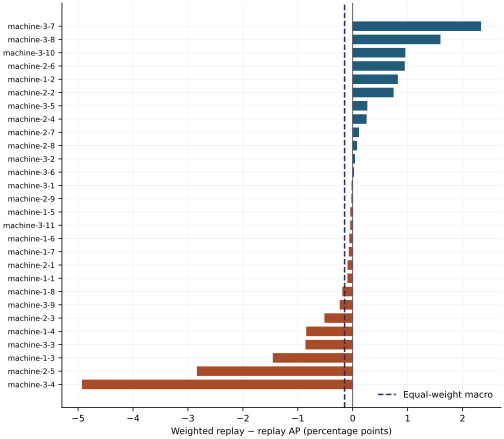

# Source transfer and mixed-unlabeled adaptation with LEFT for multivariate time-series anomaly detection

*A controlled empirical study*

## Abstract

Unlabeled adaptation can expose an anomaly detector to both novel normal behavior and anomalies. We study these effects in LEFT using PSM, SWaT and 28 SMD machines. The controlled protocol separates source initialization, normal target training and mixed target updating. At equal update and window budgets, replacing half the mixed target batch with normal source replay improves archived natural-mixture AP by 1.50, 0.62 and 0.47 percentage points, respectively. We repeat ordinary and window-weighted replay on PSM and SWaT across three adaptation trajectories with fixed source models, batches and donor plans. Replacing matched target slots with anomalous instead of normal donors lowers ordinary-replay AP in all six comparisons. Window weighting increases absolute AP under this replacement and reduces the relative AP penalty in every comparison. The mean interactions are +1.20 and +0.34 percentage points on PSM and SWaT, respectively. The natural-mixture AP gains are smaller, SWaT loses VUS-ROC under anomalous replacement, and SMD28 gives a negative mean natural-mixture AP difference at the archived seed. Archived operating points show trade-offs in false positives, event matching and sustained coverage. The evidence characterizes replay and weighting under the tested exposures and one detector architecture. [Result tables and receipts](../../docs/experiments/left_fixed_exposure_repeats_20261128/README.md)

## 1. Introduction

Multivariate anomaly detectors often learn by reconstructing observations judged likely to be normal. When a detector is transferred to a new domain, an adaptation prefix can contain both changing normal behavior and the anomalous behavior the detector should retain the ability to identify. Reconstruction alone gives a learner an incentive to explain both. A useful evaluation therefore asks what information is gained through updating, what detection ability is lost, and how those effects change when the training exposure is controlled.

We use LEFT as a complete detector with time, frequency and multi-scale reconstruction. Keeping the detector and readout fixed lets us compare update rules under the same architecture and input permissions. Ordinary target updating spends its budget on mixed windows. Replay replaces half that exposure with normal source windows. Window weighting redistributes the target half's loss contribution according to a frozen source score. Local weighting redistributes the same coefficients across time positions. These comparisons motivate three questions.

1. **Source initialization and target learning.** How do frozen transfer, target-normal training and mixed target updates change ranking on the fixed source–target folds?
2. **Normal-source replay.** At fixed total updates and sample presentations, how does replacing half the target batch with normal source windows change detection compared with target-only updates?
3. **Window weighting under fixed exposure.** How does weighted replay change absolute detection and the response to abnormal versus normal replacement? How do ranking changes relate to event detection, normal false positives and coverage at the archived operating points?

The study provides a reproducible controlled evaluation protocol for one complete detector, source and target comparisons on three public multivariate datasets, and a paired analysis of abnormal exposure and operating trade-offs. The exposure study repeats adaptation randomness at fixed source endpoints and fixed plans. The external methods provide performance context under their recorded permissions. [Evidence index](../../docs/experiments/left_evidence_freeze_20261128/README.md)

## 2. Related work

**Public detectors and transfer.** LEFT learns tri-view representations with cross-view consistency. TimeRadar, DADA and TimeRCD provide pretrained alternatives with different score definitions and contextual permissions. CATCH, PCA and pointwise deviation provide target-normal or simpler references. DACAD uses source supervision, anomaly injection and contrastive objectives for domain adaptation. Here the project source records are normal and the native detector runs with dimension-specific checkpoints. [LEFT (Wang et al., 2026)](https://doi.org/10.1145/3770855.3818044) · [DACAD (Darban et al., 2025)](https://doi.org/10.1109/TKDE.2025.3569909) · [External benchmark and permissions](../../docs/experiments/left_smd_reliability_20261126/SMD_RESULTS.md)

**Contaminated and changing data.** RiAD dynamically attenuates samples with uncertainty and outlierness using one-class statistics and adaptive reconstruction. CLEANet combines an encoder-neighborhood sigmoid weight with clustering-guided contrastive learning. Li et al. filter using early loss level and oscillation, and Latent Outlier Exposure alternates latent assignments and complementary losses. These methods establish the relevant precedents for robust sample weighting or selection. [RiAD](https://doi.org/10.1016/j.ins.2024.120222) · [CLEANet preprint](https://arxiv.org/html/2510.22619v1#S3.SS3) · [Li et al.](https://arxiv.org/pdf/2208.01841) · [Latent Outlier Exposure](https://proceedings.mlr.press/v162/qiu22b.html)

**Adaptation.** M2N2 uses model-predicted normal points to mask online updates. CANDI uses scores and reference similarity in sample curation and trains structured adaptation modules. Kumagai et al. adapt a robust reconstructor on unlabeled support and use labeled query ranking for the outer objective. The tested LEFT weighting instead uses one fixed scalar per target window, derived from frozen native point-score ranks with the target mass normalized within each batch. Mixing retained normal observations with new observations is standard experience replay. These ingredients define the tested protocol and its controls. [M2N2 (Kim, Park & Choo, 2024)](https://doi.org/10.1609/aaai.v38i12.29210) · [CANDI](https://doi.org/10.1609/aaai.v40i17.38524) · [Kumagai et al.](https://proceedings.mlr.press/v206/kumagai23a.html) · [Experience replay](https://proceedings.neurips.cc/paper_files/paper/2019/hash/fa7cdfad1a5aaf8370ebeda47a1ff1c3-Abstract.html)

**Evaluation studies.** TimeEval standardizes detector execution and scalable evaluation. TSB-AD addresses dataset integrity, metric reliability and broad algorithm benchmarking. Our controlled evaluation holds a complete LEFT detector and scoring procedure fixed while changing training information and the composition of the adaptation batch. Its purpose is to identify which comparisons hold for this detector and set of folds. [TimeEval](https://doi.org/10.14778/3554821.3554873) · [TSB-AD](https://proceedings.neurips.cc/paper_files/paper/2024/hash/c3f3c690b7a99fba16d0efd35cb83b2c-Abstract-Datasets_and_Benchmarks_Track.html)

| Closest work | Evaluated change | Scope of the present protocol |
| --- | --- | --- |
| TimeEval (Wenig et al., 2022) | Reusable execution and comparison infrastructure for TSAD. | Isolated target roles, matched target slots, source exposure and conditional adaptation repeats for LEFT. |
| TSB-AD (Liu and Paparrizos, 2024) | Broad benchmarking across algorithms and conditions, with metric reliability analysis. | Identical readout across adaptation rules and separate full, external-overlap and mixed axes. |
| M2N2 (2024) and CANDI (2026) | Sequential test-time adaptation with score-based masking or curation. | Fixed offline adaptation support followed by an isolated suffix. The replay split and rank-weight alignment are controlled explicitly. |
| RiAD (Chen et al., 2024), CLEANet (Zhang et al., 2025) and Kumagai et al. (2023) | Robust reconstruction under contamination, or learning to adapt from unlabeled support. | Frozen parent rankings and a matched donor-slot intervention quantify how pre-existing replay and weighting behave. |

## 3. Problem, detector and adaptation

### Normal-source initialization and information permissions

Let $X_j\in\mathbb R^{192\times C}$ be a multivariate window within one legal record and role. Each source model sees numeric normal windows. Dataset sources are PSM (Abdulaal et al., 2021), SWaT (Goh et al., 2017), SMD (Su et al., 2019), TEP (Rieth et al., 2017) and HAI 21.03 (Shin et al., 2021). PSM uses 25 variables and SWaT uses the project's 31-channel subset, with TEP FaultFree Training and SMD normal records as sources. The 38-channel SMD target fold uses TEP and HAI 21.03, excluding SMD from both source fitting and selection. The recorded source FIT positions use separate SELECT windows. TEP FIT uses runs 1–20 and SELECT runs 61–65. SMD source record splits are within-machine temporal splits. HAI train1/train3 are FIT and train2 is SELECT. Channel draws are without replacement within a window, sampled in a fixed order for that window. They do not assume shared sensor semantics across datasets. The three source jobs use 4,000 Adam updates at $10^{-4}$ with 16 windows from each source per step. Normal source validation selects step 4,000 for all three models. [Base source training and sample accounting](../../docs/experiments/left_multisource_20261126/RESULTS.md) · [HAI and 38-channel identity](../../docs/experiments/left_smd_reliability_20261126/SMD_RESULTS.md)

Frozen use Z has no target parameter updates. Normal continuation N uses target normal FIT and selection under the native target-normal protocol. Native LEFT fitted from scratch shares that target-normal protocol with N. Ordinary U starts from the same source checkpoint as replay. Both consume target values only from U-FIT. Within each archived training job and each repeated adaptation, held-out QUERY labels are used only for final evaluation. They are excluded from optimization, checkpoint selection, weighting and calibration. The broader project has already used these public target datasets for development. The fixed repeats therefore assess conditional stability on historically exposed datasets. PSM and SWaT use archived target normal-prefix statistics including normal SELECT. The SMD public axis likewise uses the normal prefix, whereas its independent U uses per-machine FIT-only statistics and a reserved nominal-normal CAL. We keep the two SMD score panels separate. [Recorded roles and statistics](../../docs/experiments/left_smd_reliability_20261126/SMD_RESULTS.md) · [Two-domain role contract](../../docs/experiments/left_multisource_20261126/RESULTS.md)

### Native fitting and readout

The implementation retains native LEFT's tri-view processing, prototype memory and curriculum. Per-window loss reductions include the time-to-frequency and frequency-to-time cycle losses, the multi-scale reconstruction loss and the full-rate consistency term. Writing $\mathcal L_\mathrm{cyc}$ for the sum of the two SmoothL1 cycle terms, $\mathcal L_\mathrm{ms}$ for native scale-weighted SmoothL1, and $\mathcal L_\mathrm{cons}$ for the consistency of the finest multi-scale output with the stopped-gradient inverse-frequency reconstruction, the native objective is
$$
\mathcal L_{\mathrm{LEFT}}=\alpha_{\mathrm{cyc}}\mathcal L_{\mathrm{cyc}}
+\alpha_{\mathrm{ms}}\mathcal L_{\mathrm{ms}}+\alpha_{\mathrm{cons}}\mathcal L_{\mathrm{cons}}.
$$
The original evaluation combines native reconstruction and association terms with the multi-scale score using the saved configuration. We average the native score over variables. A W192 nonoverlapping block is read in full. All scores inside it become available at its end. This is retrospective detection. [Native model binding and unchanged score](../../docs/experiments/left_multisource_20261126/RESULTS.md) · [Scoring entry](../../src/hybrid_tsad/left_multisource_eval.py)

### Ordinary, replay and weighted adaptation

Each U job starts fresh Adam at $10^{-4}$ and performs 2,000 updates at batch size 32. Ordinary U uses two target half-batches. Replay uses the same first 16 target slots and eight normal windows from each source in the other half. Random-init U and source-only continuation identify two alternative sources of change. Gains from changing this batch composition at the fixed budget are gains of a substitution policy. [Matched replay code](../../src/hybrid_tsad/left_multisource.py)

Window weighting measures the original channel-mean point scores from the frozen parent for the target windows in an adaptation plan. Each repeated presentation enters the empirical rank calculation. With one-based midranks across the plan's $M$ point presentations, define $r_{bit}=(\mathrm{midrank}(s_{bit})-0.5)/M$ and $u_{bit}=1.5-r_{bit}$. At step $b$, the weight of target window $i$ is
$$
w_{bi}=\frac{W^{-1}\sum_t u_{bit}}{(16W)^{-1}\sum_{i,t}u_{bit}},\qquad W=192.
$$
Source weights are one. With $\ell_\theta$ the native per-window loss contribution, the weighted data objective is $\big(\sum_i w_{bi}\ell_\theta(T_{bi})+\sum_j\ell_\theta(S_{bj})\big)/32$, with original scale reductions and native terms independent of data weighting retained. All windows still enter the native forward, including prototype admission. The coefficient weights a reduction and does not directly measure the gradient or EMA contribution of that window. A local control uses the time weights on the native grid and the same window mean in frequency and coarse terms. A permutation control preserves every target batch's weight multiset and total mass while changing assignments. The rank order is computed separately for each task and exposure condition. Deployment uses the same unweighted native score for all trained arms. [Weight code](../../src/hybrid_tsad/left_reliability.py) · [Matched SMD adaptation](../../src/hybrid_tsad/left_smd_targets.py)

## 4. Source transfer and target-normal learning

AP is the primary ranking measure and uses unadjusted average precision. ROC-AUC, VUS-PR and VUS-ROC are descriptive secondary measures. VUS follows the metric of Boniol et al. (2025) through the fixed archived LEFT implementation, with window size 100 and 250 thresholds. The local benchmark separates complete legal grids from the external overlap and the independent U suffix. Matching timestamps do not equalize context, standardization or training permissions. The primary full axes are PSM test-relative $[0,87744)$, SWaT absolute $[495000,944856)$ and complete W192 blocks within each SMD test record. The external intersection starts at 99 and ends at the common W100/W192 grid limit per record. SMD results below first compute each metric within each of the 28 machines and then take an equal-weight mean. CATCH is a three-seed mean ± sample SD. The complete public and external comparison panels use one project fit per LEFT arm. Section 6 reports new adaptation-seed repetitions on the mixed suffix. [Complete value and identity tables](../../docs/experiments/left_evidence_freeze_20261128/main_metrics.csv) · [Metric, axis and comparator permissions](../../docs/experiments/left_smd_reliability_20261126/SMD_RESULTS.md)

### Complete public grids

**Table 1.** Detection on the complete legal public grids.

<!-- table:public_native_grid -->

| Target | Method | Target fitting | AP | ROC-AUC | VUS-PR | VUS-ROC |
| --- | --- | --- | --- | --- | --- | --- |
| PSM | Native LEFT, target-normal from scratch | target normal | 0.57664 | 0.77610 | 0.57261 | 0.78507 |
| PSM | Frozen multisource LEFT (Z) | none | 0.49639 | 0.70108 | 0.50096 | 0.70649 |
| PSM | Multisource target-normal training (N) | target normal | 0.55438 | 0.75671 | 0.55201 | 0.76627 |
| PSM | CATCH | target normal | 0.43643 ± 0.00839 | 0.64736 ± 0.00601 | 0.52746 ± 0.00874 | 0.69769 ± 0.00655 |
| PSM | PCA residual | target normal | 0.53440 | 0.79332 | 0.52899 | 0.76669 |
| PSM | Pointwise level deviation | none | 0.43827 | 0.65423 | 0.44602 | 0.65429 |
| PSM | Pretrained TimeRadar (native block grid) | none | 0.43327 | 0.67067 | 0.44126 | 0.67837 |
| SWaT | Native LEFT, target-normal from scratch | target normal | 0.54387 | 0.82085 | 0.53460 | 0.80926 |
| SWaT | Frozen multisource LEFT (Z) | none | 0.72392 | 0.81151 | 0.49756 | 0.66106 |
| SWaT | Multisource target-normal training (N) | target normal | 0.54250 | 0.85558 | 0.53098 | 0.84311 |
| SWaT | Pointwise level deviation | none | 0.74480 | 0.83182 | 0.46454 | 0.64428 |
| SWaT | Pretrained TimeRadar (native block grid) | none | 0.63930 | 0.82197 | 0.51406 | 0.76683 |
| SMD28 | Native LEFT, target-normal from scratch | target normal | 0.49751 | 0.87868 | 0.54151 | 0.91862 |
| SMD28 | Frozen multisource LEFT (Z) | none | 0.49690 | 0.86792 | 0.54191 | 0.91292 |
| SMD28 | Multisource target-normal training (N) | target normal | 0.51765 | 0.88301 | 0.56463 | 0.92087 |
| SMD28 | Pointwise level deviation | none | 0.42651 | 0.80337 | 0.42547 | 0.86664 |

<!-- end:public_native_grid -->

### External common ticks

**Table 2.** Detection on the fixed overlaps with external methods.

SWaT has no row on this external intersection in the fixed archive. DADA uses released weights, a W100 block variance score and normal-prefix statistics. TimeRCD uses fixed weights, target FIT-only statistics and W5000 offline context capped by record length. The TimeRadar endpoint is available at the scored point. Each detector retains the permissions in the evidence manifest. [External row provenance](../../docs/experiments/left_evidence_freeze_20261128/source_manifest.csv)

<!-- table:public_external_intersection -->

| Target | Method | Target fitting | AP | ROC-AUC | VUS-PR | VUS-ROC |
| --- | --- | --- | --- | --- | --- | --- |
| PSM | Native LEFT, target-normal from scratch | target normal | 0.57689 | 0.77618 | 0.57412 | 0.78578 |
| PSM | Frozen multisource LEFT (Z) | none | 0.49671 | 0.70127 | 0.50229 | 0.70738 |
| PSM | Multisource target-normal training (N) | target normal | 0.55457 | 0.75672 | 0.55329 | 0.76690 |
| PSM | CATCH | target normal | 0.43684 ± 0.00844 | 0.64765 ± 0.00602 | 0.52717 ± 0.00869 | 0.69698 ± 0.00662 |
| PSM | PCA residual | target normal | 0.53444 | 0.79312 | 0.52873 | 0.76699 |
| PSM | Pretrained DADA | none | 0.39565 | 0.60496 | 0.43945 | 0.65197 |
| PSM | Pretrained TimeRCD (FIT-only) | none | 0.30193 | 0.47619 | 0.34850 | 0.53197 |
| PSM | Pretrained TimeRadar V (causal endpoint) | none | 0.53528 | 0.73098 | 0.48359 | 0.66478 |
| SMD28 | Native LEFT, target-normal from scratch | target normal | 0.49808 | 0.87855 | 0.54184 | 0.91853 |
| SMD28 | Frozen multisource LEFT (Z) | none | 0.49748 | 0.86779 | 0.54215 | 0.91282 |
| SMD28 | Multisource target-normal training (N) | target normal | 0.51818 | 0.88294 | 0.56510 | 0.92082 |
| SMD28 | Pretrained DADA | none | 0.41461 | 0.85136 | 0.47465 | 0.89970 |
| SMD28 | Pretrained TimeRCD (FIT-only) | none | 0.47295 | 0.85942 | 0.51514 | 0.90975 |
| SMD28 | Pretrained TimeRadar V (causal endpoint) | none | 0.44480 | 0.81321 | 0.46719 | 0.86996 |

<!-- end:public_external_intersection -->

Source initialization and subsequent fitting have different effects. On the complete PSM axis, N raises AP from 0.49639 for Z to 0.55438, while the target-normal model from scratch reaches 0.57664. On SWaT, frozen transfer reaches 0.72392 AP, while target normal continuation reaches 0.54250. At matched normal target training, changing the initialization gives small decreases in both PR metrics and improves the ROC metrics. On SMD28, N improves macro AP by 0.02014 over the matched from-scratch model, with 21 per-machine gains and seven losses. Source composition changes with the held-out target and is part of the fold definition. [Two-domain normal transfer](../../docs/experiments/left_multisource_20261126/RESULTS.md) · [SMD per-machine distributions](../../docs/experiments/left_smd_reliability_20261126/smd_paired_distribution.csv)

## 5. Natural mixed adaptation and source replay

PSM and SWaT use the same fixed QUERY suffix across their mixed arms, respectively $[22656,87744)$ and $[608535,944856)$. SMD uses entity-specific suffixes with an independent CAL. Native target-normal LEFT is evaluated on the public grid. Its suffix metrics and SMD local-weighting results remain NA in this archive. The natural table below reports the archived 2025 fits so all rows retain their original identity. Random-init target U is a separate control. All rows inside a domain block share the same scored points. [Exact source and score identities](../../docs/experiments/left_evidence_freeze_20261128/source_manifest.csv) · [All SMD entities](../../docs/experiments/left_evidence_freeze_20261128/smd_entities.csv)

**Table 3.** Natural mixed target QUERY, archived seed2025.

<!-- table:mixed_suffix -->

| Target | Method | AP | ROC-AUC | VUS-PR | VUS-ROC |
| --- | --- | --- | --- | --- | --- |
| PSM | Native LEFT, target-normal from scratch | NA | NA | NA | NA |
| PSM | Frozen multisource LEFT (Z) | 0.504296 | 0.720009 | 0.515853 | 0.731294 |
| PSM | Multisource ordinary target U | 0.576967 | 0.757871 | 0.585024 | 0.771524 |
| PSM | Multisource source replay U | 0.591946 | 0.755556 | 0.592012 | 0.771655 |
| PSM | Window-weighted source replay U | 0.594855 | 0.762450 | 0.594007 | 0.777015 |
| PSM | Local-weighted source replay U | 0.597741 | 0.762939 | 0.597100 | 0.778199 |
| PSM | Random-initialized target U | 0.580865 | 0.739244 | 0.574255 | 0.750188 |
| PSM | Normal source continuation | 0.524133 | 0.729912 | 0.534574 | 0.743078 |
| SWaT | Native LEFT, target-normal from scratch | NA | NA | NA | NA |
| SWaT | Frozen multisource LEFT (Z) | 0.791359 | 0.842321 | 0.630690 | 0.734086 |
| SWaT | Multisource ordinary target U | 0.779989 | 0.841665 | 0.633183 | 0.744684 |
| SWaT | Multisource source replay U | 0.786150 | 0.841968 | 0.633839 | 0.740272 |
| SWaT | Window-weighted source replay U | 0.787213 | 0.842038 | 0.631845 | 0.738376 |
| SWaT | Local-weighted source replay U | 0.787218 | 0.842086 | 0.631912 | 0.738421 |
| SWaT | Random-initialized target U | 0.788190 | 0.842215 | 0.633795 | 0.741378 |
| SWaT | Normal source continuation | 0.789719 | 0.842889 | 0.629091 | 0.736839 |
| SMD28 | Native LEFT, target-normal from scratch | NA | NA | NA | NA |
| SMD28 | Frozen multisource LEFT (Z) | 0.540538 | 0.871383 | 0.590123 | 0.916426 |
| SMD28 | Multisource ordinary target U | 0.555152 | 0.888150 | 0.608026 | 0.926151 |
| SMD28 | Multisource source replay U | 0.559843 | 0.895781 | 0.613119 | 0.929473 |
| SMD28 | Window-weighted source replay U | 0.558367 | 0.895324 | 0.611582 | 0.929960 |
| SMD28 | Local-weighted source replay U | NA | NA | NA | NA |
| SMD28 | Random-initialized target U | 0.545181 | 0.888176 | 0.597083 | 0.924072 |
| SMD28 | Normal source continuation | 0.540520 | 0.875003 | 0.588346 | 0.916472 |

<!-- end:mixed_suffix -->

Compared with no target updates, ordinary target U raises suffix AP on PSM and in the SMD28 macro, while it lowers AP on SWaT. Replay improves natural suffix AP over ordinary U by 0.014979 on PSM, 0.006160 on SWaT and 0.004692 in the SMD28 macro. Relative to replay, window weighting improves AP by 0.002909 on PSM and 0.001063 on SWaT, while the latter domain loses both VUS metrics. SWaT's two weighted arms remain below Z in AP. Window weighting loses 0.001477 macro AP on SMD28, with 12 machine gains, 16 losses and a paired median of −0.000344. The small VUS-ROC gain coexists with lower AP, ROC-AUC and VUS-PR in that domain. Local weighting improves PSM natural AP by 0.002886 over window weighting. The SWaT difference is approximately 0.000005. [PSM/SWaT mixed contrasts](../../docs/experiments/left_local_reliability_20261126/contrasts.csv) · [Per-machine SMD contrasts](../../docs/experiments/left_smd_reliability_20261126/smd_paired_distribution.csv)

## 6. Matched exposure, adaptation repeats and operating cost

A retains natural U-FIT. B and C replace the same 3,200 of the 32,000 shared target slots with windows entirely labeled anomalous and normal, respectively, from U-FIT. These replacements account for 5% of all 64,000 presentations. The background retains its natural mixture. Public labels construct eligible donor windows offline. Learners consume only their numeric observations. B/C match slot count and location, while donor operating conditions can differ. Repeated donors do not create independent events. [Eligibility and exposure ledger](../../docs/experiments/left_memory_exposure_20261126/RESULTS.md)

The repetition holds the source checkpoints, numeric target and source exposure schedules, condition-specific rankings and weight tensors fixed. The two added adaptation random seeds are 2026 and 2027, applied to every method and condition in both domains. The archived seed2025 supplies the third trajectory. R and W share the corresponding seed, and the first four native updates of each new R/W pair were checked for matching input and RNG fingerprints. An independent real-batch probe verifies dropout and parameter updates differ across the new seeds. All runs use fresh Adam and the final step 2,000. There is one frozen parent and one exposure plan per condition and domain. [Repeat protocol and gates](../../docs/experiments/left_fixed_exposure_repeats_20261128/PROTOCOL.md)

For any ranking metric $M$, write $\Delta_m=M(m,B)-M(m,C)$. The primary interaction uses AP and is $I=\Delta_W-\Delta_R$. A positive interaction means the B-versus-C change is larger for W. The absolute B levels show whether that relative response also yields better detection under B. Exposure conditions refit their own frozen-score ranks over their complete target plans, so the interaction also includes changes in weights on common inputs. We report the absolute endpoint along with the interaction.

### Absolute scores and paired contrasts

Table 4 shows absolute AP. R is ordinary replay and W is window-weighted replay. Both use the same numeric batch sequence within a condition. Table 5 reports AP differences in original units and Table 6 summarizes the three matched differences per contrast. The sample SD uses $n-1$. Positive, zero and negative counts describe direction over these three adaptation runs.

**Table 4.** Absolute AP for the matched repeat matrix.

<!-- table:repeat_endpoints -->

| Target | Seed | R A | W A | R B | W B | R C | W C |
| --- | --- | --- | --- | --- | --- | --- | --- |
| PSM | 2025 | 0.591946 | 0.594855 | 0.575372 | 0.595739 | 0.595996 | 0.600230 |
| PSM | 2026 | 0.592168 | 0.593265 | 0.576914 | 0.596198 | 0.592163 | 0.595548 |
| PSM | 2027 | 0.585323 | 0.597000 | 0.575510 | 0.593492 | 0.586508 | 0.600432 |
| SWaT | 2025 | 0.786150 | 0.787213 | 0.780606 | 0.784462 | 0.786090 | 0.787194 |
| SWaT | 2026 | 0.786297 | 0.787103 | 0.780928 | 0.784822 | 0.786683 | 0.786769 |
| SWaT | 2027 | 0.786526 | 0.787206 | 0.779682 | 0.784100 | 0.786584 | 0.787318 |

<!-- end:repeat_endpoints -->

**Table 5.** Paired AP differences and exposure interactions.

<!-- table:repeat_pairs -->

| Target | Seed | W−R in A | W−R in B | W−R in C | R B−C | W B−C | Interaction |
| --- | --- | --- | --- | --- | --- | --- | --- |
| PSM | 2025 | +0.002909 | +0.020367 | +0.004234 | -0.020624 | -0.004491 | +0.016132 |
| PSM | 2026 | +0.001097 | +0.019284 | +0.003385 | -0.015249 | +0.000650 | +0.015899 |
| PSM | 2027 | +0.011677 | +0.017982 | +0.013924 | -0.010998 | -0.006939 | +0.004058 |
| SWaT | 2025 | +0.001063 | +0.003856 | +0.001105 | -0.005484 | -0.002732 | +0.002752 |
| SWaT | 2026 | +0.000806 | +0.003894 | +0.000086 | -0.005754 | -0.001947 | +0.003808 |
| SWaT | 2027 | +0.000680 | +0.004417 | +0.000733 | -0.006902 | -0.003218 | +0.003684 |

<!-- end:repeat_pairs -->

**Table 6.** Conditional stability of each paired AP effect.

<!-- table:repeat_stats -->

| Target | Contrast | Mean ± sample SD | Min, max | +/0/− |
| --- | --- | --- | --- | --- |
| PSM | W−R in A | +0.005228 ± 0.005658 | [+0.001097, +0.011677] | 3/0/0 |
| PSM | W−R in B | +0.019211 ± 0.001194 | [+0.017982, +0.020367] | 3/0/0 |
| PSM | W−R in C | +0.007181 ± 0.005855 | [+0.003385, +0.013924] | 3/0/0 |
| PSM | R B−C | -0.015623 ± 0.004824 | [-0.020624, -0.010998] | 0/0/3 |
| PSM | W B−C | -0.003594 ± 0.003873 | [-0.006939, +0.000650] | 1/0/2 |
| PSM | Interaction | +0.012030 ± 0.006904 | [+0.004058, +0.016132] | 3/0/0 |
| SWaT | W−R in A | +0.000850 ± 0.000195 | [+0.000680, +0.001063] | 3/0/0 |
| SWaT | W−R in B | +0.004056 ± 0.000314 | [+0.003856, +0.004417] | 3/0/0 |
| SWaT | W−R in C | +0.000641 ± 0.000515 | [+0.000086, +0.001105] | 3/0/0 |
| SWaT | R B−C | -0.006047 ± 0.000753 | [-0.006902, -0.005484] | 0/0/3 |
| SWaT | W B−C | -0.002632 ± 0.000641 | [-0.003218, -0.001947] | 0/0/3 |
| SWaT | Interaction | +0.003415 ± 0.000577 | [+0.002752, +0.003808] | 3/0/0 |

<!-- end:repeat_stats -->

Table 7 reports paired means for all four ranking metrics. The per-seed absolute and paired results for all metrics are available in the archive. The original exposure table also includes ordinary target U, local weighting, permuted weights and source-only EMA writes. [Repeat endpoints](../../docs/experiments/left_fixed_exposure_repeats_20261128/endpoints.csv) · [All paired differences](../../docs/experiments/left_fixed_exposure_repeats_20261128/paired.csv) · [Other archived exposure controls](../../docs/experiments/left_evidence_freeze_20261128/abc_metrics.csv)

**Table 7.** Mean paired effects across four ranking measures.

<!-- table:repeat_metrics -->

| Target | Contrast | AP | ROC-AUC | VUS-PR | VUS-ROC |
| --- | --- | --- | --- | --- | --- |
| PSM | W−R in A | +0.005228 | +0.007944 | +0.003400 | +0.006179 |
| PSM | W−R in B | +0.019211 | +0.023846 | +0.017264 | +0.022454 |
| PSM | Interaction | +0.012030 | +0.014211 | +0.011824 | +0.014382 |
| SWaT | W−R in A | +0.000850 | -0.000164 | -0.002175 | -0.002213 |
| SWaT | W−R in B | +0.004056 | +0.000876 | +0.000741 | -0.001390 |
| SWaT | Interaction | +0.003415 | +0.000859 | +0.001931 | +0.000763 |

<!-- end:repeat_metrics -->

The archived direction repeats under both new adaptation seeds. W has higher absolute B AP in all six pairs. The B gain on PSM ranges from +0.017982 to +0.020367 and the SWaT range is +0.003856 to +0.004417. For PSM, the positive interaction varies substantially, from +0.004058 to +0.016132. In the 2026 run, PSM W is slightly higher in B than in C. In SWaT, both policies lose AP under B in all three runs, and the weighted loss is smaller. The interaction ranges from +0.002752 to +0.003808. These are differences within the fixed source and donor plans. The natural and matched-normal comparisons show that weighting can already change AP without added abnormal replacement. Under B, all PSM mean ranking differences favor W, while SWaT loses VUS-ROC. Under A, SWaT gains very little AP and loses both mean VUS measures. [Distribution and full precision](../../docs/experiments/left_fixed_exposure_repeats_20261128/paired_summary.csv)

### Archived operating points

Operating metrics use each model's own fixed higher-q99 CAL threshold and strict exceedance. The three-point rule confirms at the third consecutively flagged score index, with no backfill. A retrospective flag becomes usable only once its required scores are available, each at the end of its W192 window. The third indexed observation can arrive before confirmation is computable. Event matching uses chronological first-unmatched overlap, with at most one match per predicted and reference event. Any-hit is counted separately. Sustained coverage is measured after the first 512 points in qualifying events and retained both by equal event weight and by pooled points. All 512 PSM CAL points and 38 of 512 SWaT CAL points carry attack labels. These historical thresholds provide retrospective operating-point diagnostics. Neither PSM nor SWaT CAL establishes a normal 1% false-positive rate. This section’s operating comparisons use only archived seed2025. The added repeats have no new CAL or operating metrics. Existing SMD CAL is nominal normal and independent of adaptation and its FIT statistics. [Full point, event and coverage metrics](../../docs/experiments/left_local_reliability_20261126/operations.csv) · [SMD operating panel](../../docs/experiments/left_smd_reliability_20261126/SMD_RESULTS.md)

In PSM B, window weighting reduces confirmed FPR from 0.1525 to 0.1341 and point recall from 0.4932 to 0.4694. The number of one-to-one matches drops from 24 to 21 of 48 and any-hit counts drop from 24 to 22. Long-event macro coverage falls from 0.7207 to 0.6833. In SWaT B, weighting increases FPR from 0.5387 to 0.6060 and long macro coverage from 0.2854 to 0.5677, while matched events decline from 14 to 12 of 22. In SMD28's natural suffix, both replay methods match 137 of 233 events after confirmation. Weighting reduces any-hit counts from 154 to 153 and increases false alarm fragments from 1,981 to 1,999, with small changes in coverage. [PSM/SWaT event records](../../docs/experiments/left_local_reliability_20261126/events.csv) · [SMD event totals](../../docs/experiments/left_smd_reliability_20261126/smd_event_totals.csv)

## 7. Discussion and mechanism controls

**Weight correspondence and granularity.** In PSM B, correct weight assignments improve AP by 0.017951 over a within-batch permutation that preserves the coefficient multiset and target mass. On SWaT the corresponding difference is 0.003422 and VUS-ROC declines. The local allocation moves weight toward the normal points of partially anomalous windows, but its PSM AP gain over window weighting in A becomes a loss of 0.001481 in B. The permutation holds the per-batch multiset fixed and varies the assignment. This single-seed comparison addresses weight correspondence within the archived plan. [Permutation contrast](../../docs/experiments/left_smd_reliability_20261126/permutation_contrasts.csv) · [Local allocation, gradients and complete results](../../docs/experiments/left_local_reliability_20261126/RESULTS.md)

**Prototype and optimization controls.** The explicit prototype-write restriction makes little difference to ranking. The traced study records zero eligible explicit EMA writes, while prototypes still move through Adam. The study therefore observes no harmful native explicit write for the restriction to prevent. Separate domain constraints suppress first-order conflicts but change AP over replay by only +0.000319 on PSM and −0.000221 on SWaT. Both controls are kept as boundary evidence. [EMA traces and controlled outcomes](../../docs/experiments/left_memory_exposure_20261126/RESULTS.md) · [Source-constraint results](../../docs/experiments/left_source_constraints_20261126/RESULTS.md)

## 8. Limitations, compute and reproducibility

The three adaptation trajectories per PSM and SWaT comparison share one fixed source parent per domain, one replacement schedule and fixed donor pools. They leave source-initialization variability, alternative donors and sampling plans unmeasured. The SMD28 machine differences describe fixed evaluation entities from one seed. A direct frozen-versus-dynamic ablation would be needed to attribute benefits to freezing. None of the reported mechanisms constitutes a new detector with established transferability. All target datasets have prior development exposure, A/B/C applies one specific replacement rate and donor policy, source compositions vary by fold, and retrospective W192 scores carry window-end delay. The controlled tests cannot establish causal or physical fault relations. [Frozen scope and missing evidence](../../docs/experiments/left_evidence_freeze_20261128/README.md)

In the base PSM/SWaT archive, source fit, normal transfer, mixed fits and new reads used 1.42 A40 job-hours. The archived SMD expansion plus permutation work used 3.60 A40 hours, with failed setup excluded. The weighting development has frozen-scoring, training and readout costs reported separately, for example 6.63 seconds for the PSM exposure-rank preparation and 73.21 seconds for its A window-weighted update. These are per-study scopes. Reused models and banks are counted once in their own archives. The 24 added repetitions use 0.559 A40 hours, including 1,810.75 seconds of training, 49.14 seconds of QUERY scoring, 12.11 seconds of GPU probes and 141.20 seconds of lane overhead. The four lanes finish within 8.53 minutes and no GPU job fails. Metrics, figure construction and document rendering use the CPU. [Repeat cost ledger](../../docs/experiments/left_fixed_exposure_repeats_20261128/costs.json) [Base timing](../../docs/experiments/left_multisource_20261126/training.csv) · [Weighting costs](../../docs/experiments/left_local_reliability_20261126/costs.csv) · [SMD timing and accounting](../../docs/experiments/left_smd_reliability_20261126/SMD_RESULTS.md)

The versioned evidence tables record the original metric row, permission, seed and available checkpoint, score-bank, plan and weight hashes. A rebuild script reads the archived metric rows, verifies the SMD joins and recomputes interactions from the existing precision. Both original and new weights and banks remain in author storage, subject to the stated access conditions. The distributed tables can be generated from versioned metrics, whereas score regeneration and retraining require the bound author inputs. [Reproducibility levels and data access](REPRODUCIBILITY.md) [Rebuild script](../../scripts/build_left_evidence_freeze.py) · [Identity manifest](../../docs/experiments/left_evidence_freeze_20261128/source_manifest.csv) · [Bound archive inputs](../../docs/experiments/left_evidence_freeze_20261128/inputs.json)

## 9. Conclusion

Source initialization, normal target fitting and mixed target updating have distinct effects on LEFT. In the archived comparisons, ordinary replay improves AP over target-only updates on the three mixed suffixes at a fixed update and sample budget. With source endpoints and exposure held fixed, window weighting improves absolute AP under abnormal replacement and attenuates the B−C AP response in all three PSM and SWaT adaptation repeats. The magnitude varies, particularly on PSM. Smaller natural effects, the SMD28 macro loss, SWaT VUS trade-offs and the original operating-point results limit the scope of that benefit. The study establishes a reproducible controlled comparison for this detector and fixed exposure design. Broader generalization depends on different source fits, exposure plans and architectures. [Complete empirical evidence](../../docs/experiments/left_fixed_exposure_repeats_20261128/README.md)

## References

Abdulaal, A., Liu, Z., & Lancewicki, T. (2021). Practical approach to asynchronous multivariate time series anomaly detection and localization. *Proceedings of KDD*, 2485–2494. [DOI](https://doi.org/10.1145/3447548.3467174)

Boniol, P., Krishna, A. K., Bruel, M., Liu, Q., Huang, M., Palpanas, T., Tsay, R. S., Elmore, A., Franklin, M. J., & Paparrizos, J. (2025). VUS: Effective and efficient accuracy measures for time-series anomaly detection. *The VLDB Journal*, 34, 32. [DOI](https://doi.org/10.1007/s00778-025-00907-x)

Chen, Z., Li, Z., Chen, X., Chen, X., Fan, H., & Hu, R. (2024). Rectifying inaccurate unsupervised learning for robust time series anomaly detection. *Information Sciences*, 662, 120222. [DOI](https://doi.org/10.1016/j.ins.2024.120222)

Goh, J., Adepu, S., Junejo, K. N., & Mathur, A. (2017). A dataset to support research in the design of secure water treatment systems. *Critical Information Infrastructures Security*, LNCS 10242, 88–99. [DOI](https://doi.org/10.1007/978-3-319-71368-7_8)

He, H., Qiao, H., Chen, Y., Yi, K., & Pang, G. (2026). TimeRadar: A domain-rotatable foundation model for time series anomaly detection. *Proceedings of KDD*, 1602–1613. [DOI](https://doi.org/10.1145/3770855.3818062)

Kim, D., Park, S., & Choo, J. (2024). When model meets new normals: Test-time adaptation for unsupervised time-series anomaly detection. *Proceedings of AAAI*, 38(12), 13113–13121. [DOI](https://doi.org/10.1609/aaai.v38i12.29210)

Kim, H., Mok, J., Lee, H., Shin, J., & Yoon, S. (2026). CANDI: Curated test-time adaptation for multivariate time-series anomaly detection under distribution shift. *Proceedings of AAAI*, 40(17), 15018–15026. [DOI](https://doi.org/10.1609/aaai.v40i17.38524)

Kumagai, A., Iwata, T., Takahashi, H., & Fujiwara, Y. (2023). Meta-learning for robust anomaly detection. *Proceedings of AISTATS*, PMLR 206, 675–691. [Proceedings](https://proceedings.mlr.press/v206/kumagai23a.html)

Lan, T., Le, H. D., Li, J., He, W., Wang, M., Liu, C., & Zhang, C. (2026). Towards foundation models for zero-shot time series anomaly detection: Leveraging synthetic data and relative context discrepancy. *Proceedings of ICML*, PMLR 306, 62494–62529. [Proceedings](https://proceedings.mlr.press/v306/lan26b.html)

Li, W., Feng, C., Chen, T., & Zhu, J. (2022). Robust learning of deep time series anomaly detection models with contaminated training data. *arXiv preprint 2208.01841*. [Preprint](https://arxiv.org/abs/2208.01841)

Liu, Q., & Paparrizos, J. (2024). The elephant in the room: Towards a reliable time-series anomaly detection benchmark. *Advances in Neural Information Processing Systems*, 37, Datasets and Benchmarks Track. [DOI](https://doi.org/10.52202/079017-3437)

Qiu, C., Li, A., Kloft, M., Rudolph, M., & Mandt, S. (2022). Latent outlier exposure for anomaly detection with contaminated data. *Proceedings of ICML*, PMLR 162, 18153–18167. [Proceedings](https://proceedings.mlr.press/v162/qiu22b.html)

Rieth, C. A., Amsel, B. D., Tran, R., & Cook, M. B. (2017). Additional Tennessee Eastman Process simulation data for anomaly detection evaluation. *Harvard Dataverse*, V1. [DOI](https://doi.org/10.7910/DVN/6C3JR1)

Rolnick, D., Ahuja, A., Schwarz, J., Lillicrap, T., & Wayne, G. (2019). Experience replay for continual learning. *Advances in Neural Information Processing Systems*, 32. [Proceedings](https://proceedings.neurips.cc/paper_files/paper/2019/hash/fa7cdfad1a5aaf8370ebeda47a1ff1c3-Abstract.html)

Shentu, Q., Li, B., Zhao, K., Shu, Y., Rao, Z., Pan, L., Yang, B., & Guo, C. (2025). Towards a general time series anomaly detector with adaptive bottlenecks and dual adversarial decoders. *Proceedings of ICLR*. [Proceedings](https://openreview.net/forum?id=aKcd7ImG5e)

Shin, H.-K., Lee, W., Yun, J.-H., & Min, B. G. (2021). Two ICS security datasets and anomaly detection contest on the HIL-based augmented ICS testbed. *Proceedings of CSET*. [DOI](https://doi.org/10.1145/3474718.3474719)

Su, Y., Zhao, Y., Niu, C., Liu, R., Sun, W., & Pei, D. (2019). Robust anomaly detection for multivariate time series through stochastic recurrent neural network. *Proceedings of KDD*, 2828–2837. [DOI](https://doi.org/10.1145/3292500.3330672)

Wang, D., Chen, T., Pang, G., Chen, C., Li, S., & Yin, H. (2026). LEFT: Learnable fusion of tri-view tokens for unsupervised time series anomaly detection. *Proceedings of KDD*, 4800–4811. [DOI](https://doi.org/10.1145/3770855.3818044)

Wenig, P., Schmidl, S., & Papenbrock, T. (2022). TimeEval: A benchmarking toolkit for time series anomaly detection algorithms. *Proceedings of the VLDB Endowment*, 15(12), 3678–3681. [DOI](https://doi.org/10.14778/3554821.3554873)

Wu, X., Qiu, X., Li, Z., Wang, Y., Hu, J., Guo, C., Xiong, H., & Yang, B. (2025). CATCH: Channel-aware multivariate time series anomaly detection via frequency patching. *Proceedings of ICLR*. [Paper](https://arxiv.org/abs/2410.12261)

Darban, Z. Z., Yang, Y., Webb, G. I., Aggarwal, C. C., Wen, Q., Pan, S., & Salehi, M. (2025). DACAD: Domain adaptation contrastive learning for anomaly detection in multivariate time series. *IEEE Transactions on Knowledge and Data Engineering*, 37(8), 4485–4496. [DOI](https://doi.org/10.1109/TKDE.2025.3569909)

Zhang, S., Lai, Y., Zheng, P., Yu, B., Tang, X., Fu, Q., & He, P. (2025). CLEANet: Robust and efficient anomaly detection in contaminated multivariate time series. *arXiv preprint 2510.22619*. [Preprint](https://arxiv.org/abs/2510.22619)

## Appendix A. Archived exploratory work

**Detection-oriented source supervision.** Static proxy ranking (M1) did not meet the matched full-target U gate. U AP differences against matched normal continuation were −0.003363 on PSM and +0.000282 on SWaT. Some ROC or frozen Z VUS terms improved. The M2 proposal was stopped at the design review, so there is no trained M2 outcome. [M1 matched evaluation](../../docs/experiments/left_proxy_rank_20261127/RESULTS.md) · [M2 design review](../../docs/experiments/left_detection_oriented_source_20261127/REVIEW.md)

**Bounded input repair.** The archived transformation used $Y=X-\rho\,\operatorname{sign}(r)(|r|-\tau_q)_+$ with $r=X-\widehat X_0$ and a common corrected student input across all views. Sixteen matched source-proxy endpoints completed the fixed eight-arm study. R0 averaged 0.552964 proxy AP, the best finite repair 0.553008 and R7 0.553022. The preregistered source rule retained R0. The repair altered held-out clean coordinates and seldom activated at actual shift edits. The teacher diagnostic did not support near-complete copying of the source edits as an explanation. These data constrain the proxy-based motivation and contain no real target repair outcome. Proxy R0 and R7 checkpoints have their own source plan and are distinct from the true mixed-target methods reported above. [Original formula and protocol](../../docs/experiments/left_input_correction_20261127/PROTOCOL.md) · [Full archive](../../docs/experiments/left_input_correction_20261127/RESULTS.md)

### Historical material

The previous draft preserves the five-domain public panels, literature-reported CrossAD and ModernTCN, and the archived TimesFM conditioning, contiguous holdout, fixed-lag and other studies. They retain their original permissions and claims. [Previous draft and full historical tables](https://github.com/codexpker/Hybrid/blob/a1ada3751e8840212b75400e3291422a302a9ed0/manuscript/next_generation_20261115/draft.md)
