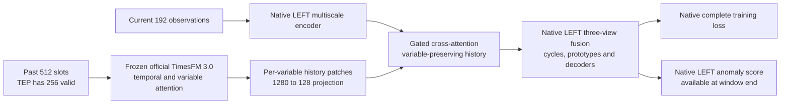

# Frozen TimesFM history conditioning of the multi-source LEFT detector

## Frozen TimesFM history conditioning

The fixed experiment is complete: fifteen source endpoints, three-domain Z evaluation and sixty matched replay endpoints across PSM, SWaT and all SMD machines. The architecture is not advanced to more seeds, pollution or F because the public comparisons and fixed controlled inputs did not establish a useful incremental advantage. The following definition describes the executed architecture; it is not a claim that the project's final method has been established. [Complete results and evidence boundary](../../docs/experiments/left_timesfm_hidden_20261126/RESULTS.md)

The current architecture conditions a complete LEFT detector on the hidden sequence of the released TimesFM 3.0 model. This experiment uses Google code `918df02c9d366b2145bc5876135fa2131d3ed2a6` and checkpoint revision `43046b85ec22d584a13f8098c2ed39c889e129c2`. Its model.safetensors SHA-256 is `a7592b0a8432baee54483254e5647856911ce69e09d09a9bb65904b2d98f17da`. The original twenty layers, causal temporal attention and multivariate attention are retained. The code is Apache-2.0. The downloaded 3.0 weights have the separately archived non-commercial, non-production license. [Official implementation](https://github.com/google-research/timesfm)

For a current W192 window beginning at s, input only observations preceding s to TimesFM. TEP provides 256 valid observations within one 500-point run. Other source records and target evaluation use 512 valid observations. TEP histories are left-padded to the same 512-position layout with a value mask. Every variable is a separate coordinate within the same multivariate sample. The full official forward with `return_aux_outputs=True` supplies `__call__:transformer_output`, a tensor of shape B×C×16×1280. Padding is excluded from official running statistics and valid attention keys. Hidden values for padded query positions are additionally masked in the downstream condition module. On the normal-source check, changing only padding values left valid hidden states exactly unchanged. Calling the model on a shorter unpadded tensor did not produce identical hidden states; its largest difference was about 0.329. The internal cause of that input-format sensitivity was not isolated. All experiments retain the same 512-slot representation and mask rule. Sample counts also represent different physical durations across the source datasets.

Let Q_i be LEFT's native encoded tokens for variable i and let H_i contain its TimesFM hidden patches. A trainable linear projection maps each H_i to dimension 128. Four-head cross-attention takes normalized Q_i as queries and normalized projected H_i as keys and values. It returns A_i, and the detector replaces Q_i by Q_i + tanh(g) A_i, with a trainable scalar g initialized at zero. The attention acts before LEFT's existing three-view fusion and reconstruction pathways. Its history remains variable-specific, while TimesFM's original variable attention has already mixed information across variables. The added attention has zero dropout. LEFT and the condition layer receive the unmodified full native training objective. TimesFM remains frozen. Deployment uses the native LEFT anomaly score from the conditioned reconstruction and cycle.

At D=128, the pretrained, reassigned and random-encoder conditions each add 230,529 trainable parameters. The statistics condition adds 66,945. In addition, the three hidden-state arms depend on a complete frozen TimesFM model, whose runtime and storage must be included in cost comparisons. The archived configuration declares `max_variates=32`, but this field is not used by the fixed PyTorch attention path. The implementation reshapes each patch to its actual variable count and attends across all variables. The 38-variable SMD call therefore retains full 38-by-38 variable attention without cropping or grouping. This does not establish that upstream pretraining included 38-variable samples.



The five matched source arms are native continuation, a historical mean/variance condition, pretrained hidden features, causally reassigned pretrained features and hidden features from an identically configured randomly initialized frozen TimesFM. All inherit the same existing LEFT compatibility wrapper: differentiable prototype snapshots preserve the pre-EMA read, while the original loss, curriculum and score definitions are retained. The decoder's older optional context interface remains unused. The new difference is the encoder-output history hook. The last three arms share the same condition module initialization. The mean/variance control has two inputs per variable and one condition token. Only this control directly receives raw historical level and variance. The main model has the information carried by the original hidden states. The random encoder has the full official architecture and is frozen; it is not a small randomly initialized predictor.

Writing the official historical encoder as \(F_{\psi}\), define \(H=F_{\psi}(X_{s-h:s})\), with \(\psi\) fixed. For each variable, \(K_i=V_i=\operatorname{LN}(W_HH_i+b_H)\), \(Q_i'=\operatorname{LN}(Q_i)\), and \(\widetilde Q_i=Q_i+\tanh(g)\operatorname{MHA}(Q_i',K_i,V_i)\). The objective is exactly \(\mathcal L_{\mathrm{LEFT}}(X_{s:s+192};\theta,\widetilde Q)\), including the original reconstruction, multiscale and cycle terms and their existing coefficients. Optimization updates \(\theta\) and the projection, normalization, attention and gate parameters. There is no historical prediction loss or extra score. The frozen historical encoder receives neither current-window observations nor gradients. Parameter conditioning can change every downstream component of the native anomaly score; it does not create a separately calibrated anomaly detector.

This use of historical attention is motivated by the original TimesFM temporal and variable modeling architecture, while the reconstruction and detection objective remains LEFT's. Reusing cross-attention and a gate is not itself an originality claim. The empirical questions are whether pretrained historical features improve the complete detector beyond matched continuation and historical statistics, whether that gain requires the actual window history, and whether it survives ordinary mixed-target replay. Temporal causality here describes the historical encoder's input and mask. The current detection window still uses all 192 observations, so scores are retrospective and become available at the current window end. No attention visualization, gate value or public AP gain alone establishes weak-anomaly, delay-specific or physical causal capability. [TimesFM architecture description](https://research.google/blog/timesfm-3-a-zero-shot-foundation-model-for-multivariate-forecasting/) · [LEFT](https://arxiv.org/abs/2602.08638)

Historical reassignment is restricted to the same record and role with donor history ending no later than the recipient's current start. The recipient's ordered variable mapping is retained. When earlier history exists, the assignment uses an isolated deterministic random stream and excludes the identical start. Earliest windows can remain aligned, and their count is recorded. This causal reassignment changes the empirical donor frequency. An arbitrary permutation over an entire evaluation record could disclose observations later than the recipient's detection time.

Project source exclusion applies to the TEP/SMD or TEP/HAI continuation data. Membership of the public target datasets in the upstream TimesFM pretraining corpus is not established by these local records. The experiments therefore evaluate frozen official representations on exposed public tasks.

Both source domains receive equal window presentations. All arms start from the matching archived 25-, 31- or 38-channel source model, share their current windows and native random stream, and receive 2,000 Adam updates at learning rate 10⁻⁴ with batch size 32. Fixed endpoints determine the source models. Normal source SELECT supplies diagnostics and feature fixtures. Features are calculated in full float32 and streamed to avoid storing hundreds of gigabytes per source fold. Each batch records its feature hash, history footprint, original record and ordered variable mapping. Public score banks retain their input identities and actual window-end availability.

| Fold | Project source records | Variables per sample | Target permission |
|---|---|---:|---|
| PSM | TEP FaultFree Training + all SMD normal FIT records | 25 | Known normal target-prefix scaling; no target parameter update in Z |
| SWaT | TEP FaultFree Training + all SMD normal FIT records | 31 | Known normal target-prefix scaling; no target parameter update in Z |
| SMD28 | TEP FaultFree Training + HAI 21.03 normal FIT files | 38 | Per-machine normal scaling; no SMD source optimization or source SELECT in this fold |

Each source draw selects distinct ordered channels once and keeps that ordering for the full history and current window. TEP FIT uses runs 1–20 and SELECT uses runs 61–65. The SMD source split uses each record's first 80% and last 20% without cross-boundary windows. HAI uses train1/train3 for FIT and train2 for SELECT. In every case, existing FIT-derived source scalers remain fixed. An A–E source step therefore has the following implementation:

```text
Draw the shared 32 current windows and their preceding legal histories.
Extract frozen pretrained, causally reassigned pretrained, and frozen random states.
For each of the five LEFT arms:
    Restore the same native dropout RNG state for this update.
    Set its prescribed history condition, retaining variable and patch indices.
    Run the complete native LEFT forward once; update native EMA and step once.
    Backpropagate the native complete loss; take one Adam step.
Check that the native RNG advances identically across arms; archive input hashes.
After update 2000, seal all endpoints before target metric computation.
```

The frozen encoder has 330,710,976 registered parameters. Its output head is retained in the full official forward, although forecast outputs do not enter the detector. Costs include feature extraction, not just the small trainable attention module. Source and target feature reuse requires equal normalized input hashes, ordered channel maps, masks and historical indices.

The second stage compares ordinary source replay from the native continuation with the same replay from the conditioned source model. Each step includes sixteen mixed target windows and eight windows from each normal source. Both use 2,000 updates, fresh Adam at 10⁻⁴ and a fixed endpoint. Every target history and current window belongs to the existing U-FIT role. Z and U are evaluated separately on their legal axes. Existing CAL indices retain their original definition. An operating point is unavailable if its complete legal history cannot be formed at every required CAL location.

Implementation separates the [official hidden-state adapter](../../src/hybrid_tsad/timesfm_hidden.py), [native encoder-output condition](../../src/hybrid_tsad/left_timesfm_condition.py), [matched source learning](../../src/hybrid_tsad/left_timesfm_training.py), [paired replay](../../src/hybrid_tsad/left_timesfm_adaptation.py) and [footprint-aware evaluation](../../src/hybrid_tsad/left_timesfm_evaluation.py). Feature-cache placement and allocator allowances were corrected during execution without changing the mathematical program, sample plans or selected endpoints. Executed-source snapshots and failed preparation records are retained with the experiment, rather than being presented as method contributions.

The historical Pearson prediction-head experiment below is archived. Its representations, scores and conclusions retain their original identities.

## Historical reference for changes in local dependence

For a current window starting at \(s\), the detector receives \(H=X[s-256:s]\) and \(D=X[s:s+192]\) from one continuous record. The reference sees only \(H\); the native three-view path sees \(D\). Divide \(H\) into eight chronological 32-point patches per variable. A channel-shared history representation feeds a relation head whose coordinates specify the future block, ordered driver and response, and lag. Predictions for all six blocks exist before the current window begins. The full detector publishes the native point score and the associated relation evidence at \(s+191\).

Let \(I_b=\{s+32b,\ldots,s+32b+31\}\). In each block and at each fixed lag \(\ell \in \{0,1,2,4,8,16,32,64\}\), correlate the driver's 32 observations \(X_{t-\ell,i}\) with the response's 32 observations \(X_{t,j}\), \(t\in I_b\). Center each vector separately. A centered RMS of at most \(10^{-5}\) on either side invalidates the coordinate. The earliest driver observation for the first block is \(s-64\), within the legal history. Self relations use \(i=j,\ell>0\); cross relations use \(i\ne j\), retaining both directions even though their zero-lag targets coincide. A changing peak can therefore move error between named coordinates. There is no lag selection on the observed detection window.

**Shared implementation.** Map each 32-sample patch to the native patch input width by fixed adaptive average pooling (6 components for PSM and SWaT, 16 for SMD). Apply LEFT's existing value embedding, positional embedding and encoder. The last of the eight output tokens gives \(z_i\in\mathbb R^{128}\) for channel \(i\). Shared affine maps produce four-dimensional vectors \(q_{jb\ell}\) for the response and \(k_{ib\ell}\) for its driver. The predicted cross coefficient is \(\tanh(q_{jb\ell}^{\mathsf T}k_{ib\ell}/2)\); a separate affine map followed by \(\tanh\) predicts the seven autocorrelations. Six block horizons use different rows of the same maps. The head adds \(129(192+192+42)=54{,}954\) parameters at each width. The relation gradient and native reconstruction gradient reach the same patch embedding and temporal encoder. The complete native current-window pass retains its original prototype updates. [Model and score implementation](../../src/hybrid_tsad/left_history_relation.py)

Write \(R_{bg}\) for the mean squared error between the predicted and observed coefficients among valid coordinates of group \(g\) (self or cross) in block \(b\). A valid group carries equal weight in the block error \(R_b\). Source training combines the native LEFT objective and masked relation regression with coefficient one. We compare the joint endpoint to a native LEFT endpoint with the same source draws, optimizer schedule, 2,000 updates and starting checkpoint for each fold. Both endpoints are fixed in advance. The source fold uses TEP and SMD for PSM and SWaT, and TEP and HAI for SMD. Sampling takes one contiguous 448-point footprint from one record with one fixed ordered channel draw. A 500-point TEP run supplies 53 possible starts.

For the joint detector, let \(A_t\) be the native LEFT point score. Estimate the arithmetic means of the native point scores and valid block errors on 1,024 fixed normal source SELECT windows per fold, then freeze these scales \(a,r\). The deployment rule is \(S_t=\tfrac12(A_t/a+R_{b(t)}/r)\) with scale floors of \(10^{-6}\). If a block contains no valid relation, the complete score falls back to the normalized native score. Relation evidence has 32-point resolution; repeating its value on the evaluation grid preserves this resolution. A statistical comparator predicts each current coefficient by its corresponding coefficient in the last 32 history response positions. The matched native-plus-statistical score, the native readout of the joint checkpoint, and self/cross component readouts separate the effect of source learning from that of including a second score. Only the predefined joint score represents the complete candidate.

**Relationship to prior work.** LEFT supplies the shared encoder, multi-resolution path, time–frequency cycle and anomaly score. MSCRED estimates anomalies by reconstructing multiscale inter-sensor signature matrices. CrossAD reconstructs finer series from coarser series and uses a query library for cross-window context. Heppel et al. estimate conditional distributions given inferred lagged causal parents. Our reference instead predicts an observed vector of fixed-lag coefficients from a disjoint history and evaluates it alongside the jointly trained LEFT path. This is a testable distinction in the target and information available to the predictor. TimeRadar motivates anomaly-oriented time–frequency evidence; TimesFM motivates learning from historical patches and variables. Only LEFT supplies implementation components here. The older project history/lag branch injected convolutional history features into native reconstruction; it did not train against these coefficient targets. Directed correlation is a statistical quantity and shared common drivers can produce it. [LEFT](https://arxiv.org/abs/2602.08638) · [MSCRED](https://arxiv.org/abs/1811.08055) · [CrossAD](https://proceedings.neurips.cc/paper_files/paper/2025/hash/c9658e8c20879632cb1cfca91d80ceb7-Abstract-Conference.html) · [Heppel et al.](https://doi.org/10.4230/OASIcs.DX.2024.11) · [TimeRadar](https://github.com/mala-lab/TimeRadar) · [TimesFM](https://github.com/google-research/timesfm) · [Older lag implementation](../../src/hybrid_tsad/left_native_history_lag.py).

**Two-stage use.** Z freezes the selected source model and its component scales. Public target normal-prefix scaling follows the established dataset permission, including normal validation. U would start independently from the same source checkpoint, retain the joint loss and score, and mix 16 unlabeled target footprints with 16 normal source footprints under the ordinary replay budget. Every 448-point footprint must lie in its permitted training role. F would start independently from the source checkpoint and use a prespecified public support event and a separate normal support block. Pair complete labeled 32-point response blocks on the deployed joint score, retaining native learning on normal support. Choose support and history eligibility before evaluation; no support or history window may draw from QUERY. U and F are separate uses proposed for this integrated detector. This evaluation measures Z.

### Multisource LEFT backbone and fold permissions

**Detector and transfer unit.** For PSM and SWaT we train two full LEFT models from random initialization, one for a 25-variable target and one for a 31-variable target. Both use W192 and the previously matched native implementation of upstream revision `3fadb4811797075e233076b9faceb0d8ec59b697`, including the pre-EMA read snapshot. The three original views, prototype associations, curriculum, cyclic reconstructions, training loss and point scoring all operate in each stage. Et's first convolution takes C input channels and Ef's takes 2C real/imaginary channels. The last projections of Dt and Df produce 192C and 2CFK outputs respectively, where F and K are the frequency-bin and frame counts. Checkpoints are loaded strictly at the width at which they were trained. Sensor identity is fixed across a window. Across domains there is no assumption that channel 7 on two records measures the same quantity.

**Source learning.** Each of 4,000 Adam updates (constant learning rate 0.0001, batch 32) presents 16 TEP fault-free training windows and 16 SMD normal training windows. Within each source, draw a record uniformly and a legal window start uniformly; choose an ordered sample of C distinct channels and apply that map to all 192 time points. TEP FIT runs are 1–20 and held-out SELECT runs are 61–65. The TEP scaler uses pooled fault-free FIT runs. Each of the 28 SMD machines contributes its first 80% of its official normal training record to FIT and its last 20% to SELECT, scaled by that machine's FIT statistics. No PSM or SWaT values enter this optimizer or its validation. The validation panel contains 512 windows per source, drawn once with an isolated stream and reused. Choose the earliest minimum native normal loss at steps 3,200, 3,600 or 4,000. The native PSM-width model has 1,000 warmup steps followed by a 2,000-step ramp to memory weight 0.3. For SWaT width the corresponding lengths are 500 and 1,000. All selectable states have completed the ramp.

**Target use.** Z freezes the selected source weights and prototypes. Its scaler uses the official target normal prefix, including its normal SELECT portion. N starts from the same source checkpoint, preserves the prototype banks and their curriculum step, and fits the complete model with a fresh optimizer. It uses the existing target-native LEFT trainer, chronological 80/20 normal split, stride-one FIT windows, nonoverlapping SELECT windows, batch 128, native learning-rate schedule, at most 20 epochs and patience three. The seed-2025 target-only LEFT is the matched from-scratch comparison. The inference score at each position is the native LEFT channel mean and becomes available at the end of its 192-point window.

**Mixed target learning.** U is a separate experiment. Only the fixed U-FIT prefix of the released target test record enters the optimizer. Each job runs 2,000 steps with a fresh Adam at 0.0001, batch 32, using its endpoint. Ordinary U presents 32 target windows. Replay presents 16 shared target windows and 16 source windows (eight TEP, eight SMD). Independent streams preserve the first target half across arms. A third model starts with random weights and native initial prototype state, then uses the entire ordinary U target plan. A pretrained optimizer starts from fresh moments, while the network inherits its selected curriculum step. A random model follows the native curriculum from zero. The contrast therefore assesses the complete source initialization, including the learned prototypes and their runtime state. All arms use the same target-normal scaler. No target annotation enters fitting or selection. Each model calibrates on the preassigned 512 mixed-CAL points with q99/higher and strict exceedance. [Complete results, exposures and operating costs](../../docs/experiments/left_multisource_20261126/RESULTS.md)

**SMD target fold.** A third, 38-channel LEFT model uses the same source sampling and selection algorithm with TEP and HAI 21.03. All 28 SMD machines are excluded from the source optimizer and its validation. HAI train1 and train3 supply FIT windows and each uses its own normal scaler. The independent train2 SELECT record uses point-pooled statistics from train1 and train3. The released CSV headers contain 79 process columns after removing the timestamp and four attack indicators. Windows remain within their original records. SMD retains its native 1,000-step warmup, 2,000-step ramp and maximum memory weight 0.2. TEP contributes 16 windows per source update. HAI supplies the remaining 16. Because the two other folds used SMD as their second source, between-target differences combine target and source composition effects. These publicly exposed datasets support development comparisons.

**SMD target permissions.** Public Z and N use the complete official normal training record for per-machine scaling, consistent with the archived target-only LEFT. Under mixed adaptation, let \(n\) and \(q\) denote lengths of the released normal training and test records, respectively. Fit the target scaler on training points \([0,\lfloor0.6n\rfloor)\) and reserve \([\lfloor0.8n\rfloor+544,n)\) for nominal normal calibration. Use \([0,\lfloor q/3\rfloor)\) of the test record for mixed updates and \([\lfloor q/3\rfloor+544,q)\) for evaluation. Each record has its own W192 grid. Retain complete within-role windows and select 512 evenly spaced legal CAL positions. The three-domain public panel and the separate mixed panel preserve their own target-statistics permissions. Eight TEP and eight HAI windows supply the source half of SMD replay. Source-only continuation trains one 38-channel model and each machine calibrates it separately. [HAI file identities and roles](../../docs/experiments/left_smd_reliability_20261126/source_inputs.json) · [Official HAI release](https://github.com/icsdataset/hai/tree/2a814cebc9a66b06c9e5cd545e2d72e65d383737/hai-21.03)

### Reliability within a replayed target window

Let \(s_{ijt}\) be the frozen source LEFT score, averaged across channels at position \(t\) of target slot \(j\) in minibatch \(i\). For each exposure condition separately, let \(r(s)=(n_{<s}+n_{=s}/2)/N\), where \(N=2000\times16\times192\). Repeated presentations count in this distribution. Set \(u=1.5-r(s)\) and divide each target coefficient by the mean of \(u\) over the 16 target windows and their 192 positions in that batch. Source coefficients are one. The scorer is fixed in evaluation mode. Computing a teacher vector once for a repeated window preserves its multiplicity when forming the ranks. The ranks use unlabeled U-FIT values and the existing scaler.

The whole-window arm uses each window's mean normalized coefficient for all its sample losses. The local arm retains the 192 coefficients for the frequency-to-time reconstruction, the full-rate multiscale reconstruction, and the consistency loss between these two reconstructions. It applies the same window mean to spectral-cycle coefficients and every coarse-scale segment. The original smooth-L1 reductions, per-scale mixing, detached consistency target, loss coefficients and independent band regularizer are retained. Both arms see the same coefficient sum in each window and batch. They differ in which observed positions receive this weight. Native prototype updates, Adam and deployed scoring follow the original replay procedure.

Contamination-aware learning has several precedents. RiAD addresses inaccurate unsupervised learning, CLEANet combines adaptive reconstruction weighting with clustering-guided contrastive learning, and TSAD-C uses decontamination followed by dependency modeling. Here the empirical question concerns window-constant versus time-local loss weighting within the same window, with the same frozen detector and target weight budget. The earlier project truncation study also showed that ranking complete windows by loss can suppress difficult normal windows. This experiment retains every exposure. [RiAD](https://www.sciencedirect.com/science/article/pii/S002002552400135X), [CLEANet](https://arxiv.org/abs/2510.22619), [TSAD-C](https://proceedings.mlr.press/v286/ho25a.html), [historical truncation study](../../docs/experiments/left_selective_swat_20261118/RESULTS.md).

### Who can write to the prototype banks during adaptation?

LEFT updates each prototype through two pathways. The prototype tensors are parameters of the native association and memory read, and receive gradients from the complete batch. During a training forward, LEFT can also assign a window to a prototype in each view and explicitly move the assigned row toward the mean normalized embedding of the assigned windows. The matched implementation takes a differentiable snapshot for the read before the explicit write. Adam then updates the parameters from the full native loss. At detection both prototype banks are fixed.

For each training window let \(e_i\) be the mean absolute cycle reconstruction error from the frequency-side reconstruction of the observed series. Let \(j_i\) be the time average of the JS divergence between the time-view assignments and the frequency-view assignments aligned to the time grid. Each confidence value is the mean across tokens of that view's maximum assignment probability. For a set of slots \(S\), a window qualifies if it lies in \(S\), its error and divergence fall at or below their respective empirical 0.30 quantiles over \(S\), and both confidences reach 0.85. Ordinary LEFT uses the full batch for \(S\). Restricted replay uses the eight TEP and eight SMD source slots pooled together. The accepted windows retain the native per-view hard assignment and EMA momentum of 0.99. This intervention jointly changes the reference sample for the quantiles and the write permissions. The target windows retain their gradient pathways into the banks and the rest of the network.

All methods use the same first 16 target slots per update. Target-only U adds 16 independently drawn target windows; replay supplies eight normal windows from each source instead. Under the controlled conditions, 3,200 presampled shared slots receive an all-attack window (B) or an all-normal window (C) from the respective target U-FIT. The other slots and streams follow their original plans. Exposure counts refer to presentations. Event identity and temporal overlap are recovered using the public labels at evaluation; repeated draws can come from the same event. At fixed validation-free endpoints we compare the absolute B results and within-method B−C changes on the same suffix. The difference of B−C changes tests differential response to this one substitution schedule. [Controlled exposure and prototype measurements](../../docs/experiments/left_memory_exposure_20261126/RESULTS.md)

### Constraining the Adam displacement during mixed replay

Each update uses one native training forward on 16 unlabeled target windows, eight fault-free TEP windows and eight normal SMD windows. Let \(\theta_*\) denote the parameter state after this forward's native prototype EMA. Its saved main-loss gradients drive one Adam step, starting with fresh moments at the beginning of adaptation. The unconstrained proposal is the measured displacement \(d_0=\theta_{\mathrm{Adam}}-\theta_*\). Both constrained variants retain the moments of that proposal. The curriculum advances once, from step 4,000 at initialization to step 6,000 at the fixed endpoint.

At \(\theta_*\), two differentiable evaluation-mode forwards compute \(g_T\) and \(g_S\), the gradients of the native source loss on the respective eight replay windows. These calls preserve the main gradients, prototype state, curriculum counter and random stream. With separate constraints we solve

\[
\min_d\tfrac12\|d-d_0\|_2^2
\quad\text{subject to}\quad g_T^\top d\le0,\quad g_S^\top d\le0.
\]

The mean-source comparator uses the single normal \((g_T+g_S)/2\) before unit normalization. A feasible proposal passes through unchanged. Otherwise the solver tests the single active faces, then projects onto their intersection using an orthogonal basis if both are active. Zero normals impose no restriction. Inner products are computed in float64. We measure the displacement after writing the float32 parameters and, if rounding crosses a face, nudge the stored update inward and recheck it. Paired before/after reference losses measure the finite change with all other state held fixed. The inequalities describe the parameter substep at this particular reference state. Ordinary EMA changes and finite-step curvature remain relevant to the detector. Separate task constraints and averaged reference gradients follow established continual-learning work. [GEM](https://papers.nips.cc/paper/7225-gradient-episodic-memory-for-continual-learning.pdf), [A-GEM](https://openreview.net/forum?id=Hkf2_sC5FX).

Source-only continuation retains the eight shared windows per source in the second half of the batch and independently draws eight more per source in the first half. This gives 32,000 presentations per source, compared with 16,000 per source plus 32,000 target windows during replay. Reference passes reuse the same replay samples. The source-only and average-gradient comparators respectively test continued source learning and the utility of separate constraints. None matches the realized step length without enforcing its direction. The training comparison uses one development seed and the unmodified LEFT retrospective readout. [Adaptation and mechanism results](../../docs/experiments/left_source_constraints_20261126/RESULTS.md)

## Archived synthetic-intervention TimeRadar study

The detector starts from the complete released TimeRadar checkpoint. Only the reconstruction decoder is trainable. The order network and encoder run in evaluation mode on each window independently. Ten complementary masked reconstructions use the same isolated random seed 84551. For window \(x\) and location \(j\), deployment returns \(v_j(x)=C^{-1}\sum_c\operatorname{Var}_{m}(\hat x^{(m)}_{jc})\) with sample variance (divisor nine). A complete nonoverlapping 100-point window produces one score per real position, available at its last observation. The entire test grid is fixed at multiples of 100 in test-relative PSM or absolute SWaT coordinates. Each role admits only complete input windows. No scoring head is fitted.

**Source learning.** TEP contributes the previously bound 52-variable fault-free training runs 1–20 for FIT and 61–65 for SELECT. SMD contributes the first and last 80/20 percent of each of its 28 normal training records, with FIT statistics per machine. The TEP array uses the archived fault-free FIT scaler. The two source domains receive equal window counts. The corresponding official pretraining history is inherited; domain exclusion describes the additional project training. For each sampled W100 window, edit a uniformly sampled quarter of channels (rounded up), over positions 40–59. Multiply the change by a squared-sine taper (half-sample endpoints). Half of the edits add a randomly signed uniform 1–2 FIT-scale offset. The remainder interpolate toward the values three or six positions ahead or behind in the same input. The window pair provides synthetic supervision. Physical faults and propagation delays have no labels in this experiment.

Let \(a\) be the official model's median native variance on the edit support of 64 fixed source FIT windows, floored at \(10^{-8}\), and \(g(v)=\operatorname{asinh}(v/a)\). For the source pair \((x,x^+)\), average \(\operatorname{softplus}(1+g(v_j(x))-g(v_j(x^+)))\) over the 20 edited positions. Add that loss to the normal ten-copy full-window reconstruction MSE. The reconstruction control uses the same normal window plan and reconstruction gradients alone. Both select the earliest minimum synthetic pair risk on 56 held-out source windows at steps 0, 20, …, 120. Thus the control also has synthetic source validation information. There is one development seed (2025), four windows per source update, AdamW at \(10^{-4}\) and 12 steps of linear warmup.

**Mixed adaptation.** Each arm starts at the selected source-pair decoder. The frozen source model gives \(v^0_j(x)\) on each unedited target window. The absolute reference \(b\) is a new median on the same source FIT panel using this selected model. Let \(u=v_j^\theta(x), e=v_j^\theta(x^+), t=v^0_j(x)\). The edited score used for the training comparison is \(g(e-u+t)\). Use \(\operatorname{softplus}(1+g(r)-g(e-u+t))\) over the edit support, with \(r=b\) for the absolute arm and \(r=t\) for the local arm. Each arm also matches \(g(v^\theta_j(x))\) to \(g(v^0_j(x))\) with unit-beta SmoothL1 over **all** positions in the original target window. Both arms replay the same source reconstruction and synthetic ranking loss. Only \(r\) differs. Adding a constant to both student scores cancels exactly in \(e-u+t\); at the reference state it increases the anchor cost. This removes the uniform additive shortcut in raw V. Other changes of scale and synthetic-edit-specific learning remain possible.

Ordinary replay uses copy reconstruction on both source and target windows. Each of the six target jobs uses four source and four target windows per step with equal weight for the two halves, fresh AdamW, the same 12-step warmup and a fixed endpoint of 120 steps. The target FIT scaler may use the designated normal prefix. The learner receives only U-FIT values. CAL selects the operating threshold after training. QUERY labels enter the evaluator alone. The same frozen-source Z is evaluated on the separate U axis.

The historical synthetic ranking head learns a new scalar from handcrafted features. The public real-event decoder uses SWaT event labels. Historical response-preservation arms constrain the reconstruction outputs of a source teacher. The present teacher supplies a **target-window native score** and the deployed detector retains the pretrained variance readout. Ordinary replay remains an experimental control. The completed results and limits are in the [two-domain comparison](../../docs/experiments/intervention_reference_20261126/RESULTS.md).


## Archived fixed Hankel trajectory-subspace study

**Implementation status.** The [first fixed evaluation](../../docs/experiments/trajectory_subspace_20261126/RESULTS.md) covers the public test and independent mixed-target roles on PSM and SWaT. The technical question is whether an unlabeled target can update transferable normal dynamics after separating localized deviations in the original sensor timeline. The object transferred across domains is a set of temporal subspaces. Sensor identities remain local to each record.

## Rationale and closest methods

A mixed target window can contain a normal operating transition in many channels and a departure in just a few measurements. Rejecting or accepting the entire window couples their influence on learning. Source replay in the archived SWaT and PSM experiments improved AP over equal-budget target updates, with coverage and false-alarm trade-offs. Those experiments motivate a finer unit of adaptation. They do not identify which observations were abnormal during learning. [Matched replay results](../../docs/experiments/left_replay_exposure_repeat_20261118/RESULTS.md)

The closest starting point is **Hankel-structured robust PCA for multivariate anomaly detection**. Wang, Miranda-Moreno and Sun embed traffic data into a structured tensor and separate a low-rank background from sparse deviations. Chen et al. exploit the relation between spectral structure and a low-rank Hankel trajectory for outlier removal. Learning a reusable basis while solving for local coefficients also has established precedents. These works supply the decomposition and learning principles. The two specific hypotheses here concern transfer of band-specific *lag subspaces* across different sensor inventories, and updating these subspaces from a *jointly estimated normal trajectory* on a mixed target. The distinction depends on a comparison against structured decomposition trained on the target alone and against ordinary adaptation. Novelty and empirical benefit remain open. [Wang et al.](https://arxiv.org/abs/2110.04352) · [Chen et al.](https://doi.org/10.1002/stc.3144) · [Mairal et al.](https://jmlr.org/papers/v11/mairal10a.html)

## The normal trajectory model

Use complete, non-overlapping standardized blocks \(X\in\mathbb R^{W\times C}\), \(W=96\), anchored to each record and role start. All valid positions receive a score at block end. Truncate incomplete tails and retain timestamps. For each possible length-\(L=32\) subwindow of a block and each sensor, form one length-32 column. Stack these into \(H(Y)\in\mathbb R^{32\times K}\), \(K=(W-L+1)C\), for a latent normal block \(Y\). \(F_b\) extracts eight consecutive coefficients of the orthonormal DCT-II of each lag column, with four disjoint bands ordered from DC to Nyquist. These frequencies are relative to each dataset's sampling rate. The model assumes transferable *normalized* waveform structure. A failure across sampling rates is scientifically meaningful.

Each \(P_b\) is an \(8\times8\) orthogonal projector of rank two. Its range represents common short trajectories within that band. For \(P=(P_1,\ldots,P_4)\) define

\[
R_P(Y)=\frac{1}{2LK}\sum_b\|(I-P_b)F_bH(Y)\|_F^2.
\]

One raw-time \(Y_{tc}\) participates in every lag column containing that observation. The residual cannot independently rewrite overlapping copies. Lag embedding gives interior samples greater multiplicity in this prior. The observation term below counts each sample once. A nuclear norm on the *local* time-by-sensor matrix couples channels that share temporal responses. Every target supplies its own channels. A single-sensor record reduces this norm to one vector norm and supplies no cross-channel evidence.

## Stage 1. Multi-source normal pretraining

Use no external model weights. For the PSM, SWaT and NASA targets the project source domains are TEP and SMD. For the SMD28 target fold replace the whole SMD source with PSM. TEP uses only the 52 process variables in FaultFree_Training, runs 1–20 for FIT and 61–65 for SELECT. SMD uses the 28 public normal training arrays. PSM uses its public training array. For a source SMD machine or source PSM record use its first 80% of the published nominal record for FIT and its last 20% for SELECT, rounding the split down. No windows cross a boundary. Standardize per record from source FIT only (TEP shares one scaler across FIT runs), with scale one for a constant channel. No source fault labels, synthetic positives, target records or subsequent target results enter this fit. Nominal status follows the release protocol. This fold makes SWaT project-source-excluded, while its earlier development exposure remains visible. [TEP release](https://doi.org/10.7910/DVN/6C3JR1) · [PSM source](https://github.com/eBay/RANSynCoders) · [SMD source](https://github.com/NetManAIOps/OmniAnomaly)

Minimize the equal-domain, then equal-record, then equal-block average of \(R_P(X)\) over legal FIT blocks. For each band accumulate the identically weighted \(F_bH(X)H(X)^\top F_b^\top/(LK)\). The leading two eigenvectors span \(P_b^S\). This self-supervised fit uses the observed normal trajectories as reconstruction targets and requires four small eigendecompositions. It transfers 4 rank-two planes (48 continuous degrees of freedom) irrespective of the sensor count. Record the eigengaps and source SELECT reconstruction risk on all legal blocks. An exact eigenspace tie at the cutoff uses coordinate-axis Gram-Schmidt within the tied eigenspace in increasing coordinate order. There is no epoch or checkpoint search for this fit.

## Stage 2. A single decomposition for adaptation and scoring

For a fixed set of planes, infer a normal block \(Y\) and a raw-time sparse departure \(O\) by minimizing

\[
J_P(X;Y,O)=
\frac{\|X-Y-O\|_F^2}{2WC}
+\lambda\frac{\|O\|_1}{WC}
+R_P(Y)+\tau\frac{\|Y\|_*}{\sqrt{WC}}
+\frac{\epsilon}{2WC}\|Y\|_F^2 .
\]

Design constants in standardized units are \(\lambda=1,\ \tau=0.05,\ \epsilon=10^{-4}\). They are design choices with no empirical calibration as fault rates. For fixed \(Y\), \(O=\operatorname{soft}(X-Y,\lambda)\) entrywise. Substitution gives a Huber observation loss. Its derivative clips the influence of a single large residual. The inference of \(Y\) also uses neighboring lags and the contemporaneous channel matrix. Robust regression alone cannot tell a new normal regime from a persistent fault. The ridge term and the quadratic observation term ensure a unique block solution for fixed planes. A proximal gradient step on \(Y\) uses the Huber derivative, the lag adjoint and the ridge gradient, followed by singular-value shrinkage for the nuclear term. Use backtracking for objective descent. Require relative fixed-point residual below \(10^{-5}\) with a 500-iteration cap; record failures and keep their eligibility visible. These operations need a \(96\times C\) thin SVD per inner iteration, which may dominate inference. Measured costs, convergence and capped-block policy are documented in the linked evaluation.

- **Z.** Freeze \(P^S\). Use the target's archived permitted normal FIT mean and scale solely for preprocessing. Record their exact footprints. CAL supplies only an operating threshold when a legal CAL exists. Fitting \(Y,O\) within one observation block is score evaluation. No parameters or state carry across query blocks.
- **U.** Start at \(P^S\). On the complete fixed mixed U-FIT blocks minimize the mean block objective plus \(\frac{\eta}{2}\sum_b\|P_b-P_b^S\|_F^2\), \(\eta=0.1\). Alternate a full solve for each \(Y,O\) with a projector update. If \(G_b\) is the U-FIT mean band covariance of the inferred \(Y\), normalized as in Stage 1, take the leading two eigenvectors of \(G_b+2\eta P_b^S\). This follows by expanding the squared projector distance. It fits recurring target dynamics after separating localized departures and preserves a finite source reference even for a short target record. Use five full alternating sweeps and the fixed endpoint. No event labels, source replay, CAL statistics or QUERY feedback enter the update. Fit target planes per device for SMD and per domain for the shared NASA single-sensor configurations (equal entity, then equal complete block). Empty U-FIT roles yield U unavailable. Freeze planes before CAL and QUERY.
- **F.** Start independently at \(P^S\). Use the same decomposition and score. A minimal supervised use condition selects one projector set from the six predeclared states obtained by zero through five sweeps on the **labeled-normal support blocks only**. Rank states by mean event-balanced pair risk \(\operatorname{softplus}(1-s_++s_-)\) over support anomaly positions and normal support positions with complete within-support block footprints. Give positive events equal weight, then their points equal weight, and average uniformly over normal positions. Break ties by the earlier sweep. This uses support labels for target selection and normal support for fitting. Disclose the budget of one complete public event and 512 normal points, their preassigned timestamps and usable points after gridding. Preserve unsupported tasks as NA. Check eligibility anew for W96 on the fixed grid. Never import support from CAL or QUERY. F tests a labeled use condition and cannot validate mixed-U behavior.

At detection, retain every position's continuous residual
\[
s_t=C^{-1}\sum_c |X_{tc}-\widehat Y_{tc}|.
\]
This scores both departures assigned to \(O\) and small departures below its soft threshold. For a capped, unconverged solve retain the last iterate and record its status alongside every score; report the count. A nonfinite result invalidates the affected comparison and cannot be silently deleted. The score and all solver constants are identical in Z/U/F. The time footprint is the full observed block and the availability index is its last real observation. Full-test public sorting uses fixed non-overlapping blocks from the test start. Where a released test prefix is reused for U or F, comparisons of *changes* use a separate untouched QUERY role and the same role-local grid for all arms. Target FIT, SUPPORT, U-FIT, CAL and QUERY metadata and scaler fingerprints must be sealed before evaluation. Label-aware contamination or support construction belongs to the evaluator. The learner receives only the permitted role and labels for F. Independent CAL, where available, uses q99/higher and strict exceedance. PSM's historical all-attack CAL cannot certify a nominal error budget.

## What would distinguish the proposed learning rule?

The target-normal training lane uses the same five anchored U updates on the published nominal FIT instead of the mixed prefix. Fit its scaler on FIT alone; keep normal SELECT separate for descriptive validation. Use this permission in the target-normal matched controls. The approved target-only control estimates its four reference projectors from the entire permitted target covariance (normal FIT or mixed U-FIT, respectively), initializes there and anchors the same five updates to those planes. This adds one covariance pass. Comparison against the source-initialized procedure includes both the reference and initialization differences. No source parameters are fitted from any target test segment.

1. **Complete public detector first.** Score the frozen source planes and, separately, a target-normal-fit version with normal-array permissions matched to the target-trained comparators. Report entity-macro AP first, then ROC-AUC and both VUS metrics on actual timestamp intersections. Give available-index and source permissions beside the external references. Compare with a complete structured low-rank/sparse baseline under the same input and normal-training permissions where implementable. The first public method rows are reported on PSM and SWaT.
2. **Transfer and structure.** Compare source-initialized and target-only planes with the same rank, band partition, readout and target budget. For the frequency restriction compare the four band planes with one unrestricted rank-eight lag projector, disclosing its larger degrees of freedom. For multivariate coupling, remove the nuclear penalty and retain the temporal prior. These controls separate transfer, a frequency restriction and cross-channel shrinkage. They provide no direct test of directed lag.
3. **Mixed update.** Compare U with (i) frozen Z on the identical suffix, (ii) the same five updates using quadratic observation loss (\(O=0\) during U only), and (iii) an ordinary target/source replay control at matched total block exposures. For (iii) use the quadratic U rule, replacing half the target block slots with fixed nominal source slots, retaining the anchor and robust inference of all arms. Record actual source and target exposures. The decisive contrast for localized contamination handling is U against (ii), with identical windows and deployment. Report rank, false-alarm fragments, one-to-one event matches, any-hit, long-event macro and pooled coverage and delay using actual availability.
4. **Contamination and attribution.** Only after the public and Z/U/F comparisons, apply fixed natural, abnormal-replacement and same-origin nominal-replacement conditions with matched exposure slots and intact events. Use direct absolute levels and the paired interaction of the two update rules. Keep negative entities and compare retention of naturally changing normal intervals. An improvement over replay alone cannot identify sparse separation as the reason. A domain-average AP gain alone cannot establish a weak-anomaly or lag mechanism.

The method can fail on coordinated, persistent faults that lie in the learned subspace. Abrupt but legitimate normal changes may be assigned to \(O\). A global channel mean can dilute a single-sensor fault, and a 96-point block delays availability by up to 95 samples. A fixed frequency partition may transfer poorly between sampling rates. On these two tasks outlier separation during U did not establish an advantage over (ii). LEFT exceeded the frozen and both target-normal-trained subspace methods on all four public metrics. This design introduces neither an event-trained V readout nor a learned score fusion. Its separable components have prior art; their implementation and interaction have yet to earn a method claim.

## Implementation boundary

| Location | Concrete responsibility |
|---|---|
| Existing [normal-run reader](../../src/hybrid_tsad/normal_run_data.py) and [TEP source adapter](../../src/hybrid_tsad/native_tep_support.py) | Reuse role/identity checks and full 52-column field mapping. Bind per-domain records separately before pooling covariances. The earlier TEP supervised plan is archival. |
| [Implemented block solver](../../src/hybrid_tsad/trajectory_subspace.py) | Lag lift/adjoint, orthonormal band transform, source covariance fit, exact soft threshold, thin-SVD proximal solve and anchored eigen-update. Store projectors, scaler, convergence and exposure counts. |
| Existing [multi-entity comparison](../../src/hybrid_tsad/left_context_public_metrics.py) and [external-axis evaluator](../../src/hybrid_tsad/external_endpoint_metrics.py) | Reuse the metric kernel, fixed entity lists and timestamp joins; bind an independent W96 score bank with start, end and available index. Preserve original axis receipts. |
| Evaluation/program entry | The [fit and bank entry](../../src/hybrid_tsad/trajectory_experiment.py) binds the source fold and target roles. The [evaluation entry](../../src/hybrid_tsad/trajectory_evaluation.py) checks score seals and joins labels. Require an adjoint dot-product check, zero-departure arithmetic, analytic projector-update check, no inter-record windows and frozen-state evaluation before any scientific run. |

The earlier [endpoint V manuscript](../native_endpoint_v_research_20261126/manuscript.md) and [historical definitions](https://github.com/codexpker/Hybrid/blob/87f6aaab085d58277aae8987aa390ec206803ee3/manuscript/next_generation_20261115/method_definition.md) retain their original provenance and conclusions.
