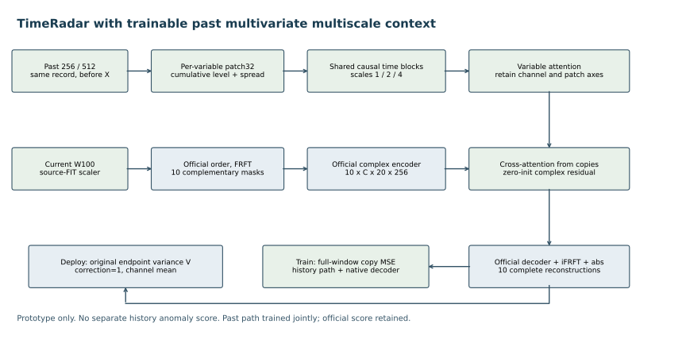
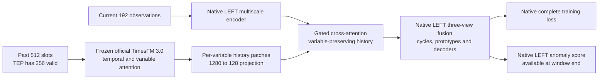

# TimeRadar 主体的历史多变量多尺度上下文模型

状态为已完成匹配源训练、正在执行首轮完整 Z/U 的模型候选。两类共享源模型均正常选中第240步；四个2000步U按固定合同执行，检测结论以封存评分为准。以官方 TimeRadar 权重为初态，所有新增路径联合训练。TimesFM 3.0 提供 patch 历史及变量交互的设计参考，LEFT 提供多尺度经验。该模型复用完整 TimeRadar，历史编码与交互层为项目实现。[代码](../../src/hybrid_tsad/timeradar_history_context.py) · [真实源输入 CPU 回执](../../docs/experiments/timeradar_history_context/CPU_CHECK.json) · [首轮实际训练合同与回执](../../docs/experiments/timeradar_history_development/PROTOCOL.md)

## 唯一方法问题

同一 TimeRadar 的当前窗口时频重构能否利用此前的多尺度、多变量过程状态，产生更有用的副本分歧，而非只降低正常重构误差？

旧 V1 的附加未来预测和误差融合、冻结 TimesFM 条件化 LEFT、独立历史关系评分均已完成各自范围内的验证。它们约束对应配方，尚未回答本模型的问题。必须用完整方法检测、历史对应对照和同预算原生模型一起判断；正常损失下降和接线成功均不足以成立检测贡献。

## 完整架构




## 数据、归一化与交互

当前窗 $X=[s,s+100)$ 与历史 $H=[s-h,s)$ 来自同一原始记录、同一角色，$h=256$ 用于 TEP，长记录取512。源标准化仅由合法源 FIT 确定；目标复用既有 LEFT 正常前缀 FIT＋正常 SELECT 的统计量，排除 TEST。每条记录的当前和历史使用同一个 scaler，目标统计权限与零参数更新分别披露。TEP 一条 run500 能合法容纳356点，禁止跨 run。记录、角色、变量映射和绝对时间由采样器绑定，模型的时间偏移断言只能检查相邻关系。

不进行窗内 RevIN，保留外部标准化后的水平与波动。每个32点patch嵌入为64维，并加入固定正弦时间坐标与截至该patch末端的累计均值、标准差投影。统计量不读取后续patch。按1、2、4个patch求均值得到各尺度输入，共享两层、四头、宽64的因果Transformer。各尺度再在相同历史patch结束位置跨变量注意力，保留变量轴。它实现过去信息下的有向时间可见性和统计变量交互，物理因果或显式时滞能力另需证据。

设原生编码输出为 $F_{m,c,p}\in\mathbb C^{256}$，十副本、当前分数域20个patch。记三尺度历史记忆为 $Z_{c,r,k}\in\mathbb R^{64}$，每变量各尺度最后一个token的均值为 $u_c$。交互为
$$
 Q_{m,c,p}=W_Q[\Re F_{m,c,p};\Im F_{m,c,p}]+u_c,\quad
 A=\operatorname{MHA}(Q,\operatorname{vec}Z,\operatorname{vec}Z),
$$
$$
 [\delta_R;\delta_I]=W_O A+b_O,\qquad
 F'_{m,c,p}=F_{m,c,p}+\delta_R+\mathrm i\,\delta_I .
$$
$W_O,b_O$ 初始为零，初态等于官方模型。历史记忆在每个当前窗口只计算一次，供全部副本使用。不同副本的query保留各自掩码后表示，残差可随副本改变。跨变量注意力参数不依赖通道数。原型支持1/25/31/38通道。这里的分数域patch没有被解释为原时间patch，与历史token通过注意力连接。

完整官方阶次网络、输入映射、编码器、解码器、逆变换、abs投影、十互补副本均保留，逐窗B=1，norm=0，eval模式和隔离掩码RNG。原型通过临时encoder输出hook注入，调用结束移除hook，无持久历史缓存。源码和权重沿用现行字节绑定。新增168,768个参数，总参数1,804,811。首版更新历史编码、交互层与原decoder，共962,378参数，原生非decoder部分冻结。第一步零投影允许历史梯度为零，之后必须核验实际梯度和位移。

## 目标、评分与两阶段组织

源阶段只用正常公开源数据：
$$
 L_{\mathrm{src}}=\frac{1}{10\cdot100\cdot C}\sum_{m,j,c}
       (\widehat X^{(m)}_{j,c}(H,X)-X_{j,c})^2 .
$$
部署唯一主评分：
$$
 s(s+99)=\frac1C\sum_c
 \frac1{9}\sum_{m=1}^{10}\big(\widehat X^{(m)}_{99,c}
       -\overline{\widehat X}_{99,c}\big)^2 .
$$
不增加独立预测或关系误差。训练复制误差含均值误差及副本方差，可能同时压低异常分歧，这是必须报告的风险。联合训练期间记录正常 E/V、源SELECT损失，检测能力由封存后真实目标指标判断。训练目标是明确开发选择，没有已证明的跨域异常保留保证。

| 模式 | 同一模型与评分 | 学习权限 |
| --- | --- | --- |
| Z | 源检查点直接评分 | 零目标参数更新，目标FIT统计权限另行披露 |
| U | 历史、当前路径一起更新，评分仍为V | 普通源重放16个目标混合窗、8+8正常源窗；目标只提供数值；CAL/QUERY不更新 |
| F | 从同一源端点开始 | 独立公开支持事件及正常支持；原copy项＋同一V的固定pairwise ranking，尺度只由合法支持正常或源FIT预定；支持与QUERY隔离 |

源折保持 TEP＋SMD→PSM/SWaT，TEP＋HAI→SMD，目标整域排除。官方 TimeRadar 的上游预训练权限照实说明，项目源排除不等于证明官方上游未见目标。F 支持资格按新612点完整输入足迹重新核定，旧W100支持资格不能直接复用。F仅在模型定型后以同骨干匹配支持比较执行。

开发首版 seed2025，源训练固定240更新、逻辑批量32逐窗梯度累积、fresh AdamW沿用原重构续训的 lr=1e-4、betas=(0.9,0.95)、eps=1e-8、普通参数weight_decay=0.1、bias/LayerNorm为0的设置、24步warmup，固定32窗SOURCE SELECT面板在0/40/.../240评估正常copy损失，最早最低选权。全模型与原生继续训练使用相同612或356点完整足迹及当前窗口计划，不能以旧无历史计划冒充匹配。两目标使用完整TEP52变量及SMD38变量的同一源合同，模型参数不依赖变量数，故共享两个源端点。两者已各完成240步，均选中240；正常验证仍在下降，只能视为有限源预算，不能称已充分收敛。U采用普通重放2000步、lr1e-4、batch32、200步warmup和固定终点。预算增加只能属于同模型有限开发修订并整组匹配，最多两轮。[可运行训练与评分入口](../../docs/experiments/timeradar_history_development/REPRODUCE.md)

F的固定支持已按完整612点足迹核定：PSM首个完整支持事件为[3248,3439)，SWaT为[496754,497694)，均只使用U-FIT。最早合法512点正常支持块各仅提供1个合法正常末点，异常支持分别提供92和841个末点；此限制必须保留，不把重复曝光当成独立正常样本。事件标签、512正常点标签与额外无标签历史分别登记。两个方法共享240步、32正常copy窗、15配对窗、三个时间层的合法正例末点数权重、系数1、margin1、log1p及官方初态的正常支持V中位数尺度（下限1e-8）。已完成四个一次性内存更新的入口检查，未生成正式F端点。模型冻结后再执行。无项目源阶段的入口同时重置官方初态和初始历史路径，不能只重置历史层。[支持与入口回执](../../docs/experiments/timeradar_history_development/F_entry_check.json)

## 三组实验与数据范围

| 组别 | 固定比较 | 首轮范围与回答 |
| --- | --- | --- |
| 完整公开方法 | 完整候选、官方TimeRadar、匹配重构续训、LEFT；兼容DADA/TimeRCD/CATCH及简单基线 | PSM、SWaT、完整SMD。四指标、合法共同轴，实体先计算后宏平均。官方发布固定权重与项目继续训练各自标明权限 |
| 两阶段与预训练 | 同一候选Z/U/F，U与普通源重放；源预训练前后及完整初态控制 | 首轮PSM/SWaT的Z和四个完整U；F在模型冻结后匹配执行。SMD全体用于范围验证，不逐机挑选。后续只对主要比较做训练重复 |
| 消融及机制 | 无历史的同预算原生继续训练、同容量错配历史、只保留自身变量历史、只保留细尺度；同权旁路 | 新权重均新评分。移除组件伴随容量和成本报告。对应历史与错配在共同合法足迹比较，长异常、弱幅值及相对时滞主张需匹配控制 |

不执行上述条目与全部模式和种子的笛卡尔积。第一组完成检测竞争比较，第三组在Z的两域开发范围定位机制。新的种子确认在模型冻结后进行。AP主指标，ROC及两项VUS完整保留，CAL缺少合法覆盖则NA。因果末点和离线全窗外部面板各自维护，不能跨轴相减。当前窗完整可见，因此末点当前已到达；因果历史不等于提前预测当前窗。

NASA资产决定在看新结果前固定。原身份表核对MSL27/SMAP53全部实体均为C=1、最短测试长度分别1096与4453，已有原数组、首列单传感器绑定、基线分数与评价入口，模型支持C=1。由于它们没有跨变量验证条件，暂不加入本轮核心矩阵，预留为冻结模型的单变量通用性补充。纳入补充时全部固定实体参与，不按结果挑选。[数据身份与既有外部轴](../../docs/experiments/native_endpoint_external_20261125/AXES_AND_INPUTS.json) · [NASA LEFT](../../docs/experiments/left_nasa_author_20261123/RESULTS.md)

## 资产复用与实际差异

| 项目 | 直接复用 | 必须新增 |
| --- | --- | --- |
| TimeRadar | 官方完整模型及权重、固定掩码、B1读出、官方abs和correction=1 | 历史编码和复数残差；新源模型权重与对应分数 |
| 数据 | 源FIT/SELECT、目标角色、原数组和scaler、完整实体清单 | 356/612点全足迹计划、历史输入哈希、变更共同轴后的汇总 |
| 评价与比较 | AP/ROC/VUS、事件和CAL代码；兼容外部原分数 | 新权重评分；同预算原生继续训练控制；需要更严格暖机时仅裁分数不填零 |
| 旧模型 | V1、TimesFM/留出、confirmed-delay、V监督全部封存 | 本模型从官方初态出发，旧V1或SWaT源事件监督权重不作为新源初态 |

旧V1采用TimesFM轻量块、LEFT交互、滞后模块及重建/预测分数融合。本模型由官方TimeRadar完整前向持有全部重构与评分，历史只经一个复数交互进入decoder。冻结TimesFM注入LEFT采用完整官方历史特征和LEFT损失评分；本模型的历史路径实际训练且以原生TimeRadar副本重构为目标。历史分数校正改变V后处理，本模型在重构前改变表示并保持V公式。上述区别定义实现，原创性仍需相对近期完整方法核验与检测支持。

## 当前可运行性和推进

运行 `PYTHONPATH=src python scripts/check_timeradar_history_context.py <author_workspace> <new_receipt.json>`。检查依赖作者工作区官方源码、权重和TEP正常数组。CPU真实源回执覆盖初态数值一致、原生V归约、三步工程更新、decoder/历史梯度、历史置换与旁路影响、跨变量重排、历史前缀因果性、256/512长度、非法偏移拒绝、无持久状态变化、RNG隔离和C=1/25/31/38。它验证工程路径，尚未验证异常检测。

按用户时限，第1—2天完成原型和源数据全足迹入口，第3—5天在同模型至多两轮开发，第6天冻结，第7—12天完成三组必要比较及重复，第13—15天成稿。具体日程以此指令开始计，不据运行主机日期倒写结果。每轮同时看完整竞争力、机制和操作代价，再定位假设失效处。五块双循环门保持暂停，没有为该门启动或排队科学训练；当前执行的是上文TimeRadar完整模型的源训练与Z/U。

## 已暂停的双循环更新接受门

# 历史暂停设计：双循环更新接受门

**状态**　以下为已暂停、未经训练与检测的历史设计，不是当前主方法，不接续作业。第二篇维持公开多变量混合无标签 TSAD 方法论文。现有 LEFT 实证稿、PDF 和适配结果保留于 [c65c81d 完整快照](https://github.com/codexpker/Hybrid/tree/c65c81d0d0a4df3db204225714e9a39984158dc3)，作为基线与探索证据。

## 科学问题和可识别范围

**在目标异常标签不可用时，能否用时间上分离的目标块中的双向时频共同改善，识别值得保留的混合适配更新，从而改善独立 QUERY 上的异常检测？** 这里测试更新能否在隔离足迹上重现，关注同一时间块能否同时支持两个循环方向。跨度足够长的正常变化可能重复出现，局部异常带来的拟合收益可能只留在少数时间块。这是待检验假设。时间块彼此分离仍可能共享工况或异常，持续异常也可能在多数块重复。

- **存在实际检测问题。** PSM 普通重放的 B−C AP 在三条轨迹上为 −0.020624、−0.015249、−0.010998，SWaT 为 −0.005484、−0.005754、−0.006902。窗口加权的交互在两域三次均为正，但幅度依赖任务。SWaT 的自然混合加权 AP 增量虽为正，均值只有 +0.000850，且两项 VUS 平均下降。SMD28 自然混合的窗口加权宏 AP 相对重放为 −0.001477。B/C 匹配槽位及替换次数，供体工况和全计划重排名的作用尚未分离。现有结果也没有直接证明跨块双向改善与检测净收益相连。[三种子同计划结果](../../docs/experiments/left_fixed_exposure_repeats_20261128/README.md) · [SMD28 实体与宏平均](../../docs/experiments/left_smd_reliability_20261126/SMD_RESULTS.md)
- **已缩小的解释。** 受观测的 28,000 次更新中没有原生显式 EMA 写入，此组退化不能由观测到的目标异常 EMA 写入解释。源梯度投影改变一阶更新几何，未取得有分量的检测增量。固定输入修正只得到源代理结果，不能回答真实目标问题。TimesFM 条件化和留出重建的内部正项不足以超过匹配原生 LEFT。M1 的代理排序没有带来双域实用 U 增量，M2 停在设计阶段。上述结果各自限定在对应合同内。[EMA 路径](../../docs/experiments/left_memory_exposure_20261126/RESULTS.md) · [源投影](../../docs/experiments/left_source_constraints_20261126/RESULTS.md) · [输入修正](../../docs/experiments/left_input_correction_20261127/RESULTS.md) · [留出历史](../../docs/experiments/left_holdout_history_20261127/RESULTS.md) · [M1 实测](../../docs/experiments/left_proxy_rank_20261127/RESULTS.md) · [M2 审查](../../docs/experiments/left_detection_oriented_source_20261127/REVIEW.md)

## 两阶段方法

**源学习与 Z。** 用完整 LEFT `3fadb4811797075e233076b9faceb0d8ec59b697` 的原生三视图编码、原型、解码、损失和状态规则。设 $X\in\mathbb R^{192\times C}$。记可学习时频变换 $T_\theta$、其逆变换 $T_\theta^{-1}$，以及联合表示给出的时域、频域解码 $\widehat X_\theta,\widehat S_\theta$。以下两项为同一原生前向中的循环分量，计算采用源码既有 SmoothL1 的元素均值。

$$
\begin{aligned}
\ell_{\mathrm{tf}}(X;\theta)&=\mathrm{SmoothL1}\big(T_\theta(\widehat X_\theta),T_\theta(X)\big),\\
\ell_{\mathrm{ft}}(X;\theta)&=\mathrm{SmoothL1}\big(T_\theta^{-1}(\widehat S_\theta),X\big),\\
L_{\mathrm{LEFT}}&=\alpha_{\mathrm{cyc}}(\ell_{\mathrm{tf}}+\ell_{\mathrm{ft}})
+\alpha_{\mathrm{ms}} L_{\mathrm{ms}}+\alpha_{\mathrm{cons}} L_{\mathrm{cons}} .
\end{aligned}
$$

正常源 FIT 仍按原合同训练，SOURCE SELECT 正常风险选权，直接复用 25/31/38 通道端点。PSM、SWaT 折为 TEP FaultFree＋SMD 正常记录。SMD28 折为 TEP FaultFree＋HAI 正常记录。Z 用源端点直接冻结评分。沿用归档标准化权限，PSM/SWaT 使用目标正常前缀统计，因此这里的 Z 指零目标参数更新。单独从源 SELECT 的固定 64 个合法正常窗口（两源各 32，固定独立抽样流）计算 $a_v=\max(10^{-6},\operatorname{median}_i h_v(X_i;q_0))$，只用于计算更新证据。原生分数和 CAL 不受这些尺度影响。[源折、初始化和评分资产](../../docs/experiments/left_multisource_20261126/RESULTS.md) · [38 通道合同](../../docs/experiments/left_smd_reliability_20261126/SMD_RESULTS.md) · [LEFT 论文与官方实现](https://doi.org/10.1145/3770855.3818044)

**更新证据使用固定度量。** 源码 `TFTransform.window_param` 可训练。直接比较前后原生频谱循环损失，会同时改变预测和频谱度量。验证因此冻结源端分析算子 $T_0=T_{\theta_0}$。保持候选各自的原生前向，取同一数据上两项可比的损失

$$
h_{\mathrm{tf}}(X;q)=\mathrm{SmoothL1}\big(T_0(\widehat X_q),T_0(X)\big),\qquad
h_{\mathrm{ft}}(X;q)=\ell_{\mathrm{ft}}(X;q).
$$

频到时分量已在共同波形坐标上度量，保留候选自己的逆变换。源端的 $h_{\mathrm{tf}}$ 等于原生 $\ell_{\mathrm{tf}}$。只有更新验证使用固定频谱度量。训练保持原生损失，推理保持原生分数。

**目标 U 的唯一新增机制。** 用同一模型的真实更新前后差，要求**同一批隔离足迹中的多数时间块同时改善时到频与频到时的原生循环**。一般的按视图分别计票允许两个视图各自受益于不同时间段。这里先对每块取较弱的改善，再在时间块上做多数归约。训练损失、可训练参数和部署读出沿用原生模型。

1. 仅在预先隔离的目标 U-FIT 内规划数值样本。以角色起点为原点，将完整 W192 网格划成五个按时间近等长的区间。若共有 $n$ 个完整窗，第 $b$ 段为窗口索引区间 $[l_b,r_b)=[\lfloor(b-1)n/5\rfloor,\lfloor bn/5\rfloor)$。令 $c_b=\lfloor(l_b+r_b-3)/2\rfloor$，取 $c_b,c_b+1,c_b+2$ 三窗组成 $V_b$，两侧各保留一个 W192 间隔。训练提议池 $P$ 只包含完整足迹不触碰这五组窗口和间隔的窗口。对合法起点均匀有放回抽样。任一段放不下五窗或 $P$ 少于 16 个合法起点时，记此折不具备当前协议条件。分块和足迹清单在分数及标签可见前固定。时间顺序、间隔与合法性不依赖分数。所有验证窗口都保留，低分、高分和难正常样本均无选择性删除。
2. 从源端点及 fresh Adam 出发，用固定提议计划运行 20 个区间，每次 100 个原生更新。单步 batch32 中，16 个来自 $P$，8＋8 来自两个正常源，Adam 学习率 $10^{-4}$。记当前已经接受的状态为 $q_j=(\theta_j,\beta_j,m_j,k_j)$，其中 $\beta$ 包括原型等持久缓冲，$m$ 含 Adam 各参数组与状态，$k$ 是 LEFT 课程计数。记同一状态出发的 100 步真实结果为 $\widetilde q_j=\mathrm{Replay}_{100}(q_j;P_j,S_j)$。原型梯度和 EMA 均按原生规则执行。
3. 对同样的 $V_b$ 无梯度、关闭 dropout 地测量提议前后的两个循环。定义 $H_{bv}(q)=|V_b|^{-1}\sum_{X\in V_b}h_v(X;q)$，计算
   $$
   d_{bv}=\frac{H_{bv}(q_j)-H_{bv}(\widetilde q_j)}{a_v},\quad
   G_j=\operatorname{median}_{b=1,\ldots,5}\min_{v\in\{\mathrm{tf},\mathrm{ft}\}} d_{bv}.
   $$
   若全部所需量有限且 $G_j>10^{-4}$，接受 $\widetilde q_j$。否则恢复 $q_j$ 的全部模型和优化状态。每次提议消耗固定计划中的下一段，即使恢复也不补步。提议序号与可恢复的模型课程计数分别记录，每段使用事先分配的训练 RNG，避免回滚后重复同段随机流。所有执行更新的 U 对照尝试 2,000 次，实际保留的更新数可不同。阈值为预定的源尺度相对数值容差，不由目标指标调节。
4. 用最后一次被接受的完整状态评分。若全部拒绝，模型等于 Z，记录为无有效适配，不能将保留 Z 检测能力计为适配收益。U-FIT 检查块反复用于这一训练规则，属于目标训练权限。对整个流程的检验使用隔离的 QUERY。

对任意实数 $d$，$G_j>\epsilon$ 等价于至少三个验证块的两个 $d_{bv}$ 都大于 $\epsilon$。因此，只在两个验证块造成损失下降的提议不通过。分别检查两视图中位数的对照可在每视图三个改善块仅交叠一个时通过。这个确定性性质只约束所测损失的分布，不证明它能识别正常、保证异常分离或推出跨域迁移。异常跨块重复、同时改善两项损失却削弱排名、少见的合法工况被拒绝，以及反复使用 $V_b$ 导致的过拟合，都是可观察的反例。

**部署读出与 F 接口。** 对合法非重叠 W192 窗口，始终对原生 `infer` 输出按通道求均值，$s_\theta(t)=C^{-1}\sum_c [\mathrm{infer}_\theta(X)]_{t,c}$，分数在窗末可用。验证增益和块权重不进入异常评分。SWaT 归档配置的 `alpha_cycle_s=0`，两循环仍参与训练，部署变化只能经共同学习的表示和原生多尺度读出体现。不得把两循环的改进直接写成 SWaT 评分改进。F 是后续独立权限模式，仍从同一源端点开始，保留 U 的数值权限并额外读取预留公开支持集。拟在单步提议损失中加入固定系数 0.1 的支持事件配对项 $\mathrm{softplus}(1+\log(1+s^-/a_s)-\log(1+s^+/a_s))$，$s^\pm$ 为支持窗内合法标注位置的原生分数均值，$a_s$ 为源 SELECT 点分数中位数下限 $10^{-6}$。支持事件、正常支持及窗口足迹须与 $P,V,\mathrm{CAL},\mathrm{QUERY}$ 分离，事件预算先登记。缺失则报 NA。F 用同一无标签检查门和部署分数，对同权限的无支持监督 U 比较。当前只给出 F 接口，效果范围聚焦 U。[原生读出实现和时序](../../src/hybrid_tsad/left_multisource_eval.py) · [SWaT 分量的已核对状态](../../docs/experiments/left_proxy_rank_20261127/RESULTS.md)

## 最近邻与实质差异

- **MAMS 是最接近的同领域先例。** IEEE TII 的出版页明确记载掩码元训练、在线只更新解码器、条件回滚和多尺度评分。已有证据足以排除将「重构式 TSAD 加条件回滚」作为新颖性主张。当前可审阅差异集中在固定观测坐标下、同一混合目标块中双向改善的多数提交规则，以及离线 U-FIT 与 QUERY 权限。已核验 MAMS 出版摘要和作者项目页，尚未取得可核对的回滚公式。最终新颖性判断须比对其具体判据与取样权限。[IEEE TII Early Access](https://doi.org/10.1109/TII.2026.3733708) · [作者说明](https://faculty.neu.edu.cn/yaoyu/en/lwcg/117075/content/62908.htm)
- **跨任务更新后的判定已有先例。** LiteST-TTA 有基于代理值的回滚及更新次数和帧身份对照，研究对象为手术器械分割，最终配置关闭回滚。Wang 等的预印本对实际适配后的分割输出按碎片化路由，阈值由有标签数据校准。本设计的可验证差别限于无异常标签的隔离时间块双向增益。有关更新计数的控制只能缩小混淆，保留相同步数仍可能得到不同轨迹。[LiteST-TTA](https://doi.org/10.3389/frobt.2026.1991989) · [分割路由预印本](https://arxiv.org/abs/2609.20700)
- **LEFT 与时频共识域适配。** LEFT 原方法提供两个循环、异常分数和原型课程。TFCDA 用时域及频域特征的一致性做域适配。本设计的改动在目标更新接受规则，以固定度量计算同一模型真实状态变化的隔离时间块损失差，再验证两个循环是否在**同一**分离时间块共同改善。时频一致性、重构和预训练均为继承部分。[LEFT](https://doi.org/10.1145/3770855.3818044) · [TFCDA 原文](https://www.cse.cuhk.edu.hk/~sinnopan/publications/%5BTAI2026%5DBoosting%20Time-series%20Domain%20Adaptation%20via%20A%20Time-Frequency%20Consensus%20Framework.pdf)
- **CANDI、M2N2 与 SAR。** CANDI 通过分数和相似性筛选适配样本并训练 SANA，M2N2 对在线数据以模型估计的正常位置更新。SAR 已有滤除噪声样本、锐度优化和模型恢复。这里的决策单位是已经计算出的原生模型更新，依据混合目标中隔离足迹的共同有限步增益。恢复到上个接受状态并包含优化器及原型。回滚或适配筛选本身已有先例。[CANDI](https://doi.org/10.1609/aaai.v40i17.38524) · [M2N2](https://arxiv.org/abs/2312.11976) · [SAR](https://arxiv.org/abs/2302.12400)
- **Fish、已有源约束及元学习。** Fish 在训练环境间提高梯度的内积以促进域外泛化。项目过去的投影限制参考源梯度与参数位移的一阶内积。这里在独立目标块实测整段更新的前后差，原生更新方向未被投影。Kumagai 等用有标签查询风险优化适配初始化，本设计只用无标签验证值决定本次是否接受，不向初态反传。无标签域适配的模型选择也已有工作，具体可检验差异是同块双向增益的联合多数规则及其对目标更新的作用。[Fish](https://arxiv.org/abs/2104.09937) · [Kumagai 等](https://proceedings.mlr.press/v206/kumagai23a.html) · [Deep Embedded Validation 原文](https://ise.thss.tsinghua.edu.cn/~mlong/doc/deep-embedded-validation-icml19.pdf)

现有核对支持将上述区别作为开发假设。最薄弱的一环是循环损失能否度量真实检测收益。已有时序异常检测预印本也观察到正常样本自适配未必改善排序。若同块联合规则无附加检测价值，结论应收紧到对实际更新状态做验证或限制更新本身的价值。文献筛查范围内尚无最终原创性结论。[正常更新的目标错配研究](https://arxiv.org/abs/2611.23761)

## 可直接实现的代码改动

- 检查路径从固定原生 `_forward` 的既有返回值读取 `X_hat`、`X_hat_from_S` 和 `x_enc`。无需修改 [left_decoder_context.py](../../src/hybrid_tsad/left_decoder_context.py) 的训练前向。单独复制冻结源 `TFTransform`，用其对 `X_hat` 和 `x_enc` 计算固定频谱差。逐窗取元素均值，合批时在块归约前保留逐窗值。波形分量直接用原生出参。此路径不新增训练参数。
- 在 [left_multisource.py](../../src/hybrid_tsad/left_multisource.py) 的适配入口增加一个选择项。隔离的 `left_block_acceptance.py` 负责角色规划、证据读出、增益归约和完整状态接受或恢复。重用 `initialize`、`restore`、`source_batch`、`update`。提议与优化器完全快照。验证在独立评估实例使用 `eval/no_grad`，隔离原生前向写入的临时缓存（例如 `last_x_res`）。验证前后检查活动训练实例的 `step`、原型、参数、缓冲和 RNG 未变。接受回执记录 $d_{bv}$、模型和优化状态哈希、步数、参数位移和额外前向。可缓存未改变状态的检查值，所以每折每个检查臂最多 21 次五块面板评分，外加每折一次源尺度计算。入选端点仍交给[现行评分和评价](../../src/hybrid_tsad/left_multisource_eval.py)。
- 必要工程核对为默认分数数值、源初态下按窗验证循环与原循环归约等价、只改变候选频谱窗参数时固定度量保持不变（输入和输出均固定）、禁用检查时训练轨迹、拒绝时 Adam/原型/计数准确回滚、无重叠足迹，以及不同独立随机流不互相消耗。简单数值反例可单测联合规则和边际规则的区别。源权重和原外部评分按时间轴及统计权限直接复用。历史真实 R/W 端点保留为已有结果。从 U-FIT 划出新隔离块会改变原训练计划，旧的 R/W 权重和系数不能冒充严格匹配端点。若走到实证阶段，只为必要匹配臂生成此合同的新端点。源模型、现行原生公开比较和关闭候选都不重做。

## 最小能决定机制的比较

先在既有开发折 PSM 和 SWaT 用一份固定种子及同一提议计划，单列 Z 与真实自然混合 U，报告相同 QUERY 上 AP、ROC-AUC、VUS-PR、VUS-ROC 和合法操作指标。旧 CAL 限制不变。开发折已曝光。参数与规则冻结后才能进行更广正式评价，优先完整 SMD28，保留逐实体和宏平均。首轮可以围绕同一机制做针对性定位，不使用 QUERY 选择移除哪个块、变更容差或种子。

| 对照 | 能区分什么 |
| --- | --- |
| Z 与同计划普通重放 | 是否真有适配净收益，接受规则能否超出单纯在同批样本上更新。 |
| 同计划窗口加权重放 | 同块验证是否有超出成熟可靠性加权的实际价值。保持冻结教师定义，在同一合法提议池重建系数。 |
| 边际视图对照 $\min_v\operatorname{median}_b d_{bv}$ | 只交换两种归约的次序。额外前向、参数容量、源重放、尝试更新和部署评分相同。 |
| 接受次数匹配的置乱对照 | 用情形固定的隔离 RNG 在前 10 段和后 10 段内置乱完整方法的接受序列。各阶段尝试步数和保留步数相同。实际梯度、Adam 轨迹和更新范数可能不同，逐一报告。序列只读取 U 过程，在 QUERY 评分前封存。若某阶段全部接受或全部拒绝，置乱不会改变该阶段，直接记录该对照的可辨识限制。 |

可用四个预定事务索引 1、6、11、16 做同父比较。训练时保留该事务的前、后两个检查点及联合、边际决策，所有正式端点封存后才由独立评价器读 QUERY，计算各提议相对其实际父状态的 AP 变化。只作过程诊断，禁止用它重选检查点。成对检查能揭示共同循环下降却损害检测的反例，端点差仍由完整方法对照承担。

用既有 B/C 供体原则可做随后独立的匹配曝光验证。若采用新的 $P,V$ 划分，供体也须完全留在 $P$，冻结同一 $V$ 面板及计划间的配对。旧 B/C 数值只作动机与参照。判断应同时看真实 U 相对 Z、R、W 的排序和操作代价，及同块规则相对边际与置乱对照的增量。若收益可由置乱复现，证据无法区分接受规则与少更新或接受时序的作用。若两视图总在同块共同变动，边际与联合轨迹近乎相同，这个设置无法区分机制。若能够通过检查却反复失去检测能力，说明循环改善对异常分离的代理假设在该设置下不足。弱异常、时滞能力和污染鲁棒性需要各自匹配验证，当前没有这些结论。


## 历史方法档案

此前 LEFT 实证稿及方法记录保存于 [基线与探索正文](draft.md) 和 [冻结证据表](../../docs/experiments/left_evidence_freeze_20261128/README.md)。以下各节保留原方法定义。

## Archived multi-source LEFT experiments on historical context

## Contiguous holdout reconstruction

The new development test changes the observation available to the detector. For every current W192 window, remove two 24-point patches across all variables before constructing any current view. Four complementary masks cover each position once. The temporal, spectral and multiscale paths receive this same masked tensor. Retain the native encoders, fusion, learnable multiscale analysis, decoders and prototype state. The hidden values supply targets only after prediction.

The underlying learning objective closes the time-to-frequency cycle on a completed window that combines visible observations with temporal predictions at hidden positions. The inverse-frequency and fine multiscale outputs reconstruct hidden truth with SmoothL1. Their consistency is evaluated on the same hidden indices and retains the native stop-gradient on the inverse-frequency output. Each term retains the corresponding native coefficient. The coarse target losses are omitted, the band regularizer is retained, and native EMA estimates its reliability from masked input. Readout uses each position's own held-out temporal and inverse-frequency absolute errors plus fine multiscale SmoothL1, using the native component coefficients and channel averaging. All scores become available at the window end.

The three arms vary the history input: none, frozen official pretrained TimesFM, or frozen random TimesFM of the same architecture. All three use the same source sampling and fixed optimization budget. The two history arms also share the original conditioner architecture and initialization. Normal target training (N) uses a separate FIT/SELECT program with identical exposure across arms. Z and N use the same legal TEST axis. The source checkpoint, random encoder, history permissions, loss, masking, selection and predeclared SMD28 expansion decision are specified in the [fixed protocol](../../docs/experiments/left_holdout_history_20261127/PROTOCOL.md).

## Archived unmasked TimesFM history conditioning

The fixed experiment is complete: fifteen source endpoints, three-domain Z evaluation and sixty matched replay endpoints across PSM, SWaT and all SMD machines. The architecture is not advanced to more seeds, pollution or F because the public comparisons and fixed controlled inputs did not establish a useful incremental advantage. The following definition describes the executed architecture; it is not a claim that the project's final method has been established. [Complete results and evidence boundary](../../docs/experiments/left_timesfm_hidden_20261126/RESULTS.md)

The current architecture conditions a complete LEFT detector on the hidden sequence of the released TimesFM 3.0 model. This experiment uses Google code `918df02c9d366b2145bc5876135fa2131d3ed2a6` and checkpoint revision `43046b85ec22d584a13f8098c2ed39c889e129c2`. Its model.safetensors SHA-256 is `a7592b0a8432baee54483254e5647856911ce69e09d09a9bb65904b2d98f17da`. The original twenty layers, causal temporal attention and multivariate attention are retained. The code is Apache-2.0. The downloaded 3.0 weights have the separately archived non-commercial, non-production license. [Official implementation](https://github.com/google-research/timesfm)

For a current W192 window beginning at s, input only observations preceding s to TimesFM. TEP provides 256 valid observations within one 500-point run. Other source records and target evaluation use 512 valid observations. TEP histories are left-padded to the same 512-position layout with a value mask. Every variable is a separate coordinate within the same multivariate sample. The full official forward with `return_aux_outputs=True` supplies `__call__:transformer_output`, a tensor of shape B×C×16×1280. Padding is excluded from official running statistics and valid attention keys. Hidden values for padded query positions are additionally masked in the downstream condition module. On the normal-source check, changing only padding values left valid hidden states exactly unchanged. Calling the model on a shorter unpadded tensor did not produce identical hidden states; its largest difference was about 0.329. The internal cause of that input-format sensitivity was not isolated. All experiments retain the same 512-slot representation and mask rule. Sample counts also represent different physical durations across the source datasets.

Let Q_i be LEFT's native encoded tokens for variable i and let H_i contain its TimesFM hidden patches. A trainable linear projection maps each H_i to dimension 128. Four-head cross-attention takes normalized Q_i as queries and normalized projected H_i as keys and values. It returns A_i, and the detector replaces Q_i by Q_i + tanh(g) A_i, with a trainable scalar g initialized at zero. The attention acts before LEFT's existing three-view fusion and reconstruction pathways. Its history remains variable-specific, while TimesFM's original variable attention has already mixed information across variables. The added attention has zero dropout. LEFT and the condition layer receive the unmodified full native training objective. TimesFM remains frozen. Deployment uses the native LEFT anomaly score from the conditioned reconstruction and cycle.

At D=128, the pretrained, reassigned and random-encoder conditions each add 230,529 trainable parameters. The statistics condition adds 66,945. In addition, the three hidden-state arms depend on a complete frozen TimesFM model, whose runtime and storage must be included in cost comparisons. The archived configuration declares `max_variates=32`, but this field is not used by the fixed PyTorch attention path. The implementation reshapes each patch to its actual variable count and attends across all variables. The 38-variable SMD call therefore retains full 38-by-38 variable attention without cropping or grouping. This does not establish that upstream pretraining included 38-variable samples.



The five matched source arms are native continuation, a historical mean/variance condition, pretrained hidden features, causally reassigned pretrained features and hidden features from an identically configured randomly initialized frozen TimesFM. All inherit the same existing LEFT compatibility wrapper: differentiable prototype snapshots preserve the pre-EMA read, while the original loss, curriculum and score definitions are retained. The decoder's older optional context interface remains unused. The new difference is the encoder-output history hook. The last three arms share the same condition module initialization. The mean/variance control has two inputs per variable and one condition token. Only this control directly receives raw historical level and variance. The main model has the information carried by the original hidden states. The random encoder has the full official architecture and is frozen; it is not a small randomly initialized predictor.

Writing the official historical encoder as \(F_{\psi}\), define \(H=F_{\psi}(X_{s-h:s})\), with \(\psi\) fixed. For each variable, \(K_i=V_i=\operatorname{LN}(W_HH_i+b_H)\), \(Q_i'=\operatorname{LN}(Q_i)\), and \(\widetilde Q_i=Q_i+\tanh(g)\operatorname{MHA}(Q_i',K_i,V_i)\). The objective is exactly \(\mathcal L_{\mathrm{LEFT}}(X_{s:s+192};\theta,\widetilde Q)\), including the original reconstruction, multiscale and cycle terms and their existing coefficients. Optimization updates \(\theta\) and the projection, normalization, attention and gate parameters. There is no historical prediction loss or extra score. The frozen historical encoder receives neither current-window observations nor gradients. Parameter conditioning can change every downstream component of the native anomaly score; it does not create a separately calibrated anomaly detector.

This use of historical attention is motivated by the original TimesFM temporal and variable modeling architecture, while the reconstruction and detection objective remains LEFT's. Reusing cross-attention and a gate is not itself an originality claim. The empirical questions are whether pretrained historical features improve the complete detector beyond matched continuation and historical statistics, whether that gain requires the actual window history, and whether it survives ordinary mixed-target replay. Temporal causality here describes the historical encoder's input and mask. The current detection window still uses all 192 observations, so scores are retrospective and become available at the current window end. No attention visualization, gate value or public AP gain alone establishes weak-anomaly, delay-specific or physical causal capability. [TimesFM architecture description](https://research.google/blog/timesfm-3-a-zero-shot-foundation-model-for-multivariate-forecasting/) · [LEFT](https://arxiv.org/abs/2602.08638)

Historical reassignment is restricted to the same record and role with donor history ending no later than the recipient's current start. The recipient's ordered variable mapping is retained. When earlier history exists, the assignment uses an isolated deterministic random stream and excludes the identical start. Earliest windows can remain aligned, and their count is recorded. This causal reassignment changes the empirical donor frequency. An arbitrary permutation over an entire evaluation record could disclose observations later than the recipient's detection time.

Project source exclusion applies to the TEP/SMD or TEP/HAI continuation data. Membership of the public target datasets in the upstream TimesFM pretraining corpus is not established by these local records. The experiments therefore evaluate frozen official representations on exposed public tasks.

Both source domains receive equal window presentations. All arms start from the matching archived 25-, 31- or 38-channel source model, share their current windows and native random stream, and receive 2,000 Adam updates at learning rate 10⁻⁴ with batch size 32. Fixed endpoints determine the source models. Normal source SELECT supplies diagnostics and feature fixtures. Features are calculated in full float32 and streamed to avoid storing hundreds of gigabytes per source fold. Each batch records its feature hash, history footprint, original record and ordered variable mapping. Public score banks retain their input identities and actual window-end availability.

| Fold | Project source records | Variables per sample | Target permission |
|---|---|---:|---|
| PSM | TEP FaultFree Training + all SMD normal FIT records | 25 | Known normal target-prefix scaling; no target parameter update in Z |
| SWaT | TEP FaultFree Training + all SMD normal FIT records | 31 | Known normal target-prefix scaling; no target parameter update in Z |
| SMD28 | TEP FaultFree Training + HAI 21.03 normal FIT files | 38 | Per-machine normal scaling; no SMD source optimization or source SELECT in this fold |

Each source draw selects distinct ordered channels once and keeps that ordering for the full history and current window. TEP FIT uses runs 1–20 and SELECT uses runs 61–65. The SMD source split uses each record's first 80% and last 20% without cross-boundary windows. HAI uses train1/train3 for FIT and train2 for SELECT. In every case, existing FIT-derived source scalers remain fixed. An A–E source step therefore has the following implementation:

```text
Draw the shared 32 current windows and their preceding legal histories.
Extract frozen pretrained, causally reassigned pretrained, and frozen random states.
For each of the five LEFT arms:
    Restore the same native dropout RNG state for this update.
    Set its prescribed history condition, retaining variable and patch indices.
    Run the complete native LEFT forward once; update native EMA and step once.
    Backpropagate the native complete loss; take one Adam step.
Check that the native RNG advances identically across arms; archive input hashes.
After update 2000, seal all endpoints before target metric computation.
```

The frozen encoder has 330,710,976 registered parameters. Its output head is retained in the full official forward, although forecast outputs do not enter the detector. Costs include feature extraction, not just the small trainable attention module. Source and target feature reuse requires equal normalized input hashes, ordered channel maps, masks and historical indices.

The second stage compares ordinary source replay from the native continuation with the same replay from the conditioned source model. Each step includes sixteen mixed target windows and eight windows from each normal source. Both use 2,000 updates, fresh Adam at 10⁻⁴ and a fixed endpoint. Every target history and current window belongs to the existing U-FIT role. Z and U are evaluated separately on their legal axes. Existing CAL indices retain their original definition. An operating point is unavailable if its complete legal history cannot be formed at every required CAL location.

Implementation separates the [official hidden-state adapter](../../src/hybrid_tsad/timesfm_hidden.py), [native encoder-output condition](../../src/hybrid_tsad/left_timesfm_condition.py), [matched source learning](../../src/hybrid_tsad/left_timesfm_training.py), [paired replay](../../src/hybrid_tsad/left_timesfm_adaptation.py) and [footprint-aware evaluation](../../src/hybrid_tsad/left_timesfm_evaluation.py). Feature-cache placement and allocator allowances were corrected during execution without changing the mathematical program, sample plans or selected endpoints. Executed-source snapshots and failed preparation records are retained with the experiment, rather than being presented as method contributions.

The historical Pearson prediction-head experiment below is archived. Its representations, scores and conclusions retain their original identities.

## Historical reference for changes in local dependence

For a current window starting at \(s\), the detector receives \(H=X[s-256:s]\) and \(D=X[s:s+192]\) from one continuous record. The reference sees only \(H\); the native three-view path sees \(D\). Divide \(H\) into eight chronological 32-point patches per variable. A channel-shared history representation feeds a relation head whose coordinates specify the future block, ordered driver and response, and lag. Predictions for all six blocks exist before the current window begins. The full detector publishes the native point score and the associated relation evidence at \(s+191\).

Let \(I_b=\{s+32b,\ldots,s+32b+31\}\). In each block and at each fixed lag \(\ell \in \{0,1,2,4,8,16,32,64\}\), correlate the driver's 32 observations \(X_{t-\ell,i}\) with the response's 32 observations \(X_{t,j}\), \(t\in I_b\). Center each vector separately. A centered RMS of at most \(10^{-5}\) on either side invalidates the coordinate. The earliest driver observation for the first block is \(s-64\), within the legal history. Self relations use \(i=j,\ell>0\); cross relations use \(i\ne j\), retaining both directions even though their zero-lag targets coincide. A changing peak can therefore move error between named coordinates. There is no lag selection on the observed detection window.

**Shared implementation.** Map each 32-sample patch to the native patch input width by fixed adaptive average pooling (6 components for PSM and SWaT, 16 for SMD). Apply LEFT's existing value embedding, positional embedding and encoder. The last of the eight output tokens gives \(z_i\in\mathbb R^{128}\) for channel \(i\). Shared affine maps produce four-dimensional vectors \(q_{jb\ell}\) for the response and \(k_{ib\ell}\) for its driver. The predicted cross coefficient is \(\tanh(q_{jb\ell}^{\mathsf T}k_{ib\ell}/2)\); a separate affine map followed by \(\tanh\) predicts the seven autocorrelations. Six block horizons use different rows of the same maps. The head adds \(129(192+192+42)=54{,}954\) parameters at each width. The relation gradient and native reconstruction gradient reach the same patch embedding and temporal encoder. The complete native current-window pass retains its original prototype updates. [Model and score implementation](../../src/hybrid_tsad/left_history_relation.py)

Write \(R_{bg}\) for the mean squared error between the predicted and observed coefficients among valid coordinates of group \(g\) (self or cross) in block \(b\). A valid group carries equal weight in the block error \(R_b\). Source training combines the native LEFT objective and masked relation regression with coefficient one. We compare the joint endpoint to a native LEFT endpoint with the same source draws, optimizer schedule, 2,000 updates and starting checkpoint for each fold. Both endpoints are fixed in advance. The source fold uses TEP and SMD for PSM and SWaT, and TEP and HAI for SMD. Sampling takes one contiguous 448-point footprint from one record with one fixed ordered channel draw. A 500-point TEP run supplies 53 possible starts.

For the joint detector, let \(A_t\) be the native LEFT point score. Estimate the arithmetic means of the native point scores and valid block errors on 1,024 fixed normal source SELECT windows per fold, then freeze these scales \(a,r\). The deployment rule is \(S_t=\tfrac12(A_t/a+R_{b(t)}/r)\) with scale floors of \(10^{-6}\). If a block contains no valid relation, the complete score falls back to the normalized native score. Relation evidence has 32-point resolution; repeating its value on the evaluation grid preserves this resolution. A statistical comparator predicts each current coefficient by its corresponding coefficient in the last 32 history response positions. The matched native-plus-statistical score, the native readout of the joint checkpoint, and self/cross component readouts separate the effect of source learning from that of including a second score. Only the predefined joint score represents the complete candidate.

**Relationship to prior work.** LEFT supplies the shared encoder, multi-resolution path, time–frequency cycle and anomaly score. MSCRED estimates anomalies by reconstructing multiscale inter-sensor signature matrices. CrossAD reconstructs finer series from coarser series and uses a query library for cross-window context. Heppel et al. estimate conditional distributions given inferred lagged causal parents. Our reference instead predicts an observed vector of fixed-lag coefficients from a disjoint history and evaluates it alongside the jointly trained LEFT path. This is a testable distinction in the target and information available to the predictor. TimeRadar motivates anomaly-oriented time–frequency evidence; TimesFM motivates learning from historical patches and variables. Only LEFT supplies implementation components here. The older project history/lag branch injected convolutional history features into native reconstruction; it did not train against these coefficient targets. Directed correlation is a statistical quantity and shared common drivers can produce it. [LEFT](https://arxiv.org/abs/2602.08638) · [MSCRED](https://arxiv.org/abs/1811.08055) · [CrossAD](https://proceedings.neurips.cc/paper_files/paper/2025/hash/c9658e8c20879632cb1cfca91d80ceb7-Abstract-Conference.html) · [Heppel et al.](https://doi.org/10.4230/OASIcs.DX.2024.11) · [TimeRadar](https://github.com/mala-lab/TimeRadar) · [TimesFM](https://github.com/google-research/timesfm) · [Older lag implementation](../../src/hybrid_tsad/left_native_history_lag.py).

**Two-stage use.** Z freezes the selected source model and its component scales. Public target normal-prefix scaling follows the established dataset permission, including normal validation. U would start independently from the same source checkpoint, retain the joint loss and score, and mix 16 unlabeled target footprints with 16 normal source footprints under the ordinary replay budget. Every 448-point footprint must lie in its permitted training role. F would start independently from the source checkpoint and use a prespecified public support event and a separate normal support block. Pair complete labeled 32-point response blocks on the deployed joint score, retaining native learning on normal support. Choose support and history eligibility before evaluation; no support or history window may draw from QUERY. U and F are separate uses proposed for this integrated detector. This evaluation measures Z.

### Multisource LEFT backbone and fold permissions

**Detector and transfer unit.** For PSM and SWaT we train two full LEFT models from random initialization, one for a 25-variable target and one for a 31-variable target. Both use W192 and the previously matched native implementation of upstream revision `3fadb4811797075e233076b9faceb0d8ec59b697`, including the pre-EMA read snapshot. The three original views, prototype associations, curriculum, cyclic reconstructions, training loss and point scoring all operate in each stage. Et's first convolution takes C input channels and Ef's takes 2C real/imaginary channels. The last projections of Dt and Df produce 192C and 2CFK outputs respectively, where F and K are the frequency-bin and frame counts. Checkpoints are loaded strictly at the width at which they were trained. Sensor identity is fixed across a window. Across domains there is no assumption that channel 7 on two records measures the same quantity.

**Source learning.** Each of 4,000 Adam updates (constant learning rate 0.0001, batch 32) presents 16 TEP fault-free training windows and 16 SMD normal training windows. Within each source, draw a record uniformly and a legal window start uniformly; choose an ordered sample of C distinct channels and apply that map to all 192 time points. TEP FIT runs are 1–20 and held-out SELECT runs are 61–65. The TEP scaler uses pooled fault-free FIT runs. Each of the 28 SMD machines contributes its first 80% of its official normal training record to FIT and its last 20% to SELECT, scaled by that machine's FIT statistics. No PSM or SWaT values enter this optimizer or its validation. The validation panel contains 512 windows per source, drawn once with an isolated stream and reused. Choose the earliest minimum native normal loss at steps 3,200, 3,600 or 4,000. The native PSM-width model has 1,000 warmup steps followed by a 2,000-step ramp to memory weight 0.3. For SWaT width the corresponding lengths are 500 and 1,000. All selectable states have completed the ramp.

**Target use.** Z freezes the selected source weights and prototypes. Its scaler uses the official target normal prefix, including its normal SELECT portion. N starts from the same source checkpoint, preserves the prototype banks and their curriculum step, and fits the complete model with a fresh optimizer. It uses the existing target-native LEFT trainer, chronological 80/20 normal split, stride-one FIT windows, nonoverlapping SELECT windows, batch 128, native learning-rate schedule, at most 20 epochs and patience three. The seed-2025 target-only LEFT is the matched from-scratch comparison. The inference score at each position is the native LEFT channel mean and becomes available at the end of its 192-point window.

**Mixed target learning.** U is a separate experiment. Only the fixed U-FIT prefix of the released target test record enters the optimizer. Each job runs 2,000 steps with a fresh Adam at 0.0001, batch 32, using its endpoint. Ordinary U presents 32 target windows. Replay presents 16 shared target windows and 16 source windows (eight TEP, eight SMD). Independent streams preserve the first target half across arms. A third model starts with random weights and native initial prototype state, then uses the entire ordinary U target plan. A pretrained optimizer starts from fresh moments, while the network inherits its selected curriculum step. A random model follows the native curriculum from zero. The contrast therefore assesses the complete source initialization, including the learned prototypes and their runtime state. All arms use the same target-normal scaler. No target annotation enters fitting or selection. Each model calibrates on the preassigned 512 mixed-CAL points with q99/higher and strict exceedance. [Complete results, exposures and operating costs](../../docs/experiments/left_multisource_20261126/RESULTS.md)

**SMD target fold.** A third, 38-channel LEFT model uses the same source sampling and selection algorithm with TEP and HAI 21.03. All 28 SMD machines are excluded from the source optimizer and its validation. HAI train1 and train3 supply FIT windows and each uses its own normal scaler. The independent train2 SELECT record uses point-pooled statistics from train1 and train3. The released CSV headers contain 79 process columns after removing the timestamp and four attack indicators. Windows remain within their original records. SMD retains its native 1,000-step warmup, 2,000-step ramp and maximum memory weight 0.2. TEP contributes 16 windows per source update. HAI supplies the remaining 16. Because the two other folds used SMD as their second source, between-target differences combine target and source composition effects. These publicly exposed datasets support development comparisons.

**SMD target permissions.** Public Z and N use the complete official normal training record for per-machine scaling, consistent with the archived target-only LEFT. Under mixed adaptation, let \(n\) and \(q\) denote lengths of the released normal training and test records, respectively. Fit the target scaler on training points \([0,\lfloor0.6n\rfloor)\) and reserve \([\lfloor0.8n\rfloor+544,n)\) for nominal normal calibration. Use \([0,\lfloor q/3\rfloor)\) of the test record for mixed updates and \([\lfloor q/3\rfloor+544,q)\) for evaluation. Each record has its own W192 grid. Retain complete within-role windows and select 512 evenly spaced legal CAL positions. The three-domain public panel and the separate mixed panel preserve their own target-statistics permissions. Eight TEP and eight HAI windows supply the source half of SMD replay. Source-only continuation trains one 38-channel model and each machine calibrates it separately. [HAI file identities and roles](../../docs/experiments/left_smd_reliability_20261126/source_inputs.json) · [Official HAI release](https://github.com/icsdataset/hai/tree/2a814cebc9a66b06c9e5cd545e2d72e65d383737/hai-21.03)

### Reliability within a replayed target window

Let \(s_{ijt}\) be the frozen source LEFT score, averaged across channels at position \(t\) of target slot \(j\) in minibatch \(i\). For each exposure condition separately, let \(r(s)=(n_{<s}+n_{=s}/2)/N\), where \(N=2000\times16\times192\). Repeated presentations count in this distribution. Set \(u=1.5-r(s)\) and divide each target coefficient by the mean of \(u\) over the 16 target windows and their 192 positions in that batch. Source coefficients are one. The scorer is fixed in evaluation mode. Computing a teacher vector once for a repeated window preserves its multiplicity when forming the ranks. The ranks use unlabeled U-FIT values and the existing scaler.

The whole-window arm uses each window's mean normalized coefficient for all its sample losses. The local arm retains the 192 coefficients for the frequency-to-time reconstruction, the full-rate multiscale reconstruction, and the consistency loss between these two reconstructions. It applies the same window mean to spectral-cycle coefficients and every coarse-scale segment. The original smooth-L1 reductions, per-scale mixing, detached consistency target, loss coefficients and independent band regularizer are retained. Both arms see the same coefficient sum in each window and batch. They differ in which observed positions receive this weight. Native prototype updates, Adam and deployed scoring follow the original replay procedure.

Contamination-aware learning has several precedents. RiAD addresses inaccurate unsupervised learning, CLEANet combines adaptive reconstruction weighting with clustering-guided contrastive learning, and TSAD-C uses decontamination followed by dependency modeling. Here the empirical question concerns window-constant versus time-local loss weighting within the same window, with the same frozen detector and target weight budget. The earlier project truncation study also showed that ranking complete windows by loss can suppress difficult normal windows. This experiment retains every exposure. [RiAD](https://www.sciencedirect.com/science/article/pii/S002002552400135X), [CLEANet](https://arxiv.org/abs/2510.22619), [TSAD-C](https://proceedings.mlr.press/v286/ho25a.html), [historical truncation study](../../docs/experiments/left_selective_swat_20261118/RESULTS.md).

### Who can write to the prototype banks during adaptation?

LEFT updates each prototype through two pathways. The prototype tensors are parameters of the native association and memory read, and receive gradients from the complete batch. During a training forward, LEFT can also assign a window to a prototype in each view and explicitly move the assigned row toward the mean normalized embedding of the assigned windows. The matched implementation takes a differentiable snapshot for the read before the explicit write. Adam then updates the parameters from the full native loss. At detection both prototype banks are fixed.

For each training window let \(e_i\) be the mean absolute cycle reconstruction error from the frequency-side reconstruction of the observed series. Let \(j_i\) be the time average of the JS divergence between the time-view assignments and the frequency-view assignments aligned to the time grid. Each confidence value is the mean across tokens of that view's maximum assignment probability. For a set of slots \(S\), a window qualifies if it lies in \(S\), its error and divergence fall at or below their respective empirical 0.30 quantiles over \(S\), and both confidences reach 0.85. Ordinary LEFT uses the full batch for \(S\). Restricted replay uses the eight TEP and eight SMD source slots pooled together. The accepted windows retain the native per-view hard assignment and EMA momentum of 0.99. This intervention jointly changes the reference sample for the quantiles and the write permissions. The target windows retain their gradient pathways into the banks and the rest of the network.

All methods use the same first 16 target slots per update. Target-only U adds 16 independently drawn target windows; replay supplies eight normal windows from each source instead. Under the controlled conditions, 3,200 presampled shared slots receive an all-attack window (B) or an all-normal window (C) from the respective target U-FIT. The other slots and streams follow their original plans. Exposure counts refer to presentations. Event identity and temporal overlap are recovered using the public labels at evaluation; repeated draws can come from the same event. At fixed validation-free endpoints we compare the absolute B results and within-method B−C changes on the same suffix. The difference of B−C changes tests differential response to this one substitution schedule. [Controlled exposure and prototype measurements](../../docs/experiments/left_memory_exposure_20261126/RESULTS.md)

### Constraining the Adam displacement during mixed replay

Each update uses one native training forward on 16 unlabeled target windows, eight fault-free TEP windows and eight normal SMD windows. Let \(\theta_*\) denote the parameter state after this forward's native prototype EMA. Its saved main-loss gradients drive one Adam step, starting with fresh moments at the beginning of adaptation. The unconstrained proposal is the measured displacement \(d_0=\theta_{\mathrm{Adam}}-\theta_*\). Both constrained variants retain the moments of that proposal. The curriculum advances once, from step 4,000 at initialization to step 6,000 at the fixed endpoint.

At \(\theta_*\), two differentiable evaluation-mode forwards compute \(g_T\) and \(g_S\), the gradients of the native source loss on the respective eight replay windows. These calls preserve the main gradients, prototype state, curriculum counter and random stream. With separate constraints we solve

\[
\min_d\tfrac12\|d-d_0\|_2^2
\quad\text{subject to}\quad g_T^\top d\le0,\quad g_S^\top d\le0.
\]

The mean-source comparator uses the single normal \((g_T+g_S)/2\) before unit normalization. A feasible proposal passes through unchanged. Otherwise the solver tests the single active faces, then projects onto their intersection using an orthogonal basis if both are active. Zero normals impose no restriction. Inner products are computed in float64. We measure the displacement after writing the float32 parameters and, if rounding crosses a face, nudge the stored update inward and recheck it. Paired before/after reference losses measure the finite change with all other state held fixed. The inequalities describe the parameter substep at this particular reference state. Ordinary EMA changes and finite-step curvature remain relevant to the detector. Separate task constraints and averaged reference gradients follow established continual-learning work. [GEM](https://papers.nips.cc/paper/7225-gradient-episodic-memory-for-continual-learning.pdf), [A-GEM](https://openreview.net/forum?id=Hkf2_sC5FX).

Source-only continuation retains the eight shared windows per source in the second half of the batch and independently draws eight more per source in the first half. This gives 32,000 presentations per source, compared with 16,000 per source plus 32,000 target windows during replay. Reference passes reuse the same replay samples. The source-only and average-gradient comparators respectively test continued source learning and the utility of separate constraints. None matches the realized step length without enforcing its direction. The training comparison uses one development seed and the unmodified LEFT retrospective readout. [Adaptation and mechanism results](../../docs/experiments/left_source_constraints_20261126/RESULTS.md)

## Archived synthetic-intervention TimeRadar study

The detector starts from the complete released TimeRadar checkpoint. Only the reconstruction decoder is trainable. The order network and encoder run in evaluation mode on each window independently. Ten complementary masked reconstructions use the same isolated random seed 84551. For window \(x\) and location \(j\), deployment returns \(v_j(x)=C^{-1}\sum_c\operatorname{Var}_{m}(\hat x^{(m)}_{jc})\) with sample variance (divisor nine). A complete nonoverlapping 100-point window produces one score per real position, available at its last observation. The entire test grid is fixed at multiples of 100 in test-relative PSM or absolute SWaT coordinates. Each role admits only complete input windows. No scoring head is fitted.

**Source learning.** TEP contributes the previously bound 52-variable fault-free training runs 1–20 for FIT and 61–65 for SELECT. SMD contributes the first and last 80/20 percent of each of its 28 normal training records, with FIT statistics per machine. The TEP array uses the archived fault-free FIT scaler. The two source domains receive equal window counts. The corresponding official pretraining history is inherited; domain exclusion describes the additional project training. For each sampled W100 window, edit a uniformly sampled quarter of channels (rounded up), over positions 40–59. Multiply the change by a squared-sine taper (half-sample endpoints). Half of the edits add a randomly signed uniform 1–2 FIT-scale offset. The remainder interpolate toward the values three or six positions ahead or behind in the same input. The window pair provides synthetic supervision. Physical faults and propagation delays have no labels in this experiment.

Let \(a\) be the official model's median native variance on the edit support of 64 fixed source FIT windows, floored at \(10^{-8}\), and \(g(v)=\operatorname{asinh}(v/a)\). For the source pair \((x,x^+)\), average \(\operatorname{softplus}(1+g(v_j(x))-g(v_j(x^+)))\) over the 20 edited positions. Add that loss to the normal ten-copy full-window reconstruction MSE. The reconstruction control uses the same normal window plan and reconstruction gradients alone. Both select the earliest minimum synthetic pair risk on 56 held-out source windows at steps 0, 20, …, 120. Thus the control also has synthetic source validation information. There is one development seed (2025), four windows per source update, AdamW at \(10^{-4}\) and 12 steps of linear warmup.

**Mixed adaptation.** Each arm starts at the selected source-pair decoder. The frozen source model gives \(v^0_j(x)\) on each unedited target window. The absolute reference \(b\) is a new median on the same source FIT panel using this selected model. Let \(u=v_j^\theta(x), e=v_j^\theta(x^+), t=v^0_j(x)\). The edited score used for the training comparison is \(g(e-u+t)\). Use \(\operatorname{softplus}(1+g(r)-g(e-u+t))\) over the edit support, with \(r=b\) for the absolute arm and \(r=t\) for the local arm. Each arm also matches \(g(v^\theta_j(x))\) to \(g(v^0_j(x))\) with unit-beta SmoothL1 over **all** positions in the original target window. Both arms replay the same source reconstruction and synthetic ranking loss. Only \(r\) differs. Adding a constant to both student scores cancels exactly in \(e-u+t\); at the reference state it increases the anchor cost. This removes the uniform additive shortcut in raw V. Other changes of scale and synthetic-edit-specific learning remain possible.

Ordinary replay uses copy reconstruction on both source and target windows. Each of the six target jobs uses four source and four target windows per step with equal weight for the two halves, fresh AdamW, the same 12-step warmup and a fixed endpoint of 120 steps. The target FIT scaler may use the designated normal prefix. The learner receives only U-FIT values. CAL selects the operating threshold after training. QUERY labels enter the evaluator alone. The same frozen-source Z is evaluated on the separate U axis.

The historical synthetic ranking head learns a new scalar from handcrafted features. The public real-event decoder uses SWaT event labels. Historical response-preservation arms constrain the reconstruction outputs of a source teacher. The present teacher supplies a **target-window native score** and the deployed detector retains the pretrained variance readout. Ordinary replay remains an experimental control. The completed results and limits are in the [two-domain comparison](../../docs/experiments/intervention_reference_20261126/RESULTS.md).


## Archived fixed Hankel trajectory-subspace study

**Implementation status.** The [first fixed evaluation](../../docs/experiments/trajectory_subspace_20261126/RESULTS.md) covers the public test and independent mixed-target roles on PSM and SWaT. The technical question is whether an unlabeled target can update transferable normal dynamics after separating localized deviations in the original sensor timeline. The object transferred across domains is a set of temporal subspaces. Sensor identities remain local to each record.

## Rationale and closest methods

A mixed target window can contain a normal operating transition in many channels and a departure in just a few measurements. Rejecting or accepting the entire window couples their influence on learning. Source replay in the archived SWaT and PSM experiments improved AP over equal-budget target updates, with coverage and false-alarm trade-offs. Those experiments motivate a finer unit of adaptation. They do not identify which observations were abnormal during learning. [Matched replay results](../../docs/experiments/left_replay_exposure_repeat_20261118/RESULTS.md)

The closest starting point is **Hankel-structured robust PCA for multivariate anomaly detection**. Wang, Miranda-Moreno and Sun embed traffic data into a structured tensor and separate a low-rank background from sparse deviations. Chen et al. exploit the relation between spectral structure and a low-rank Hankel trajectory for outlier removal. Learning a reusable basis while solving for local coefficients also has established precedents. These works supply the decomposition and learning principles. The two specific hypotheses here concern transfer of band-specific *lag subspaces* across different sensor inventories, and updating these subspaces from a *jointly estimated normal trajectory* on a mixed target. The distinction depends on a comparison against structured decomposition trained on the target alone and against ordinary adaptation. Novelty and empirical benefit remain open. [Wang et al.](https://arxiv.org/abs/2110.04352) · [Chen et al.](https://doi.org/10.1002/stc.3144) · [Mairal et al.](https://jmlr.org/papers/v11/mairal10a.html)

## The normal trajectory model

Use complete, non-overlapping standardized blocks \(X\in\mathbb R^{W\times C}\), \(W=96\), anchored to each record and role start. All valid positions receive a score at block end. Truncate incomplete tails and retain timestamps. For each possible length-\(L=32\) subwindow of a block and each sensor, form one length-32 column. Stack these into \(H(Y)\in\mathbb R^{32\times K}\), \(K=(W-L+1)C\), for a latent normal block \(Y\). \(F_b\) extracts eight consecutive coefficients of the orthonormal DCT-II of each lag column, with four disjoint bands ordered from DC to Nyquist. These frequencies are relative to each dataset's sampling rate. The model assumes transferable *normalized* waveform structure. A failure across sampling rates is scientifically meaningful.

Each \(P_b\) is an \(8\times8\) orthogonal projector of rank two. Its range represents common short trajectories within that band. For \(P=(P_1,\ldots,P_4)\) define

\[
R_P(Y)=\frac{1}{2LK}\sum_b\|(I-P_b)F_bH(Y)\|_F^2.
\]

One raw-time \(Y_{tc}\) participates in every lag column containing that observation. The residual cannot independently rewrite overlapping copies. Lag embedding gives interior samples greater multiplicity in this prior. The observation term below counts each sample once. A nuclear norm on the *local* time-by-sensor matrix couples channels that share temporal responses. Every target supplies its own channels. A single-sensor record reduces this norm to one vector norm and supplies no cross-channel evidence.

## Stage 1. Multi-source normal pretraining

Use no external model weights. For the PSM, SWaT and NASA targets the project source domains are TEP and SMD. For the SMD28 target fold replace the whole SMD source with PSM. TEP uses only the 52 process variables in FaultFree_Training, runs 1–20 for FIT and 61–65 for SELECT. SMD uses the 28 public normal training arrays. PSM uses its public training array. For a source SMD machine or source PSM record use its first 80% of the published nominal record for FIT and its last 20% for SELECT, rounding the split down. No windows cross a boundary. Standardize per record from source FIT only (TEP shares one scaler across FIT runs), with scale one for a constant channel. No source fault labels, synthetic positives, target records or subsequent target results enter this fit. Nominal status follows the release protocol. This fold makes SWaT project-source-excluded, while its earlier development exposure remains visible. [TEP release](https://doi.org/10.7910/DVN/6C3JR1) · [PSM source](https://github.com/eBay/RANSynCoders) · [SMD source](https://github.com/NetManAIOps/OmniAnomaly)

Minimize the equal-domain, then equal-record, then equal-block average of \(R_P(X)\) over legal FIT blocks. For each band accumulate the identically weighted \(F_bH(X)H(X)^\top F_b^\top/(LK)\). The leading two eigenvectors span \(P_b^S\). This self-supervised fit uses the observed normal trajectories as reconstruction targets and requires four small eigendecompositions. It transfers 4 rank-two planes (48 continuous degrees of freedom) irrespective of the sensor count. Record the eigengaps and source SELECT reconstruction risk on all legal blocks. An exact eigenspace tie at the cutoff uses coordinate-axis Gram-Schmidt within the tied eigenspace in increasing coordinate order. There is no epoch or checkpoint search for this fit.

## Stage 2. A single decomposition for adaptation and scoring

For a fixed set of planes, infer a normal block \(Y\) and a raw-time sparse departure \(O\) by minimizing

\[
J_P(X;Y,O)=
\frac{\|X-Y-O\|_F^2}{2WC}
+\lambda\frac{\|O\|_1}{WC}
+R_P(Y)+\tau\frac{\|Y\|_*}{\sqrt{WC}}
+\frac{\epsilon}{2WC}\|Y\|_F^2 .
\]

Design constants in standardized units are \(\lambda=1,\ \tau=0.05,\ \epsilon=10^{-4}\). They are design choices with no empirical calibration as fault rates. For fixed \(Y\), \(O=\operatorname{soft}(X-Y,\lambda)\) entrywise. Substitution gives a Huber observation loss. Its derivative clips the influence of a single large residual. The inference of \(Y\) also uses neighboring lags and the contemporaneous channel matrix. Robust regression alone cannot tell a new normal regime from a persistent fault. The ridge term and the quadratic observation term ensure a unique block solution for fixed planes. A proximal gradient step on \(Y\) uses the Huber derivative, the lag adjoint and the ridge gradient, followed by singular-value shrinkage for the nuclear term. Use backtracking for objective descent. Require relative fixed-point residual below \(10^{-5}\) with a 500-iteration cap; record failures and keep their eligibility visible. These operations need a \(96\times C\) thin SVD per inner iteration, which may dominate inference. Measured costs, convergence and capped-block policy are documented in the linked evaluation.

- **Z.** Freeze \(P^S\). Use the target's archived permitted normal FIT mean and scale solely for preprocessing. Record their exact footprints. CAL supplies only an operating threshold when a legal CAL exists. Fitting \(Y,O\) within one observation block is score evaluation. No parameters or state carry across query blocks.
- **U.** Start at \(P^S\). On the complete fixed mixed U-FIT blocks minimize the mean block objective plus \(\frac{\eta}{2}\sum_b\|P_b-P_b^S\|_F^2\), \(\eta=0.1\). Alternate a full solve for each \(Y,O\) with a projector update. If \(G_b\) is the U-FIT mean band covariance of the inferred \(Y\), normalized as in Stage 1, take the leading two eigenvectors of \(G_b+2\eta P_b^S\). This follows by expanding the squared projector distance. It fits recurring target dynamics after separating localized departures and preserves a finite source reference even for a short target record. Use five full alternating sweeps and the fixed endpoint. No event labels, source replay, CAL statistics or QUERY feedback enter the update. Fit target planes per device for SMD and per domain for the shared NASA single-sensor configurations (equal entity, then equal complete block). Empty U-FIT roles yield U unavailable. Freeze planes before CAL and QUERY.
- **F.** Start independently at \(P^S\). Use the same decomposition and score. A minimal supervised use condition selects one projector set from the six predeclared states obtained by zero through five sweeps on the **labeled-normal support blocks only**. Rank states by mean event-balanced pair risk \(\operatorname{softplus}(1-s_++s_-)\) over support anomaly positions and normal support positions with complete within-support block footprints. Give positive events equal weight, then their points equal weight, and average uniformly over normal positions. Break ties by the earlier sweep. This uses support labels for target selection and normal support for fitting. Disclose the budget of one complete public event and 512 normal points, their preassigned timestamps and usable points after gridding. Preserve unsupported tasks as NA. Check eligibility anew for W96 on the fixed grid. Never import support from CAL or QUERY. F tests a labeled use condition and cannot validate mixed-U behavior.

At detection, retain every position's continuous residual
\[
s_t=C^{-1}\sum_c |X_{tc}-\widehat Y_{tc}|.
\]
This scores both departures assigned to \(O\) and small departures below its soft threshold. For a capped, unconverged solve retain the last iterate and record its status alongside every score; report the count. A nonfinite result invalidates the affected comparison and cannot be silently deleted. The score and all solver constants are identical in Z/U/F. The time footprint is the full observed block and the availability index is its last real observation. Full-test public sorting uses fixed non-overlapping blocks from the test start. Where a released test prefix is reused for U or F, comparisons of *changes* use a separate untouched QUERY role and the same role-local grid for all arms. Target FIT, SUPPORT, U-FIT, CAL and QUERY metadata and scaler fingerprints must be sealed before evaluation. Label-aware contamination or support construction belongs to the evaluator. The learner receives only the permitted role and labels for F. Independent CAL, where available, uses q99/higher and strict exceedance. PSM's historical all-attack CAL cannot certify a nominal error budget.

## What would distinguish the proposed learning rule?

The target-normal training lane uses the same five anchored U updates on the published nominal FIT instead of the mixed prefix. Fit its scaler on FIT alone; keep normal SELECT separate for descriptive validation. Use this permission in the target-normal matched controls. The approved target-only control estimates its four reference projectors from the entire permitted target covariance (normal FIT or mixed U-FIT, respectively), initializes there and anchors the same five updates to those planes. This adds one covariance pass. Comparison against the source-initialized procedure includes both the reference and initialization differences. No source parameters are fitted from any target test segment.

1. **Complete public detector first.** Score the frozen source planes and, separately, a target-normal-fit version with normal-array permissions matched to the target-trained comparators. Report entity-macro AP first, then ROC-AUC and both VUS metrics on actual timestamp intersections. Give available-index and source permissions beside the external references. Compare with a complete structured low-rank/sparse baseline under the same input and normal-training permissions where implementable. The first public method rows are reported on PSM and SWaT.
2. **Transfer and structure.** Compare source-initialized and target-only planes with the same rank, band partition, readout and target budget. For the frequency restriction compare the four band planes with one unrestricted rank-eight lag projector, disclosing its larger degrees of freedom. For multivariate coupling, remove the nuclear penalty and retain the temporal prior. These controls separate transfer, a frequency restriction and cross-channel shrinkage. They provide no direct test of directed lag.
3. **Mixed update.** Compare U with (i) frozen Z on the identical suffix, (ii) the same five updates using quadratic observation loss (\(O=0\) during U only), and (iii) an ordinary target/source replay control at matched total block exposures. For (iii) use the quadratic U rule, replacing half the target block slots with fixed nominal source slots, retaining the anchor and robust inference of all arms. Record actual source and target exposures. The decisive contrast for localized contamination handling is U against (ii), with identical windows and deployment. Report rank, false-alarm fragments, one-to-one event matches, any-hit, long-event macro and pooled coverage and delay using actual availability.
4. **Contamination and attribution.** Only after the public and Z/U/F comparisons, apply fixed natural, abnormal-replacement and same-origin nominal-replacement conditions with matched exposure slots and intact events. Use direct absolute levels and the paired interaction of the two update rules. Keep negative entities and compare retention of naturally changing normal intervals. An improvement over replay alone cannot identify sparse separation as the reason. A domain-average AP gain alone cannot establish a weak-anomaly or lag mechanism.

The method can fail on coordinated, persistent faults that lie in the learned subspace. Abrupt but legitimate normal changes may be assigned to \(O\). A global channel mean can dilute a single-sensor fault, and a 96-point block delays availability by up to 95 samples. A fixed frequency partition may transfer poorly between sampling rates. On these two tasks outlier separation during U did not establish an advantage over (ii). LEFT exceeded the frozen and both target-normal-trained subspace methods on all four public metrics. This design introduces neither an event-trained V readout nor a learned score fusion. Its separable components have prior art; their implementation and interaction have yet to earn a method claim.

## Implementation boundary

| Location | Concrete responsibility |
|---|---|
| Existing [normal-run reader](../../src/hybrid_tsad/normal_run_data.py) and [TEP source adapter](../../src/hybrid_tsad/native_tep_support.py) | Reuse role/identity checks and full 52-column field mapping. Bind per-domain records separately before pooling covariances. The earlier TEP supervised plan is archival. |
| [Implemented block solver](../../src/hybrid_tsad/trajectory_subspace.py) | Lag lift/adjoint, orthonormal band transform, source covariance fit, exact soft threshold, thin-SVD proximal solve and anchored eigen-update. Store projectors, scaler, convergence and exposure counts. |
| Existing [multi-entity comparison](../../src/hybrid_tsad/left_context_public_metrics.py) and [external-axis evaluator](../../src/hybrid_tsad/external_endpoint_metrics.py) | Reuse the metric kernel, fixed entity lists and timestamp joins; bind an independent W96 score bank with start, end and available index. Preserve original axis receipts. |
| Evaluation/program entry | The [fit and bank entry](../../src/hybrid_tsad/trajectory_experiment.py) binds the source fold and target roles. The [evaluation entry](../../src/hybrid_tsad/trajectory_evaluation.py) checks score seals and joins labels. Require an adjoint dot-product check, zero-departure arithmetic, analytic projector-update check, no inter-record windows and frozen-state evaluation before any scientific run. |

The earlier [endpoint V manuscript](../native_endpoint_v_research_20261126/manuscript.md) and [historical definitions](https://github.com/codexpker/Hybrid/blob/87f6aaab085d58277aae8987aa390ec206803ee3/manuscript/next_generation_20261115/method_definition.md) retain their original provenance and conclusions.
